---
authors:
  - aitoboxrobot
categories:
  - 工具教程
date: 2026-10-13
hide:
  - navigation
tags:
  - Alpha Micro
  - 复古计算机
  - 硬件修复
  - ZuluSCSI
title: "复古计算修复录 II：Alpha Micro Eagle 300 迷你机翻新与现代硬件改造"
---

# 复古计算修复录 II：Alpha Micro Eagle 300 迷你机翻新与现代硬件改造

> # Refurb Weekend II: Alpha Micro Eagle 300 and Friends

### 文章背景与核心概要
在 20 世纪八九十年代的商用计算浪潮中，Alpha Microsystems 凭借独特的 AMOS 多用户操作系统与兼具向下兼容的硬件架构，打造了诸多被称为“平民迷你机”的经典商用计算设备。本文记录了一场跨越数年的经典硬件抢救与现代化升级之旅——围绕搭载 Motorola 68EC030 处理器的 Alpha Micro Eagle 300 迷你塔式机展开。面对电源风扇老化、开机自检持续报错代码 `2d` 等严峻硬件挑战，作者不仅深入排查主板逻辑与 DIP 引导开关时序使其重获新生，还成功引入现代固态存储仿真器 (ZuluSCSI) 替换脆弱的机械硬盘，使这台 30 年前的老机器兼具超高可靠性与高速备份能力。这不仅是一次硬核的复古硬件修复实战，更是一篇向已故资深硬件工程师 Rod Hewitt 及那个黄金工程时代致敬的诚挚之作。

---

## 内容总结

> ## Summary

本文记录了一场跨越数年的修复与升级之旅，核心聚焦于 **Alpha Microsystems 基于 68K 处理器的 Eagle 计算机家族**，特别是其中一台 **Alpha Micro Eagle 300**，以及它的同系机型 (Eagle 450 和 Eagle 500)。该项目涵盖了硬件与开机故障的深入排查、通过固态 **ZuluSCSI** 仿真器替换老旧机械硬盘以实现复古存储的现代化改造、系统梳理 Alpha Micro 的硬件发展史 (从 S-100 迷你机到 Motorola 68K 及 ColdFire 处理器)，并向已故资深工程师 **Rod Hewitt** 致以崇高敬意。

> This article chronicles a multi-year restoration and upgrade journey focusing on **Alpha Microsystems' 68K-based Eagle computer family**, specifically an **Alpha Micro Eagle 300**, alongside its siblings (the Eagle 450 and Eagle 500). The project involves troubleshooting hardware and boot failures, modernizing vintage storage by replacing aging spinning hard disks with solid-state **ZuluSCSI** emulators, examining the hardware history of Alpha Micro (from S-100 minicomputers to Motorola 68K and ColdFire processors), and paying tribute to late engineer **Rod Hewitt**.

---

## 1. 引言：跨越多个周末的翻新续篇

> ## 1. Introduction: A Refurb Multi-Weekend Sequel

本次“翻新周末”在两个层面上都是一部续作。

> This Refurb Weekend is a sequel in two ways.

[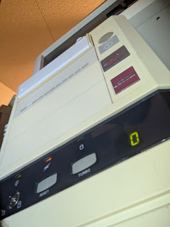](https://blogger.googleusercontent.com/img/b/R29vZ2xl/AVvXsEhtxXh6ipOCrGK54Zsl5U0tbOrL7jLHeBbGPf766eyl_M2XO_OdG7O_oqStkg8TBzXiW-towqKCGHfvAFiQT-9wVV2jkYw8TIEXZ24qJ4vR8lcy23R-v3Ma6idK4ObQRthAfID7v9JeUsfxa1k-OJNI8JkRhs4UQqzJOGOE47N7rDTEQP9nDuP5VoVyX5Y/s3648/PXL_20261004_143856069.jpg)

[六年前](https://oldvcr.blogspot.com/2020/06/refurb-weekend-alpha-micro-eagle-300.html)，我修好了自己那台基于 68EC030 处理器的 Alpha Microsystems Eagle 300 的电源与机箱风扇——这是一台运行着 **AMOS** 操作系统 (这是 Alpha Micro 自研的、深受 DEC 启发的独特多用户操作系统) 的现代化高速迷你机。这些外观朴素的“蓝领商用机”凭借深度集成的企业级软件，在当年的垂直行业市场中备受青睐；更罕见的是，为了向下兼容早期的 WD-16 架构祖先，它们竟反常规地以*小端序* (Little-Endian) 运行原本为大端序 (Big-Endian) 的 68000 系列处理器。

> [Six years ago](https://oldvcr.blogspot.com/2020/06/refurb-weekend-alpha-micro-eagle-300.html), I fixed the power supply and case fan in my 68EC030-based Alpha Microsystems Eagle 300—a faster, modernized Alpha Micro running **AMOS**, their unique DEC-inspired multiuser operating system. These blue-collar boxes were common in vertical markets for their tightly integrated business software and are unusual for running their big-endian 68000-series processors *little*-endian for backwards compatibility with WD-16 ancestors.

第二重“续作”意义，则是接续了[我们此前那场 Alpha Micro 翻新周末](https://oldvcr.blogspot.com/2026/03/refurb-weekend-double-header-alpha.html)——在那次行动中，我们成功救活了一台 Alpha Micro AM-1000 与一台 AM-1200。

> The second way it's a sequel is to [our previous Alpha Micro refurb weekend](https://oldvcr.blogspot.com/2026/03/refurb-weekend-double-header-alpha.html), which restored an Alpha Micro AM-1000 and AM-1200.

### 现代化改造中遭遇的阻碍

> ### The Modernization Roadblock

我的这台 Eagle 300 通过板载以太网 (Ethernet) 与 AlphaTCP 协议常年运行着 `ampm.floodgap.com` 服务。当机箱散热风扇最初发生故障时，我就计划将内部的机械硬盘替换为 SCSI2SD 固态方案。时间转眼来到去年秋天：

> My Eagle 300 runs `ampm.floodgap.com` via AlphaTCP on its on-board Ethernet. When its cooling fan originally failed, I planned to swap the mechanical hard disk for a SCSI2SD. Fast-forward to last fall:

[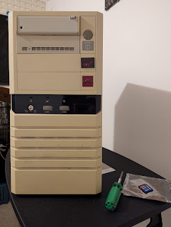](https://blogger.googleusercontent.com/img/b/R29vZ2xl/AVvXsEhmTPjhLcwjhOwGfqm_KF9N0kxGAO0J2V_XuFcnPvHAd2Ubz5HXsxoRIG-n0qexU4WYkhVK7d1fRfzZdGHSK4DMlpsy0zV0MHNx3vwyxikRn4NUbkhwntxNH2V6qOJ6TcmlCgDfqN0is0AYn4tBuUk7MHz6dL8-grGoJS7yG6VBzouXRcPjFf0_1dhg7-Q/s4080/PXL_20250904_023117154.jpg)

当我尝试为其安装 ZuluSCSI 时，系统却彻底罢工，甚至无法进入加电自检 (POST)。由于担心主板电路被烧毁，我四处搜寻可替换的整机备件，阴差阳错地淘到了一台更罕见的高配机型，直到最终成功唤醒了仓库里沉睡的原机。

> When I attempted to install a ZuluSCSI, the system refused to start or even enter self-test. Fearing I had blown a system board, I hunted for a replacement unit, stumbling upon a rarer configuration before eventually reviving my original machine from storage.

---

## 2. Alpha Microsystems 发展简史与“平民的迷你机”

> ## 2. History of Alpha Microsystems & The "Poor Man's Minicomputer"

Alpha Micro 于 1977 年在加利福尼亚州奥兰治县创立，致力于打造价格亲民且搭载 DEC 风格 **AMOS** 操作系统的多用户计算机系统。

> Founded in 1977 in Orange County, California, Alpha Micro produced affordable multi-user systems running the DEC-influenced **AMOS** operating system.

[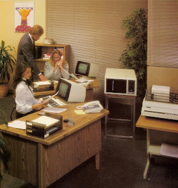](https://blogger.googleusercontent.com/img/b/R29vZ2xl/AVvXsEiMZC9dxjdp0l_edqXabKOjO89Fl4YfWQ0D1bhXfZ42-uQrFo51_a-LyCP8WB9hczWR4k_t_MPfa9_8Zp-DBZUHiYdRZf84mdbiDCgyyYcJA-ss3uvtnwlG3uxoeAjxcKxSPiDqtfKM2J5DG0Z3WCd45cdL8YHKvaLl2S5a1SKcG2ssU2Src-UTtmB8oqI/s2309/am1042ead.jpg)

早期的产品 (如 AM-100) 采用 WD-16 芯片组 (其架构与 DEC 的 LSI-11 颇为相似)。到了 1982 年，公司全面转向 Motorola 68000 处理器 (例如广受欢迎的 [AM-1000](https://oldvcr.blogspot.com/2026/03/refurb-weekend-double-header-alpha.html) 系列)，并在硬件层面通过调换地址线巧妙保持了对早期软件的小端序兼容性。

> Early systems (like the AM-100) used the WD-16 chipset (akin to DEC's LSI-11). By 1982, they transitioned to Motorola 68000 processors (such as the popular [AM-1000](https://oldvcr.blogspot.com/2026/03/refurb-weekend-double-header-alpha.html)), swapping address lines to maintain little-endian compatibility.

### Eagle 系列架构演进 (1993–1994)

> ### The Eagle Family Evolution (1993–1994)

步入 20 世纪 90 年代，公司亟需一套模块化且更具成本优势的新架构。工程师 Joshua Stumpf 主导设计了代号为 **Roadrunner** 的 CPU 主板 (集成 68K/ColdFire 处理器、内存及 SCSI 控制器)，而 Rod Hewitt 则负责设计 **I/O 接口板** (承载供电控制、前面板接口、SSD 授权认证芯片以及扩展槽)。这两块主板通过两条专用的“X-BUS”排线相连，并于 1994 年装入标准 PC 风格的迷你塔式机箱中正式发布，这便是 **Alpha Micro Eagle** 家族：

> By the 1990s, the company needed a modular, lower-cost architecture. Engineer Joshua Stumpf designed the **Roadrunner** CPU board (carrying the 68K/ColdFire CPU, RAM, and SCSI controller), while Rod Hewitt designed the **I/O board** (handling power, front panel, SSD licensing, and option slots). Connected via twin "X-BUS" cables, these boards launched in 1994 as the **Alpha Micro Eagle** family housed in PC-style minitower cases:

*   **Eagle 100：** 采用单一集成主板设计。
*   **Eagle 200 / 300：** 搭载 40MHz 68EC030 处理器并配备模块化 I/O 板。
*   **Eagle 400 / 500：** 搭载完整规格的 68040 处理器系统。

> *   **Eagle 100:** Single unified logic board.
> *   **Eagle 200 / 300:** 40MHz 68EC030 systems with modular I/O.
> *   **Eagle 400 / 500:** Full 68040 systems.

[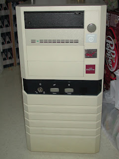](https://blogger.googleusercontent.com/img/b/R29vZ2xl/AVvXsEgB9Z8ou6CC7m93vCLUs2nS-O8qOo8MKR8uScKzV7GHnwGJALWHjhQApNu2nS9_sVYyWa45bPfy-_ypYuPTS_IYooWBAM-da_byuO7Qa3PKYwnmSYC552SemyHGAqMtblLJfkRF4tAr1Uri_Z5XuFx_t0K7QP_Jrkzk-GRrosaSLpJ749sGRIxvaB701Es/s2048/DSCN7891.JPG)

---

## 3. Eagle 300 结构剖析 (AM-3500-E300)

> ## 3. Anatomy of the Eagle 300 (AM-3500-E300)

### 外观特性与前面板设计

> ### External Features & Front Panel

Eagle 采用了现成的商用 PC 机箱，并通过定制金属徽标、机械钥匙锁以及数码管 LED 状态显示屏进行了深度改造。

> The Eagle uses an off-the-shelf PC case customized with metal badges, keylocks, and a numerical LED status display.

| 前面板 LED 与数字显示屏 (Front LEDs & Display) | 后面板接口与扩展槽 (Rear Ports) |
| :---: | :---: |
| [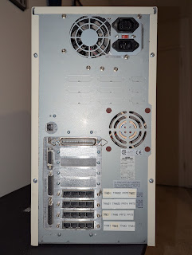](https://blogger.googleusercontent.com/img/b/R29vZ2xl/AVvXsEjnstrpkesU86y-LdoFwc80yv2HiapHVRZfBoZAN6NtWsbBYlLMh04KcnNi9WdsvqZXXmp1e8ldg1cv4Qf7X8ldjytVduu1yIIiht2i7H9s0KLI7OiP-XGTy4OKvu7mofjhtkd60L57kB2BhKqLgA2iWRCgudbyzpd6g8ZpBzA9ICO8_VpRwZDhxoVSyIk/s4080/PXL_20250904_025255281.jpg) | [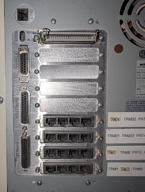](https://blogger.googleusercontent.com/img/b/R29vZ2xl/AVvXsEibPiX5VRxcczoLBBTL8StWxyKgFht5pQ0e43d_GaZe2PP9FCnplyvfqnSHkaw2nnFrP5FHRnwd7VkhOvxPZZ381PiNPgIVNCRkXJmaUp9_SlFne7rNdzqMW2U8saM4l3q8N5_JfZM41V6vZErMWDhqbu8-G9EXugyrVZar2OSfUKIkagkVFliBJJuEB5Q/s4080/PXL_20250904_025625568.jpg) |

### 系统安全设备芯片 (SSD)

> ### The System Security Device (SSD)

每台 Alpha Micro 主机都包含一颗插拔式的 **SSD 芯片** (System Security Device, 系统安全设备)，操作系统及独立软件开发商 (VAR) 软件包通过产品安装码 (PIC) 与之绑定，以实现严格的防篡改与软件授权席位控制。

> Every Alpha Micro system contains a socketed **SSD chip** (System Security Device) used by the OS and VAR software packages to enforce copy protection and license caps via Product Installation Codes (PICs).

### 软件运行与基准测试

> ### Software & Benchmarking

在原装的 AM-65/AM-75 终端连接环境下，Eagle 300 运行经典 AMOS 软件依然极为流畅：

> Running on its original AM-65/AM-75 terminal setups, the Eagle 300 executes legacy AMOS software smoothly:

```text
.si dsk0:
   SI--AMOS System Information, (C) Copyright 1990, Alpha Microsystems Inc.
                                Version 3.0(114)

               Computer Type: Eagle
              Main Processor: 68030
                Co-Processor: None
                 MMU present: Yes
            Operating System: AMOS 2.3A(484)
          Boot PROM revision: M00
              Number of SSDs: 1
                Total Memory: 16384 K-bytes
     Resident Monitor Memory: 6218 K-bytes

     Computing Index (CX), relative to AM-100:    36.9
     48 bit FP Index (4X), relative to AM-100:    36.3
Floating Point Index (FX), relative to AM-100/L:  5.6
          Disk Index (DX), relative to ST-506:    15.3
```

---

## 4. 内部组件与扩展板卡

> ## 4. Internal Components & Expansion Cards

### CPU 主板与 I/O 接口板

> ### CPU and I/O Boards

*   **AM-172 68EC030 CPU 主板：** 搭载插拔式 40MHz 68EC030 处理器、NCR 53C710 SCSI-2 控制器，以及单根支持最高 64MB 内存的 72 针 SIMM 插槽。
*   **AM-319 I/O 接口板：** 采用极为巧妙的设计，在每次系统加电开机时，直接由 CPU 引导 PROM 动态重编程板载的 Altera PLD 逻辑芯片。

> *   **AM-172 68EC030 CPU Board:** Features a socketed 40MHz 68EC030, NCR 53C710 SCSI-2 controller, and a single 72-pin SIMM slot supporting up to 64MB of RAM.
> *   **AM-319 I/O Board:** Utilizes dynamic reprogramming of Altera PLDs directly from the CPU boot PROMs on every power-up.

| AM-172 CPU 主板 (AM-172 CPU Board) | AM-319 I/O 接口板 (AM-319 I/O Board) | AM-318 8 串口子卡 (AM-318 8-Port Serial Card) |
| :---: | :---: | :---: |
| [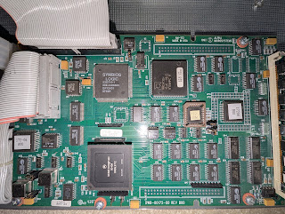](https://blogger.googleusercontent.com/img/b/R29vZ2xl/AVvXsEgi6IwkMzJkyx2LUHAqr4uaDa0eRIn2WtYBwhXlvxKw7uheFno_d_h66PqGCapGvxIS4fVkxFZLLfhV9ydCIh0W5An551ciDIxsTZUBUMF0VtSiDqQHfyEeo35ZELjj1JDVZnMdm6d9Rj8zG9y-z5dH2W0f37k-tder7F9kgZcjRqNCY_NDE18wdw4p7Qw/s4080/PXL_20260516_230031193~2.jpg) | [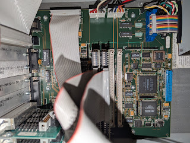](https://blogger.googleusercontent.com/img/b/R29vZ2xl/AVvXsEh3j4CWGAV0gofAnuELAuZzAfGEcMPhdaubf4FSreQhoQmhRpsRaLTU6imi4th1dE1eS4MqFdSZnyE5Lyw0zS6Y75LADmnsi2JpOcgQqbCnYzWZ7oYJ6_cnqPNePSeLSAUEXR7DWXqsWCE9hui5TJiz7qUWzcNR525ftm2NxblSwxbgLURMBwqOJMGeTwY/s4080/PXL_20250904_031420318.jpg) | [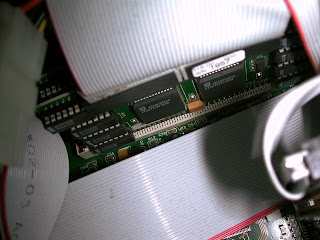](https://blogger.googleusercontent.com/img/b/R29vZ2xl/AVvXsEg-udC9_HSb1bCObB9c9WKq70EDeW4GfvMS_U7H4wiWxegWVD31_JN1AVJzGEBjG47kAeeG-i9zdIU4qbCSxMv-W7imywN2XNqJDQIpt_sZHjrM2McZP929sPED1H7PbZ6o7JboxL9mXOP-MMtxF2GlEaNUHMJGrZNnoEiITjgUdOQ2esKa28POhHeHcJw/s2048/DSCN9980a.JPG) |

---

## 5. 存储现代化改造：ZuluSCSI 升级实战

> ## 5. Storage Modernization: ZuluSCSI Upgrades

### 替换 Seagate Hawk 机械硬盘为闪存存储

> ### Swapping the Seagate Hawk for Flash Storage

使用固态 **ZuluSCSI** 仿真器替换老旧的 Seagate Hawk ST31051N SCSI 机械硬盘，不仅极大简化了数据备份流程，还显著提升了磁盘 I/O 读写吞吐速率。

> Replacing the old Seagate Hawk ST31051N SCSI hard drive with a solid-state **ZuluSCSI** simplifies backups and dramatically accelerates disk I/O.

| 拆卸原装 Seagate 机械硬盘 (Removing Original Seagate Hard Drive) | 安装固定 ZuluSCSI 模组 (Installing ZuluSCSI Rig) |
| :---: | :---: |
| [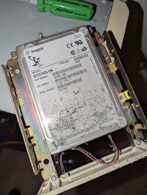](https://blogger.googleusercontent.com/img/b/R29vZ2xl/AVvXsEhY_-xif2ynVwBZaWDjKfQU70iaicV3K3o6VNeNCmLIeiMDkM-xPJIbxhPbVOpC8FGovyXtH57eYdYeezvrNO4X_e9EdadfTGiEF2W3gvF19-xUnRxGLMBiisLyp2rInUNWcWh5ReIpxvc_cYaS5BlrGI7f7PhnTcTP1jswJ4U5Ltbx4xTgWr5_OXJfR78/s4080/PXL_20250904_032309708.jpg) | [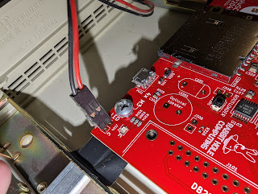](https://blogger.googleusercontent.com/img/b/R29vZ2xl/AVvXsEhZKF61Hrjiyj9pes_tH5OFZR5wQD_APs7EGrWPtg0va4_a7OdUaRe0eklbrhMxVlYndwv1pfLisNhHApUXASUVz1aArjtPx8ZdQvlUCNdDNIXcGRcMSejta0C2YGky0_wQNWchm-A2OE1OZNA7QEWZNKDObwZS3v6z0el7kZsvak77YxAzviPjO1C0mKQ/s4080/PXL_20250904_043318443.jpg) |

### 排查错误代码 `2d` 的疑难杂症

> ### Troubleshooting Error Code `2d`

在升级改装过程中，我不慎碰掉了 CPU 供电线，导致系统持续报错并卡死在初始化错误代码 (`2d`)。经过深度排查排错，并将整机彻底断电静置以清除动态逻辑芯片的状态电荷后，我发现只需微调机箱背面的引导 DIP 开关、将磁带机启动优先级置顶 (将 `#4` 拨至开)，机器便能稳定通过 ZuluSCSI 完成系统引导。

> During the upgrade, I accidentally disconnected the CPU power cable, throwing a persistent initialization error (`2d`). After extensive debugging and letting the system sit unpowered to clear dynamic logic states, I discovered that tweaking the rear boot DIP switches to prioritize the tape streamer (`#4` on) allowed the system to boot reliably with the ZuluSCSI.

---

## 6. 扩充机队：基于 ColdFire 的 Eagle 450 与 Super Eagle 550

> ## 6. Expanding the Fleet: The ColdFire Eagle 450 & Super Eagle 550

### Eagle 450 架构：MCF5102 ColdFire 服务器

> ### The Eagle 450 (MCF5102 ColdFire Server)

发布于 1998 年 8 月的 **Eagle 450** 是业界首款商用 ColdFire 架构服务器，搭载 Motorola MCF5102 芯片 (这是一款基于 68040 深度改良、通往 ColdFire 架构的过渡处理器)。

> Introduced in August 1998, the **Eagle 450** was the first ColdFire-based server produced, powered by Motorola's MCF5102 chip (a modified 68040-derivative bridging the gap to the ColdFire architecture).

[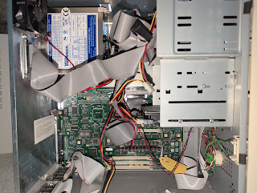](https://blogger.googleusercontent.com/img/b/R29vZ2xl/AVvXsEjSmNaGo977U3VUvy96jmjmrL11g35wBoEZ2JQQG18yMcq53PZbEot_eRsKPEW5sdtLdx0aqHokmQIRe_rXmaEZrKCKoNy4l0xWCz58WfgLr55F39uNcJOlT2OorigBh5UczEhvJq30fLxq5Wj5JMXfbfhFQTN5rP7G-Q-MC5ACYJiVmotM0O29Z_20q9I/s4080/PXL_20260606_233821629.jpg)

### 性能基准测试与对比

> ### Performance Benchmarks

运行 `SI.LIT` 基准测试清晰地展示了早期 ColdFire 与 68040 处理器相较于基础款 E300 展现出的惊人计算效率：

> Running the `SI.LIT` benchmark demonstrated the incredible efficiency of early ColdFire and 68040 processors compared to our base E300:

*   **Eagle 300 (40MHz 68EC030)：** CX 指数 = `36.9`
*   **Eagle 450 (25MHz MCF5102)：** CX 指数 = `59.9`
*   **Eagle 500 (40/80MHz 68040)：** CX 指数 = `83.6`

> *   **Eagle 300 (40MHz 68EC030):** CX Index = `36.9`
> *   **Eagle 450 (25MHz MCF5102):** CX Index = `59.9`
> *   **Eagle 500 (40/80MHz 68040):** CX Index = `83.6`

---

## 7. 致敬传奇工程师 Rod Hewitt

> ## 7. Tribute to Rod Hewitt

在调试 E300 的过程中，我得知了 **Rod Hewitt** 于 2025 年 3 月不幸辞世的噩耗。Hewitt 是 Alpha Micro 的元老级奠基工程师之一 (Eagle 系列 I/O 接口板的主架构师)，此后他还开发了著名的 *ZTERM* 与 *TSReader* 软件。他的卓越技术贡献通过开源档案与多用户终端系统长久留存。愿你安息，Rod。

> While troubleshooting the E300, I learned of the passing of **Rod Hewitt** in March 2025. Hewitt was a foundational engineer at Alpha Micro (architect of the Eagle I/O board) and later developed *ZTERM* and *TSReader*. His contributions live on via open-source preservation and his legacy in multiuser terminal systems. Rest in peace, Rod.

---

## 结语：多机集群部署与时代回响

> ## Conclusion & Stacked Deployment

在所有系统成功升级为固态 **ZuluSCSI** 存储 (采用了 ZuluSCSI Blaster 与 Wide 等变体版本) 后，我的整个 Alpha Micro 计算机群不仅运行更为安静、读写速度倍增，而且实现了完整的数据镜像备份。

> With all systems successfully upgraded to solid-state **ZuluSCSI** storage (utilizing ZuluSCSI Blaster and Wide variants), my Alpha Micro fleet is quieter, faster, and fully backed up.

[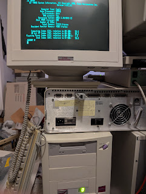](https://blogger.googleusercontent.com/img/b/R29vZ2xl/AVvXsEgc17fcKHkQxq5KffcJTNhqZD2iebI9SsKBHRX5Rfl4BoPVIj5YXC5aAPfPLwjwy5Q7WR9kARfGRdl6Yea-ujT08Dggu8SP6yyZ_8Tq7sRWqX3IMqnLTEg76ntYeRqGmD1Xv2I9-b5DP3-UJJfB1PeGd0fjCc0G16YvYiDNrI07SqLCXU6fLJGVLlDvPnE/s4080/PXL_20260906_213413592.jpg)

在其整个产品生命周期内，搭载 68K 处理器的 Eagle 系列累计售出约一万台。如今，在一叠经典复古迷你塔式机上稳定运行 `ampm.floodgap.com` 服务，强有力地证明了这些皮实可靠的机器依旧是 20 世纪 90 年代初期工程设计的杰出丰碑。

> Over their lifespan, approximately ten thousand 68K Eagles were sold. Today, running `ampm.floodgap.com` from a stack of vintage minitowers proves that these robust machines remain monuments of early 90s engineering.
