---
authors:
  - aitoboxrobot
categories:
  - 研究解读
date: 2026-10-15
hide:
  - navigation
tags:
  - AI 智能体
  - 代码生成
  - 多智能体系统
  - 推理时扩展
title: "扩展代码智能体团队的经验教训：仅用 30% 成本触达前沿能力"
---

# 扩展代码智能体团队的经验教训：仅用 30% 成本触达前沿能力

> # Lessons from Scaling Teams of Coding Agents: Reach the Frontier at 30% of the Cost

### 文章背景与核心概要

随着多智能体系统在真实软件工程中的落地，如何高性价比地利用推理算力成为了关键难题。最新研究通过类似 `mini-swe-agent` 的极简测试底座，在包含 200 个逆向重写任务的 ProgramBench 基准测试上系统探究了代码智能体团队的扩展规律。实验发现，盲目堆砌智能体只会导致算力成本成倍飙升，而将工作智能体精准配置在任务最前期的“探索与规划”阶段，能以一半的成本获得与全阶段分工相同的性能。更关键的是，采用“高能力领队搭配轻量级员工”的异构团队——由强模型 Sol 担任主导智能体、经济型模型 Luna 负责前期探索规划，仅需全 Sol 团队约 30% 的推理成本即可触达前沿性能。

---

## 执行摘要

> ## Executive Summary

随着多智能体代码生成系统从实验室里的原型演示走向生产级软件工程，如何高效管理推理算力已经成为头等大事。组建 AI 智能体 (AI Agent) 团队为推理时扩展 (Inference-time Scaling) 开辟了一条强大的新途径，但如果不加思考地生硬编排，往往会导致账单费用爆炸式飞涨，而实际收益却越来越微薄。

> As multi-agent coding systems transition from experimental demos to production-grade software engineering, managing inference compute efficiently becomes paramount. Using teams of agents introduces a powerful new dimension of inference-time scaling, but naive orchestration often leads to ballooning costs and diminishing returns. 

在 **ProgramBench** 等基准测试 (Benchmark) 上开展的受控实验清晰地表明：合理优化智能体在各个环节的“**排兵布阵**”，远比盲目堆砌算力重要得多。通过将实力出众的“主导智能体”与廉价且专精的“工作智能体”协同搭配，让后者主要聚焦于前期的代码探索与规划，整个团队就能以极低的成本换取逼近前沿模型的优异表现 (将整体开销大幅削减高达 70%)。

> Controlled experiments on benchmarks like **ProgramBench** demonstrate that optimizing **where** agents are deployed matters far more than simply adding more compute. By utilizing a strong lead agent paired with cheaper, specialized worker models focused primarily on early exploration and planning, teams can achieve near-frontier performance at a fraction of the cost (reducing expenses by up to 70%).

### 核心发现

> ### Key Takeaways

* **智能体团队开辟了推理时扩展的新维度**：在面对高难度的编程挑战时，组织有序的智能体团队表现显著超越单个智能体，在 ProgramBench 上实现了高达约 10 个百分点的性能提升。然而，这些亮眼成绩是以 3 到 7 倍的昂贵成本为代价的。因此，核心问题并不在于增加智能体是否管用，而在于如何让每一份追加的推理算力都花在刀刃上。
* **智能体派驻到哪个环节，远比数量堆多少更关键**：在 ProgramBench 测试中，团队如果仅仅将“探索与规划”环节指派给工作智能体，其表现完全可以比肩将“规划、编写代码、运行验证”全流程统统下放的重型团队，而耗费的成本却直接砍半。只有当智能体精准对准任务中最棘手的真正瓶颈时，团队协作才能发挥出最大的经济回报。
* **强力领队搭配廉价员工，能以降低 70% 的成本斩获近前沿的卓越表现**：由高阶模型 Sol 充当主管、统领 16 个低成本模型 Luna 组成的规划工作小队，最终取得了 61.8% 的奖励得分；而所有环节全部采用纯 Sol 模型的豪华团队，得分仅为 63.2%，两者的开销却从 510 美元断崖式下降到了 155 美元。

> * **Teams of agents unlock a new axis of inference-time scaling.** On challenging coding tasks, well-organized teams outperform single agents, with gains of up to ~10 percentage points on ProgramBench. However, these gains come at 3–7× higher cost. The question is not whether more agents help, but how to make that additional compute count.
> * **Where you allocate agents matters more than how many you add.** On ProgramBench, delegating only exploration and planning matches the performance of delegating planning, implementation, and verification together at half the cost. Collaboration pays off most when agents target the task's actual bottleneck.
> * **A strong lead with cheap workers delivers near-frontier performance at 70% lower cost.** A Sol lead coordinating 16 inexpensive Luna planning workers reaches 61.8% reward, compared with 63.2% for an all-Sol team delegating every stage, while reducing cost from $510 to $155.

---

## 智能体团队正在构建真正的软件

> ## Agent Teams are Building Software

在过去的一年里，由代码智能体组成的开发团队已经从新奇好玩的演示案例，阔步迈向了构建大型真实软件工程的新阶段：
* **构建 Linux C 语言编译器**：16 个 Claude 智能体协同编写出一个包含 10 万行代码的 C 编译器，能够成功编译 Linux 内核。整个过程耗费了大约 2,000 次智能体会话，API 调用成本达 20,000 美元。
* **从零开发浏览器**：Cursor 调度了数百个智能体通力合作，仅用大约一周时间就从零编写了一款拥有超过 100 万行代码的网页浏览器。
* **移植 Bun 项目**：Bun 在短短 11 天内完成了从 Zig 语言向 Rust 语言的完整移植，在研发峰值时有 64 个 Claude 智能体在并行运转。

> In the past year, teams of coding agents have moved from interesting demos to building large-scale software projects:
> * **The Linux C Compiler:** Sixteen Claude agents wrote a 100,000-line C compiler that can build the Linux kernel, requiring about 2,000 agent sessions and $20,000 in API costs.
> * **Building a Browser:** Cursor ran hundreds of agents that together wrote a web browser from scratch—over a million lines of code—in about a week.
> * **Porting Bun:** Bun was ported from Zig to Rust in 11 days, with 64 Claude agents running in parallel at its peak.

尽管这些项目充分验证了智能体团队的可行性，但它们的架构设计却大相径庭——从利用锁文件进行去中心化的对等抢单认领，到层级分明的金字塔任务分解与严格的角色分工 (例如配备一名代码编写者、两名对抗性审查员以及一名 Bug 修复员) 应有尽有。

> While these projects demonstrate viability, their architectural designs varied widely—ranging from peer-to-peer task claims via lock files to hierarchical decomposition and strict role assignments (e.g., one implementer, two adversarial reviewers, one fixer). 

然而，多智能体架构也是极其耗费资源的“算力吞吐怪兽”。Factory 对其自研的多智能体系统 (在协调者、编写者与校验者之间循环轮转) 展开的深入研究发现，在重构地理空间数据处理库 GDAL 的任务中，虽然多智能体拿到的基准得分是单个智能体的两倍多，但代价却是耗费了 **14 倍的算力资金** 以及 **13 倍的漫长用时**。

> However, multi-agent frameworks are resource-intensive. Factory's study of their own multi-agent system (cycling an orchestrator, implementer, and validator) showed that rebuilding the geospatial library GDAL more than doubled the reward of a single agent, but cost **14 times as much** and took **13 times as long**. 

这就引发了一个极其尖锐的问题：*如果智能体团队本质上是消耗推理算力的一种全新形态，那么我们究竟该如何组织它们，才能做到既能力拔群又高效省钱？*

> This raises a critical question: *If a team of agents is a new way to spend inference compute, how should it be organized to be both effective and efficient?*

**图 1.** 代码智能体团队协同运行示意图。主导智能体将任务分派给属下的工作智能体，后者在共享工作区中分析探索原始程序、编写代码并检验实现。

> **Figure 1.** An illustrative run of a coding-agent team. A lead hands out work to its workers, who explore the original program, write code, and check it in a shared workspace.

---

## 严密可控的实验评测体系

> ## A Controlled Testbed

### 极简的测试底座

> ### A Minimal Harness

为了精确剥离并控制特定的设计变量，研究团队受 `mini-swe-agent` 的启发，特意构建了一套极简的测试底座 (Harness)：
* **共享工作区 (Shared Workspace)**：所有智能体均在同一个共享工作区中，通过最简单的 `bash` 工具执行命令并协同作业。
* **主导智能体 (The Lead Agent)**：负责接收顶层主任务，并通过 `delegate_agent` 工具向下指派子任务。从属的工作智能体只能看到分配给自己的子任务，并在任务完成后向上汇报结果。
* **状态管理 (State Management)**：在调用 `delegate_agent` 时，既可以生成一个全新的工作智能体，也可以唤醒现有的工作智能体，从而完整保留历史上下文，方便主导智能体开展迭代跟进 (例如要求某个工作智能体针对其先前编写的代码排查并修复 Bug)。

> To isolate specific design variables, a deliberately minimal harness was constructed, inspired by `mini-swe-agent`. 
> * **Shared Workspace:** Every agent works through a simple `bash` tool within a single shared workspace.
> * **The Lead Agent:** Receives the primary task and delegates subtasks using a `delegate_agent` tool. Workers only see their assigned subtask and report back upon completion.
> * **State Management:** The `delegate_agent` call can either spawn a fresh worker or resume an existing one, preserving prior context so the lead can execute iterative follow-ups (e.g., asking a worker to fix bugs in code it previously authored).

### 测试的五大核心变量

> ### Five Key Variables Tested

1. **主导智能体在哪些环节启用下属员工 (Where the Lead Uses Workers)**：
   * *极简提示词 (Minimal Prompt)*：仅提示主导智能体它正率领一支团队，要求其拆解出清晰独立的子任务，至于具体如何拆解以及动用多少员工，完全由主导智能体自由裁量。
   * *PIV 结构化提示词 (PIV Prompt)*：强制实施规范的工作流阶段划分——探索与规划 (P)、代码编写 (I) 与测试验证 (V)。
2. **主导智能体的等待策略 (How the Lead Waits)**：
   * *阻塞式主管 (Blocking Lead)*：派发任务后原地闲置挂起，静待工作智能体返回汇报。
   * *异步式主管 (Asynchronous Lead)*：在下属全力运转的同时自己保持工作，借助 `wait_for_updates` 和 `list_agents` 等工具适时跟进状态。
3. **各角色的模型选型 (Model Selection per Role)**：
   * *同构团队 (Homogeneous Teams)*：团队内所有智能体均采用完全相同的底层模型。
   * *异构团队 (Heterogeneous Teams)*：由实力强大但调用昂贵的高阶模型担当团队主管，统筹指挥廉价轻量的普通工作模型 (类似于资深架构师指导初级程序员)。
4. **团队规模 (Team Size)**：对比主导智能体动态自选员工数量，与固定配置 2、4、8 或 16 名员工在效率上的优劣差异。
5. **通信协议机制 (Communication Protocols)**：测试为工作智能体赋予直接互相交流的 `send_message` 工具后，能否显著增强彼此间的协同合作。

> 1. **Where the Lead Uses Workers:** 
>    * *Minimal Prompt:* Tells the lead it is in charge of a team and asks it to assign distinct, independent tasks, leaving decomposition and worker counts to its discretion.
>    * *PIV Prompt:* Enforces a structured workflow of Exploring and Planning (P), Implementing (I), and Verifying (V).
> 2. **How the Lead Waits:** 
>    * *Blocking Lead:* Waits idly for workers to report back.
>    * *Asynchronous Lead:* Keeps working while subordinates run, utilizing `wait_for_updates` and `list_agents` tools.
> 3. **Model Selection per Role:** 
>    * *Homogeneous Teams:* All agents run the same model.
>    * *Heterogeneous Teams:* A strong, expensive model acts as the lead, directing cheaper worker models (analogous to a senior engineer directing junior staff).
> 4. **Team Size:** Comparing dynamic lead decisions against fixed allocations of 2, 4, 8, or 16 workers.
> 5. **Communication Protocols:** Testing whether enabling a direct `send_message` tool between workers improves collaboration.

**图 2.** 两种主管派发完全相同子任务的情景对比，假定每个工作智能体的运行耗时均相同。阻塞式主管在下属回传报告前只能原地空转；异步式主管则能在下属工作期间继续执行任务，并在收到第一份汇报时立刻启动第二轮指派。

> **Figure 2.** Two leads hand out the same subtasks, and each worker run takes the same time. The blocking lead sits idle until its workers report back. The asynchronous lead keeps working and starts the second round as soon as the first reports arrive.

---

## ProgramBench 评测与基准实验结果

> ## ProgramBench and Benchmarking Results

上述所有配置均在 **ProgramBench** 上进行了全面严苛的测试。这是一个包含 200 个软件重构项目的评测基准，要求智能体从零开始完整重写程序。智能体在起始阶段仅能获得一个可执行的黑盒原始程序 (可运行但代码不可见) 以及对应的开发文档，评测系统会通过一套未公开的行为测试用例来为其重构成果打分。

* **参评模型**：GPT-5.6 的系列衍生变体：**Luna**、**Terra** 与 **Sol** (能力水平与使用成本依次递增)。
* **辅助验证基准**：Commit0-Lite (精选了 16 个 Python 常用库，清空其实际功能实现，仅保留代码仓库骨架供智能体填补)。

> The configurations were tested on **ProgramBench**, a benchmark of 200 programs to rebuild from scratch. Agents start with an executable black-box original program (runnable but unreadable) and its documentation, scoring points based on a hidden behavioral test suite.
> 
> * **Models Evaluated:** GPT-5.6 variants: **Luna**, **Terra**, and **Sol** (in increasing order of capability and cost).
> * **Secondary Benchmark:** Commit0-Lite (16 Python libraries with removed implementations and provided repository skeletons).

### 团队协作完胜单兵作战——但代价昂贵

> ### Teams Outperform Solo Agents—at a Cost

* 在采用极简提示词时，阻塞式 Sol 团队平均通过了 **61.8%** 的测试，而单兵作战的单个 Sol 智能体仅能通过 **52.1%**。
* 采用 PIV 结构化提示词的异步式主管在保持同等优秀得分的同时，完成全流程所消耗的时间比阻塞式团队**缩短了 19.5%**。
* 由全 Sol 模型构成的智能体团队，其整体开销达到单个基础智能体的 **4 到 7 倍**。

> * With the minimal prompt, a blocking Sol team passed **61.8%** of tests on average, compared to **52.1%** for a solo agent.
> * An asynchronous lead with the PIV prompt finished in **19.5% less time** than the blocking team while maintaining comparable rewards.
> * All Sol teams incurred **4 to 7 times the cost** of a solo baseline agent.

**图 3.** 针对全部 200 项编程任务，平均奖励得分与推理成本 (左图) 以及物理耗时 (右图) 的对应关系。

> **Figure 3.** Mean reward against inference cost (left) and wall-clock time (right) across all 200 tasks.

---

## 工作智能体在“规划阶段”回报率最高

> ## Workers Pay Off Most in Planning

当我们将整个软件开发工作流解构为三个离散阶段时：
* **规划 (Planning, P)**：工作智能体运行程序以观察理解其黑盒行为，并拟定实现规划；主导智能体亲自负责编码实现与最终测试验证。
* **编码实现 (Implementation, I)**：工作智能体负责编写代码。
* **测试验证 (Verification, V)**：工作智能体负责测试并核验主导智能体的代码实现。

**规划阶段成为了毋庸置疑的最大赢家。** 一个仅将规划工作委派出去的异步式主管，其取得的成绩与将所有阶段全面下放的主管完全平分秋色 (**63.6% 对比 63.2%**)，而**花费却只有后者的一半** (249 美元对比 510 美元)。若以每增加 100 美元额外成本所换取的得分提升来衡量，规划阶段的投入产出比是排名第二的阶段的两倍之多。

> When breaking down workflows into stages:
> * **Planning (P):** Workers run the program to learn behavior and draft a plan; the lead implements and verifies.
> * **Implementation (I):** Workers write the code.
> * **Verification (V):** Workers test the lead's implementation.
> 
> **Planning was the clear winner.** An asynchronous lead delegating *only* planning matched the reward of a lead delegating every stage (**63.6% vs. 63.2%**) at **half the cost** ($249 vs. $510). Measured as reward gained per $100 of added cost, planning was twice as efficient as the next-best stage.

**图 4.** 异步式 Sol 团队仅委派单个阶段与委派全部三个阶段的对比表现。

> **Figure 4.** Asynchronous Sol teams delegating one stage or all three.

---

## 规划类工作智能体可以用平价轻量模型

> ## Planning Workers Can Be Cheap

通过让实力强劲的 **Sol 主管** 统筹协调廉价轻量的 **Luna 规划智能体**，团队一举斩获了 **60.5% 的高分** (非常接近全 Sol 豪华团队的 63.6%)。

* **极致的性价比**：这种异构团队方案仅花费了纯 Sol 团队额外成本的 **13.9%**，就成功拿下了后者 47.5% 的性能增益，使每一美元产生的效益回报飙升至三倍以上。
* **模型等级梯队**：保持基层员工统一为 Luna，同时将主管从 Luna 升级到 Terra 再到 Sol 的实验表明，廉价员工无法弥补领队能力的先天不足 (例如，由 Terra 主管挂帅、搭配 Luna 员工的团队，其最终得分甚至赶不上单个孤独运行的 Sol 智能体)。

> By pairing a strong **Sol lead** with cheaper **Luna planning workers**, the team achieved **60.5% reward** (close to the all-Sol team’s 63.6%). 
> 
> * **Cost Efficiency:** This heterogeneous configuration captured 47.5% of the all-Sol team's performance gain for only **13.9% of its extra cost**, yielding over triple the reward per dollar.
> * **Model Hierarchy:** Holding workers fixed at Luna while upgrading the lead from Luna to Terra to Sol showed that cheap workers cannot compensate for a weak lead (e.g., a Terra lead with Luna workers still fell short of a solo Sol agent).

---

## 扩展工作智能体的团队规模

> ## Scaling the Number of Workers

在由 Sol 担任主管、搭配 2 到 16 名 Luna 规划员工的固定规模测试中，研究人员观察到了清晰的规模扩展特征：
* **规划型团队**：团队整体表现随员工人数的增加呈现良好的正向增长，得分从 **59.6%** (2 名员工) 稳步攀升至 **61.8%** (16 名员工)。当员工规模扩充到 16 人时，Luna 规划小队的整体成本仅为 **155 美元**——比纯 Sol 规划团队便宜 38%，比全流程完全委派的纯 Sol 团队便宜了整整 70%。
* **代码编写与测试验证团队**：盲目增派负责编写代码或测试验证的员工，却带来了收益递减甚至是细微的性能滑坡；这主要是因为过细的任务切分引发了上下文碎片化，而在系统级验证上却没有获得同等比例的把控提升。

> Fixing team sizes with a Sol lead and 2 to 16 Luna planning workers revealed distinct scaling properties:
> * **Planning Teams:** Performance scaled positively with team size, moving from **59.6%** (2 workers) to **61.8%** (16 workers). At 16 workers, Luna planners cost **$155**—38% cheaper than an all-Sol planning team and 70% cheaper than a fully delegated all-Sol team.
> * **Implementers & Verifiers:** Adding more implementers or verifiers yielded diminishing returns and slight performance regressions due to fragmented task slicing without proportional increases in system-level validation.

---

## 探索智能体之间的通信机制

> ## Exploring Communication

当为智能体配备直接通信的 `send_message` 工具时，数据揭示了一个有趣的现象：**84% 的消息均为自下而上**由工作智能体发送给主导智能体。在每个任务中，工作智能体之间对等平行的点对点消息平均还不到一条。

> Giving agents a `send_message` tool revealed that **84% of messages traveled upward** from workers to the lead. Peer-to-peer messages between workers averaged fewer than one per task. 

尽管顶尖高阶模型 (Sol) 能够高效利用这一通信渠道，但较弱的小模型 (Luna) 却遭遇了明显的性能倒退，这很可能是因为频繁通信带来的上下文爆炸超载或工具调用格式畸变所致。实践证明，只有当各个智能体拥有统一、未割裂的整体目标，并且能够直接核验彼此的实际进展时，沟通协同才能真正发挥正面价值。

> While stronger models (Sol) utilized communication channels effectively, weaker models (Luna) suffered performance drops, likely due to context overload or malformed tool calls. Communication appears most effective when agents share a unified, non-partitioned goal and can directly verify each other's progress.

---

## 不同前沿模型在团队协作中的特质差异

> ## Model Variations in Team Utilization

在被赋予团队协作工具时，不同的前沿大模型表现出了截然不同的行为模式：
* **GPT-5.6 与 Claude Opus 4.8**：能够频繁且主动地向下委派任务，相比各自单兵作战的基线取得了极其显著的性能跃升。
* **Claude Opus 4.7**：极少下发任务 (每个任务平均最多下发 1.3 次)，在多智能体架构下几乎未能获得任何提升。
* **Claude Haiku 4.5 与 Gemini 3.7 Flash**：下派任务非常频繁，但却无法有效汇总和提炼属下回传的报告，导致最终没有任何实质性的性能收益。

> Different frontier models exhibited radically different behaviors when given team tooling:
> * **GPT-5.6 & Claude Opus 4.8:** Delegated tasks frequently and achieved significant performance lifts over solo baselines.
> * **Claude Opus 4.7:** Rarely delegated (at most 1.3 times per task), gaining little from multi-agent setups.
> * **Claude Haiku 4.5 & Gemini 3.7 Flash:** Delegated frequently but failed to effectively synthesize incoming reports, resulting in zero performance gains.

---

## 未来探索方向

> ## What's Next

1. **层级化结构与自组织架构的权衡 (Hierarchy vs. Self-Organization)**：未来在面对跨越极长周期、涵盖数千个智能体的超大规模团队扩展时，系统必须引入动态的自组织协议，让智能体之间能够自发共享全新发现，而不是单纯依赖死板的自顶向下任务路由。
2. **构建更多元的通信通道 (Alternative Communication Channels)**：精心设计全局共享的进展日志以及可自动校验的证据流，从而激发智能体之间产生真正有价值的高质量协作。
3. **自适应任务特性的动态委派 (Task-Adaptive Delegation)**：打造具备自适应调优能力的主导智能体，使其能够依据即时执行反馈，动态将工作智能体调度至最棘手的瓶颈环节 (无论是前期的规划、中期的代码编写还是后期的测试验证)。
4. **专项训练模型的“领导力” (Training Models to Lead)**：将所谓的“领导力”——敏锐判断何时分发任务、客观权衡相互冲突的多方汇报、把握适时的等待时机——视为一种独特的关键核心能力，并通过强化学习 (Reinforcement Learning, RL) 进行专门训练。

> 1. **Hierarchy vs. Self-Organization:** Scaling teams to thousands of agents over long horizons will require dynamic, self-organizing protocols where agents share discoveries natively rather than relying solely on top-down routing.
> 2. **Alternative Communication Channels:** Designing shared progress logs and checkable evidence streams to incentivize meaningful agent collaboration.
> 3. **Task-Adaptive Delegation:** Building leads capable of dynamically shifting workers to bottlenecks (whether planning, implementation, or verification) based on real-time execution feedback.
> 4. **Training Models to Lead:** Treating "leadership"—knowing when to delegate, how to weigh conflicting reports, and when to wait—as a distinct core capability trainable via reinforcement learning.
