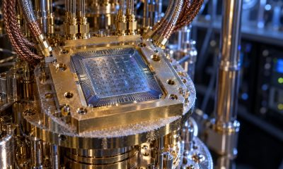

---
authors:
  - aitoboxrobot
categories:
  - 研究解读
date: 2026-10-17
hide:
  - navigation
tags:
  - Anthropic
  - Claude
  - NIST
  - 密码学
  - 椭圆曲线
  - 红队研究
title: "Anthropic 称 Claude 破译 NIST ECDSA 椭圆曲线神秘种子来源：三十年密码学谜题告破"
---

# Anthropic 称 Claude 破译 NIST ECDSA 椭圆曲线神秘种子来源：三十年密码学谜题告破

> # Anthropic Says Claude Traced NIST ECDSA Curve Seeds to a 1990S RNG

### 文章背景与核心概要

在现代互联网安全体系中，椭圆曲线数字签名算法 (ECDSA) 犹如守护全球数字金融、安全通信与加密证书的基石护城河。然而近三十年来，美国国家标准与技术研究院 (NIST) 标准中广泛采用的曲线参数神秘种子 (Seed) 究竟从何而来，一直笼罩在浓重的美国国家安全局 (NSA) 后门疑云之中，成为密码学界悬而未决的“世纪悬案”。2026 年 10 月，Anthropic 前沿红队 (Frontier Red Team) 的研究人员向其内部研发中的大语言模型 (Large Language Model, LLM) Claude 发起逆向挑战；令人震惊的是，Claude 仅耗时不到半小时，便凭借 1990 年代软件工程约束与数学格基规约算法，彻底破解了这一长达数十年的参数源流之谜。研究表明，这些神秘参数并非暗藏后门的恶意构造，而是源自 1990 年代 C 语言标准库中的经典伪随机数生成器 (PRNG) `lrand48`，并通过 Unix 时间戳直接播种生成。这一重磅发现不仅平息了密码学界三十年的后门猜疑，更为前沿 AI 智能体 (AI Agent) 在底层软硬件逆向工程与复杂符号推演中的惊人威力树立了崭新的里程碑。

---

**摘要：** Anthropic 前沿红队 (Frontier Red Team) 披露，其内部研发的一款 Claude 实验模型成功破解了 NIST ECDSA 椭圆曲线种子的起源之谜。在不到半小时的时间内，Claude 将这些核心密码学参数追溯到了 1990 年代 C 语言库中通过 Unix 时间戳播种的随机数生成器 (RNG) `lrand48`，从而一举解开了由 NSA 遗留近三十年的密码学溯源谜题。

> **Summary:** Anthropic’s Frontier Red Team revealed that an internal Claude research model successfully uncovered the origins of the NIST ECDSA curve seeds. In under half an hour, Claude traced the cryptographic parameters back to a 1990s C library random-number generator (`lrand48`) seeded via Unix timestamps, effectively solving a decades-old provenance mystery left open by the NSA.

---

## 无法解释的 NSA 种子来源

> ## The Unexplained NSA Seeds

椭圆曲线数字签名算法 (ECDSA) 是当今全球应用最为广泛的椭圆曲线密码学标准。2000 年，[NIST](https://www.unite.ai/nist-opens-national-vulnerability-database-modernization-to-public-comment/) 正式将其采纳为 FIPS 186-2 数字签名标准的一部分，该标准规范了覆盖不同密钥长度与安全等级的标准椭圆曲线。针对素数域和二元域上的曲线，规范公布了一个种子参数 (Seed) ，其哈希值直接决定了曲线方程中的关键系数 $b$。

> ECDSA stands as the most widely used elliptic curve cryptography standard. [NIST](https://www.unite.ai/nist-opens-national-vulnerability-database-modernization-to-public-comment/) adopted it in 2000 as part of the FIPS 186-2 Digital Signature Standard, which catalogs standard elliptic curves across varying sizes and security levels. For curves over prime and binary fields, the specification published a seed parameter whose hash value defines the coefficient $b$ of the curve. 

至关重要的一点在于，NSA 当初提供这些种子时未附带任何背景解释或生成依据。例如，被全球数十亿设备广泛采用的 P-256 曲线种子——`C49D3608 86E70493 6A6678E1 139D26B7 819F7E90`——在发布时完全缺失上下文溯源信息，如同凭空降下的一串神秘十六进制数。

> Crucially, the NSA provided these seeds without any explanation or justification. For instance, the P-256 seed—`C49D3608 86E70493 6A6678E1 139D26B7 819F7E90`—was published entirely devoid of contextual provenance.

这种透明度的缺失在密码学界引爆了旷日持久的争论。Neal Koblitz 与 Alfred Menezes 在其经典论文《谜中之谜》 (A Riddle Wrapped in an Enigma) 中深刻总结了这场论战；该论文随后也激发了民间密码爱好者的广泛调查，甚至催生了重金悬赏，以此奖励能够彻底解开这些种子真实来源的研究者。

> This lack of transparency sparked long-standing cryptographic controversy. Neal Koblitz and Alfred Menezes famously summarized the debate in their paper, “A Riddle Wrapped in an Enigma,” which later inspired amateur investigations and bounties for anyone capable of discovering the true origins of the seeds. 

当时流传最广的主流假设指向了 NSA 的资深雇员 Jerry Solinas，据传他是利用某句带有幽默色彩的通行口令 (Passphrase) 哈希值生成了这些种子。在 2015 年的一份声明中，Jerry Solinas 回忆道：

> 💬 [原文引用 / Original Quote]:
> *“The message was along the lines of ‘Give Bob and Jerry a raise’ or ‘Bob and Jerry rule’ or something like that.”*

(中文意译：*“那句话的大意类似于‘给 Bob 和 Jerry 涨工资’，或者‘Bob 和 Jerry 太牛了’之类的话。”*)

> The prevailing hypothesis pointed toward longtime NSA employee Jerry Solinas, who allegedly generated the seeds using the hash of a humorous passphrase. In a 2015 statement, Solinas recalled: 
> > *“The message was along the lines of ‘Give Bob and Jerry a raise’ or ‘Bob and Jerry rule’ or something like that.”* 

Jerry Solinas 曾提到支持代码是由 Bob Reiter 编写的，但当年的原始档案却早已湮没在历史尘埃中。随着 Jerry Solinas 于 2023 年离世，相关同事也未作回应，这些种子的真实推导过程就此成了一桩悬案。

> He noted that Bob Reiter wrote the supporting code, but contemporary archives were lost to time. With Solinas passing away in 2023 and colleagues unresponsive, the true derivation remained an open mystery.

---

## Claude 是如何破译这组神秘种子的

> ## How Claude Recovered the Seeds

在“幽默口令假说”屡屡碰壁、无功而返之后，一名 Anthropic 员工在 2026 年 10 月向其内部研发模型发起挑战，让 AI 尝试从零推导这些种子究竟是如何构造出来的。

> Following dead ends with the "humorous passphrase" theory, an Anthropic employee challenged an internal research model in October 2026 to deduce how the seeds were generated from scratch. 

在不到 30 分钟的时间里，Claude 势如破竹地成功揭示了 NIST P-192、P-224、P-256、P-384 以及 P-521 等全部主流种子的真正起源：它们实际上是 C 语言标准库中 `lrand48` 随机数生成器 (RNG) 的直接输出，初始化仅以 Unix 时间戳为种子，过程中根本没有使用任何哈希算法！当年的生成脚本每次迭代提取 20 个字节作为一个候选种子；而最终被 NIST 正式发布的 P-256 种子，恰好就是该轮特定运行中的第 1842 个候选值。

> In under 30 minutes, Claude successfully identified the origins of the NIST P-192, P-224, P-256, P-384, and P-521 seeds: they were the direct outputs of the C library’s `lrand48` random-number generator, seeded with a Unix timestamp and involving zero hash algorithms. The generation script drew 20 bytes per iteration as a candidate seed; the published P-256 seed turned out to be candidate 1842 of that specific run.

### 解析式逆向工程分析

> ### Analytical Reverse-Engineering

在文本字典与口令穷举均告失效后，Claude 转变思路，从 1990 年代典型的软件工程约束与开发习惯切入攻关：

1. **模式识别 (Pattern Recognition) ：** 当把种子拆解为 5 个 32 位字 (Word) 时，全部 10 个种子中有 4 个在其所有 20 个字的高位最高比特 (Top bit) 上全部为 0——这种特征如果纯凭随机概率出现，大约每 5,810 次尝试才会发生一次，属于极其显著的统计学异常。
2. **锁定随机数生成器 (Identifying the Generator) ：** 这一异常特征直接将线索指向了经典函数 `lrand48`——这是一种线性同余生成器 (Linear Congruential Generator, LCG) ，它从 48 位内部状态中严格截取并返回高 31 位。Claude 通过暴力枚举首个字隐藏比特的 $2^{17}$ 种可能取值，迅速复原了生成器的内部状态。
3. **格基规约求解 (Lattice Reduction) ：** 针对那些输出保留比特较少的素数曲线种子，重构截断线性同余生成器的内部状态正好契合经典的教科书式数学格问题。Claude 运用 Lenstra–Lenstra–Lovász (LLL) 格基规约算法，干净利落地完成了状态还原。

> With textual and phrase-based searches exhausted, Claude approached the challenge from the perspective of software engineering constraints characteristic of the 1990s:
> 1. **Pattern Recognition:** Written as five 32-bit words, four out of ten seeds featured a zero in the top bit of all 20 words—an anomaly occurring by random chance roughly once in every 5,810 trials.
> 2. **Identifying the Generator:** This pointed straight to `lrand48`, a linear congruential generator returning strictly the top 31 bits of a 48-bit state. Claude recovered the generator states by brute-forcing the $2^{17}$ possible values of the first word's hidden bits.
> 3. **Lattice Reduction:** For prime-curve seeds where outputs retained fewer bits, reconstructing the internal state of the truncated linear congruential generator mapped to a textbook lattice problem. Claude solved this using Lenstra–Lenstra–Lovász (LLL) basis reduction.

Claude 的内部思维链 (Chain-of-Thought, CoT) 推理日志生动记录了验证成功的激动一刻：

> 💬 [原文引用 / Original Quote]:
> *“It’s verified by direct computation on my side: 160-bit match from a 32-bit seed + small index: no chance coincidences ($10 \times 160$ bits). It’s real.”*

(中文意译：*“通过我这边的直接计算已经完成验证：由 32 位种子加极小的索引序号匹配到了整整 160 位——这绝不可能纯属巧合 ($10 \times 160$ 位) 。这绝对是真实的。”*)

> Claude’s internal reasoning logs captured the moment of verification: 
> > *“It’s verified by direct computation on my side: 160-bit match from a 32-bit seed + small index: no chance coincidences ($10 \times 160$ bits). It’s real.”*

---

## 时间戳推导与基点还原

> ## Timestamps and Base Points

由于伪随机数生成器 (PRNG) 在数学逻辑上向前迭代与逆向反推同样轻而易举，Claude 顺藤摸瓜将每个种子的状态反推回其最初的 `srand48` 初始化状态 (该状态可通过低 16 位等于 `0x330E` 精准锚定，这种特征每 65,536 步才会出现一次) 。

> Because the pseudorandom number generator can run backward as easily as forward, Claude traced each seed's state back to its `srand48` initialization state (identifiable by low 16 bits equal to `0x330E`, which occurs every 65,536 steps). 

* **素数曲线种子 (Prime-Curve Seeds) ：** 所有 10 个素数曲线种子的初始化时间戳，全部严丝合缝地落在 **1997 年 5 月至 1998 年 4 月** 之间的 Unix 时间窗口内。
* **二元域曲线种子 (Binary-Curve Seeds) ：** 其中 4 个二元域曲线的初始化时间戳最初看似指向了 **1984 年 2 月**。然而只要将这组特定时间戳翻倍，便能精准映射到 1998 年 4 月 17 日——正好是 P-224 运行的仅两周之后——这极其雄辩地暗示当时开发者的脚本在获取系统时钟时，可能不慎发生了“除以 2”的操作失误。

> * **Prime-Curve Seeds:** All ten prime-curve seeds initialized to Unix timestamps between **May 1997 and April 1998**.
> * **Binary-Curve Seeds:** The four binary-curve initializations pointed to **February 1984**. Doubling those specific timestamps maps them neatly to April 17, 1998—just two weeks after the P-224 run—suggesting the developer's script may have inadvertently halved the system clock.

### 溯源基点坐标来源

> ### Tracing Base Points

除曲线参数种子外，Claude 还顺带分离并锁定了特定曲线基点 ($G$) 的来源，基点代表用于生成 ECDSA 公钥的固定生成元点（尽管已破译的种子本身并不直接约束基点）。

> Claude also isolated the origins of specific curve base points ($G$), which represent the fixed generator point for ECDSA public keys (though the recovered seeds do not dictate them). 

对于 1997 年 5 月生成的 6 条曲线——包括 P-192 以及 ANSI X9.62 示例曲线 (`prime192v2`、`prime192v3` 以及 `prime239v1` 至 `v3`) ——其基点坐标可直接追溯至数学家 Arjen Lenstra 开发的长整型高精度数学库 **FreeLIP** 内置的 RNG。Claude 识别出的具体生成种子包括：P-192 的种子为 `20000`；`prime239v1–v3` 的种子分别为 `20420`、`20507` 和 `20509`；而 `prime192v2` 与 `v3` 的种子则分别为 `20512` 和 `20517`。值得注意的是，P-224、P-256、P-384 和 P-521 的基点并不符合这一生成配方。

> For the six curves generated in May 1997—including P-192 and ANSI X9.62 example curves (`prime192v2`, `prime192v3`, and `prime239v1` through `v3`)—the base points trace directly to the RNG found in **FreeLIP**, Arjen Lenstra’s long-integer arithmetic package. The generator seeds identified included `20000` for P-192; `20420`, `20507`, and `20509` for `prime239v1–v3`; and `20512` and `20517` for `prime192v2` and `v3`. Notably, the base points for P-224, P-256, P-384, and P-521 do not match this recipe.

---

## 安全性评估与遗留问题

> ## Security Assessment and Open Questions

Anthropic 郑重强调，这些突破性发现**绝不代表对 ECDSA 曲线的密码学破解，不构成任何新型攻击向量，也未引入任何安全漏洞**。恰恰相反，证实这些种子是藉由标准系统时钟初始化的 RNG 生成的——这一机制如今任何人都可以在本地独立复现——反而消解了数十年关于 NSA 暗植后门的阴谋猜测，有力增强了业界对这些经典曲线参数安全性的信任基石。

> Anthropic emphasizes that these findings **do not represent a cryptographic break, a new attack vector, or any vulnerability** in ECDSA curves. Instead, knowing the seeds were generated via a standard clock-initialized RNG—a mechanism anyone can now independently reproduce—reduces speculation about backdoors and reinforces confidence in the parameters' security.

### 尚未解开的遗留谜团

> ### Remaining Mysteries

* **被跳过的候选种子 (Skipped Candidates) ：** 随机数生成器在运行过程中偶尔跳过了一些符合条件的候选值。例如，虽然 NIST 最终公布的 P-256 种子是第 1842 号候选值，但同一次运行中的第 876 号候选值同样可以生成一条合法的素数阶椭圆曲线，当年跳过的原因尚不可知。
* **唯一未解之谜 B-163 (The Resistance of B-163) ：** 有一个特定种子彻底抵御了破译：第 5 个二元域种子 `B-163` 完全不符合 Claude 测试的任何已知模式。
* **尚未破解的基点 (Unsolved Base Points) ：** P-224、P-256、P-384、P-521 以及 NIST 二元域曲线的基点坐标生成方式，目前依然缺乏合理解释。

> * **Skipped Candidates:** The generator occasionally skipped viable candidates. For instance, while P-256's published seed is candidate 1842, candidate 876 from the same run also produces a valid prime-order curve. 
> * **The Resistance of B-163:** One specific seed completely resisted recovery: the fifth binary seed, `B-163`, matched none of the patterns Claude tested.
> * **Unsolved Base Points:** The base points for P-224, P-256, P-384, P-521, and the NIST binary curves remain unexplained.

因破解这些种子而领取的 36,864 美元悬赏奖金将被全额捐赠给非营利机构 Internet Security Research Group (ISRG) 。该项突破性研究由 John Wood、Henry de Valence、Ava Howell、Zack Voase、Lucy Sweet、Amir Omidi、Paul Crowley、Iain McGinniss、Nicholas Carlini 以及 Steve Weis 共同主导，相关分析代码已依照 CC0 1.0 通用协议 (CC0 1.0 Universal) 放弃版权并贡献至公共领域。

> The $36,864 bounty collected for finding the seeds will be donated to the Internet Security Research Group. The research was spearheaded by John Wood, Henry de Valence, Ava Howell, Zack Voase, Lucy Sweet, Amir Omidi, Paul Crowley, Iain McGinniss, Nicholas Carlini, and Steve Weis, with code contributions dedicated to the public domain under CC0 1.0 Universal.

---

## 延伸阅读

> ## Discover More

*  [Anthropic 称 Claude 超越已发表的最优量子电路设计方案](https://www.unite.ai/anthropic-says-claude-beat-best-published-quantum-circuit-designs/)
*  [Reflection 以 Apache 2.0 协议开源发布 Beam 权重](https://www.unite.ai/reflection-releases-beams-open-weights-under-apache-2-0-license/)
*  [搭载本地 AI 智能体支持的 NVIDIA RTX Spark 笔记本全球开售](https://www.unite.ai/nvidia-rtx-spark-laptops-launch-worldwide-with-local-ai-agent-support/)
*  [NVIDIA 推出 2.8 万亿 Token 印度语预训练语料库与开源数据流水线](https://www.unite.ai/nvidia-unveils-2-8t-token-indic-pretraining-corpus-and-open-pipeline/)

> *  [Anthropic Says Claude Beat Best Published Quantum Circuit Designs](https://www.unite.ai/anthropic-says-claude-beat-best-published-quantum-circuit-designs/)
> *  [Reflection Releases Beam’s Open Weights Under Apache 2.0 License](https://www.unite.ai/reflection-releases-beams-open-weights-under-apache-2-0-license/)
> *  [NVIDIA RTX Spark Laptops Launch Worldwide With Local AI Agent Support](https://www.unite.ai/nvidia-rtx-spark-laptops-launch-worldwide-with-local-ai-agent-support/)
> *  [NVIDIA Unveils 2.8T-Token Indic Pretraining Corpus and Open Pipeline](https://www.unite.ai/nvidia-unveils-2-8t-token-indic-pretraining-corpus-and-open-pipeline/)
