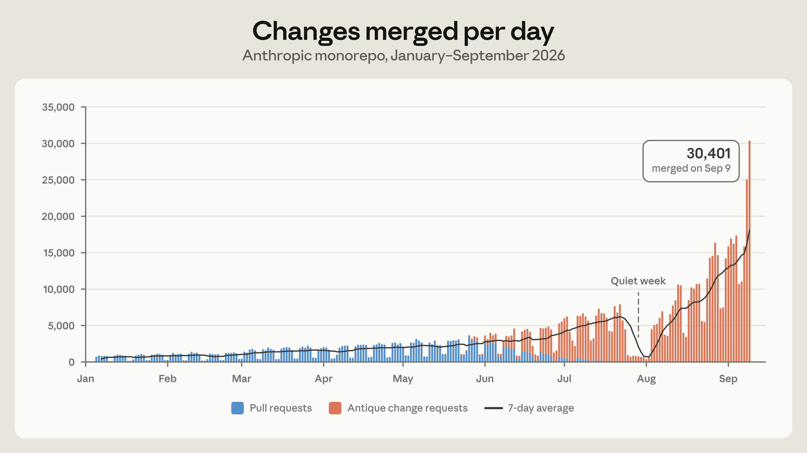
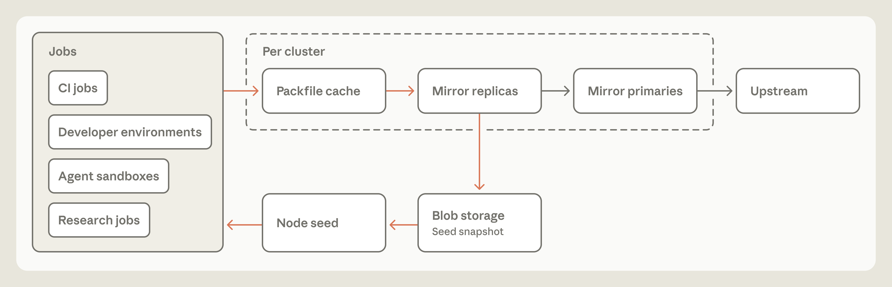
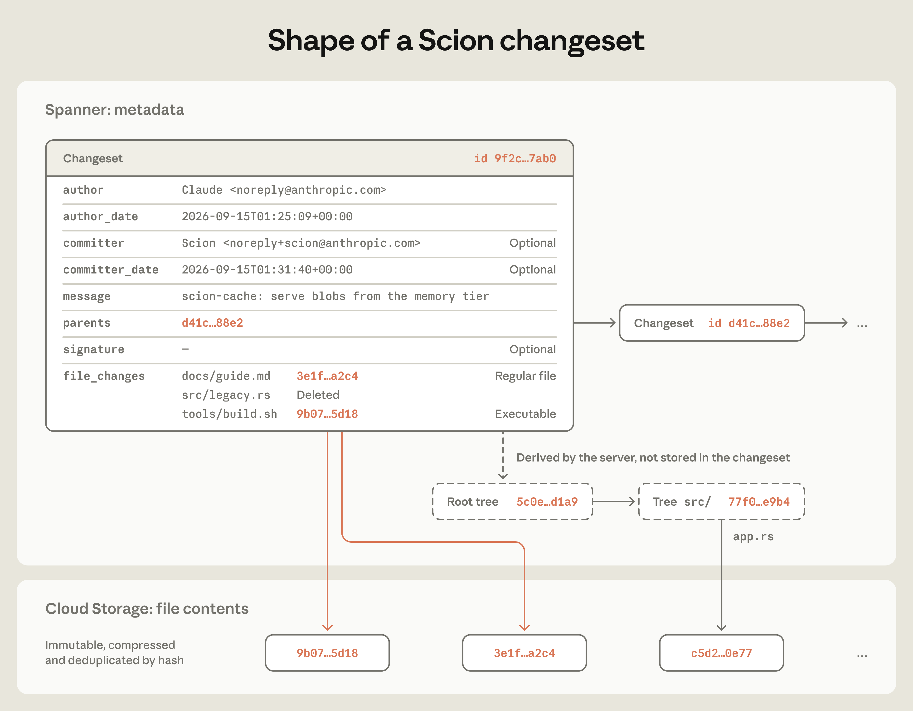

---
authors:
  - aitoboxrobot
categories:
  - 研究解读
date: 2026-10-20
hide:
  - navigation
tags:
  - Anthropic
  - Claude
  - 版本控制
  - Monorepo
  - Scion
title: "Anthropic 重构版本控制系统：从 Git 迁移至自研 Scion"
---

# Anthropic 重构版本控制系统：从 Git 迁移至自研 Scion

> # Redesigning source control at Anthropic

### 文章背景与核心概要
随着以 Claude 为代表的自主 AI 编码智能体 (AI Agent) 在 Anthropic 内部广泛普及，软件研发的生产力范式被彻底重构。每天合并到核心代码库的变更量在短短四个月内暴涨十倍以上，专为“人类节奏”设计的传统版本控制系统 Git 迅速逼近性能极限，甚至濒临崩溃。面对 100 GB 历史体积与潜在数百 PB 的惊人流量消耗，一支仅有 7 名工程师的核心小队耗时 5 个月打造出面向“智能体时代”的全新版本控制系统 Scion，并顺利完成了超大规模单体仓库 (Monorepo) 的全量迁移。通过将智能体客户端预设为“永在线”、引入基于预写日志 (WAL) 的集中式轻量变更集架构，并深度让 Claude “自己为自己编写基础设施”，Anthropic 实现了资源消耗 200 倍的缩减与数十倍的性能飞跃，展现了下一代 AI 原生软件工程的全新图景。

---

**核心摘要**：随着像 Claude 这样的自主 AI 编码智能体 (AI Agent) 极大加速了 Anthropic 内部的代码生成——每日合并的代码变更从 2026 年 5 月的 2,500 次激增至 9 月的超过 30,000 次——为人类协作规模设计的 Git 等开发者基础设施成为了主要瓶颈。为了解决这一难题，一个仅有 7 名工程师的小团队打造了专为智能体规模设计的自研版本控制系统 **Scion**，并在短短 5 个月内完成了庞大单体仓库 (Monorepo) 的全量迁移。通过将客户端预设为“永远在线”、将服务端与本地仓库状态解耦，并借助 AI 自身编写与优化底层基础设施，Anthropic 将基础设施资源占用削减了 200 倍，并大幅提升了持续集成 (CI) 的性能。

> > 💬 [原文引用 / Original Quote]:
> > **Summary:** As autonomous AI coding agents like Claude dramatically accelerate code generation at Anthropic—jumping from 2,500 daily merged changes in May 2026 to over 30,000 by September—human-scale developer infrastructure like Git became the primary bottleneck. To solve this, a small team of seven engineers built **Scion**, a custom, agent-scale version control system, and migrated their massive monorepo in just five months. By treating clients as always online, decoupling the server from local repository states, and leveraging AI to write and optimize the infrastructure itself, Anthropic achieved a 200x reduction in infrastructure footprint and significantly faster CI performance.

*10 月 15 日更新：补充了在 Scion 所采用的多项核心技术中扮演先驱角色的相关开源项目细节。*

> *Updated October 15 to include more detail on the projects that pioneered many of the techniques we use in Scion.*

***

在 Anthropic，编写代码早已不再是构建软件系统或推进前沿科研的瓶颈所在。如今，Claude 能够以人类前所未见的速度与规模，自主闭环推进科研迭代、深度微调复杂程序，并从零开始搭建全新的后端服务。当下真正卡脖子的瓶颈，反而是那些过去专为“人类开发节奏”量身定制的基础设施：版本控制、代码构建以及持续集成 (CI) 系统。

> At Anthropic, coding is no longer the bottleneck to building systems or doing research. Claude is able to autonomously iterate on research loops, micro-optimize complex programs, and build new services from the ground up at a speed and scale we haven’t seen before. The bottleneck, now, is all of the developer infrastructure built for human scale: source control, builds, and CI.

2026 年 5 月，Anthropic 平均每天合并大约 2,500 次代码变更；而到了 9 月，这一数字已飙升至每日超过 30,000 次。并且我们预计这种爆发式增长短期内绝不会放缓——代码合并的潜在需求几乎是无穷无尽的，我们每消除一处瓶颈，系统产出代码的体量就会紧接着迎来新一轮激增。

> In May 2026, Anthropic averaged around 2,500 code changes merged per day; as of September, we merged over 30,000 per day. We don’t expect this rate of growth to slow down anytime soon; the latent demand for merging code is practically infinite, and every bottleneck we remove immediately leads to a further increase in the amount of code we produce.

为了支撑这股汹涌的代码洪流，我们打造了自研版本控制系统 Scion，并在短短 5 个月内将核心单体仓库 (Monorepo) 从 Git 全面迁移完毕。在此期间，我们还同步构建并上线了全新的代码审查平台 (代号 Antique)、全代码检索系统、功能完备的版本控制身份与访问管理系统 (IAM)，以及一套高效管理和合入海量已评审代码的创新机制。在本篇文章中，我们将重点聚焦于 Scion 的架构演进与设计实现。这是一个极为耐人寻味的绝佳案例：Claude 惊人的自主编码能力不仅是导致我们陷入基础设施危机的“始作俑者”，但同时，也正是借助 Claude 的强大力量，我们才得以在极短时间内构建出一套高质量、高扩展性的分布式系统来化解这场危机。

> In order to support this growth, we built Scion, an in-house version control system, and fully migrated our monorepo from git in five months. We also built and shipped a code review surface (called Antique), code search, a rich source control IAM system, novel ways of managing and landing large amounts of reviewed code, and more, all in that same time period. In this post, we’ll focus on how we built Scion specifically. It makes for an interesting case study: Claude’s ability to write code was both what put us in this situation in the first place _and_ how we were able to quickly build a high-quality, scalable system to deal with it.

---

## 膨胀的单体代码仓库

> ## Growing our monorepo

在深入探讨系统细节之前，我们必须首先指出当前系统所承载的工作负载是何等不同寻常。毋庸置疑，Anthropic 借助 Claude 编写软件的深度与频次远超当下几乎任何企业，正因如此，我们往往成为第一批直面“人类尺度工具开始捉襟见肘”的先遣者，而版本控制仅仅是其中最具代表性的一个缩影。虽然在极短期内未必会有太多企业遇到同等量级的瓶颈，但我们确信，随着 AI 编码工具在业界的深度普及，更多团队迟早会遭遇完全相同的痛点。这也正是我们决定公开这套技术方案与踩坑心得的核心初衷。

> Before we explore what we built, we should acknowledge how unusual our workload is. Unsurprisingly, Anthropic uses Claude to write software far more than almost any other company, so we’re often the first to see where tools built for human scale start to strain. Source control is just one example of this. While we don’t expect many organizations to have these problems in the very near term, we suspect it won’t be too long before others who use AI coding tools experience these same pressure points, which is why we wanted to share what we built and what we learned.

Git 本质上是一套去中心化的分布式系统：每一次克隆 (Clone) 操作都会在本地复制一份自包含的完整仓库。即使在完全离线的环境下，本地也能自由计算差异 (Diff)、回溯版本历史与逐行追溯 (Blame)，并随时检出任意提交历史版本。对于绝大多数常规代码库而言，这种设计极其优雅得体，也正是 Git 能成为当今事实行业标准的关键所在。

> Git is a decentralized system: every clone is a complete, self-contained repository that can compute diffs, read history and blame, and check out any revision while fully offline. For the vast majority of repositories, this is the right design, and it’s a large part of why git became the standard.

然而，随着单体仓库的体量不断膨胀，Git 最初的设计假设已越来越难以容纳我们的现实需求。仅我们主分支 (`main`) 的提交历史数据就已逼近 100 GB，一份经过压缩的工作副本 (Working Copy) 体积也超过了 25 GB。仅持续集成 (CI) 流程每天执行的代码检出 (Checkout) 就高达 2,500 万次左右——这甚至还没算上工程师的开发环境、AI 智能体沙盒以及各类实验科研任务。如果直接按照常规方式全量拉取，每天仅 Git 产生的网络传输流量就将超过惊人的 600 PB。

> As our monorepo grows, it increasingly doesn’t fit that design space. The history of our main branch alone is almost 100 GB, and a _compressed_ working copy is over 25 GB. We perform on the order of 25 million code checkouts per day for CI, before counting developer environments, agent sandboxes, and research jobs. Fetched naively, that would be over 600 PB of git traffic per day.

针对大型单体仓库，Git 本身提供了一些局部切片拉取工具，例如浅克隆 (Shallow Clone)、稀疏检出 (Sparse Checkout) 以及承诺式远端 (Promisor Remote) 等。除此之外，业内针对巨型单体仓库还有不少通用缓解手段，例如搭建内部 Git 镜像集群，以及将代码仓库快照 (种子包/Seeds) 存放在对象存储中。我们把这些招数试了个遍——在业务负载峰值期，我们同时运行了数百个内部 Git 镜像节点来分担高并发冲击。这些措施确实为我们争取到了宝贵的缓冲时间，但随着代码合并速率的指数级攀升，维护这套集群变得愈发痛苦。快照种子包在每次定时刷新之间，与最新主分支尖端的落后差距越来越大；而在部分切片克隆上保证 Diff、Blame 等依赖历史追溯的操作平稳运行，所需要投入的维护精力也变得愈加沉重。

> Git offers tools for working with a slice of a repository, such as shallow clones, sparse checkouts, and promisor remotes. Beyond these, there are standard workarounds for large monorepos, like internal git mirrors and repository snapshots (seeds) kept in blob storage. We’ve used all of them—at our peak, we operated several hundred internal git mirrors to deal with the load. This bought us time, but they became harder to operate as our merge rate increased. Seeds fell further from the tip of main between refreshes, and it took more and more care to keep operations that depend on history, like diff and blame, working on partial clones.

跳出细节退一步审视，我们意识到：与大多数现代企业类似，我们在实际运作中把 Git 当作一套拥有唯一权威源的“集中式系统”在使用，但我们的客户端几乎清一色是天生永远在线的 AI 智能体和自动化任务流水线。Git 赖以成名的“分布式、离线自治”优良特性，在代码库膨胀的场景下，反而变成了制约系统水平横向扩展的枷锁。于是我们反思：如果我们从第一天起，就建立在“智能体客户端永远在线”的假设前提下去设计一套全新的版本控制系统，它究竟该是什么模样？

> Taking a step back, we noticed that, like most companies, we were using git as a centralized system with one authoritative copy, but nearly all of our clients were agents and jobs that are online by definition. The properties that make git excellent for distributed, offline work were actively undermining our ability to scale as the repo grew. So we asked ourselves: if we designed source control with the fact that agents are always online in mind from the start, what would it look like?

---

## 面向智能体规模的版本控制设计原则

> ## Principles for agent-scale source control

在智能体编程时代，关于软件开发流程的大量传统假设正在发生深刻演变。在打造 Scion 时，我们全面拥抱了这些变革，使得我们在多个核心原则上做出了与 Git 截然不同的路径抉择。针对超大型单体仓库的版本控制，业内早有先驱探索，其中最著名的当属 Google 的 [Piper](https://en.wikipedia.org/wiki/Piper_(source_control_system)) 与 Meta 的 [Sapling](https://sapling-scm.com/)。吸纳它们经过多年实战检验的宝贵经验，我们确立了指导 Scion 演进的六大核心原则：

> With agentic coding, many common assumptions about how software is developed are evolving. We embraced these changes when building Scion, which allowed us to take a fundamentally different approach than git on several core principles. Source control for huge monorepos has prior art, notably Google’s [Piper](https://en.wikipedia.org/wiki/Piper_(source_control_system)) and Meta’s [Sapling](https://sapling-scm.com/), so we were able to build Scion with their hard-won lessons in mind. Our principles are:

* **客户端预设永远在线 (Clients are always online)**：Git 预设客户端需要在离线环境下工作，因此必须在本地保留全量仓库。但在我们的场景中，绝大多数客户端都是常驻在线的 AI 智能体与自动化作业，因此我们将 Scion 的客户端与通信协议完全围绕“服务端始终触手可及”进行构建，客户端仅在真正需要时才动态按需拉取数据。
* **客户端-服务端非对称设计 (Client-server asymmetry)**：在 Git 中，每个客户端理论上都能充当一个全功能的独立服务端。而在 Scion 中，服务端统筹处理所有复杂运算——回答文件历史与逐行追溯查询、创建提交、执行合并 (Merge) 与变基 (Rebase) 等；客户端仅维护一个受限的本地对象缓存、在磁盘上组织工作目录树、监听文件系统变动，并为用户提供符合人体工程学的交互界面。客户端自身的计算负担极低，换来的是本地对数据存储的诉求大幅缩减。
* **以全能版本控制服务赋能全新上层应用 (A comprehensive source control service can power many novel applications)**：在 Git 体系下，任何需要查询代码库的 CI 任务或工具（例如追查某行代码由谁修改、或者两条提交记录如何关联），都必须在本地拉取代码库副本，或者寄希望于特定托管平台提供的 API。而在 Scion 中，客户端使用的所有核心查询能力均已沉淀为标准的开放 API。这使得在许多场景下，任务根本不需要拉取本地仓库。像自动二分查找故障 (Bisect) 和自动回滚 (Revert) 这一类内部关键管线，若没有这种极低成本、可编程的版本控制访问接口，在超大规模下根本无法落地。
* **全栈架构必须具备水平横向扩展能力 (Everything must be horizontally scalable)**：在峰值时期，我们曾维护数百个内部 Git 镜像，这对系统算力造成了巨大压力，且一旦仓库体积超出镜像节点的磁盘或内存上限便无法继续扩展。在 Scion 中，仓库数据完全分布式存储，每一个组件均可独立横向扩展；无论在客户端还是服务端，全网不存在任何一份“全量物化”的代码库拷贝。系统彻底废弃了类似 Git 打包文件 (Packfile) 的概念，因而彻底免除了定期仓库维护与 GC 整理的沉重负担。
* **提交操作必须廉价、增量化且无锁化 (Commits must be cheap, incremental, and lock-free)**：在 Git 中，开发者需要先在本地 Commit，再通过 Push 将代码推送共享。而在 Scion 中，所有的提交、变基或合并都直接发生在服务端，完全不存在 Push 操作，但每一步操作都必须极度轻量快速。创建提交及更新其下游衍生数据结构的开销，必须仅与本次变更的差异大小成正比，而绝不能随仓库整体规模膨胀，否则服务端必将瘫痪。同时，Scion 在开发流程中严格限制引用指针 (Ref，例如分支与标签) 的滥用，仅保留主分支与发布分支等极少数核心 Ref，因为需要所有服务端强一致达成共识的“全局状态”，在超大规模下必然会演变为扩展性噩梦。
* **工作副本按需选用，天生具备稀疏特性 (The working copy is optional, and sparse by design)**：正因为我们的单体仓库体积过于庞大，且 CI 每天需要检出数千万次代码，我们尽可能在所有场景下避免发生落盘检出。在 Scion 体系下，如果一个 CI 任务只需要某次提交与其合并基准点之间的差异比较 (Diff)，它直接调用服务端 API 获取即可。代码写入亦是同理：海量的写入型工作流同样可以跳过落盘检出，完全依托 API 执行。Scion 的通信协议原生围绕稀疏检出（客户端仅拉取显式请求的目录）与虚拟化检出（按需动态物化文件）进行构建，因此当某个任务确实需要在磁盘上落地文件时，客户端也只需为它真正读取到的文件付出传输代价。

> * **Clients are always online.** Git assumes that clients work offline and need a complete copy of the repository. Since nearly all of our clients are agents and jobs, we designed Scion’s client and protocols around a server that is always reachable, and have clients fetch data when they need it.
> * **Client-server asymmetry.** In git, every client is capable of being a full-fledged server. In Scion, the server answers questions about file history and blame, creates commits, performs merges and rebases, and so on. The client maintains a bounded local object cache, lays out the working copy files on disk, monitors for filesystem changes, and gives users an ergonomic way to work with the server. It can compute very little on its own but, in exchange, it requires much less data locally.
> * **A comprehensive source control service can power many novel applications.** With git, a CI job or tool that needs to ask a question about the repository, such as who last changed a line or how two commits are related, has to maintain a local copy of the repo or hope that vendor-specific APIs provide the answer. With Scion, all of the source control queries the client uses are also exposed via API, so in many cases jobs don’t need a local repository at all. Many internal tools, such as our automated bisect and revert pipelines, wouldn’t be practical at scale without this cheap, programmatic access to source control.
> * **Everything must be horizontally scalable.** At our peak, we ran several hundred git mirrors, which significantly strained capacity and no longer scaled once the repo outgrew the mirrors’ disks or memory limits. In Scion, the repository’s data is distributed, and every component is independently scalable; there is no fully materialized copy of the repo anywhere, even on the server. There is no equivalent of packfiles (git’s compressed bundles of objects), so no repository maintenance is needed.
> * **Commits must be cheap, incremental, and lock-free.** In git, you commit locally and then push to share your work. In Scion, every commit, rebase, or merge happens on the server, so there’s nothing to push, but each of those operations needs to be fast. The cost of creating a commit and updating its downstream data structures has to scale with the size of the change, not the overall size of the repo, or the server can’t keep up. The development lifecycle in Scion discourages refs (pointers to commits, such as branches and tags), except for the main ref or release branches, because *global* state that every server has to agree on is a looming scaling problem.
> * **The working copy is optional, and sparse by design.** Because our monorepo is so large, and because we check out code tens of millions of times a day for CI, we wanted to avoid checkouts whenever we could. With Scion, a CI job that needs the diff between a commit and its merge base, for example, can ask the server for it. The same goes for writes: many write workloads can also skip the checkout and function entirely via API. Scion’s protocol is centered around sparse checkouts, which only contain the directories the client asks for, and virtualized checkouts, which materialize files on demand, so when a job does need files on disk, the client only pays for what it actually reads.

---

## Scion 的技术实现与架构细节

> ## How Scion works

了解这些设计原则如何在 Scion 的实际构建中融会贯通，将非常有启发性。这些工程洞见不仅适用于其他版本控制系统，也能广泛启发软件开发生命周期中的其他阶段。

> It’s helpful to understand how these principles came together in practice when building Scion. These insights can apply to other source control systems or, more broadly, to other stages of the software development lifecycle.

### 底层数据结构设计

> ### Data structures

在 Scion 中，最核心的工作单元被称为“变更集” (Changeset)，它是预写式日志 (Write-Ahead Log, WAL) 中的一条日志记录。变更集保留了 Git 提交 (Commit) 中你所熟知的大部分基础信息。然而与 Git 提交保存指向完整目录树对象 (Tree) 的指针不同，Scion 的变更集仅存储相对于其第一父节点发生变动的文件列表，以及指向对象存储中压缩后文件内容的“基于内容寻址 (Content-Addressed)”指针。变更集全都在服务端统一创建生成，并即刻对全网可见、全局可用。

> In Scion, the unit of work is a “changeset,” an entry in a write-ahead log. A changeset stores most of what you’d expect from a commit in git. But where a git commit stores a pointer to the tree, a changeset stores a list of the files that changed relative to its first parent, along with content-addressed pointers to the compressed file contents in blob storage. Changesets are created server-side and are available everywhere, instantly.

这种精简的数据结构让系统得以以极高的吞吐量持续接收变更集：这里完全无需接收笨重的打包文件 (Packfile)，没有锁竞争或跨服务器协同，更不需要在每次提交时移动引用指针。Scion 在底层技术上确实支持 Ref，但由于创建或拉取提交的过程完全不依赖 Ref，移动一个指针仅仅是对 Google Cloud Spanner 单个数据行执行一次原子 CAS (Compare-And-Swap) 操作，这与变更集的创建完全解耦、独立进行。

> This structure lets us accept changesets with very high throughput because there are no packfiles to accept, no locking or cross-server coordination, and no refs to move around. Scion does technically support refs, but since neither creating nor fetching commits involves them, moving one is a compare-and-swap on a single Spanner row that happens separately from creating changesets.

由于变更集本身仅忠实记录差异改动，单凭它自身无法迅速回答“某一行代码由谁最后编辑”或“哪些提交曾修改过该文件”等复杂追溯问题。为此，Scion 在变更集的基础上构建了额外的补充数据结构，包括专门用于文件 Blame 逐行追溯和路径历史查询的专用结构，以及针对提交图谱的跳表 (Skip List)。我们将所有不属于变更集本体的数据通称为“衍生数据” (Derived Data)，并通过一套通用的计算机制统一处理。每种类型的衍生数据均采用递归方式定义，因此一个变更集对应的衍生数据值，直接从其父节点的对应数值推导计算而来。

> A changeset records only what’s changed, so on its own, it can’t quickly answer questions like who last edited a line or which commits affected a file. To answer those, Scion builds additional data structures from the changesets, including dedicated structures for file blame and path history and skip lists for the commit graph. We call everything that isn’t directly part of the changeset “derived data,” and we compute it all through one generic mechanism. Each type of derived data is defined recursively, so its value for a changeset is computed from its values for that changeset’s parents.

这套机制带来了三大显著优势：首先，当我们发现引入某种新数据结构能显著加速某项操作时，可以非常轻松地增加一种新的衍生数据类型；其次，针对每种类型，我们可以灵活权衡选择即时计算 (Eager) 还是延迟惰性计算 (Deferred)，从而避免将无用的冷数据物化落盘；第三，由于客户端完全感知不到这些数据结构的内部实现细节，我们可以在完全不修改客户端代码的前提下自由优化后端结构。随着系统规模的不断壮大，我们已经多次扩充了新型衍生数据，例如用于代码复制检测 (Copy Detection) 或基于路径的文件检索的新型索引。

> This mechanism has three benefits. First, we can easily add a new type of derived data when a new data structure would make some operation faster. Second, for each type, we can choose whether to compute it eagerly or defer the work, so we avoid materializing data we don’t need. And third, because the client never sees the internals of these data structures, we can optimize them without changing the client. We’ve added new types of derived data many times as the system has grown, such as new indices for performing copy detection or path-based file search.

### Scion 的规模化扩展架构

> ### Scaling Scion

由一小群 Scion 服务器构成的无状态集群，为客户端所需的各项操作提供了丰富的版本控制 API，包括拉取变更集、计算差异、查找合并基准点以及获取文件数据块 (Blob) 等。由于所有版本控制数据都采用了基于内容的寻址方式，任何数据一旦存储便具有不可变性，任意服务器都可以在无需与其他节点协商核对的情况下安全进行本地缓存。因此，这一服务器集群具备极高的水平横向扩展能力，彼此之间几乎不需要复杂的分布式协调。它们本质上是一批超大型分布式缓存，兼具按需动态计算衍生数据并将结果持久化写回 Spanner 的能力。

> A small fleet of Scion servers provides source control APIs for any operation a client needs, such as getting changesets, computing diffs, finding merge bases, and fetching blobs. All source control data is content-addressed, so a piece of data never changes once it’s stored, and any server can cache it without checking with the others. As a result, the servers are horizontally scalable and require little coordination. They are essentially large caches that can also compute derived data on the fly and write the results back to Spanner.

这使得 Scion 的海量上层调用方彻底告别了在本地维护代码仓库副本的沉重包袱。过去，对于那些仅需向版本控制系统查询提交血缘与逐行追溯信息的 CI 作业或内部工具而言，同步与维护本地仓库是一项巨大的运维负担。在迁移早期，甚至在我们尚未设计出专属客户端、仓库格式或协议之前，Scion 仅仅承担了响应这类“元数据”查询的职责。而拉取文件实体内容与物化工作副本属于数据密集度高得多的重量级操作，需要一套截然不同的架构设计。

> Scion’s many consumers no longer need to maintain local repositories of their own. Fetching and maintaining the repository used to be a significant maintenance burden for CI jobs or tools that needed to ask source control questions, particularly about commit ancestry and blame. Early in the migration, before we had our own client, repo format, or protocols, Scion only answered these “metadata” queries. Fetching file contents and materializing working copies are far more data-intensive operations, and they needed a design of their own.

Scion 的 `scn` 命令行客户端在拉取协议上对 Git 进行了数项关键革新，从而构建出极具扩展性、且相较于 Git 服务端大幅削减 CPU 开销的高性能架构。在握手协商阶段，Scion 并不需要客户端反复向服务端汇报“自己本地已拥有哪些对象”；相反，它完全围绕“客户端究竟需要哪些目录树 (Tree) 与文件块 (Blob)”展开。从根目录树出发，客户端在本地缓存中排查缺失的子目录树并递归发起请求，随后对文件块重复同样的过程。每一个请求指向的都是永不变更的特定对象，因此任意层级的缓存节点都能直接予以应答，整个架构呈现出非常纯粹的传统多级分层缓存形态。此外，由于彻底杜绝了单次动辄数个吉字节 (GB) 的超大打包文件响应，整个拉取过程极其高效且天然支持断点续传。稀疏检出甚至虚拟化检出也完全无需额外的定制逻辑，因为客户端只需对不想要的目录树“不予请求”即可自然实现。

> Scion’s scn client deviates from git’s fetch protocols in several important ways and, as a result, lends itself to a highly scalable architecture that requires significantly less CPU than git servers. Scion’s negotiation doesn’t tell the server what the client already has; instead, it operates exclusively on trees and blobs the client wants. Starting from a root tree, the client checks its local store for missing trees and requests them recursively, then repeats the process for blobs. Every request is for a specific object that never changes, so any cache can answer it, and the architecture closely resembles traditional tiered caches. The process is also efficient and resumable, because there is no single multi-gigabyte packfile response. Sparse and even virtualized checkouts don’t need special support, because the client simply doesn’t ask for trees it doesn’t want.

在整个服务器集群中，客户端通过本地 Socket 与单机常驻守护进程 `scion-daemon` 进行高速通信，由该守护进程统一管理整台物理宿主机节点上的对象缓存。由于我们大多数节点都需要访问单体仓库，同一节点上的不同作业往往高度复用相同的底层对象。每个守护进程初始从一个定期刷新的本地快照启动，其后仅与其所在地域的目录树与文件块缓存集群 `scion-cache` 建立通信。这些缓存服务器直接以守护进程所需的磁盘格式从内存中高速串流对象，完全不必浪费 CPU 算力去推演客户端缺失了哪些对象，亦无需进行繁重的增量差异压缩 (Delta Compression)。而当某一层缓存未命中特定对象时，它会向上游权威的 `scion-server` 发起回源请求，由后者按需从 Spanner 或云端对象存储中读取。

> In the fleet, the client talks over a socket to a daemon, scion-daemon, that stores objects for the whole node. Most of our nodes need access to the monorepo, and jobs on the same node reuse most of the same objects. Each daemon starts from a periodically refreshed snapshot, then talks only to the tree and blob cache servers in its region, called scion-cache. These cache servers stream objects directly from memory, in the disk format that the daemon will consume, so they don’t need to spend time computing the client’s missing objects or performing delta compression. When a cache is missing an object, it asks the authoritative scion-servers, which read from Spanner or cloud storage as needed.

在通信协议层面，`scion-daemon`、`scion-cache` 与 `scion-server` 均响应完全相同的远程过程调用 (RPC) 接口，因此客户端根本无需感知底层的多级缓存拓扑。虽然从理论上讲任意层级均可与其他层直接通信，但我们严格强制执行层级隔离，以实现严密的安全故障域划分。我们必须坚决防范因某个区域的 `scion-cache` 发生异常抖动而引发上游 `scion-server` 遭遇流量洪峰雪崩、进而拖垮整个系统的灾难。

> The scion-daemon, scion-cache, and scion-server all respond to identical RPCs for this protocol, so the client doesn’t need to know the cache topology. Any tier could theoretically talk to any other, but we strictly enforce the tiering to isolate failure domains. We want to avoid a situation where a failure in a regional scion-cache overwhelms the upstream scion-servers and brings down the entire system.

这套分层架构的每一层都保持了 99% 以上的超高缓存命中率，且完全不依赖长期的有状态数据，因此在面对业务洪峰时能够以极低成本快速水平扩容。在 CPU 与内存资源开销方面，Scion 的整体基础设施资源占用相比此前维持 Git 镜像集群时暴降了 200 倍。CI 与科研计算作业的代码检出延迟缩短了整整两个数量级（从数分钟降至短短几秒），在整个计算集群中释放了海量宝贵的算力容量——仅 CI 这一项就在集群层面带来了高达 25% 的 CPU 净算力节省。此外，客户端和各级缓存均完全免去了执行日常仓库维护 (Repository Maintenance) 的需要，极大简化了各类作业任务的生命周期管理。

> Each tier of this system maintains a cache hit rate of over 99% and does not require long-lived state, so it’s easy to scale up if needed. Our Scion infrastructure footprint is now 200x smaller than our previous git mirroring infrastructure in terms of CPU and memory requirements. CI and research jobs check out code two orders of magnitude faster (in seconds rather than minutes), which frees up a sizable amount of capacity across the fleet; CI alone realized a 25% CPU capacity win. Neither clients nor caches need to perform repository maintenance, which simplifies the lifecycle management of our jobs.

---

## 构建 Scion 的核心认知与经验启示

> ## What we learned building Scion

在着手研发 Scion 的大致同一时期，[Claude Mythos Preview](https://www.anthropic.com/claude/mythos) 与 [Claude Tag](https://www.anthropic.com/news/introducing-claude-tag) 开始在 Anthropic 内部开放使用。这两项重磅技术的推出，不仅让构建 Scion 的迫切性骤增，更实质性地大幅缩短了我们的研发交付周期。

> We started building Scion around the same time as [Claude Mythos Preview](https://www.anthropic.com/claude/mythos) and [Claude Tag](https://www.anthropic.com/news/introducing-claude-tag) became available internally. Both of these releases simultaneously amplified the need for Scion and meaningfully accelerated how quickly we could build it.

这里有一个极其震撼的鲜活例证：今年早些时候，我们纯手工编写了从 Git 到 Scion 的首版数据摄取流水线 (Ingestion Pipeline) 原型。我们原本自我感觉相当良好——直到我们拿到了 Claude Mythos Preview 的早期内部版本。在没有给予任何额外调优指令的情况下，我们让它将整套流水线彻底重写。结果，它直接交出了一套内存消耗降低 20 倍、运行速度提升 4 倍的全新实现，同时完美保留了摄取时序与底层数据结构之间的所有隐式不变量 (Implicit Invariants)。

> Here’s a particularly striking example. Earlier in the year, we had largely handwritten the first version of the git-to-Scion ingestion pipeline as a prototype. We thought it was good—until we got our hands on an early internal snapshot of Claude Mythos Preview. We asked it to rewrite the whole thing, and with no further instructions, it produced a version that consumed 20x less memory and was 4x faster, while preserving all of the implicit invariants around ingestion ordering and data structures.

在构建与运维 Scion 的全流程中，我们积累了诸多弥足珍贵的认知，为探究“面向智能体规模构建软件”的未来范式提供了生动的实践样本：

> What we learned building and operating Scion offers some interesting lessons for what building agent-scale software could look like.

* **精悍小团队主导的敏捷闪电战将成为行业常态**：一个仅由 7 名工程师构成的核心小组，不仅完成了 Scion 与 Antique（我们的自研代码评审工具，单是它就足够单独写一篇长文深度剖析）的完整搭建，还囊括了半打周边支撑系统，并在 5 个月内完成了全量平滑迁移。尤为惊人的是，这一切是在每日合并代码量暴涨 10 倍的极端高压背景下并行达成的。在过去，开发并落地这样一套庞大的底层版本控制基础设施，往往需要数十上百名工程师耗费数年进行渐进迭代。我们相信，这种极致精简且爆发力惊人的快速迁移范式，未来将在行业中越来越普遍。
* **软件工程师的价值未减反增，但职责重心正在深刻蜕变**：参与该项目的所有工程师如今一致认为，Claude 在“写代码”的具体层面上已经比人类更加卓越。但工程师不可替代的价值在于：对系统间高层级协作架构的敏锐理解、对设计层权衡取舍 (Tradeoffs) 的深刻拿捏，以及在面临要解决的具体核心痛点和必须达成的规模瓶颈时作出明智的战略决策。在极多场景下，我们发现工程师最重要的核心职责反而是对 Claude 果断“说不”。智能体有时会为了迎合某种局部模式，而不惜违反核心系统的全局边界约束——而这种模式从一开始就根本不该被允许。这在我们的迁移过程中尤为典型：例如，有多个上层系统曾试图通过线性遍历读取整个提交日志来强行排查某项变更何时合入主分支，而不是直接向代码评审工具发起查询。此外，Anthropic 广泛推行对抗性代码审查 (Adversarial Review)，虽然该机制在多方面极其高效，但有时也容易陷入短视与过敏，因此经验老到的工程师必须及时介入，引导 Claude 远离那些纯粹为了应对假想风险而过度工程化 (Over-engineering) 的倾向。例如，在一次审查中，模型对信任另一项内部服务表现得过度防御，导致 Claude 在代码中堆砌了极度繁琐的冗余校验与复杂逻辑。如今，我们的团队成员依然会严格审查系统的每一次变更请求 (Change Request)，但精力已经从“逐行逐句抠代码细节”全面转向“审查本次变更的核心意图”。
* **系统的极限性能优化与整体交付质量实现质的飞跃**：凭借 Claude 远超人类极限的海量代码产出速率，Scion 成为我们有史以来参与过的测试覆盖最全面、架构防御最固若金汤的代码库之一。即便面临如此紧张严苛的交付节点，我们依然为所遭遇过的每一次非平凡底层基建与版本控制交互场景，都构建了高度气密封闭的仿真测试环境 (Hermetic Simulations)，并全面落地了模糊测试 (Fuzzing) 与精密的速率限制防护。不仅如此，Claude 经常信手拈来地挖掘出惊人的深层优化——例如在一次血缘追溯查询遗漏了索引时，它直接提出了一套精妙的算法层优化方案，而这类方案如果换作资深人类专家，往往需要耗费数天甚至数周去分析与调优……更令人叹为观止的是，第二天它又在另一个模块中重现了同等水准的奇迹。

> * **Rapid development with a small team will become more common.** A team of seven people built both Scion _and_ Antique (our code review tool, which we could easily write a whole other blog post about), not to mention half a dozen related systems, and fully migrated to them in five months. We did all this while the volume of code merged per day increased by 10x. In the past, developing and deploying a source control system like this would have taken a company years of iterative migration, with many more engineers. We think this sort of fast, nimble migration will become more common in the future.
> * **Engineers are no less valuable, but their work is changing.** All of the engineers who worked on this system would now rate Claude as better at _writing_ code than them. But our engineers still supplied the invaluable understanding of the high-level inter-system components and the design-level tradeoffs, making informed choices around the problems we wanted to solve and the scale we knew we needed to achieve. Very often, we found that the role of the engineers was to tell Claude “no.” Agents will sometimes violate core system constraints to satisfy a pattern that should never have been allowed in the first place. This was particularly common in our migration. For example, there were multiple systems that tried to brute force looking up when a change merged to main by linearly reading the commit log instead of asking our code review tool. Anthropic also makes extensive use of adversarial review, and, while this is incredibly effective in many ways, it can also be myopic, so skilled engineers needed to steer Claude away from over-engineering parts of the system in response to hypothetical concerns. For example, one such review was overly defensive about trusting another internal service, which resulted in Claude adding excessive validation and complexity. Our team members still review every change request for the system, but they now examine the _intent_ of the change as opposed to reading every line of code.
> * **We were able to substantially improve optimization and quality.** By virtue of Claude’s ability to write immense amounts of code much faster than we could ourselves, Scion is among the most well-tested and well-defended codebases we have ever worked on. Even on our tight timeline, we were able to build hermetic simulations of every non-trivial infrastructure and source control interaction we’ve ever encountered, as well as fuzzing and sophisticated rate limiting. Claude also casually found significant optimizations—for example, an algorithmic optimization to ancestry queries that missed one of our indexes—that would have taken an expert days or weeks of analysis and tuning… and then did it all again the next day.

* **为全新维度的单体仓库安全治理筑牢基石**：在体量庞大的单体仓库中，安全把控、数据防护与合规审计的重要性丝毫不亚于支撑超大规模吞吐本身。从立项伊始，我们就将这些诉求深植于 Scion 的基因中。它不仅提供细粒度的仓库级访问控制，更支持将权限精确配置到单一目录级别，从而在不破坏单体仓库高效协同红利的前提下，为最核心的敏感代码构筑铜墙铁壁。此外，我们搭建的代码评审工具能够对代码合并审批表达复杂的语义级约束规则，这使系统能够敏锐区分“仅改动注释”的普通调整与“触碰敏感业务逻辑”的重大变更，让宝贵的人类审查精力可以全身心聚焦在最具决定性影响的关键变更上。
* **推动运维卓越性迈向全新高度**：我们的团队深度运用了 Claude Tag，这对全面监控系统的每一个细分组件起到了决定性作用。例如，我们在 Slack 中开辟了专属频道，指派特定的 Claude 智能体全天候不间断死磕单个组件的健康运行状况。我们把这些 AI 称为“狂热死忠粉” (Superfans)——包括负责 `scion-daemon` 的死忠粉、负责 `scion-cache` 的死忠粉、负责 Antique 合并队列的死忠粉等。它们拥有直接访问遥测指标与运行日志的权限，如同一位经验丰富、除了反复刷新图表并从中搜寻任何蛛丝马迹异样之外别无他事的资深值班工程师。尽管我们对所有系统依然保留了传统警报机制，但这些智能体死忠粉能够主动识别出极其隐蔽且前所未见的新型异常，相比之下让传统的静态单维告警相形见绌。
* **彻底重构先验假设与思维定势**：这一项目倒逼我们以极为严苛的视角，重新审视所有专为“人类开发节奏”设计的既有工作流。举例而言，在面向智能体的庞大吞吐下，传统意义上的“合并队列” (Merge Queue) 几乎失去了存在的合理性。当测试套件还在艰难运行期间，可能就已经有数百甚至数千次代码变更完成了合并，此时传统的 CI 又究竟意味着什么？我们发现根本无法在合并队列中继续沿用业界通行的“全局仓库锁”标准，因此果断将工程重心转移到了“合并后与部署前的全自动验证机制”上。这确实意味着并发提交之间可能会发生冲突，但 Claude 自动解决这类合并冲突的速度，往往比人类甚至还来不及发现冲突存在还要快得多。

> * **We laid the groundwork for new forms of monorepo security.** Managing safety, security, and compliance in a massive monorepo is as important as managing the size and scale. We built Scion with these in mind from the start. It supports rich access control on repositories, as well as the ability to apply permissions to individual directories in order to protect the most sensitive code without losing the benefits of a monorepo. Furthermore, the code review tooling we built can express complex semantic constraints on approvals, which lets us differentiate simple things like comment-only changes from sensitive logical changes, so that human reviewers can focus on the most consequential changes.
> * **A new level of operational excellence is possible.** Our team uses Claude Tag heavily, which has helped us monitor each component of the system. For example, we created Slack channels where we tasked Claude with being obsessively focused on the health of a single component. We call these Claudes “superfans.” We have a scion-daemon superfan, a scion-cache superfan, an Antique merge queue superfan, and so on. They have access to our telemetry and logs, and act like an experienced engineer who has nothing better to do than to refresh charts and look for anything strange. We also have traditional alerts for all of our systems, but our superfans can detect subtle and novel issues that make these alerts seem one-dimensional by comparison.
> * **We’re completely rethinking our priors.** This project prompted us to take a very hard look at other workflows designed for human scale. A proper merge queue, for example, doesn’t make much sense at agent scale. What does CI even mean when hundreds or even thousands of changes can merge while tests are running? We haven’t been able to effectively replicate the industry standard of a global repository lock on the merge queue, so instead, we’ve invested in post-merge and pre-deploy automated testing. This does mean that concurrent changes can conflict, but Claude can typically fix these conflicts faster than humans can even identify them.

---

## 为更广泛的技术生态贡献力量

> ## Contributing to the wider ecosystem

在日益强大的 AI 智能体所引发的规模扩展难题面前，我们将 Scion 视为探索破局之路的解法之一。我们毫无保留地分享这些架构细节，旨在为业界同行攻关类似挑战提供工程参考，尽管我们深知自身的技术方案与设计权衡未必适用于所有团队。

> We see Scion as just one part of the answer to the scaling concerns that increasingly capable AI agents have raised. We’re sharing these details as an example of how teams can tackle similar challenges, though we don’t expect our solution, or our considerations, to suit every case.

Scion 绝非一个可以在通用场景下直接替代 Git 的通用产品。我们在本文中阐述的核心设计理念，唯有在真正超级庞大的单体仓库场景中才具备实践意义——要么拥有数万名人类工程师并行协同，要么由成群结队的 AI 智能体日夜兼程地疯狂编写海量代码。此外，Anthropic 的特殊性在于，我们在内部消耗 Token 的吞吐能力，远远超出了任何一般商业组织在现实中所能承担的预算。我们之所以如此不计成本地投入，一方面是为了满足内部高强度的软件演进需求，另一方面也是为了在极限极限压力下淬炼 Claude 的前沿能力。

> Scion is by no means a suitable replacement for git for general use. The concepts we’ve outlined here really only make sense for truly enormous monorepos, with either tens of thousands of engineers or swarms of agents prolifically writing code. Plus, Anthropic is unique in that our ability to spend tokens for internal use far exceeds what any other business would realistically want to spend. We do this both to address our own software development needs, and to test Claude’s capabilities.

从务实角度来看，若要将 Scion 打造成一个能广泛普适于其他机构的开源产品，难度极大。它与 Git 在底层设计上背道而驰，这意味着企业若想采纳，就必须彻底推倒重构软件开发生命周期的每一个环节，同时它还高度依赖自研的代码评审、代码搜索以及持续集成流水线。由于我们内部的这套套件高度定制化，其他组织极难直接迁移适配；而如果试图打造一个八面玲珑、迎合所有人需求的公开发行版，最终往往会沦为平庸无奇且难以落地的妥协产物。

> Practically speaking, it’s difficult to offer Scion in a form that would be broadly useful to other organizations. It diverges significantly from git, meaning companies would need to migrate every piece of the development lifecycle, and it requires its own code review, code search, and CI. Our internal versions of these components are highly bespoke, so they would be difficult for other organizations to adopt, and we worry that attempting to build a public version that tries to please everyone wouldn’t actually be very useful.

然而，我们预判在未来 6 到 12 个月内，这类吞吐与伸缩瓶颈将在整个软件行业中变得愈发普遍。如果每家使用 Git 的科技企业都要从头独自面对完全相同的阵痛，这无疑是对全行业宝贵工程算力与人力的极大浪费。正因如此，我们坚信当下最具深远影响的事情，就是将我们的顶层设计思路公之于众，以便其他开发者能够在不完全抛弃 Git 现有体系的前提下，将 Scion 中最成功的核心理念反哺应用到 Git 中。Git 服务端的工作逻辑完全不需要与 Git 客户端生搬硬套保持一致；业界完全可以通过新颖的服务端架构来实现数量级的扩展能力飞跃。主流代码托管平台完全可以像 Scion 一样提供全功能的服务端 RPC，甚至在各大代码平台 (Forges) 之间形成统一的标准协议，使 Git 客户端能够直接与之交互。协商协议也完全不必拘泥于现有的固定形态，Git 体系中零散的稀疏检出与浅克隆特性，同样可以实现极为优美优雅的协同融合。

> However, we anticipate that this class of problems will become more commonplace over the next six to 12 months, and it would be an inefficient use of engineering resources for every company using git to face similar challenges alone. Given that, we think the most impactful thing we can do is to share our thinking, so that other developers can apply some of the most successful parts of Scion to git without departing from the overall model. A git server doesn’t have to work the same way as a git client does; novel server architectures exist that provide significant scaling improvements. Git platforms can provide comprehensive server-side RPCs like Scion, perhaps even in a standardized way across forges that the git client can learn to talk to. The negotiation protocol doesn’t have to look exactly like it does today, either, and the various sparse and shallow features in git can be made to compose well.

最后，我们必须向整个 Git 开源社区致以由衷的崇高敬意：在近二十年的漫长岁月里，社区倾注心血，将这套底座扩展到了能够稳健支撑全球数以千万计开发者的庞大规模。我们今天所做的贡献微不足道，仅仅是尽早分享智能体软件研发与底层版本系统碰撞交织时的先遣观察，以便携手 GitHub、GitLab 以及全球开源开源社区，共同应对广大开发者日新月异的需求更迭。当软件开发生命周期与 AI 时代的指数级浪潮深度交汇，我们所有人都在休戚与共的同一条航船上。

> Lastly, we want to acknowledge that the git community has spent nearly two decades scaling the platform for millions of developers. Our contribution is far narrower: sharing our early view into how agentic software development interacts with these systems, so that we can partner with GitHub, GitLab, and the OSS community to support the changing needs of developers. We’re all in it together as the software development lifecycle intersects with the AI exponential.

---

## 致谢与创作团队

> ## Acknowledgements

本文由 Nick G. 与版本控制团队联合撰写，核心团队成员包括：S.G.、R.K.、Dan C.、Garrett H.、Ben L.、Colin M.、Joe P.。由衷感谢 Vilas J. 与 Sergiu D. 在这一雄心勃勃的技术长征中为版本控制团队提供的坚定支持，同时感谢 Amir O. 对 Antique 审查工具的早期关键贡献。

> Written by Nick G. and the source control team: S.G., R.K., Dan C., Garrett H., Ben L., Colin M., Joe P. We’re grateful to Vilas J. and Sergiu D. for supporting the source control team on this ambitious journey and Amir O. for early contributions to Antique.

---

## 脚注注释

> ## Footnotes

1. 将发生变动的文件仅相对于合并提交的第一父节点进行存储，是一种风格化的工程取舍；在工程实践中我们发现，在单体仓库的主干开发模型 (Trunk-Based Development) 中，大家在追溯历史或排查责任人 (Blame) 时，普遍只关心主线上的提交改动。
2. 特指 Sapling 的服务端组件 [Mononoke](https://github.com/facebook/sapling/blob/main/eden/mononoke/README.md)。它开创了我们在 Scion 中所借鉴的诸多核心技术，尤其是其 [Bonsai](https://github.com/facebook/sapling/blob/79071c2a3ea20c36ed71332608535e5801101bba/eden/mononoke/mononoke_types/serialization/bonsai.thrift#L50) 数据模型。

> 1. Storing changed files relative to the first parent of a merge is a stylistic choice; in practice, we’ve found that people only care about history or blame for commits on the main line in trunk-based development in a monorepo.
> 2. Specifically, the server component of Sapling, [Mononoke](https://github.com/facebook/sapling/blob/main/eden/mononoke/README.md). It pioneered many of the techniques we use in Scion, in particular the [Bonsai](https://github.com/facebook/sapling/blob/79071c2a3ea20c36ed71332608535e5801101bba/eden/mononoke/mononoke_types/serialization/bonsai.thrift#L50) data model.
