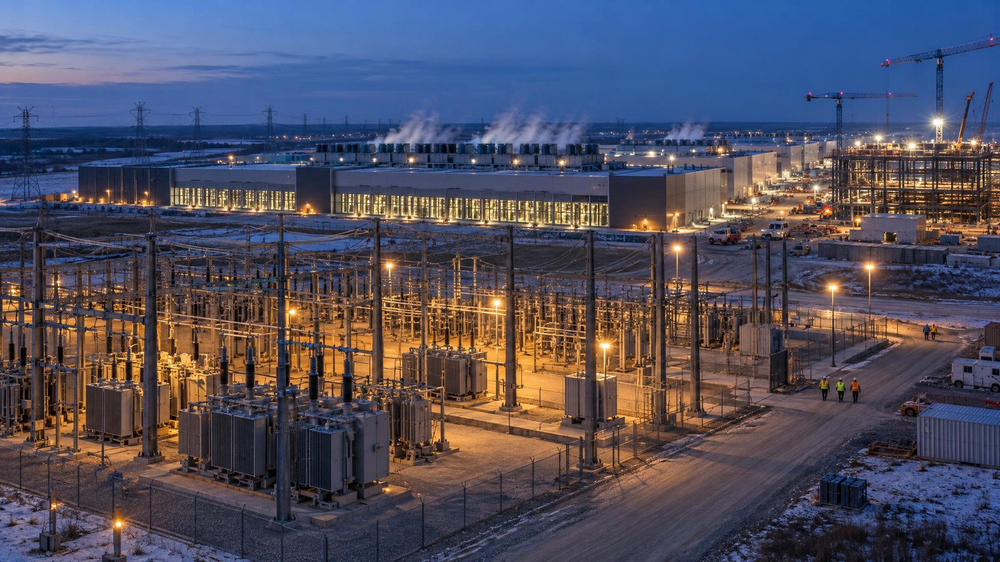

---
authors:
  - aitoboxrobot
categories:
  - 商业动态
date: 2026-10-20
hide:
  - navigation
tags:
  - Meta
  - 超级集群
  - GPU
  - NVIDIA
  - AI算力
title: "Meta 披露 Prometheus 超级集群技术细节：迈向百万张 GPU 规模"
---

# Meta 披露 Prometheus 超级集群技术细节：迈向百万张 GPU 规模

> # Meta Details Prometheus Supercluster Scaling Toward 1 Million GPUs

### 文章背景与核心概要

随着前沿大语言模型与多模态智能体参数规模的指数级爆炸，底层 AI 基础设施正迎来前所未有的工程挑战。Meta 首次对外披露了其位于美国俄亥俄州新奥尔巴尼的千兆瓦 (Gigawatt, GW) 级巨型 AI 超级集群 —— Prometheus (普罗米修斯) 的深度技术架构。该集群第一阶段不仅成功支撑了 Meta 新一代前沿基座模型 Muse 家族的预训练与强化学习，更将终极演进目标锚定在惊人的“百万张 GPU”互联规模。通过深度整合 NVIDIA 最新 Blackwell NVL72 机架架构、自研非调度以太网后端 Fabric，以及创新的动态配电削峰与先进液冷技术，Meta 为超大规模分布式 AI 计算提供了极具前瞻性的工业级工程范本。

---

## 执行摘要

> ## Executive Summary

Meta 工程团队全面公布了其位于美国俄亥俄州新奥尔巴尼 (New Albany, Ohio) 的千兆瓦级 AI 超级集群 —— **Prometheus** 的深度技术细节。目前已竣工的项目一期工程成功承担了 Meta 核心基座大模型 **Muse** 家族 (包含前沿旗舰模型 *Muse Wonder*) 的训练任务，并在计算性能和运行稳定性上交出了亮眼答卷。Meta 目前正通过阶段性扩建持续推进该基础设施建设，其终极目标是互联约 **100 万张 GPU**，深度整合了 NVIDIA 先进 GPU 架构、自研专有网络 Fabric，以及前沿的大规模供电与散热创新方案。

> Meta's engineering team released a comprehensive technical breakdown of **Prometheus**, a gigawatt-scale AI supercluster located in New Albany, Ohio. The completed first phase of the project successfully trained Meta's foundational **Muse** model family (including the *Muse Wonder* frontier models), achieving high performance and reliability metrics. Meta is currently scaling the infrastructure through phased developments with an ultimate target of roughly **1 million GPUs**, incorporating advanced NVIDIA GPU architectures, proprietary networking fabrics, and large-scale power and cooling innovations.

---

## Prometheus 超级集群全景概览

> ## Overview of the Prometheus Supercluster

这座位于新奥尔巴尼的计算中心最初只是一座承载传统互联网业务流量的通用数据中心，Meta 对其进行了彻底重构，使其完全具备支撑前沿大模型训练的极限性能。通过分阶段建设，如今的 Prometheus 成功将数十万张 GPU 汇聚分布在传统机房、AI 专属优化结构以及快速部署模块化设施中，让庞大的物理硬件如同一台超大型统一计算机般高效协同运转。

> Originally a conventional web-traffic data center, Meta overhauled the New Albany facility to handle frontier-model training. Completed in phases, Prometheus now integrates hundreds of thousands of GPUs across traditional data centers, AI-optimized structures, and rapid-deployment facilities to function as a singular, unified machine.

Prometheus 的第一期工程成功训练了 Muse 基座模型家族，在个人辅助与专业 AI 智能体 (AI Agent) 任务上均展现出顶尖性能。在预训练和强化学习运行过程中，该集群交出了极为优异的工程指标：

> The first phase of Prometheus successfully trained the Muse foundational models, delivering state-of-the-art performance for personal and professional agentic tasks. During pre-training and reinforcement learning runs, the cluster achieved:

* 在 Muse Wonder 预训练任务中，实现了 **>85% 的有效算力吞吐率 (Goodput)**；
* 在强化学习 (Reinforcement Learning) 训练流程中，实现了 **>90% 的有效算力吞吐率**；
* 平均中断间隔时间 (Mean Time Between Interruptions, MTBI) 达到 **约 4.7 万 GPU 小时**，随后通过全集群工程调优更是突破了 **5.4 万 GPU 小时**。

> * **>85% goodput** on Muse Wonder pre-training.
> * **>90% goodput** on reinforcement learning runs.
> * A mean time between interruptions (MTBI) of **~47k GPU hours**, which fleet-wide optimizations later boosted beyond **54k GPU hours**.

---

## 两款已投入生产的 NVIDIA 硬件平台

> ## Two NVIDIA Platforms in Production

Prometheus 深度集成了多种基于 **NVL72 机架架构** 的 NVIDIA GPU 平台，在该架构下一个网络 Fabric 内的 72 张 GPU 可以视作单台巨型加速器协同运行。此外，基于下一代 **NVIDIA Vera Rubin NVL72** 的全新平台也已进入规划蓝图。

> Prometheus integrates multiple NVIDIA GPU platforms leveraging the **NVL72 rack architecture**, where 72 GPUs operate as a single accelerator across one network fabric. An upcoming platform based on the **NVIDIA Vera Rubin NVL72** is also on the horizon.

### 1. Catalina 平台 (NVIDIA GB200 NVL72)

> ### 1. Catalina (NVIDIA GB200 NVL72)

* **硬件配置**：采用 Ariel 双机架变体方案 (每机架 36 张 GPU，通过 NVLink 跨机架互联汇聚为一个包含 72 张 GPU 的统一计算域) 。每张 Blackwell GPU 搭配一颗 Grace CPU 以及两张 ConnectX-7 400G 网卡 (NIC) (保持 1:1 的 CPU 与 GPU 配比，每张 GPU 享有 800G 的 I/O 吞吐带宽) ；
* **功耗与物理设计**：基于 Meta 自研的 Open Rack V3 高功率规范运行，整套双机架系统的功耗约为 **120 kW**；
* **核心规格参数**：
  * 搭载 72 张 Blackwell GPU，配备 **13.4 TB 的 HBM3e** 高带宽内存 (单卡 192 GB) ；
  * 具备 720 PFLOPS 的 FP8 训练峰值算力 (FP4 精度下可达 1,440 PFLOPS) ；
  * 拥有高达 **130 TB/s** 的 NVLink 峰值互联带宽以及 **576 TB/s** 的聚合内存峰值带宽。

> * **Configuration:** Ariel two-rack variant (36 GPUs per rack joined over NVLink into a unified 72-GPU domain). Each Blackwell GPU pairs with a Grace CPU and two ConnectX-7 400G NICs (1:1 CPU-to-GPU ratio, 800G I/O per GPU).
> * **Power & Design:** Operates on Meta’s Open Rack V3 high-power design, drawing roughly **120 kW** across the two-rack pair.
> * **Specifications:** 
>   * 72 Blackwell GPUs with **13.4 TB of HBM3e** (192 GB per GPU).
>   * 720 peak PFLOPS of FP8 training compute (1,440 PFLOPS at FP4).
>   * **130 TB/s** of peak NVLink bandwidth and **576 TB/s** of peak aggregate memory bandwidth.

### 2. Clemente 平台 (NVIDIA GB300 NVL72)

> ### 2. Clemente (NVIDIA GB300 NVL72)

* **硬件配置**：采用 Blackwell Ultra GPU 并将 GPU 与 CPU 的比例调整为 2:1，成功将完整的 72-GPU 域压缩凝聚至单一机架内。配备 ConnectX-8 SuperNIC 超级网卡，为每张 GPU 提供原生 800G 的超高带宽网络接入；
* **功耗与物理设计**：单机架功耗约为 **135 kW**。部署时可根据机房条件灵活采用模块化风冷辅助液冷 (Air-Assisted Liquid Cooling) 或机房级原生直接液冷 (Facility Liquid Cooling) ；
* **核心规格参数**：
  * 搭载 72 张 Blackwell Ultra GPU，配备高达 **20.7 TB 的 HBM3e** 显存 (单卡 288 GB，较前代提升 1.5 倍) ；
  * 提供超过 **1 EFLOPS (1 exaFLOP)** 的 FP4 峰值算力，注意力机制 (Softmax) 加速性能实现翻倍；
  * 相比 GB200 NVL72 平台，官方标称可带来 **5% 至 10% 的综合性能提升**。

> * **Configuration:** Utilizes Blackwell Ultra GPUs with a 2:1 GPU-to-CPU ratio, condensing the full 72-GPU domain into a single rack. Features ConnectX-8 SuperNICs delivering native 800G per GPU.
> * **Power & Design:** Draws about **135 kW** per rack. Deployed using modular Air-Assisted Liquid Cooling or Facility Liquid Cooling.
> * **Specifications:** 
>   * 72 Blackwell Ultra GPUs with **20.7 TB of HBM3e** (288 GB per GPU—a 1.5x increase).
>   * Over **1 exaFLOP** of peak FP4 compute and roughly double the attention (softmax) acceleration.
>   * Delivers a stated **5–10% performance improvement** over the GB200 NVL72.

---

## 楼宇级 Fabric 网络与区域级互联汇聚

> ## Building Fabrics and Regional Aggregation

为了高效支撑 GPU 之间的直接通信，Meta 量身定制并部署了专门的 **以太网后端网络 (Ethernet Back-End network)**，深度适配超大规模预训练的数据并行层次结构：

> To support direct GPU-to-GPU communication, Meta implemented a dedicated **Ethernet Back-End network** tailored to large pre-training data-parallel hierarchies:

* **楼宇级 Fabric 架构**：每个独立的网络 Fabric 可互联高达 **20,736 张 GPU**。Meta 从最初的解耦调度型 Fabric (Disaggregated Scheduled Fabric) 升级为了基于浅缓冲区 (Shallow-buffer) 51.2T 交换机构建的 **非调度型 Fabric (Non-Scheduled Fabric)** (例如支持动态负载均衡的 Minipack3 交换机，以及搭载 Spectrum-4 芯片、支持自适应路由的 Minipack3N 交换机) ；
* **后端汇聚网络 (Backend Aggregation Network)**：采用多层轴辐式 (Hub-and-spoke) 拓扑设计，将跨越 2 公里至 100 多公里物理距离的不同楼宇 Fabric 紧密相连。该网络由搭载 Broadcom Jericho3 芯片的 Arista 7800 系列机箱式交换机强力驱动。整套物理网络设施包含了数百万英里的光纤、数万台交换机，以及数百万套光模块 (覆盖从 2x400G 短距可插拔模块到 800G-ZR 相干光模块的完整矩阵) 。

> * **Building-Level Fabrics:** Each fabric interconnects up to **20,736 GPUs**. Migrating from an initial Disaggregated Scheduled Fabric, Meta upgraded to a **Non-Scheduled Fabric** on shallow-buffer 51.2T switches (such as Minipack3 with Dynamic Load Balancing and Spectrum-4-based Minipack3N with Adaptive Routing).
> * **Backend Aggregation Network:** A multi-layer hub-and-spoke design linking building fabrics across distances ranging from 2 km to over 100 km, powered by Arista 7800-series chassis with Broadcom Jericho3 silicon. The physical plant spans millions of miles of fiber, tens of thousands of switches, and millions of optics (ranging from 2x400G short-reach pluggables to 800G-ZR coherent optics).

---

## 容错能力与系统可靠性工程

> ## Engineering for Fault Tolerance and Reliability

从以往的 H100 NVL8 架构迈向 NVL72，意味着单个纵向扩展 (Scale-up) 的故障域从 8 张 GPU 陡增到了 72 张 GPU。为了应对故障影响面 (Blast radius) 成倍扩大的挑战，Meta 采取了一系列精密工程策略：

> Scaling from the H100 NVL8 architecture to NVL72 expanded the scale-up fault domain from 8 to 72 GPUs. To address this larger blast radius:

* **机架拓扑与热备冗余**：每个 NVL72 计算域实际上运行一个 **64 张 GPU 的活跃切片 (Active slice)**，机架内预留 8 张 GPU 作为即时热备，同时全集群维持约 2% 的全局备用资源池；
* **多层次故障自愈机制**：
  * **感知并行的容错技术 (Parallelism-Aware Fault Tolerance)**：当出现单点异常时，能够迅速隔离出现故障的数据并行副本，集群其余健康节点仅需重试当前计算步即可继续；
  * **分布式异步检查点机制 (Distributed Asynchronous Checkpointing)**：结合增量检查点 (Delta checkpointing) 与内存暂存技术，在故障波及多个副本时能够以极低开销快速恢复模型状态；
* **显著的稳定性飞跃**：在 2025 年中期的峰值时期，每 8,000 张 GPU 每天发生的训练中断事件曾一度接近 1,000 次，而经过一系列软硬件联合优化后，中断率 **大幅下降了 99%**。Meta 的长期“北极星”指标是实现每 8,000 张 GPU 每天仅发生 2 次中断 (即达到约 10 万 GPU 小时的 MTBI) 。

> * **Rack Geometry & Spares:** Each NVL72 domain runs a **64-GPU active slice**, keeping 8 GPUs as in-rack spares alongside a ~2% reserve pool.
> * **Fault Recovery Mechanisms:** 
>   * *Parallelism-Aware Fault Tolerance* isolates faulty data-parallel replicas while the rest of the cluster repeats the step.
>   * *Distributed Asynchronous Checkpointing* with delta checkpointing and in-memory staging restores states when faults exceed a single replica.
> * **Reliability Gains:** Interruptions peaked near 1,000 events per 8K GPUs daily in mid-2025, but engineering refinements reduced this by **99%**. Meta's north star is two interruptions per 8K GPUs daily (~100k GPU hours MTBI).

---

## 电力管理、散热创新与未来蓝图

> ## Power, Cooling, and Future Expansion

* **电网功率动态管理**：大模型同步训练时各节点动作高度一致，会在短短数秒内引发高达 30% 至 40% 的瞬态电力波动 (功率突变往往达到数十兆瓦) 。Meta 研发了 **Dynamo Dimmer** 软件框架，通过平滑渐进式动态调整 GPU 功耗上限，并联动电池备用模块 (BBU) 、超级电容托盘以及与外部电网公司的深度调度协同，成功平抑电网冲击；
* **高密度散热系统**：在专为 AI 打造的定制化数据中心内，将模块化风冷辅助液冷与机房级芯片直接接触式闭环液冷 (Direct-to-chip closed-loop liquid cooling) 进行了深度统一融合；
* **San Miguel 平台与 Hyperion 超级集群**：Meta 即将推出的下一代 **San Miguel** 硬件平台将在单机架内集成 72 张 Vera Rubin GPU (配备 288 GB 的 HBM4 显存、高达 2.52 EFLOPS 的 FP4 峰值算力，以及 216 TB/s 的 NVLink 互联带宽，单机架功耗突破 170 kW) 。与此同时，位于路易斯安那州里奇兰堂区 (Richland Parish, Louisiana) 的全新 **Hyperion** 超级集群正从零开始拔地而起，深度绑定专属电力公用事业合作并全面引入更先进的原生液冷工程设计。

> * **Power Management:** Synchronized training triggers 30–40% power transients (tens of megawatts in seconds). Meta uses the **Dynamo Dimmer** framework to gradually adjust GPU power limits alongside battery backup modules, capacitor trays, and utility coordination.
> * **Cooling Systems:** Integrates modular air-assisted liquid cooling with facility direct-to-chip closed-loop liquid cooling in purpose-built AI facilities.
> * **San Miguel & Hyperion:** Meta's upcoming **San Miguel** platform will feature 72 Vera Rubin GPUs per rack (offering 288 GB of HBM4, 2.52 peak EFLOPS FP4 compute, and 216 TB/s NVLink bandwidth at >170 kW per rack). Meanwhile, the upcoming **Hyperion** supercluster in Richland Parish, Louisiana, is being built from the ground up with dedicated utility partnerships and advanced liquid-cooling designs.
