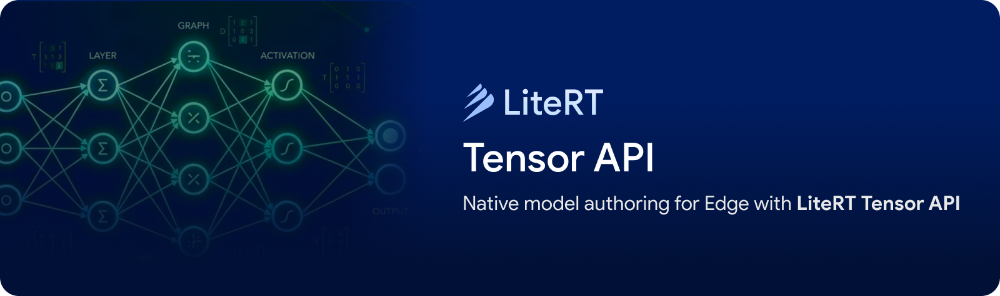
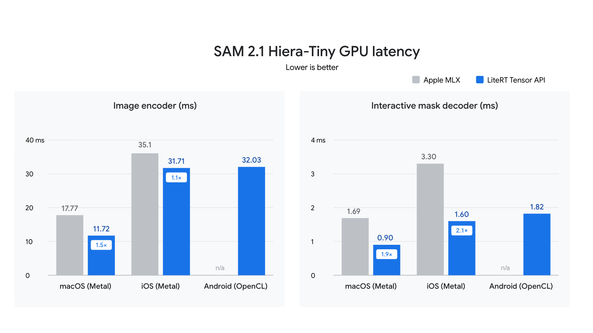
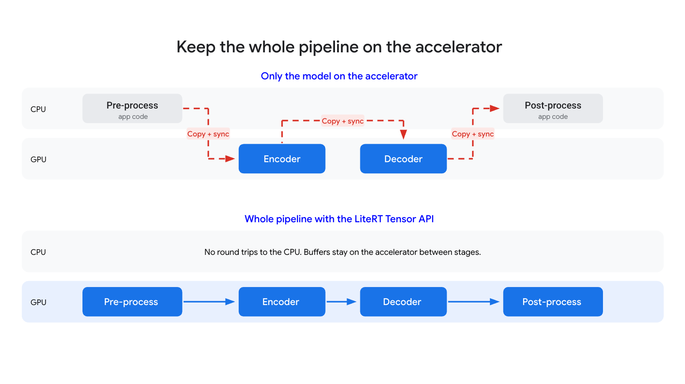

---
authors:
  - aitoboxrobot
categories:
  - 工具教程
date: 2026-10-20
hide:
  - navigation
tags:
  - LiteRT
  - 端侧AI
  - Google
  - C++
  - Tensor API
title: "利用 LiteRT Tensor API 实现端侧原生模型构建"
---

# 利用 LiteRT Tensor API 实现端侧原生模型构建
> # Native Model Authoring for Edge with LiteRT Tensor API

**发布日期：** 2026 年 10 月 19 日  
**作者：** 
* **Ping Yu** (Staff Software Engineer)
* **Quentin Khan** (Sr. Software Engineer)
* **Chintan Parikh** (Sr. Product Manager)
* **Lu Wang** (Sr. Staff Software Engineer)

> **Published:** October 19, 2026  
> **Authors:** 
> * **Ping Yu** (Staff Software Engineer)
> * **Quentin Khan** (Sr. Software Engineer)
> * **Chintan Parikh** (Sr. Product Manager)
> * **Lu Wang** (Sr. Staff Software Engineer)

---

### 文章背景与核心概要
在各类型边缘设备上部署端侧人工智能模型时，往往面临着严苛的延迟 (Latency) 与内存约束。过去，开发者为了追求极致的硬件性能，通常需要针对 Metal、Vulkan 或 OpenCL 等底层图形接口手工编写高度耦合的 C++ 或着色器代码，这给跨平台复用和端到端流水线集成带来了巨大的工程负担。为了打破这一瓶颈，Google 推出了全新的 **LiteRT Tensor API**，为 LiteRT 运行时带来了一套轻量级的原生 C++ 模型构建层。它允许开发者与 AI 编程智能体 (AI Coding Agent) 逐算子搭建计算图、直接读取加载 Hugging Face `.safetensors` 权重，并在 CPU、GPU 与 NPU 之间实现端到端全流程的零拷贝加速。借助该框架，SAM 2（Segment Anything 2）在 WebGPU 上的推理帧率成功提升了三倍以上，为端侧大模型的高性能开发提供了全新的范式。

---

## 执行概要

> ## Executive Summary

在各种各样的边缘设备上部署端侧人工智能 (On-device AI)，开发者必须在严苛的延迟 (Latency) 与内存限制之间寻找微妙的平衡。尽管对于绝大多数项目而言，采用成熟的标准模型转换流程（例如使用 LiteRT Torch）仍是官方推荐的默认途径；但对于那些追求对网络底层架构拥有极致控制权的开发者来说，传统做法往往是针对特定的底层后端（例如 Metal、Vulkan 或 OpenCL）手写定制化的 C++ 或着色器 (Shader) 代码，这导致代码与底层硬件紧密耦合。

> Deploying on-device AI requires balancing strict latency and memory constraints across diverse hardware targets. While standard model conversion (such as using LiteRT Torch) remains the recommended default for most projects, developers seeking low-level control over network architectures traditionally had to write custom C++ or shader code tightly coupled to specific backends (like Metal, Vulkan, or OpenCL). 

为了打破这一困局，Google 正式推出了 **LiteRT Tensor API**——这是一个轻量级的模型构建层，它将原生 C++ 计算图构建的高度灵活性与无缝的跨平台移植性完美融为一体。借助该 API，开发者（以及 AI 编程智能体）可以逐算子 (op-by-op) 自由构建计算图、直接读取加载 `.safetensors` 模型权重文件，并在 CPU、GPU 和 NPU 之间实现高效的零拷贝 (Zero-copy) 缓冲区互操作。

> To bridge this gap, Google has introduced the **LiteRT Tensor API**—a lightweight authoring layer that combines native C++ graph construction flexibility with cross-platform portability. This API enables developers (and AI coding agents) to build computation graphs op-by-op, ingest weights directly from `.safetensors` files, and achieve zero-copy buffer interoperability across CPUs, GPUs, and NPUs.

---



## 引言：底层端侧 AI 的工程挑战

> ## Introduction: The Challenge of Low-Level Edge AI

将端侧 AI 推向实际生产落地，意味着模型必须在每一款目标设备上都能严格满足苛刻的延迟与内存开销预算。在工业级部署中，最常规的做法是将已训练好的模型进行转换——例如使用 [LiteRT Torch](https://github.com/google-ai-edge/litert-torch) 将 PyTorch 模型转化为 LiteRT 格式，再由 [LiteRT 运行时 (LiteRT runtime)](https://developers.google.com/edge/litert/inference) 进行推理加载。对于大多数项目而言，这无疑是最快捷、最可靠的上线途径，也是官方针对多数开发场景的首选推荐。

> Shipping on-device AI means meeting tight latency and memory budgets on every device you target. The most common path for deploying models in production is converting a trained model—for example, converting a PyTorch model with [LiteRT Torch](https://github.com/google-ai-edge/litert-torch)—and running it with the [LiteRT runtime](https://developers.google.com/edge/litert/inference). This offers the quickest and most reliable route to production, and it's the path we recommend for most projects. 

然而在很多进阶场景下，开发者渴望能够全盘掌控神经网络的底层表示与执行优化——无论是为了在第一时间支持前沿的新型网络架构，还是为了尝试全新的算子下沉与图优化逻辑，而不必被动等待上游训练框架的漫长更新。

> Sometimes, though, developers want full control over how a network is represented and optimized to support new architectures or to try a new lowering logic without waiting for upstream framework updates.

为了追求这种极致的控制力，许多工程师选择使用原生 C++ 或着色器语言纯手工编写计算逻辑。[Apple 的 MLX](https://github.com/ml-explore/mlx) 让这种“代码优先”的开发理念在 Apple 芯片生态中风靡一时，而 [llama.cpp](https://github.com/ggml-org/llama.cpp) 则以惊人的表现向业界证明了经过深度裁量的 C++ 实现能将大语言模型 (Large Language Model, LLM) 的推理潜力推向何等高度。然而，这种深度控制往往伴随着沉重的代价：代码实现会高度绑定于具体的底层后端（如 Metal、OpenCL 或 Vulkan），每当适配一款新硬件设备，就不得不从头重写一遍。更棘手的是，跨越 CPU、GPU 和 NPU 协调零拷贝缓冲区以及同步机制，同时将输入预处理、核心模型推理以及后处理逻辑严丝合缝地拼接在一起，需要耗费巨大的手工工程精力。

> For ultimate control, developers write computations manually in native C++ or shader languages. [Apple's MLX](https://github.com/ml-explore/mlx) made this code-first approach popular on Apple silicon, and [llama.cpp](https://github.com/ggml-org/llama.cpp) showed how far tailored C++ implementations can take LLM inference. However, this level of control comes at a significant cost: implementations are tightly coupled to specific backends (such as Metal, OpenCL, or Vulkan) and must be rewritten for each new hardware target. Furthermore, managing zero-copy buffer interoperability and synchronization across CPU, GPU, and NPU, while gluing together pre-processing, inference, and post-processing, demands substantial manual engineering effort.

为了从根本上化解上述难题，Google 团队正式发布了全新的 [LiteRT Tensor API](https://github.com/google-ai-edge/LiteRT/blob/main/tensor/README.md)。它是 LiteRT 技术栈中一个轻量级的原生构建层，专为大幅简化与优化手工构建模型而设计。它既具备原生编程的无拘无束，又兼顾了真正开箱即用的跨平台能力。开发者可以直接使用 C++ 逐个算子搭建计算图，完全自主决定运行哪些计算节点以及它们之间如何相互连接。

> To solve the above challenges, we are excited to announce the release of the novel [LiteRT Tensor API](https://github.com/google-ai-edge/LiteRT/blob/main/tensor/README.md), a lightweight authoring layer in the LiteRT stack, designed to improve handcrafting models. It combines the flexibility of native authoring with cross-platform portability. You build the computation graph op by op in C++, choosing exactly which ops run and how they connect. 

同一套计算图不仅能够借助 LiteRT 运行时无缝运行在 CPU、GPU（由开源项目 [ML Drift](http://github.com/google-ai-edge/ml-drift) 强力驱动）以及 NPU 之上，甚至能够在无需额外模型文件和完整运行时的情况下，通过 XNNPACK 直接在 CPU 上裸跑，彻底免去了为不同硬件反复重写代码的苦恼。此外，模型推理本身与前处理、后处理逻辑均可通过相同的 API 进行组装，并依托共享的硬件加速缓冲区紧密串联，数据完全无需在 CPU 和硬件加速器之间来回搬运拷贝。对于普通模型，标准转换路径依然是首选默认项；但当你需要对计算图进行底层细粒度调优，或者希望整个推理流水线完全端到端常驻硬件加速器时，Tensor API 则是无可替代的利器。

> The same graph can run through LiteRT on CPU, GPU (powered by open-source [ML Drift](http://github.com/google-ai-edge/ml-drift)) and NPU, or without model file or runtime directly on CPU through XNNPACK, so you don't rewrite it for each new hardware target. Model inference and pre/post-processing can be assembled with the same API and chained through shared accelerator buffers, so that data never round-trips through the CPU. Start with the conversion path, which remains the best default for most models. Reach for the Tensor API when you need low-level control over the graph or want the whole pipeline to run end to end on the accelerator.

不仅如此，LiteRT Tensor API 还是 **AI 编程智能体的理想代码基座**，它提供了清晰结构化的基础原语，便于智能体自动生成、重连和调优模型计算图。在接下来的内容中，我们将深入解析其架构设计，并通过具体的实战代码示例演示如何从零构建高性能模型。

> The LiteRT Tensor API also serves as an **ideal programmatic foundation for AI coding agents**, providing structured primitives to generate, rewire, and tune model graphs automatically. In the rest of this post, we’ll dive into the design and walk through practical code examples showing how to author models from scratch.

---

## 实战范例：基于 Web 端的 Segment Anything

> ## Real-World Showcase: Segment Anything on Web

<video autoplay="" loop="" muted="" playsinline="" poster="https://storage.googleapis.com/gweb-developer-goog-blog-assets/original_videos/wagtailvideo-67risga1_thumb.jpg">
<source src="https://storage.googleapis.com/gweb-developer-goog-blog-assets/original_videos/tensor_api_web_1080p_ambient.mp4" type="video/mp4"/>
<p>Sorry, your browser doesn't support playback for this video</p>
</video>

为了直观展示 Tensor API 在实际工业场景中的威力，开发团队打造了一款交互式 [Segment Anything 应用](https://storage.googleapis.com/litertjs_demos/sam2_web/index.html)，该应用借助 WebGPU 完全在浏览器端本地实时运行。应用基于 Meta 的 [Segment Anything Model 2 (SAM 2)](https://github.com/facebookresearch/sam2) 实现了高流畅度的多目标实时图像分割与视频追踪，支持用户通过简单的鼠标点击或由 [Gemma 4 E2B](https://huggingface.co/litert-community/gemma-4-E2B-it-litert-lm) 驱动的自然语言提示词 (Prompt) 进行交互触发。

> To show the Tensor API in practice, we built an interactive [Segment Anything App](https://storage.googleapis.com/litertjs_demos/sam2_web/index.html), running entirely on-device in the browser on WebGPU. The app enables real-time multi-object segmentation and tracking via Meta's [Segment Anything Model 2 (SAM 2)](https://github.com/facebookresearch/sam2), triggered either by simple clicks or natural language prompts powered by [Gemma 4 E2B](https://huggingface.co/litert-community/gemma-4-E2B-it-litert-lm).

其中的 SAM 2 模型完全是通过 LiteRT Tensor API 用纯 C++ 代码构建而成的。在开发过程中，AI 编程智能体对其进行编写并持续迭代优化，在 WebGPU 上将 512x512 分辨率下的运行帧率从不足 10 FPS 飙升至超过 30 FPS。目前，该项目完整的实现代码和 Web 应用均已在 GitHub 的 [LiteRT Samples](https://github.com/google-ai-edge/litert-samples/tree/main/models/sam2/sam2_hiera_tiny_video) 仓库中全面开源。

> The SAM 2 model is fully authored in C++ via the LiteRT Tensor API. A coding agent wrote and evolved it from under 10 to over 30 frames per second at 512x512 on WebGPU. See that the complete implementation and the web app are open source in the [LiteRT Samples](https://github.com/google-ai-edge/litert-samples/tree/main/models/sam2/sam2_hiera_tiny_video) GitHub repo.

---

## 什么是 LiteRT Tensor API？

> ## What is the LiteRT Tensor API?

LiteRT Tensor API 提供了四大核心特性，专注于端侧模型的原生构建与极致优化：

> The LiteRT Tensor API provides four key features for authoring and optimizing on-device models:

* **对计算图结构的全面控制**：你可以全权决定模型图中的每一个算子以及各算子之间的每一条连接通路，从基础的逐元素数学运算，到专为硬件加速器量身定制的大语言模型复合算子（例如缩放点积注意力机制、RMSNorm 归一化以及 KV 缓存更新等）。
* **直接加载模型权重**：能够直接从模型检查点（如 Hugging Face 的 [.safetensors](https://github.com/huggingface/safetensors) 文件）读取权重参数，中间无需经历任何转换脚本或预处理环节。
* **以张量为核心的缓冲区互操作**：输入前处理、模型内部子网络切分以及后处理各环节之间，直接通过共享的硬件加速器缓冲区传递张量，使所有中间数据始终驻留在加速硬件上，实现真正的零数据拷贝。
* **专为 AI 智能体设计的构建基石**：模型本质上是由清晰规范的基础算子构成的纯 C++ 代码，因此编程智能体能够轻而易举地自动组装模型、对照基准测试验证输出结果，并通过在各种物理设备上进行基准跑分来迭代调优性能。

> * **Full control over graph structure**: you decide every op in the model graph and every connection between them, from elementwise math to accelerator-optimized LLM composite ops, such as scaled dot-product attention, RMSNorm, and KV-cache updates.
> * **Direct weight ingestion**: load weights straight from model checkpoints, such as Hugging Face [.safetensors](https://github.com/huggingface/safetensors) files, without conversion scripts needed in between.
> * **Tensor-centric buffer interop**: pre-processing, model partitions, and post-processing pass tensors to each other through shared accelerator buffers, so intermediate data stays on the accelerator with zero copies.
> * **Building blocks for AI agents**: models are plain C++ built from well-defined ops, so coding agents can construct a model, check its results against a reference, and tune its performance by benchmarking variants on each device.

---

## 跨平台性能表现

> ## Cross-Platform Performance

研究团队将同一套用 C++ 编写的 SAM 2 模型代码分别部署在三款不同设备的 GPU 上进行了运行测试：配备 Metal 的 macOS 笔记本电脑、运行 Metal 的 iOS 手机，以及采用 OpenCL 的 Android 手机。在 MacBook Pro 上的实测结果表明，其运行速度相比 Apple 原生框架 MLX 快了大约 1.5 倍（采用 fp16 精度，包含图像编码器与掩码解码器）。SAM 2.1 [示例代码库](https://github.com/google-ai-edge/litert-samples/blob/main/models/sam2/sam2_hiera_tiny_video/tensor_api/sam2_image/README.md) 中提供了完整的基准测试命令，供开发者自行复现该对比结果。

> We ran the same C++ code for the SAM 2 model on the GPUs of three devices: a macOS laptop (Metal), an iOS phone (Metal), and an Android phone (OpenCL). In our tests on the MacBook Pro, it ran about 1.5x faster than Apple MLX (fp16, image encoder plus mask decoder). The SAM 2.1 [sample](https://github.com/google-ai-edge/litert-samples/blob/main/models/sam2/sam2_hiera_tiny_video/tensor_api/sam2_image/README.md) includes the benchmark commands so you can reproduce the results.



*注：耗时数据涵盖图像编码器和掩码解码器；输入预处理与后处理总计仅增加约 0.34 毫秒。生成的预测掩码与 Meta 官方的 PyTorch 黄金标准在像素级完全一致。*

> *Note: Times cover the image encoder and mask decoder; pre- and post-processing add ~0.34 ms. Output masks match Meta's PyTorch reference pixel for pixel.*

---

## 开始使用 Tensor API

> ## Get Started with Tensor API

### 用原生 C++ 构建模型

> ### Authoring Models in Native C++

在 Tensor API 中，神经网络的每一个层都被表达为一个接收并返回 [Tensor](https://github.com/google-ai-edge/LiteRT/blob/6f622b5ddd51429c564f5ac2b22a7861bedbd147/tensor/tensor.h#L159) 对象的标准 C++ 函数，由高层算子以及直接从检查点加载的权重共同组装而成。例如，以下是一个经典的多头自注意力 (Multi-Head Self-Attention) 层的代码实现：

> With the Tensor API, each layer is a C++ function over [Tensor](https://github.com/google-ai-edge/LiteRT/blob/6f622b5ddd51429c564f5ac2b22a7861bedbd147/tensor/tensor.h#L159) values, built from high-level operators and weights loaded directly from the checkpoint. For example, here is a multi-head self-attention layer:

```c
// Multi-head self-attention over x: [batch, tokens, dim].
Tensor Attention(const Tensor& x, const WeightMap& w, int heads) {
  std::vector<int> s = x.GetShape();
  int b = s[0], n = s[1], dim = s[2], d = dim / heads;
  Tensor q = FullyConnected(x, w.at("q_proj.weight"), w.at("q_proj.bias"));
  Tensor k = FullyConnected(x, w.at("k_proj.weight"), w.at("k_proj.bias"));
  Tensor v = FullyConnected(x, w.at("v_proj.weight"), w.at("v_proj.bias"));
  // Split heads: [b, n, dim] -> [b, heads, n, d].
  q = Transpose(Reshape(q, {b, n, heads, d}), {0, 2, 1, 3});
  k = Transpose(Reshape(k, {b, n, heads, d}), {0, 2, 1, 3});
  v = Transpose(Reshape(v, {b, n, heads, d}), {0, 2, 1, 3});
  // softmax(q * k^T / sqrt(d)) * v, for all heads at once.
  Tensor scores = BatchMatMul(q, k, /*adj_x=*/false, /*adj_y=*/true);
  Tensor attn = Softmax(Mul(scores, 1.0f / std::sqrt(static_cast<float>(d))));
  Tensor out = BatchMatMul(attn, v);
  // Merge heads: [b, heads, n, d] -> [b, n, dim], then project.
  out = Reshape(Transpose(out, {0, 2, 1, 3}), {b, n, dim});
  return FullyConnected(out, w.at("out_proj.weight"), w.at("out_proj.bias"));
}
```

在 SAM 2 示例项目中，[BuildEncoder](https://github.com/google-ai-edge/litert-samples/blob/fe65fa5512b273bcd62936afd18b924af7d5ae2c/models/sam2/sam2_hiera_tiny_video/tensor_api/sam2_image/sam2_graph.cc#L765-L833) 与 [BuildDecoder](https://github.com/google-ai-edge/litert-samples/blob/fe65fa5512b273bcd62936afd18b924af7d5ae2c/models/sam2/sam2_hiera_tiny_video/tensor_api/sam2_image/sam2_graph.cc#L835-L1006) 正是通过类似方式将各类基础层模块组合成编码器与解码器计算图，随后 [ModelFactory](https://github.com/google-ai-edge/LiteRT/blob/6f622b5ddd51429c564f5ac2b22a7861bedbd147/tensor/backends/tflite/tflite_flatbuffer_conversion.h#L47) 会将二者导出为单个 `sam2_image.tflite` 文件中的两个独立签名函数 (Signatures)。

> In the SAM 2 sample, [BuildEncoder](https://github.com/google-ai-edge/litert-samples/blob/fe65fa5512b273bcd62936afd18b924af7d5ae2c/models/sam2/sam2_hiera_tiny_video/tensor_api/sam2_image/sam2_graph.cc#L765-L833) and [BuildDecoder](https://github.com/google-ai-edge/litert-samples/blob/fe65fa5512b273bcd62936afd18b924af7d5ae2c/models/sam2/sam2_hiera_tiny_video/tensor_api/sam2_image/sam2_graph.cc#L835-L1006) compose layers like this into the encoder and decoder graphs, and [ModelFactory](https://github.com/google-ai-edge/LiteRT/blob/6f622b5ddd51429c564f5ac2b22a7861bedbd147/tensor/backends/tflite/tflite_flatbuffer_conversion.h#L47) exports both as two signatures of one `sam2_image.tflite` file.

导出为 `.tflite` 文件只是运行计算图的两种方式之一。计算后端通过 `Tensor` 的模板参数进行声明：使用 `TfLiteMixinTag` 可以导出一个 `.tflite` 模型文件，供 LiteRT 在 CPU、[ML Drift](https://developers.googleblog.com/ml-drift-next-gen-gpu-aiml-inference-at-the-edge/) (GPU) 或 NPU 上驱动执行；而指定 `XnnpackMixinTag` 则可以在无需任何模型文件的前提下，通过 XNNPACK 直接在 CPU 上运行相同的代码。你甚至可以同时为张量打上这两种标签，以便兼得两种运行方案：

> A `.tflite` file is one of two ways to run your graph. The backend is a template argument on `Tensor`: `TfLiteMixinTag` exports a `.tflite` that LiteRT runs on CPU, [ML Drift](https://developers.googleblog.com/ml-drift-next-gen-gpu-aiml-inference-at-the-edge/) (GPU), or NPU, and `XnnpackMixinTag` runs the same code directly on CPU through XNNPACK, with no model file. Tag tensors with both to keep both options:

```c
// Tag tensors for both backends; ops record one graph either can run.
using T = Tensor<TfLiteMixinTag, XnnpackMixinTag>;
T y = Attention(x, w, /*heads=*/8);  // The layer above, over T values.
// Export a .tflite and run it with LiteRT on CPU, GPU, or NPU.
Save({y}, "attention.tflite");
// Or run the same graph directly on the CPU with XNNPACK.
auto runner = XnnpackRunner::Create({y});
runner->Run();
```

SAM 2 项目选择了 `.tflite` 路径，从而顺利接入 WebGPU 并在浏览器环境中运行。而 [Gemma 4 示例](https://github.com/google-ai-edge/LiteRT/tree/main/tensor/examples/gemma4) 则采用了直接执行路径，在 CPU 上完成预填充 (Prefill) 与解码 (Decode) 计算，这也是运行 Tensor API 代码最为轻量化的途径。[Tensor API README](https://github.com/google-ai-edge/LiteRT/blob/main/tensor/README.md) 对这两种方案的操作细节都做了详尽梳理。

> SAM 2 takes the `.tflite` path to reach WebGPU in the browser. The [Gemma 4 example](https://github.com/google-ai-edge/LiteRT/tree/main/tensor/examples/gemma4) takes the direct path for prefill and decode on CPU, the lightest way to run Tensor API code. The [Tensor API README](https://github.com/google-ai-edge/LiteRT/blob/main/tensor/README.md) walks through both.

一种非常顺畅的工程工作流是同时结合这两者：在前期开发与调优阶段，使用 XNNPACK 直连路径进行极速迭代，直接从 `.safetensors` 检查点加载权重，省去了反复重新打包模型文件的繁琐步骤；当模型定型准备发布时，再将其导出为 `.tflite` 格式，借助移动端 LiteRT 或网页端的 LiteRT.js 快速完成生产部署。

> A natural workflow uses both: iterate on the direct XNNPACK path, loading weights straight from the `.safetensors` checkpoint with no model file to rebuild, then export a `.tflite` when you're ready to ship with LiteRT on mobile or on the web through LiteRT.js.

---

## 完整表达机器学习计算图

> ## Expressing the Full ML Computation Graph

一个真正的落地应用程序所涵盖的远不止神经网络模型本身。在本次演示中，将摄像头捕捉到的一帧画面以及用户的点击转化为最终的分割掩码，共分为四个步骤：

> A real app needs more than the neural network itself. In the demo, turning a camera frame and a click into a mask takes four steps: 

1. **输入预处理**：将原始摄像头画面转换为模型期望的 512x512 尺寸图像。
2. **图像编码器**：将处理后的图像转化为深层特征表示。
3. **掩码解码器**：将这些特征与用户的点击坐标信息融为一体，预测生成目标掩码。
4. **输出后处理**：将预测得到的掩码等比缩放回摄像头的原始画面尺寸。

> 1. **Pre-processing** converts the frame into the 512x512 image the model expects.
> 2. **Image Encoder** turns that image into features.
> 3. **Mask Decoder** combines those features with the click to predict a mask.
> 4. **Post-processing** scales the mask back to the frame's size. 

要想让这套完整的流水线以极高的帧率流畅运行，关键在于两点：一是确保各个步骤之间的中间数据全程驻留在硬件加速器（如 GPU）上，二是精准控制每个步骤在特定加速硬件上的执行策略。

> Running this whole pipeline fast takes two things: keeping data on the accelerator (such as the GPU) between steps, and controlling how each step runs on each accelerator.

### 零拷贝：让整个流水线全程常驻加速器

> ### Zero Copies: Keep the Whole Pipeline on the Accelerator

在传统的常见应用架构中，往往只有核心模型放在 GPU 上运行；CPU 负责调整每帧摄像头图像的大小、将编码器的输出传递给解码器，并对生成的掩码进行后处理。这种来回往复的数据搬运不仅会产生大量的拷贝开销，还会造成 GPU 频繁处于等待闲置状态。

> In a typical app, only the model runs on the GPU; the CPU resizes each camera frame, passes the encoder's output to the decoder, and post-processes the mask. Each trip copies data and stalls the GPU.



而在 [litert-samples/sam2](https://github.com/google-ai-edge/litert-samples/tree/main/models/sam2/sam2_hiera_tiny_video/tensor_api) 中，全部四个环节都被构建为由 Tensor API 表达并运行在 GPU 上的计算图。例如，预处理过程就是一个通过 [CreateLambdaRunner](https://github.com/google-ai-edge/LiteRT/blob/6f622b5ddd51429c564f5ac2b22a7861bedbd147/tensor/runners/litert/lambda_model_runner.h#L143) 构建的微型计算图。所有计算图在程序启动时仅需绑定连接一次以共享底层缓冲区，随后便可高效处理每一帧图像与用户交互点击：

> In [litert-samples/sam2](https://github.com/google-ai-edge/litert-samples/tree/main/models/sam2/sam2_hiera_tiny_video/tensor_api), all four steps are Tensor API graphs on the GPU. Pre-processing, for example, is a small graph built with [CreateLambdaRunner](https://github.com/google-ai-edge/LiteRT/blob/6f622b5ddd51429c564f5ac2b22a7861bedbd147/tensor/runners/litert/lambda_model_runner.h#L143). The graphs are connected once at startup to share buffers, then run for each frame and click:

```c
// Pre-processing is authored with the same Tensor API ops as the model:
// RGBA camera frame [1, H, W, 4] -> normalized pixels [1, 512, 512, 3].
auto pre_runner = CreateLambdaRunner(
    env, options,
    {{"frame", Tensor({.type = Type::kU8, .shape = {1, H, W, 4}})}},
    [=](const TensorsMap& inputs) {
      Tensor rgb = Slice(inputs.at("frame"), {0, 0, 0, 0}, {1, H, W, 3});
      Tensor resized = ResizeBilinear(Cast(rgb, Type::kFP32), {512, 512});
      return TensorsMap{{"pixels", Add(Mul(resized, scale), bias)}};
    });
auto model = LitertDynamicRunner::Create(env, "sam2_image.tflite", options);
// Connect once: neighboring steps share buffers, so nothing is copied.
pre_runner.SetOutput("pixels", model.GetInput("encode_image", "pixels"));
for (auto name : {"image_embeddings", "feat_s1", "feat_s0"}) {
  model.SetInput("decode_mask", name, model.GetOutput("encode_image", name));
}
post_runner.SetInput("masks", model.GetOutput("decode_mask", "masks"));
```

在各个流水线步骤之间，数据绝无任何向 CPU 回流的开销：图像编码器的全部 522 个算子与解码器的 269 个算子均完全在 GPU 上闭环执行，输入预处理与后处理总计仅为每帧画面增添了约 0.34 毫秒的微小耗时。

> No data returns to the CPU between steps: all 522 encoder and 269 decoder operations run on the GPU, and pre- and post-processing add only about 0.34 ms per frame.

---

## 极致掌控：针对各硬件后端进行计算图深度调优

> ## Full Control: Tune the Graph for Each Backend

正因为整个计算图都是纯正的 C++ 代码，你或者你的 AI 编程智能体可以轻松针对不同的硬件后端对其进行重构与调优。Google 的智能体 [Antigravity](https://antigravity.google/) 便成功将 SAM 2 针对每帧画面的逻辑决策（例如目标对象当前是否依然可见），从原本的 CPU 代码直接下沉移植到了计算图中。在 WebGPU 环境下，类似于 `score > 0` 这种逻辑比较运算往往会因为输出布尔值 (True/False) 而回退到 CPU 执行，于是该智能体巧妙地在 [StepPos](https://github.com/google-ai-edge/litert-samples/blob/fe65fa5512b273bcd62936afd18b924af7d5ae2c/models/sam2/sam2_hiera_tiny_video/tensor_api/sam2_video/sam2v_graph.cc#L191-L198) 中将其重写为了纯算术运算：

> Because the graph is plain C++, you or your coding agent can rewrite it for each backend. Our agent, [Antigravity](https://antigravity.google/), moved SAM 2's per-frame decisions, such as whether the object is still visible, from CPU code into the graph. Comparisons like `score > 0` would still fall back to the CPU on WebGPU because they output true/false values, so the agent rewrote them as arithmetic in [StepPos](https://github.com/google-ai-edge/litert-samples/blob/fe65fa5512b273bcd62936afd18b924af7d5ae2c/models/sam2/sam2_hiera_tiny_video/tensor_api/sam2_video/sam2v_graph.cc#L191-L198):

```c
// Simplified from StepPos and BuildStep in sam2v_graph.cc.
// Before: Greater outputs true/false values, which fall back to the CPU.
// Tensor visible = Cast(Greater(score, zero), Type::kFP32);
// After: GPU-friendly ops; 0 for score <= 0, 1 for score >= 1e-4.
Tensor visible = Sub(1.0f, Relu(Sub(1.0f, Mul(Relu(score), 1e4f))));
// Keep the mask if the object is visible; otherwise, blank it out.
Tensor mask = Add(Mul(best_mask, visible), Mul(Sub(1.0f, visible), -1024.0f));
```

现在，针对每个目标的跟踪在每帧画面中仅需一次 GPU 调用即可完成。智能体实施了一系列类似的深度优化——例如将注意力缩放系数直接折叠融合到模型权重中——并且在采纳每项改动前都会对照 Hugging Face 的 SAM 2 黄金参考进行严密的精度校验。正是凭借这一套工程手段，团队成功将模型的推理帧率提升了三倍以上。

> Each object now takes a single GPU call per frame. The agent made a series of changes like this—such as folding the attention scale into the weights—and checked each against Hugging Face's SAM 2 before keeping it. That's how we more than tripled the model's frame rate.

---

## 未来展望

> ## What's Next

团队目前正紧锣密鼓地开发直连 [ML Drift](https://developers.googleblog.com/ml-drift-next-gen-gpu-aiml-inference-at-the-edge/) (GPU) 的底层后端、对 NPU 更加友好的专属算子以及全图自动化量化支持。此外，团队还在积极引入 Python 构建接口与 `.tflite` 导出功能，并针对多变图像分辨率、批处理大小 (Batch size) 以及序列长度提供更全面的动态形状 (Dynamic-shape) 支持。

> We're working on direct [ML Drift](https://developers.googleblog.com/ml-drift-next-gen-gpu-aiml-inference-at-the-edge/) (GPU) backends, NPU-friendly operations, and automatic full-graph quantization. We're also adding Python authoring with `.tflite` export, plus wider dynamic-shape support for varying image sizes, batch sizes, and sequence lengths.

### 探索资源与上手指南

> ### Explore Resources & Get Started

* **正在使用 AI 编程智能体？** 可以直接引导它阅读 [Tensor API README](https://github.com/google-ai-edge/LiteRT/blob/main/tensor/README.md) 以及 [SAM 2 示例项目](https://github.com/google-ai-edge/litert-samples/tree/main/models/sam2/sam2_hiera_tiny_video/tensor_api)；这两份材料完整涵盖了 API 用法及可编译运行的端到端范例。
* **官方技术文档**：[LiteRT Tensor API 指南](https://github.com/google-ai-edge/LiteRT/blob/main/tensor/README.md)（包含快速上手、构建指引与丰富示例）以及 [Tensor API 参考手册](https://github.com/google-ai-edge/LiteRT/blob/main/tensor/tensor_api.md)。
* **参考实现**：[基于 LiteRT Tensor API 的 C++ 原生 SAM 2 实现](https://github.com/google-ai-edge/litert-samples/tree/main/models/sam2/sam2_hiera_tiny_video/tensor_api)、[在线网页体验 Demo](https://storage.googleapis.com/litertjs_demos/sam2_web/index.html) 以及 [Web 演示应用源码](https://github.com/google-ai-edge/litert-samples/tree/main/models/sam2/sam2_hiera_tiny_video/web_demo)。
* **大语言模型范例**：直接在 CPU 上由 XNNPACK 驱动的 [Gemma 4](https://github.com/google-ai-edge/LiteRT/tree/main/tensor/examples/gemma4)，以及通过 LiteRT 驱动于 CPU 和 GPU 上的 [Gemma 3](https://github.com/google-ai-edge/LiteRT/tree/main/tensor/examples/gemma3)，两者均完全通过 Tensor API 进行构建。
* **模型定义文件**：[sam2_graph.cc - Hiera 编码器与掩码解码器计算图定义](https://github.com/google-ai-edge/litert-samples/blob/main/models/sam2/sam2_hiera_tiny_video/tensor_api/sam2_image/sam2_graph.cc)。

> * **Using a coding agent?** Point it to the [Tensor API README](https://github.com/google-ai-edge/LiteRT/blob/main/tensor/README.md) and the [SAM 2 sample](https://github.com/google-ai-edge/litert-samples/tree/main/models/sam2/sam2_hiera_tiny_video/tensor_api); together they cover the API and a buildable end-to-end example.
> * **Documentation**: [LiteRT Tensor API guide](https://github.com/google-ai-edge/LiteRT/blob/main/tensor/README.md) (getting started, build instructions and examples) and [Tensor API reference](https://github.com/google-ai-edge/LiteRT/blob/main/tensor/tensor_api.md).
> * **Reference Implementation**: [SAM 2 authored in C++ on the LiteRT Tensor API](https://github.com/google-ai-edge/litert-samples/tree/main/models/sam2/sam2_hiera_tiny_video/tensor_api), [Live Web Demo](https://storage.googleapis.com/litertjs_demos/sam2_web/index.html), and [Web App Source](https://github.com/google-ai-edge/litert-samples/tree/main/models/sam2/sam2_hiera_tiny_video/web_demo).
> * **LLM Examples**: [Gemma 4](https://github.com/google-ai-edge/LiteRT/tree/main/tensor/examples/gemma4) running directly on XNNPACK (CPU) and [Gemma 3](https://github.com/google-ai-edge/LiteRT/tree/main/tensor/examples/gemma3) running through LiteRT (CPU and GPU), both authored with the Tensor API.
> * **Model Definition**: [sam2_graph.cc - the Hiera encoder and mask decoder graphs](https://github.com/google-ai-edge/litert-samples/blob/main/models/sam2/sam2_hiera_tiny_video/tensor_api/sam2_image/sam2_graph.cc).

---

## 致谢

> ## Acknowledgements

*[LiteRT Tensor API 及其参考实现是 Google AI Edge 与 LiteRT 团队跨组通力协作的心血结晶。特别鸣谢 Byungchul Kim、Changming Sun、Chenchen Tang、Dillon Sharlet、Jingjiang Li、Lu Wang、Lutz Justen、Matthias Grundmann、Misha Gutman、Ronald Wotzlaw 以及 Sachin Kotwani。]*

> *[The LiteRT Tensor API and its reference implementations are the result of a collaborative effort across the Google AI Edge and LiteRT teams. Special thanks to Byungchul Kim, Changming Sun, Chenchen Tang, Dillon Sharlet, Jingjiang Li, Lu Wang, Lutz Justen, Matthias Grundmann, Misha Gutman, Ronald Wotzlaw, and Sachin Kotwani.]*
