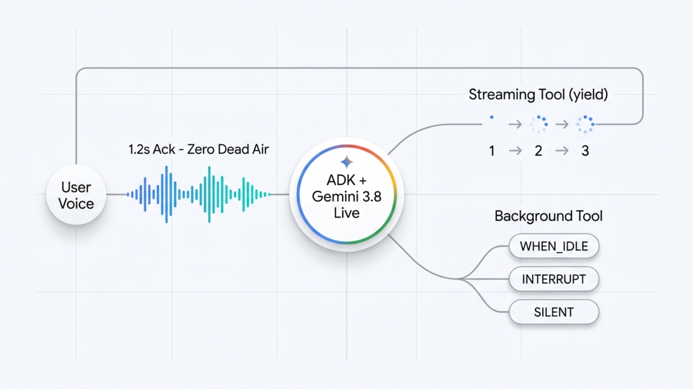
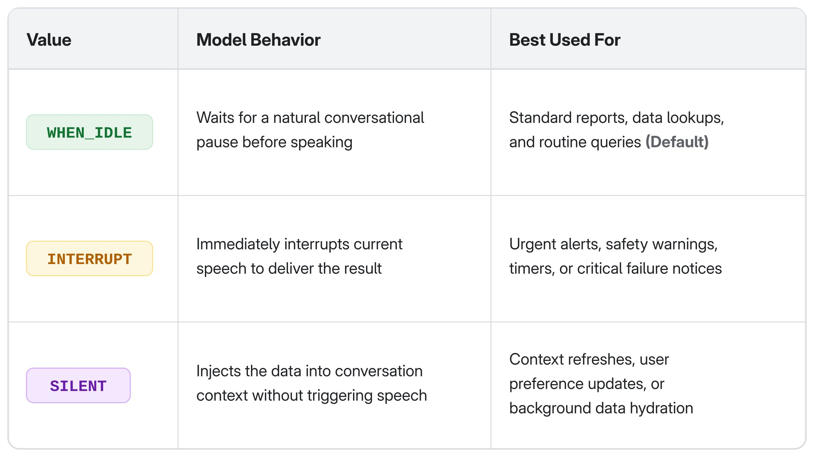
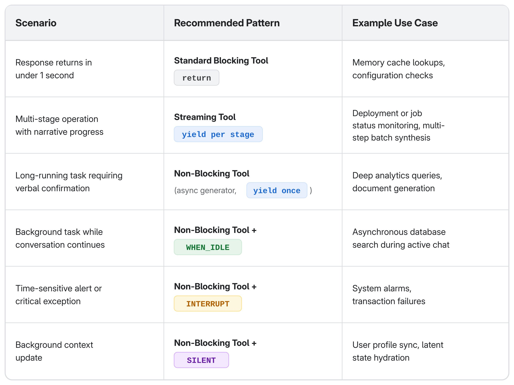

---
authors:
  - aitoboxrobot
categories:
  - 工具教程
date: 2026-10-20
hide:
  - navigation
tags:
  - 语音智能体
  - ADK
  - Gemini
  - 流式工具
  - Python
title: "实战指南：使用 ADK 与 Gemini Live 构建永不冷场的语音智能体"
---

# 实战指南：使用 ADK 与 Gemini Live 构建永不冷场的语音智能体

> # Step by Step Guide: Build a Voice Agent That Never Goes Silent Using ADK

### 文章背景与核心概要

在实时语音对话场景下，耗时较长的后台数据库查询或检索增强生成 (Retrieval-Augmented Generation, RAG) 流程常常会造成长达数秒的“死寂”空白，让用户误以为通话已经断线。为了破解这一交互难题，Google 团队基于开源的智能体开发套件 (Agent Development Kit, ADK) 与 `gemini-3.8-live` 实时语音多模态大模型，提出了创新的流式工具与非阻塞函数架构。通过在 Python 原生环境中异步调度任务，语音 AI 智能体 (AI Agent) 能够在后台工具执行的同时向用户持续输出口头反馈与进度叙述，使首字响应延迟从 14.4 秒大幅压缩至 1.2 秒。本文为构建高响应、拟人化、永不冷场的生产级实时语音智能体提供了详尽的实战指南。

---

**发布日期：** 2026 年 10 月 19 日  
**作者：** Stephen Allen (Solutions Architect, AI Apps and Platforms), Kaz Sato (Staff Developer Advocate)  

> **Published:** October 19, 2026  
> **Authors:** Stephen Allen (Solutions Architect, AI Apps and Platforms), Kaz Sato (Staff Developer Advocate)  

---

## 📌 概要

> ## 📌 Summary

在实时语音对话中，缓慢的数据库查询或检索增强生成 (Retrieval-Augmented Generation, RAG) 流程往往会导致数秒钟的无声冷场，促使用户误以为电话已经断线并挂断。本指南将探讨如何借助开源的 **智能体开发套件 (Agent Development Kit, ADK) Gemini Live API 工具包** 以及 `gemini-3.8-live` 模型来攻坚这一架构难题。通过在 Python 中构建流式工具 (Streaming Tools) 和非阻塞后台函数，开发者能够让语音智能体始终保持畅通对话与灵敏响应——将智能体开口说话的首字等待时间从 14.4 秒骤降至 1.2 秒。

> In a live voice conversation, slow database queries or RAG pipelines can lead to seconds of dead air, causing users to assume the call dropped. This guide explores how to solve this architectural challenge using the open-source **Agent Development Kit (ADK) Gemini Live API Toolkit** and `gemini-3.8-live`. By implementing streaming tools and non-blocking background functions in Python, developers can keep voice agents conversational and responsive—reducing the time to the agent's first words from 14.4 seconds down to 1.2 seconds.

---



## 使用 ADK 与 Gemini 3.8 Live 构建永不冷场的语音智能体

> ## Building a Voice Agent That Never Goes Silent with ADK and Gemini 3.8 Live

*一份关于 [智能体开发套件 (ADK) Gemini Live API 工具包](https://adk.dev/live/) 中 [流式工具](https://adk.dev/live/streaming-tools/)、非阻塞函数调用与响应调度的实战指南。*

> *A guide to [streaming tools](https://adk.dev/live/streaming-tools/), non-blocking function calls, and response scheduling in the [Agent Development Kit (ADK) Gemini Live API Toolkit](https://adk.dev/live/).*

在传统的文字聊天界面中，耗时 13 秒的数据库查询或 RAG 处理流程顶多只是在屏幕上转个加载圈圈；但在实时语音通话里，长达 13 秒的阻塞式工具调用则意味着整整 13 秒的死寂冷场，这往往会让用户断定电话出了故障或者已经挂断，从而直接结束通话。

> In text chat, a 13-second database query or RAG pipeline shows a loading spinner. In a live voice conversation, 13 seconds of blocking tool execution produces 13 seconds of dead air, causing users to assume the call dropped and hang up.

我们无法保证每次后端查询都能达到亚秒级响应，因此破局的关键必须落在架构设计上：在耗时的慢速工具于后台运行的同时，让智能体始终保持正常的口语对话能力。开源的 ADK 和 gemini-3.8-live 允许开发者直接在 Python 原生环境中编写非阻塞的语音工具，而无需费心去手写复杂的客户端 WebSocket 事件循环来管理异步工具状态。在基于 gemini-3.8-live 的销售报告基准测试工作流中，仅仅将传统的阻塞式工具替换为流式工具，就将智能体开口说话的首字等待时间从 14.4 秒大幅削减到了 1.2 秒。

> You cannot always make backend queries sub-second, so the fix must be architectural: keep the agent conversational while slow tools run in the background. Rather than forcing you to wire up custom client-side WebSocket event loops to manage asynchronous tool state, the open-source ADK and gemini-3.8-live let you implement non-blocking voice tools natively in Python. In our benchmark sales-report workflow on gemini-3.8-live, switching from a blocking tool to a streaming tool cut the time to the agent's first words from 14.4 seconds to 1.2 seconds.

本指南将全方位解析如何运用流式工具、非阻塞 `FunctionTool` 定义以及 `response_scheduling` (响应调度) 机制，打造出响应敏捷、表达自然的语音智能体。

> This guide covers how to use streaming tools, non-blocking `FunctionTool` definitions, and `response_scheduling` to build responsive, natural voice agents.

欢迎观看这段时长 1 分钟的 ADK Live AI 礼宾接待演示视频，亲身体验计划响应机制在真实对话中的运行效果：

> Watch the 1-minute ADK Live AI Concierge demo video to hear scheduled responses in action:

> 💬 [原文引用 / Original Quote]:
> **ADK Live AI 礼宾接待演示视频**  
> *ADK Live AI 礼宾接待演示视频讲解了计划响应的工作机制*  
> [观看视频源地址](https://storage.googleapis.com/gweb-developer-goog-blog-assets/original_videos/How__scheduled_response__of_ADK_Live_works.mp4)

> **ADK Live AI Concierge Demo Video**  
> *ADK Live AI Concierge demo video explains how scheduled responses work*  
> [Watch Video Source](https://storage.googleapis.com/gweb-developer-goog-blog-assets/original_videos/How__scheduled_response__of_ADK_Live_works.mp4)

---

## 非阻塞工具带来的核心优势

> ## What Non-Blocking Tools Enable

在 ADK 中落地非阻塞工具调用，能为用户体验带来立竿见影的显著提升：

> Implementing non-blocking tool calls in ADK provides several immediate user experience benefits:

* **彻底告别冷场 (Zero Dead Air)**：智能体不再会在对话中途僵死，而是能够第一时间口头确认用户的请求 (例如：“正在为您查询这些数据，请稍候……” )，让对话持续流动。
* **听得见的进度同步 (Audible Progress Updates)**：对于多步骤工作流 (比如建立连接、执行查询、核对汇总)，智能体可以实时播报阶段性里程碑，将原本枯燥的等待转化为充满生机的“进度直播”。
* **支持多任务并行对话 (Multitasking and Parallel Dialogue)**：当耗时较长的后台查询还在执行时，用户可以随时追问补充细节或提出完全无关的新问题，智能体依然能够从容作答，绝不会卡死对话会话。
* **精细化的交付控制 (Granular Delivery Control)**：开发者可以精确掌控最终结果切入对话的时机与方式——无论是等待用户说完话后的自然停顿插入、在遇到紧急预警时立即打断插播，还是静默更新对话上下文背景。

> * **Zero Dead Air:** Instead of freezing mid-conversation, the agent can acknowledge requests immediately ("Looking into those numbers now...") and keep the dialogue alive.
> * **Audible Progress Updates:** For multi-stage workflows (such as connecting, querying, and reconciling), the agent can narrate interim milestones so the wait sounds like active progress.
> * **Multitasking and Parallel Dialogue:** Users can ask follow-up or unrelated questions while a long-running query executes in the background, and receive timely answers without stalling the session.
> * **Granular Delivery Control:** You determine when and how the final result enters the conversation: waiting for a natural speaking pause, interrupting immediately for critical alerts, or silently updating conversation context.

---

## 原理剖析：为什么传统工具会导致对话阻塞？

> ## The Baseline: Why Standard Tools Block Conversation

在常规的智能体开发流程中，工具通常被定义为一个 `async def` 异步函数，它在内部完成全部计算后一次性返回单个结果：

> In standard agent development, a tool is defined as an `async def` function that completes its work and returns a single value:

```python
from typing import Any

async def query_sales_database(region: str) -> dict[str, Any]:
    """Runs the quarterly sales report query for a region.

    Args:
      region: Sales region to report on, e.g. "EMEA" or "APAC".

    Returns:
      A dict containing report metrics upon completion.
    """
    report = await run_expensive_query(region)       # e.g., 13 seconds of work
    return {"status": "success", "report": report}   # Single return at the end
```

当直接将该函数传递给 ADK 中的 `Agent` 时，它就会变成一个典型的阻塞式工具调用。在 Gemini Live API 的双向语音会话 (`run_live`) 期间，底层事件执行循环必须硬生生等待该函数执行完毕并返回，随后才能生成模型的下一轮语音响应。

> When passed directly to an `Agent` in ADK, this function creates a blocking tool call. During a Gemini Live API bidirectional voice session (`run_live`), the execution loop awaits the tool's return before generating further model turns.

如果 `query_sales_database` 需要耗时 13 秒，智能体就会陷入长达 13 秒的死寂之中。即使你在系统提示词 (Prompt) 中写下“告诉用户你正在处理”之类的指令也无济于事，因为此时模型的回合正被完全阻塞，死死等待着函数响应载荷的到达。

> If `query_sales_database` takes 13 seconds, the agent produces 13 seconds of complete silence. Prompting instructions such as "tell the user you are working on it" cannot resolve this, because the model's turn is blocked waiting for the function response payload.

为了维持行云流水般的顺畅对话，我们可以根据实际业务所需的用户体验，在两种核心非阻塞设计模式中进行选择。

> To keep the conversation fluid, you can choose between two main non-blocking patterns depending on the desired user experience.

---

## 模式一：流式工具 (进度有故事可讲的场景)

> ## Pattern 1: Streaming Tools (When Progress Has a Story)

当某项操作包含清晰明确的阶段性步骤 (例如连接数据库、聚合汇总数据记录、格式化输出报表) 时，**流式工具 (Streaming Tool)** 能够让智能体在后台处理的同时实时向用户口述当前进度。

> When an operation consists of meaningful stages (such as connecting to a database, aggregating records, and formatting results), a **streaming tool** lets the agent narrate progress as it happens.

在 ADK 中，把一个标准工具改造成流式工具极为轻巧：只需要将代码中的 `return` 改写为 `yield` 即可。通过将函数声明为异步生成器 `AsyncGenerator`，ADK 会自动将该工具的元数据声明标记为 `NON_BLOCKING` (非阻塞)，并立即向大语言模型返回一个就绪确认信号。

> In ADK, turning a standard tool into a streaming tool requires changing only `return` to `yield`. By defining the function as an `AsyncGenerator`, ADK automatically marks the tool declaration as `NON_BLOCKING` and returns an immediate status acknowledgement to the model.

```python
import asyncio
from typing import AsyncGenerator
from google.adk.agents import Agent

async def query_sales_database(region: str) -> AsyncGenerator[str, None]:
    """Runs the quarterly sales report. Call this ONCE; it pushes updates automatically.

    Args:
      region: Sales region to report on, e.g. "EMEA" or "APAC".

    Yields:
      Progress updates while the query runs, followed by the final summary.
    """
    stages = [
        ("Connecting to the sales warehouse...", 1.5),
        ("Scanning order records...", 3.5),
        ("Aggregating revenue by product line...", 3.5),
        ("Formatting the report...", 1.5),
    ]
    for message, delay in stages:
        yield f"PROGRESS: {message}"
        await asyncio.sleep(delay)

    yield f"DONE: {region} Q2 revenue reached $4.81M, up 12.4% year over year."

agent = Agent(
    name="sales_analyst",
    model="gemini-3.8-live",
    tools=[query_sales_database],
    instruction=(
        "You are a helpful sales assistant. When the user asks about sales data, "
        "call query_sales_database once. Acknowledge the request immediately, "
        "briefly paraphrase each progress update, and present the final figures "
        "when completed. Keep answers conversational and concise."
    ),
)
```

### 实际运行机制深度解析

> ### How It Works in Practice

1. **瞬时口头确认 (Immediate Acknowledgment)**：当模型触发调用 `query_sales_database` 时，ADK 会瞬间向模型派发一个异步状态事件。智能体随即开口回应 (比如：“现在马上为您查询欧洲、中东和非洲区的数据……” )。
2. **渐进式增量更新 (Partial Updates)**：每一次 `yield` 都会向上游实时推送一部分中间函数响应。模型接收到更新后便会用自然语言转述当前进展 (例如：“正在连接数据仓库……”、“正在统计各产品线销售额……” )，尽管口头播报速度可能会比底层代码运行慢上几秒。
3. **无缝的多轮并发交互 (Seamless Multi-Threading)**：如果用户在查询运行期间抛出了一个完全不相关的问题，智能体可以轻松自如地先解答该问题，而无需中断或取消正在后台有条不紊运行的任务。

> 1. **Immediate Acknowledgment:** When the model triggers `query_sales_database`, ADK immediately dispatches an asynchronous status event to the model. The agent speaks right away ("Looking into the EMEA figures for you now...").
> 2. **Partial Updates:** Each `yield` sends a partial function response upstream. The model paraphrases each update as it arrives ("Connecting to the warehouse...", "Aggregating product line data..."), though narration can trail the tool by several seconds.
> 3. **Seamless Multi-Threading:** If the user asks an unrelated question while the query is running, the agent can answer it without canceling or interrupting the background task.

### 流式工具的生产级工程考量

> ### Production Considerations for Streaming Tools

* **防止单飞工具被重复调用 (Single-Flight Tool Calls)**：由于流式工具会在多个对话轮次中持续推送更新，大语言模型在受到多轮提示时可能会偶发性地再次调用该工具。请务必在工具的文档字符串 (Docstring) 中明确注明“仅调用一次 (Call this ONCE)”的强指令；在生产环境中，更建议在工具内部实现内存锁闭机制或幂等键 (Idempotency Key)，确保系统稳健。
* **支持使用 `stop_streaming` 取消任务 (User Cancellation with `stop_streaming`)**：针对耗时过长的流式工具，ADK 提供了内置的安全逃生通道。只要在智能体的工具列表中加入名为 `stop_streaming(function_name: str)` 的函数，ADK 就会自动拦截该调用并取消生成器底层对应的 `asyncio.Task`，在函数内部抛出 `asyncio.CancelledError`，以便开发者安全优雅地关闭数据库连接或释放文件句柄。
* **用户插话打断不会取消后台工具 (User Barge-In Does Not Cancel Tools)**：当用户在智能体说话时插话打断 (Barge-In) 时，Live API 会立即停止模型的语音输出，ADK 则会发出带有 `interrupted=True` 标记的事件，通知客户端立即停止播放当前音频。然而，后台正在运行的流式工具或异步任务并不会被终止，其计算结果依然会正常递送。若想真正中断后台工具，必须由模型显式调用 `stop_streaming`。

> * **Single-Flight Tool Calls:** Because streaming tools push updates across multiple turns, models may occasionally attempt to call the tool again if prompted repeatedly. Keep a clear "Call this ONCE" directive in your docstring, and consider implementing an in-memory latch or idempotency key in your tool implementation for production safety.
> * **User Cancellation with `stop_streaming`:** ADK provides a built-in escape hatch for long-running streaming tools. By including a function named `stop_streaming(function_name: str)` in the agent's tools list, ADK intercepts the call and cancels the generator's underlying `asyncio.Task`, raising `asyncio.CancelledError` within your function so you can cleanly close database connections or file handles.
> * **User Barge-In Does Not Cancel Tools:** When the user talks over the agent, the Live API stops the model's output and ADK emits an event with `interrupted=True` so your client can stop audio playback. Running streaming or background tools are not cancelled, and their results are still delivered. To stop a tool, the model must call `stop_streaming`.

---

## 模式二：后台静默执行 (单纯等待、无话可说的场景)

> ## Pattern 2: Background Execution (When Waiting Is Just Waiting)

滔滔不绝的进度解说并不总是合适。如果用户请求了一份报表，随后立即转移话题去探讨别的事情，此时智能体如果还不断插播状态更新，就会让人觉得非常突兀甚至烦躁。

> Continuous progress commentary is not always appropriate. If a user asks for a report and immediately pivots to another topic, an agent that continually interrupts with status updates can feel intrusive.

当后台处理过程没有任何值得实时播报的故事时，最优雅的策略莫过于让任务在后台静默运行。

> When the wait has no story to narrate, run the task quietly in the background.

### 方案 A：单次 Yield 生成器 (最快捷的配置方式)

> ### Approach A: The Single-Yield Generator (Fastest Setup)

要想既获得即时的口头回应，又避免后续不必要的进度闲聊，一个极其高效的技巧就是使用仅在执行完毕时 `yield` 一次的异步生成器：

> An effective way to get an immediate verbal acknowledgment without ongoing progress chatter is an async generator that yields only once, upon completion:

```python
async def query_sales_database(region: str) -> AsyncGenerator[dict, None]:
    """Runs the quarterly sales report. Call this ONCE; results arrive when ready."""
    report = await run_expensive_query(region)   # Background execution (~13s)
    yield report                                 # Single yield upon completion
```

正因为这是一个异步生成器，ADK 会立即发出一个挂起等待的状态响应。智能体会第一时间给出口头确认 (例如：“我现在正为您调取那份报表” )，在后续长达 13 秒的计算期间保持安静，并在数据就绪或用户讲完话之后再汇报最终数字。

> Because this is an async generator, ADK issues an immediate pending response. The agent promptly acknowledges the request ("I'm pulling that report together for you now"), remains silent during computation, and presents the figures once ready or when the user finishes speaking.

### 方案 B：使用配置了 `response_scheduling` 的 `FunctionTool`

> ### Approach B: `FunctionTool` with `response_scheduling`

如果您更倾向于保留传统的单一返回协程 (`async def ... -> dict`)，可以把函数包裹进 `FunctionTool` 中，并为其配置 `response_scheduling` (响应调度属性)：

> If you prefer to keep standard coroutines (`async def ... -> dict`), wrap the function in a `FunctionTool` and configure `response_scheduling`:

```python
from google.adk.tools import FunctionTool
from google.genai import types

sales_tool = FunctionTool(query_sales_database)
sales_tool.response_scheduling = types.FunctionResponseScheduling.WHEN_IDLE
# (Note: In ADK 2.10+, you can also set sales_tool.behavior = types.Behavior.NON_BLOCKING to run a tool in the background without modifying scheduling mode.)
```

**权衡与取舍分析**：当对单次返回的协程采用 `response_scheduling` 时，模型在整个函数执行结束前都不会收到任何载荷。因此，除非用户在发出指令后继续开口交谈，否则模型通常不会给出最初的口头响应。这种模式非常适合用户发出指令后立即抛出其他连珠炮式问题的场景，此时最终结果会在下一个自然的对话停顿处被极其丝滑地融入交流之中。

> **Understanding the Trade-Off:** When using `response_scheduling` with a return-once coroutine, the model receives no payload until the entire function completes. As a result, the model typically does not utter an initial verbal acknowledgment unless the user continues speaking. This pattern is ideal when the user immediately continues with other questions and you want the result woven into the dialogue at the next natural pause.

---

## 利用 `response_scheduling` 精准控制结果交付时机

> ## Controlling Result Delivery with `response_scheduling`

`response_scheduling` 属性专门用来控制模型*何时*对接收到的工具响应作出反应。其中 `WHEN_IDLE` (空闲时交付) 绝不会打断正在进行中的对话回合：无论模型正在讲话还是用户正在发言，计算结果都会耐心等待当前回合结束，并在下一个自然的会话停顿处再行回应。ADK 目前支持三种不同的调度行为：

> The `response_scheduling` attribute controls *when* the model reacts to an incoming tool response. `WHEN_IDLE` never cuts into a turn in progress: if the model is still speaking or the user is still talking, the result waits until that turn ends, and the model responds at the next natural pause. ADK supports three scheduling behaviors:



在与 `gemini-3.8-live` 配合的基准测试会话中：

> In benchmark sessions with `gemini-3.8`-live:

* 在 `WHEN_IDLE` 模式下，新返回的销售报表会礼貌地等待模型讲完另一道长达 20 秒的问题，随后毫无违和感地顺势播报数据。
* 在 `INTERRUPT` 模式下，新返回的结果会直接在句中打断当前的语音发言，模型随后迅速调整表述并附上最新数据。
* 在 `SILENT` 模式下，结果只会被默默写入对话历史上下文中，供后续轮次随时参考，绝不会主动跳出来进行未受邀请的突兀播报。

> * Under `WHEN_IDLE`, an incoming sales report waited politely while the model finished answering a separate 20-second question, then delivered the figures seamlessly.
> * Under `INTERRUPT`, the incoming result cut off current speech mid-sentence; the model then finished its answer and appended the figures.
> * Under `SILENT`, the result was added to the conversation history, available for subsequent turns without prompting an unrequested announcement.

### 流式处理与响应调度的组合技

> ### Combining Streaming and Scheduling

任务的执行形态 (流式 vs. 单次返回) 与结果的交付时机 (`response_scheduling`) 彼此正交独立，可以随心所欲自由组合。在流式工具上统一设置 `response_scheduling`，就相当于给其中的每一个增量更新都打上相同的行为印记。

> Execution shape (streaming vs. single-return) and delivery timing (`response_scheduling`) are independent and can be composed. Setting `response_scheduling` on a streaming tool stamps every partial update with that behavior.

不仅如此，在 ADK 2.8 及以上版本中，流式工具还可以在每次 `yield` 输出 `types.FunctionResponse` 时，为每一次更新动态指定不同的调度模式：

> Furthermore, in ADK 2.8 and newer, streaming tools can dynamically specify scheduling per update by yielding `types.FunctionResponse`:

```python
# Acknowledge and keep intermediate progress quiet:
yield types.FunctionResponse(
    response={"stage": "aggregating"},
    scheduling=types.FunctionResponseScheduling.SILENT,
)

# Deliver the final result when the speaker finishes:
yield types.FunctionResponse(
    response={"report": final_data},
    scheduling=types.FunctionResponseScheduling.WHEN_IDLE,
)
```

---

## 架构选型总结：如何挑选最合适的工具模式

> ## Architecture Summary: Choosing the Right Tool Pattern



核心经验法则：**如果等待的过程有故事可讲，就用流式工具；如果等待纯粹只是等待，就让它在后台静默执行，并在空闲时自然着陆。**

> The rule of thumb: **If the wait has a story, stream it. If the wait is just a wait, run it in the background and let the result land when idle.**

---

## 总结展望

> ## Conclusion

非阻塞工具本身并不会缩短后端的实际执行耗时：一个耗时 13 秒的查询依然需要消耗 13 秒。它真正改变的，是智能体在对话交互中的“在场感”与陪伴感。

> Non-blocking tools do not reduce backend execution time: a 13-second query still takes 13 seconds. What changes is the conversational presence of your agent.

一个需要 10 秒才能完成加载的网页只会让人觉得缓慢；但在语音交互中，一个长达 10 秒没有任何声响的语音智能体则会被用户直接判定为“故障断线”。将 ADK 强大的流式工具、灵活的响应调度与 `gemini-3.8-live` 出色的实时多模态交互能力深度结合，你就能打造出即使在后台处理复杂重度任务时，也依然能够保持专注倾听、应答自如、始终在场的卓越语音助手。

> A web application that takes ten seconds to load is perceived as slow; a conversational voice agent that goes silent for ten seconds is perceived as broken. By pairing ADK's streaming tools and flexible response scheduling with the real-time capabilities of `gemini-3.8-live`, you can build voice assistants that remain attentive, natural, and present throughout complex operations.

**亲自上手体验**：访问 [交互式在线演示 (Interactive Demo)](https://adk-streaming-tools-761793285222.us-central1.run.app/demo)，该演示在 gemini-3.8-live 上针对同一个 13 秒的查询运行了各种工具模式与响应调度组合，让你亲耳听辨其中的巨大差异。

> **Try it yourself:** the [interactive demo](https://adk-streaming-tools-761793285222.us-central1.run.app/demo) runs the same 13-second query through every tool pattern and response_scheduling mode on gemini-3.8-live, so you can hear the difference.

### 环境要求与后续步骤

> ### Requirements & Next Steps

* **核心框架**：`google-adk >= 2.10.0`
* **模型依赖**：运行于 [Gemini Enterprise](https://docs.cloud.google.com/gemini-enterprise-agent-platform/models/google-models) 平台的 `gemini-3.8-live`
* **API 环境**：流式工具与实时调度必须在双向实时会话 (`run_live`) 环境下运行。

> * **Framework:** `google-adk >= 2.10.0`
> * **Model:** `gemini-3.8-live` on [Gemini Enterprise](https://docs.cloud.google.com/gemini-enterprise-agent-platform/models/google-models)
> * **API Environment:** Streaming tools and live scheduling require bidirectional live sessions (`run_live`).

### 延伸参考资料

> ### References

* [流式工具官方文档 (Streaming Tools)](https://adk.dev/live/streaming-tools/)
* [ADK Gemini Live API 工具包 (ADK Gemini Live API Toolkit)](https://adk.dev/live/)
* [函数工具深入指南 (Function Tools)](https://adk.dev/tools-custom/function-tools/)

> * [Streaming Tools](https://adk.dev/live/streaming-tools/)
> * [ADK Gemini Live API Toolkit](https://adk.dev/live/)
> * [Function tools](https://adk.dev/tools-custom/function-tools/)
