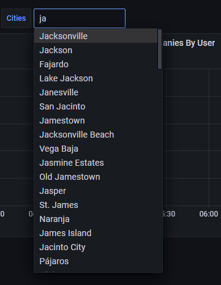

---
authors:
  - aitoboxrobot
categories:
  - 工具教程
date: 2026-10-21
hide:
  - navigation
tags:
  - ClickHouse
  - 性能优化
  - Grafana
  - 数据库调优
title: "ClickHouse 会在大规模场景下让你悄无声息地踩坑：从实战中总结的排坑与调优指南"
---

# ClickHouse 会在大规模场景下让你悄无声息地踩坑：从实战中总结的排坑与调优指南

### 文章背景与核心概要
ClickHouse 以其极致的查询速度在标准可观测性领域（如指标与常规日志）广受赞誉，然而当面对每日 20 亿行网络防火墙系统日志这种非典型超大规模场景时，其最致命的弱点便暴露无遗——**静默失效 (Fail Silently)**。ClickHouse 从不会主动提醒你查询语句写得有多糟糕或索引配置有多离谱，而是任由系统多读取 84 倍的数据、跳过主键剪枝，甚至悄无声息地退化为全表扫描。本文基于真实的生产级压测实操，深度剖析了手写过滤条件、排序列设计、物化投影 (Projections) 以及 Grafana 插件中的四大经典陷阱，并给出了基于 `system.query_log` 与 `EXPLAIN` 的严谨验证指南。

---

**核心摘要**：虽然 ClickHouse 在标准的可观测性工作流（如 OTel 指标和日志）中开箱即用、速度极快，但当面对非典型的大规模工作负载——比如每天 20 亿行的网络防火墙 syslog 日志时，它最危险的特性就会显现出来：**它总是静默失效**。ClickHouse 绝不会主动警告你的查询或配置效率低下；相反，它会若无其事地让你多读取 84 倍的数据、执行错误配置的过滤器，或者悄然退化为全表扫描。因此，在编写任何查询之前，养成借助 `system.query_log` 和 `EXPLAIN` 进行严格验证的习惯是不可妥协的底线。

> 💬 [原文引用 / Original Quote]:
> **Summary:** While ClickHouse is famously fast and efficient out of the box for standard observability workflows (like OTel metrics and logs), pushing it into atypical, high-volume workloads—such as 2 billion rows a day of network firewall syslog—reveals its most dangerous trait: **it fails silently**. ClickHouse will never tell you your query or configuration is inefficient; instead, it gracefully lets you read 84x more rows than necessary, execute misconfigured filters, or silently fallback to raw table scans. Building strict verification habits (`system.query_log` and `EXPLAIN`) before writing any queries is non-negotiable.

---

## 测试环境与架构配置

> ## Setup

在这项极限压力测试中，底层基础设施保持了清晰直接的架构设计：

> For this torture test, the infrastructure stayed straightforward:

* **ClickHouse**：通过 Altinity 算子 (Altinity Operator) 部署了 2 分片 × 3 副本的集群。每张底表均为 `ReplicatedMergeTree`，并通过 `Distributed` 分布式表对外提供统一访问，Grafana 仅针对分布式封装表发起查询。
* **Grafana**：采用官方 `grafana-clickhouse-datasource` 插件，面板包含 25 个图表组件，并在顶部配置了同时作用于所有图表组件的动态即席过滤器 (Ad-hoc Filters)。
* **硬性防护底线 (Hard Guardrails)**：设置了 `max_rows_to_read` = 10 亿行，`max_bytes_to_read` = 100 GB，`max_execution_time` = 60 秒，且全部配置为 `throw` 阻断模式（即超限立即抛出异常熔断）。

> * **ClickHouse:** 2 shard x 3 replicas via the Altinity operator. Every table is a `ReplicatedMergeTree` wrapped in `Distributed` tables, with Grafana exclusively querying the wrapper.
> * **Grafana:** Using the official `grafana-clickhouse-datasource` plugin with 25 panels and top-level ad-hoc filters affecting every panel simultaneously.
> * **Hard Guardrails:** `max_rows_to_read` = 1 billion, `max_bytes_to_read` = 100 GB, `max_execution_time` = 60s, all set to `throw` mode. 

---

## 经验教训一：切忌手写防御性过滤条件

> ## Lesson 1: Don't Handwrite the Filters

在最初的草稿中，我编写过滤条件时采用了标准的 SQL 防御性守卫语句，以确保在用户未做输入时查询依然合法：

> My first draft wrote filters using standard SQL guards to keep queries valid regardless of user input:

```sql
WHERE (empty({{observer}}) OR observer IN {{observer}})
```

这个看似稳妥的决定却对查询性能造成了灾难性的打击：

> This decision severely impacted performance:

| 谓词表达式 | 读取行数 | 执行耗时 |
| :--- | :--- | :--- |
| `observer = 'one-device'`（直接过滤） | 305 万行 | 115 毫秒 |
| `(empty(...) OR col IN ...)` 守卫语法 | **2.5764 亿行** | 1,134 毫秒 |

> | Predicate | Rows Read | Time |
> | :--- | :--- | :--- |
> | `observer = 'one-device'` (direct) | 3.05M | 115 ms |
> | `(empty(...) OR col IN ...)` guard | **257.64M** | 1,134 ms |

这种守卫语法直接破坏了 ClickHouse 的主键剪枝 (Primary-Key Pruning) 机制，迫使引擎触发全分区数据扫描，然后再逐行执行后置过滤。

> The guard prevented primary-key pruning, triggering a full partition scan with post-filtering. 

**解决方案**：改用 Grafana 自带的即席过滤机制 (Ad-hoc Filtering)。该插件并不会重写 `WHERE` 子句，而是将过滤条件以 ClickHouse 查询设置 (`additional_table_filters`) 的形式进行追加，直接在查询规划阶段生效，从而完美保留索引剪枝能力。

> **The Fix:** Use Grafana's ad-hoc filtering mechanism. Rather than rewriting the `WHERE` clause, the plugin appends the filter as a ClickHouse query setting (`additional_table_filters`), applying it at *planning* time for proper pruning.

| 过滤形式 | 读取行数 | 执行耗时 |
| :--- | :--- | :--- |
| 无任何过滤 | 2.5690 亿行 | 1,265 毫秒 |
| 手写 `WHERE observer = '...'` | 467 万行 | 170 毫秒 |
| **Grafana 即席过滤** | **467 万行** | **284 毫秒** |

> | Form | Rows Read | Time |
> | :--- | :--- | :--- |
> | No filter | 256.90M | 1,265 ms |
> | Hand-written `WHERE observer = '...'` | 4.67M | 170 ms |
> | **Ad-hoc filter** | **4.67M** | **284 ms** |



---

## 经验教训二：排序列至关重要……但有玄机

> ## Lesson 2: Sort Keys Matter... Sorta

我最初设定的 `ORDER BY` 排序子句看起来合情合理——优先按照基数 (Cardinality) 最低的网络设备列进行排序：

> My initial `ORDER BY` clause seemed logical—sorting by the lowest cardinality column (network device) first:

```sql
ORDER BY (observer, action, application, toStartOfHour(Timestamp), Timestamp)
```

然而，由于 Grafana 面板天然带有时间范围约束，这个设计反而弄巧成拙。在 ClickHouse 中，**只有排在排序列最前端的字段，才能真正走上快速查找的高速公路。**

> However, because Grafana panels are inherently time-bound, this backfired. In ClickHouse, **only the front of the sort key gets the fast lookup path.**

### ClickHouse 中 `ORDER BY` 的物理运作原理

> ### How `ORDER BY` Works in ClickHouse

与传统 MySQL 等关系型数据库不同，ClickHouse 中的排序索引直接决定了数据在磁盘上的物理布局（就像一本先按姓氏再按名字排序的电话簿）。ClickHouse 每隔 8,192 行数据（称为一个数据颗粒 / Granule）记录一次排序键的值，从而构建出一张主键索引书签表：

> Unlike MySQL, the index defines physical layout on disk (like a phone book sorted by last name, then first name). ClickHouse writes sort-key values every 8,192 rows (a *granule*), forming a primary key bookmark list:

* **查找“所有姓史密斯 (Smith) 的人”**：可以直接精准跳到 **S** 字母所在的物理存储区间（速度极快）。
* **查找“所有名字叫约翰 (John) 的人”**：约翰分散在每一个不同的姓氏区间中，因此必须翻遍整本电话簿进行全盘扫描（速度极慢）。

> * *"All the Smiths"* → Jump straight to the **S** section (Fast).
> * *"Everyone named John"* → Johns are scattered across every last-name section, requiring a full read (Slow).

### 为什么时间戳字段需要出现两次

> ### Why Timestamp Appeared Twice

我的排序键中同时包含了 `toStartOfHour(Timestamp)`（按整小时对齐的时间分桶）以及精确到微秒的 `Timestamp`。在任意固定的设备分组内，先按小时排序再按精确时间排序，能够完全保持原始的先后顺序，而不会发生行数据的交错重排。

> My key included `toStartOfHour(Timestamp)` (the hour bucket cutoff) followed by `Timestamp` (the exact time). Within any fixed group, sorting by hour then exact time preserves the exact same sequential order without re-ordering rows.

* **原排序键**：`(observer, action, application, hour, Timestamp)` → 时间字段埋得太深，导致在查询最新 N 条末尾日志（`ORDER BY Timestamp DESC LIMIT 1000`）时，引擎不得不遍历每个设备对应的数据块。
* **新排序键**：`(toStartOfHour(Timestamp), observer, action, application, Timestamp)` → 将小时时间桶提到最前面，使得指定时间范围内的数据在磁盘上形成单块连续区间。

> * **Old Key:** `(observer, action, application, hour, Timestamp)` → Time sat too deep, forcing newest-N tail-log queries (`ORDER BY Timestamp DESC LIMIT 1000`) to walk every device's block.
> * **New Key:** `(toStartOfHour(Timestamp), observer, action, application, Timestamp)` → Puts the time bucket first, making an hour range a single contiguous block.


> ⚠️ **警告**：ClickHouse 的 `MODIFY ORDER BY` 无法对已有字段进行重新排序、前置插入或合并；它仅仅支持在末尾追加新列。如果项目第一天建表时选错了排序键，后续必须新建一张表，在承载实时数据写入的同时为每个分片回填约 520 GiB 的历史数据，最后再执行原子性表切换 (Atomic Swap)。
>
> 💬 [原文引用 / Original Quote]:
> **Warning:** `MODIFY ORDER BY` cannot reorder, prepend, or absorb existing columns; it only appends new ones. Getting the key wrong on day one requires creating a new table, backfilling ~520 GiB per shard under live ingest, and executing an atomic swap.

---

## 经验教训三：物化投影远比想象的更棘手

> ## Lesson 3: Projections are Trickier Than I Thought

[物化投影 (Projections)](https://clickhouse.com/docs/data-modeling/projections) 相当于在同一张表内部按另一套物理顺序维护一份备用数据副本，并且会在每次执行 `INSERT` 时自动同步增量更新。

> A [projection](https://clickhouse.com/docs/data-modeling/projections) acts as an alternative physical ordering of data stored directly inside the same table, updating automatically on `INSERT`. 

然而，ClickHouse 对物化投影的表达式匹配要求极其苛刻且毫无容错空间：

> However, expression matching is strict and unforgiving:

1. **聚合函数必须完全对齐**：若投影中只定义了 `count()` 和 `sum(duration)`，则对于请求 `avg(duration)` 的查询，该投影*完全无法*被复用。
2. **过滤列必须包含在 `GROUP BY` 中**：遗漏过滤列会导致引擎悄无声息地放弃投影，直接退化为开销巨大的原始底表全量扫描。
3. **谓词表达式必须精准字面匹配**：使用 `toStartOfHour(Timestamp) >= X` 能被正确路由命中；但如果写成 `toStartOfInterval(Timestamp, INTERVAL 1 HOUR) >= X`（即便两者在数学和业务逻辑上完全等价），也会静默引发全表扫描降级。

> 1. **Aggregates must match:** `count()` and `sum(duration)` will *not* be used by a query asking for `avg(duration)`.
> 2. **Filter columns must be in the `GROUP BY`:** Omitting them causes a silent, costly fallback to raw tables.
> 3. **Exact predicate matching is required:** Using `toStartOfInterval(Timestamp, INTERVAL 1 HOUR) >= X` (even with identical logical values) triggers a silent full fallback.

| WHERE 子句形式 | 是否命中投影路由？ | 读取数据行数 |
| :--- | :--- | :--- |
| *(无)* | 是 | 2,022 行 |
| `toStartOfHour(Timestamp) >= X` | 是 | 2,022 行 |
| `toStartOfInterval(Timestamp, INTERVAL 1 HOUR) >= X` | **否** | 12,373,248 行 |
| `Timestamp >= X`（直接查原始字段） | **否** | 12,373,248 行 |

> | WHERE Clause | Routed? | Rows Read |
> | :--- | :--- | :--- |
> | *(none)* | Yes | 2,022 |
> | `toStartOfHour(Timestamp) >= X` | Yes | 2,022 |
> | `toStartOfInterval(Timestamp, INTERVAL 1 HOUR) >= X` | **No** | 12,373,248 |
> | `Timestamp >= X` (raw) | **No** | 12,373,248 |

---

## 经验教训四：Grafana 的 ClickHouse 插件暗藏暗礁

> ## Lesson 4: Grafana ClickHouse Plugin Has Sharp Edges

Grafana 官方的 ClickHouse 插件虽然功能强大，但在实际使用中也存在不少隐秘的踩坑点：

> While the Grafana plugin is powerful, it contains hidden failure modes:

1. **静默忽略拼写错误**：在即席过滤配置中，若未填写包含数据库 schema 的全限定表名而仅填了裸表名，安全过滤条件会被静默忽略，从而导致查询意外返回千万级无用数据。
2. **布尔逻辑表达受限**：其图形交互界面限制每个键只能绑定单一操作符和取值，这导致类似 `observer = A OR observer = B` 这样的多选或逻辑条件无法以优雅直观的方式表达。

> 1. **Silently Ignored Typos:** An unqualified table key instead of a schema-qualified one in ad-hoc filter configs silently bypasses safety filters, returning tens of millions of unexpected rows.
> 2. **Boolean Limits:** The UI offers one operator and value per key, making expressions like `observer = A OR observer = B` impossible to express cleanly.

---

## 总结

> ## Conclusion

ClickHouse 无疑是一款性能强悍的分析利器，但一旦将其推向海量规模，其缺乏防护机制与静默失效的特质就会被急剧放大。正因为引擎在出错或降级时从不报错示警，工程师必须在日常开发中主动建立深度的验证习惯——深度结合 `system.query_log`、`EXPLAIN` 以及严苛的抽样校验，时刻确保每一条查询都切实跑在预想的极速路径之上。

> ClickHouse is an incredible tool, but scale exposes its lack of guardrails. Because it fails silently, developers must proactively build verification habits—relying heavily on `system.query_log`, `EXPLAIN`, and exhaustive sanity checks to ensure queries are actually hitting their optimized paths.
