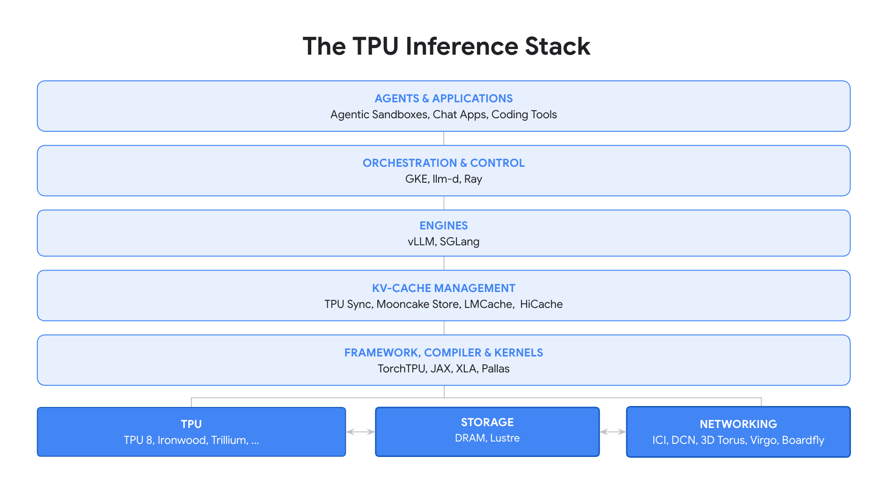

---
authors:
  - aitoboxrobot
categories:
  - 产品发布
date: 2026-10-21
hide:
  - navigation
tags:
  - TPU
  - PyTorch
  - vLLM
  - SGLang
  - 大模型推理
title: "Google 发布基于 TPU 的原生 PyTorch 推理引擎：vLLM 与 SGLang"
---

# Google 发布基于 TPU 的原生 PyTorch 推理引擎：vLLM 与 SGLang

**发布日期**：2026 年 10 月 20 日  
**作者**：Qi Zhou (Principal Software Engineer), Chris Chan (Group Product Manager)  

> **Published:** October 20, 2026  
> **Authors:** Qi Zhou (Principal Software Engineer), Chris Chan (Group Product Manager)  

---

### 文章背景与核心概要
长期以来，Google TPU 凭借极致的算力能效比支撑着庞大的 AI 工作负载，但在大语言模型 (Large Language Model, LLM) 推理生态中，主要依赖 JAX 运行库，限制了庞大 PyTorch 开发者的灵活定制与调试。为打破这一壁垒，Google 联合生态核心力量正式推出了底层框架 TorchTPU，并宣布原生支持两大主流开源推理引擎——vLLM 与 SGLang。该架构带来了针对 TPU 硬件量身定制的高性能 Pallas 算子、创新的跨主机 TPU Sync 键值缓存 (KV Cache) 传输机制以及端到端的多模态与长上下文推理支持，为高吞吐量 (Throughput) 和超低延迟 (Latency) 的智能体落地铺平了道路。

---

## 执行摘要

> ## Executive Summary

Google 正式宣布推出在 Google TPU 上原生运行的 PyTorch 后端推理引擎，包括与 Inferact 合作开发的 **vLLM** 以及与 RadixArk 合作开发的 **SGLang**。这两大新引擎构建在为 TPU 带来原生 PyTorch 支持的 **TorchTPU** 基础之上，不仅具备面向生产级部署的完备特性与深度优化的 Pallas 算子内核，还为现代 AI 智能体 (AI Agent) 场景、多模态 / 视觉语言模型 (Vision-Language Model, VLM) 以及高吞吐量 (Throughput) AI 负载提供了无缝集成的推理体验。

> Google has announced the launch of native PyTorch backends for **vLLM** (developed in partnership with Inferact) and **SGLang** (developed in partnership with RadixArk) running on Google TPUs. Built on top of **TorchTPU**—which brings native PyTorch support to TPUs—these new inference engines offer production-ready features, optimized Pallas kernels, and seamless integration for modern agentic, multimodal, and high-throughput AI workloads.

---

## 研发背景

> ## Background

多年以来，TPU 始终以卓越的性能与高能效比驱动着大规模 AI 负载的高效运转。此前，vLLM 与 SGLang 在 TPU 上的运行主要依托于基于 JAX 的后端；然而，广大开发者对在 PyTorch 原生生态中获取更高自定义自由度与调试便利性的呼声日益高涨，直接催生了 **TorchTPU** 的诞生。

> For years, TPUs have powered large-scale AI workloads with high performance and efficiency. While vLLM and SGLang previously operated on TPUs via JAX-based backends, developer demand for greater customizability and debuggability in PyTorch drove the creation of **TorchTPU**. 

TorchTPU 让 PyTorch 能够原汁原味地在 TPU 硬件上直接原生运行。新构建的 vLLM 和 SGLang 引擎深度依托 TorchTPU，让广大 PyTorch 开发者社区能够利用熟悉的技术工具链快速部署模型，同时坐享针对推理服务深度定制的高级特性与定制化 Pallas 硬件算子。

> TorchTPU allows PyTorch to run natively on TPUs. The newly built vLLM and SGLang engines leverage TorchTPU to let the PyTorch community deploy models rapidly using familiar tooling, complete with optimized serving features and custom Pallas kernels.

---

## 推理技术全栈架构

> ## The Inference Stack

在大规模生产环境中提供高并发推理服务，需要贯穿技术全栈每一层的协同协同设计——从底层芯片、编译流水线直至顶层集群编排调度。

> Serving at scale requires co-design across every layer of the technology stack—from silicon and compilers to orchestration. 

---

## 引擎架构总览

> ## Engine Overview

TorchTPU 将 TPU 确立为了 PyTorch 的原生一等计算设备：

> TorchTPU establishes the TPU as a native PyTorch device:

* **张量管理 (Tensors)**：在 `tpu` 计算设备上作为标准 PyTorch 张量进行统一管理，无需任何繁琐的中间包装类型。
* **执行模式 (Execution)**：既支持直接以 Eager 动态模式执行，也支持借助 XLA 通过 `torch.compile` 进行高效图编译加速。
* **集合通信 (Collectives)**：底层完全复用标准 `torch.distributed` 分布式通信接口。

> * **Tensors** are managed as standard PyTorch tensors on a `tpu` device without wrapper types.
> * **Execution** runs eagerly or compiles via `torch.compile` using XLA.
> * **Collectives** go through `torch.distributed`.

由于每个硬件设备均运行独立的 PyTorch 进程，两大引擎得以完整保留各自框架原生的 Worker 节点模型、任务调度器、键值缓存 (KV Cache) 管理器以及 API 服务网关，在底层干净利落地嵌入了 TPU 的硬件加速实现。

> Because each device runs its own PyTorch process, both engines preserve each framework's original worker model, scheduler, KV cache manager, and API server, embedding the TPU implementations cleanly underneath.

### 全场景工作负载支持

> ### Workload Support

两款引擎均对一系列面向生产环境的复杂业务场景提供了全方位支持：

> Both engines support a comprehensive range of production use cases:

* **智能体与多轮对话 (Agentic & Multi-Turn)**：支持针对混合架构模型的自动前缀缓存 (Prefix Caching)、通过 TPU Sync 将 KV 缓存卸载至主机内存及托管 Lustre 存储、工具调用 (Tool Calling) 以及结构化输出 (Structured Output)。
* **交互式与极低延迟 (Interactive & Low Latency)**：采用投机解码 (Speculative Decoding) 技术，深度集成 MTP、EAGLE-3、DFlash、DSpark 以及 n-gram 草稿生成器。
* **高吞吐量批处理 (High-Throughput Batch)**：融合专家并行 (Expert Parallelism) 的数据并行注意力机制。
* **超长上下文 (Long Context)**：支持面向预填充 (Prefill) 与解码 (Decode) 阶段的上下文并行 (Context Parallelism)；支持 FP8 精度 KV 缓存；支持主机级 KV 缓存动态卸载。
* **解耦式服务架构 (Disaggregated Serving)**：通过 TPU Sync 在独立的 TPU 主机节点上分别运行预填充与解码任务，灵活适配多样化的并行切分方案。
* **多模态 (Multimodal)**：全面兼容视觉语言模型（支持图像与视频作为输入模态）以及向量嵌入模型。
* **超大规模模型 (Very Large Models)**：支持混合精度与稀疏注意力架构；支持跨主机的张量并行、数据并行、专家并行、流水线并行及上下文并行；全面支持 FP8、FP4 (MXFP4, NVFP4)、INT8 与 INT4 量化权重检查点。

> * **Agentic & Multi-Turn:** Automatic prefix caching (including hybrid models), KV cache offloading to host memory and Managed Lustre via TPU Sync, tool calling, and structured output.
> * **Interactive & Low Latency:** Speculative decoding with MTP, EAGLE-3, DFlash, DSpark, and n-gram drafters.
> * **High-Throughput Batch:** Data-parallel attention with expert parallelism.
> * **Long Context:** Context parallelism for prefill and decode; FP8 KV cache; host KV offloading.
> * **Disaggregated Serving:** Separate prefill and decode hosts over TPU Sync, supporting varied parallel layouts.
> * **Multimodal:** Vision-language models (image and video inputs) and embedding models.
> * **Very Large Models:** Hybrid and sparse-attention architectures; tensor, data, expert, pipeline, and context parallelism across hosts; FP8, FP4 (MXFP4, NVFP4), INT8, and INT4 checkpoints.

### 借助 TPU Sync 迁移 KV 缓存

> ### Moving the KV Cache with TPU Sync

为了高效支撑解耦式推理架构（在分离的独立 TPU 主机上分别执行预填充与解码计算），并实现分层 KV 缓存卸载（将溢出的 KV 缓存搬运到主机 DRAM 以及 Google Cloud 托管 Lustre 高性能存储中），两款引擎均引入了 **TPU Sync**。这是一个开源的 C++ 底层库，能直接读取 PyTorch 张量底层的硬件设备缓冲区，在脱离 Python 运行时的开销下实现无额外中间副本的超高速异步内存拷贝。

> To handle disaggregated serving (running prefill and decode on separate TPU hosts) and tiered KV offload (moving excess KV cache to host DRAM and Google Cloud Managed Lustre), both engines utilize **TPU Sync**. This open-source C++ library reads device buffers behind PyTorch tensors directly, enabling asynchronous transfers outside Python without extra staging copies.

---

## 生产落地验证与公开基准测试

> ## Running Today in Production & Public Benchmarks

目前，两款引擎已在多位预览版客户的大规模生产环境中正式投入使用。在社区权威的 SemiAnalysis InferenceX 基准测试项目中，新方案斩获了行业顶尖的性能水准：

> Both engines are currently deployed at scale with preview customers. Recent benchmarks on the community-standard SemiAnalysis InferenceX project demonstrate industry-leading performance:

* **基于 Ironwood TPU (TPU 7x) 运行 Qwen 3.5**：达成了每百万 Token 仅需 **2.01 美分** 的行业领先超低成本。
* **AgentX 订阅服务**：在面向复杂智能体超长上下文与多轮对话负载的评测中，均公布了达到行业顶尖水平 (SOTA) 的性能测试数据。

> * **Qwen 3.5 on Ironwood TPU (TPU 7x):** Achieved an industry-leading cost of **2.01 cents** per million tokens.
> * **AgentX Subscriptions:** Published state-of-the-art (SOTA) performance results for agentic long-context and multi-turn workloads.

---

## 携手开源社区共同打造

> ## Building with the Community

这套原生后端与业界关键生态合作伙伴联合共建，确保其技术演进与上游开源主干严格对齐，坚持社区优先原则：

> These backends were co-developed with key industry partners to ensure they remain upstream-aligned and community-first:

* **SGLang-TorchTPU** 由 Google 与 **RadixArk**（由 SGLang 核心创始人创立）联合开发，目前已在 Meta 生产集群中平稳上线运行。
* **vLLM-TorchTPU** 由 Google 与 **Inferact**（由 vLLM 核心创始人创立）深度共建，为参数量高达 2.8 万亿 (2.8T) 的 Kimi K3 超大模型深度集成了高性能 Pallas 超级算子内核 (Megakernel)。

> * **SGLang-TorchTPU** was co-developed with **RadixArk** (founded by the creators of SGLang) and is already running in production at Meta.
> * **vLLM-TorchTPU** was co-developed with **Inferact** (founded by the creators of vLLM), integrating a high-performance Pallas megakernel for the 2.8T-parameter Kimi K3 model.

为了激发开源社区的持续创新，vLLM 正在建立面向社区贡献者的专属 TPU 算力池，为积极向这两大引擎贡献代码的开发者提供免费的 TPU 算力资源倾斜。

> To encourage ongoing innovation, vLLM is launching a community contribution TPU capacity pool to provide free TPU compute to developers contributing to both engines.

---

## 未来演进路线

> ## Roadmap

针对生产级智能体复杂工作流所需的关键核心特性现已全部上线支持，深度性能优化工作也在持续推进之中。主流开源模型家族——包括 Qwen、DeepSeek、GLM、Kimi、GPT-OSS 以及 Gemma4——均已获得完善支持，未来将持续重点保证开源新模型的首日即时支持 (Day 0 Support)。

> The major features required for production-grade agentic workloads are fully supported, with ongoing optimizations underway. Popular open model families—including Qwen, DeepSeek, GLM, Kimi, GPT-OSS, and Gemma4—are supported, with a strong focus on Day 0 support for new open-source models.

> 📌 **关于 JAX 运行时的说明**：社区现有的 [vLLM-Jax](https://github.com/vllm-project/tpu-inference) 与 [SGLang-JAX](https://github.com/sgl-project/sglang-jax) 依然会得到完全的技术支持与持续维护，供广大开发者自由选用。
>
> 💬 [原文引用 / Original Quote]:
> **Note on JAX Runtimes:** [vLLM-Jax](https://github.com/vllm-project/tpu-inference) and [SGLang-JAX](https://github.com/sgl-project/sglang-jax) remain fully supported and maintained for community use.

---

## 快速上手与开源链接

> ## Getting Started

* **vLLM-TorchTPU**：[GitHub 仓库](https://github.com/vllm-project/vllm-torchtpu) | [Inferact 官方发布公告](https://vllm.ai/blog/2026-10-20-vllm-torchtpu)
* **SGLang-TorchTPU**：[GitHub 仓库](https://github.com/sgl-project/sglang-torchtpu) | [RadixArk 官方发布公告](https://lmsys.org/blog/2026-10-20-sglang-torchtpu)
* **TorchTPU**：[GitHub 仓库](https://github.com/google-pytorch/torch_tpu)

> * **vLLM-TorchTPU:** [GitHub Repository](https://github.com/vllm-project/vllm-torchtpu) | [Inferact Announcement](https://vllm.ai/blog/2026-10-20-vllm-torchtpu)
> * **SGLang-TorchTPU:** [GitHub Repository](https://github.com/sgl-project/sglang-torchtpu) | [Radixark Announcement](https://lmsys.org/blog/2026-10-20-sglang-torchtpu)
> * **TorchTPU:** [GitHub Repository](https://github.com/google-pytorch/torch_tpu)
