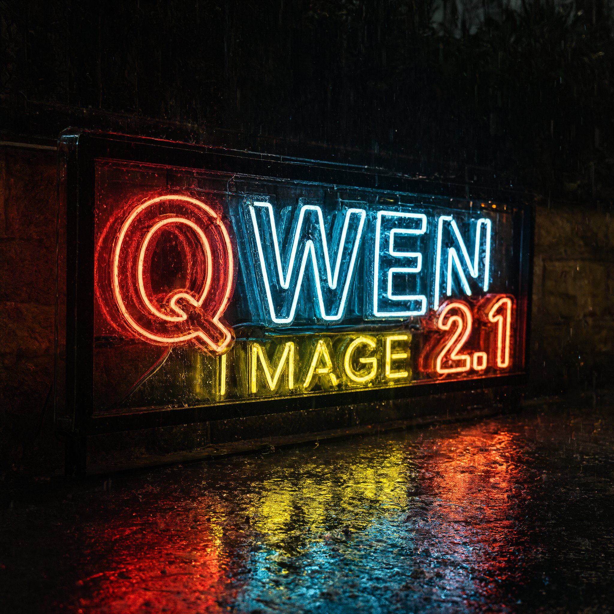
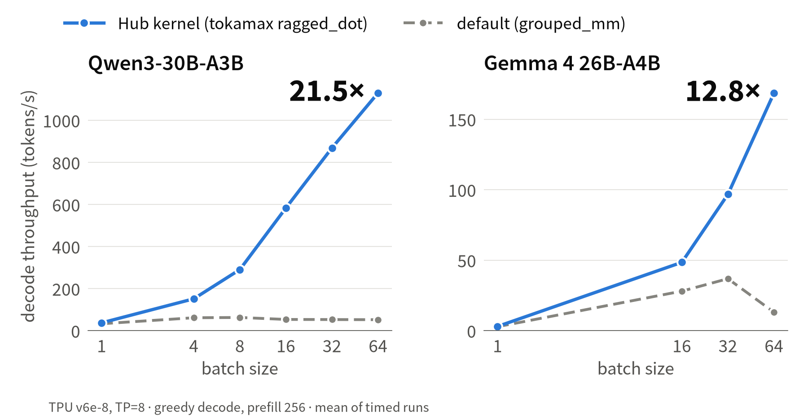
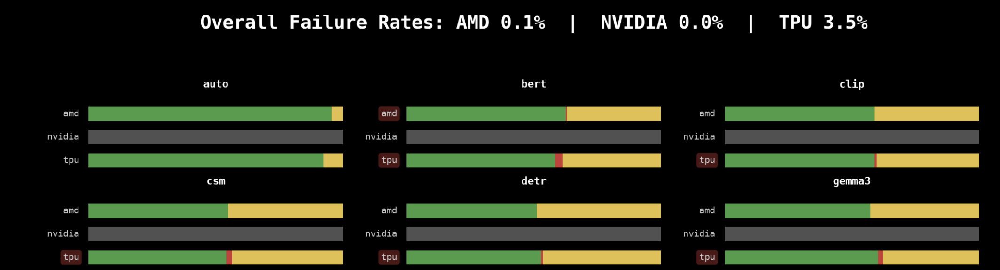

---
authors:
  - aitoboxrobot
categories:
  - 产品发布
date: 2026-10-21
hide:
  - navigation
tags:
  - Hugging Face
  - TorchTPU
  - Transformers
  - Diffusers
  - TPU
title: "Hugging Face 携手 TorchTPU：让 TPU 获得原生 PyTorch 支持"
---

# Hugging Face 携手 TorchTPU：让 TPU 获得原生 PyTorch 支持

> # Hugging Face ❤️ TorchTPU: TPUs, Natively

**发布日期：** 2026 年 10 月 20 日  
**作者：** Alvaro Moran, Jingya Huang, Simon Pagezy, Jeff Boudier, Régis Pierrard  

> **Published:** October 20, 2026  
> **Authors:** Alvaro Moran, Jingya Huang, Simon Pagezy, Jeff Boudier, Régis Pierrard  

---

### 文章背景与核心概要
长期以来，PyTorch 开发者若想使用 Google 强大的 TPU 算力集群，往往受制于 `torch_xla` 复杂的惰性求值图与 JAX 的学习成本，难以像在 GPU 上那样随心所欲。随着 **TorchTPU** 原生后端的推出，TPU 正式成为了 PyTorch 的一等公民设备 (`torch.device("tpu")`)。Hugging Face 宣布全面支持该特性，Transformers、Diffusers 和专有 Kernels 库均已原生适配 TPU，开发者仅需一行 `device_map="tpu"` 或 `.to("tpu")` 即可开箱运行最新前沿模型。无论是百亿多模态生成、高吞吐 MoE 解码，还是结合 Pallas 定制算子加速，开发者都能享受到与原生 PyTorch 完全一致的丝滑开发体验。

---

## 概要

> ## Summary

随着 **TorchTPU** 的横空出世，Google 的张量处理单元 (Tensor Processing Unit, TPU) 终于能够作为原生 PyTorch 设备直接调用。这项集成彻底摆脱了以往受制于 `torch_xla` 或 JAX 的固有约束，使得 Hugging Face 旗下的核心开源库（包括 Transformers、Diffusers 以及定制算子库 Kernels）能够直接在 TPU 上开箱即用——开发者只需简单指定 `device_map="tpu"` 或调用 `.to("tpu")` 即可畅行无阻。

> With the introduction of **TorchTPU**, Google's Tensor Processing Units (TPUs) can now act as native PyTorch devices. This integration bypasses the historical constraints of `torch_xla` or JAX, allowing Hugging Face libraries like Transformers, Diffusers, and specialized Kernels to run seamlessly on TPUs out of the box—just by targeting `device_map="tpu"` or `.to("tpu")`.

---


如果你曾经尝试过在 TPU 上运行 PyTorch 代码，很大概率不得不经历将代码大改迁移至 `torch_xla` 的痛苦，或者最终被迫从零去学 JAX。而随着原生 PyTorch 后端 [TorchTPU](https://github.com/google-pytorch/torch_tpu) 的发布，TPU 如今变成了与常规设备无异的又一个标准计算目标。这为 Hugging Face 生态全面拥抱 TPU 铺平了道路：Transformers、Diffusers 以及 Kernels 均已实现 TPU 原生运行。只需从 Hub 上挑选你中意的模型，将其分配至 `"tpu"`，一切便大功告成。

> If you ever tried to run PyTorch on a TPU, you probably ported your code to `torch_xla`, or you ended up having to learn JAX. With [TorchTPU](https://github.com/google-pytorch/torch_tpu), a native PyTorch backend, TPU is now just another device. It opens up native support of TPU in the Hugging Face ecosystem. Transformers, Diffusers and Kernels run natively on TPU. Pick a model from the Hub, send it to `"tpu"`, and you're done.

## 等等，到底什么是 TPU？ 🤔

> ## Wait, what's a TPU? 🤔

TPU 是 [张量处理单元 (Tensor Processing Unit)](https://cloud.google.com/tpu) 的英文缩写。TPU 是 Google 自主研发的专用 AI 加速芯片，其设计初衷纯粹为了极致做好一件事：加速神经网络耗时最集中的矩阵数学运算。Google 研发设计 TPU 已有大约十年时间，并长期使用它们来训练和服务自家的大规模旗舰模型，包括著名的 Gemini。

> TPU stands for [Tensor Processing Unit](https://cloud.google.com/tpu). TPUs are Google's own AI accelerators. They are chips built for one job: the matrix math that neural networks spend most of their time on. Google has been designing them for about ten years, and uses them to train and serve its own models, including Gemini.

开发者可以在 [Google Cloud](https://docs.cloud.google.com/tpu/docs/intro-to-tpu) 上随时取用 TPU 算力，从小到单个独立芯片，大到由数千颗芯片构成的 Pod 超级集群均可调用。当你在模型训练或大规模推理服务中需要澎湃算力时，TPU 的强大性能便能大放异彩。

> TPUs are available on [Google Cloud](https://docs.cloud.google.com/tpu/docs/intro-to-tpu), from a single chip up to pods of thousands of chips. They shine when you need a lot of compute, for training or for serving at scale.

但一直以来的瓶颈在于软件生态。TPU 的软件栈最早完全是围绕 TensorFlow 和 JAX 逐步生长起来的，这使得习惯了 PyTorch 的开发者想要接入 TPU 往往要克服很高的门槛。

> The catch has always been software. The TPU stack grew up around TensorFlow and JAX, and PyTorch users had to work harder to get in.

## 过去传统的开发模式

> ## The old way

在此之前，在 TPU 上跑 PyTorch 意味着必须通过 PyTorch/XLA (`torch_xla`) 中间层。虽然它能够正常工作，但存在诸多难以回避的特异行为：张量计算是惰性求值 (Lazy Evaluation) 的，你的代码并不总是像预想的那样立即执行；极其微小的代码变动都可能触发计算图的昂贵重编译；而排查调试问题时，代码执行逻辑更是晦涩难懂。

> Until now, running PyTorch on TPUs meant going through PyTorch/XLA (`torch_xla`). It worked, but it had its quirks. Tensors were lazy, so your code didn't always run when you thought it did. Small changes could trigger graph recompilations, and debugging was hard to reason about.

为了减轻开发者的负担，我们此前打造了 Optimum TPU，为 Hugging Face 模型在 TPU 上的推理与训练提供桥接支持。而如今 TorchTPU 带来了底层原生支持，开发者在使用 Transformers 和 Diffusers 运行模型时，已经不再需要额外依赖 Optimum TPU 了。

> To make life easier, we built Optimum TPU. It gave Hugging Face models inference and training support on TPUs. Now that TorchTPU brings native support, Optimum TPU is not required anymore to run Hugging Face models with Transformers and Diffusers.

## 迎接 TorchTPU 登场 🚀

> ## Enter TorchTPU 🚀

[TorchTPU](https://github.com/google-pytorch/torch_tpu) 将 TPU 作为全新原生后端直接接入了 PyTorch。你可以继续书写真正纯正的 PyTorch 代码。它不仅内置了针对 TPU 深度优化的 Pallas 算子内核，全面支持分布式训练，还深度集成了 `torch.compile` 以便在需要极致性能时一键提速。在 TPU 虚拟机 (VM) 上的安装仅需一行简单命令：

> [TorchTPU](https://github.com/google-pytorch/torch_tpu) adds TPU as a new backend to PyTorch. You write regular PyTorch code. It comes with Pallas kernels tuned for TPUs, support for distributed training, and a `torch.compile` integration for when you want more speed. Installing it on a TPU VM takes one command:

```shell
pip install torch-tpu --extra-index-url https://download.pytorch.org/whl/cpu
```

这里指定的额外索引源提供了针对 CPU 编译优化的精简版 `torch`。如果不加这个参数，pip 会默认拉取体积庞大得多的 CUDA 编译版本，而这在 TPU 环境中完全是不必要的。

> The extra index gives you the CPU build of `torch`. Without it, pip pulls the much bigger CUDA build, which you don't need on a TPU.

## 你所钟爱的开源库，如今已全面支持 TPU

> ## Your favourite libraries, now on TPU

### Transformers

> ### Transformers

Transformers v5 围绕着一个核心理念而设计：成为模型定义的唯一真实来源 (Source of Truth)，使其能够在任何硬件设备上随处运行。如今，“随处运行”正式将 TPU 纳入版图。想要在 TPU 上加载模型，只需传入 `device_map="tpu"`，就这么简单。

> Transformers v5 was built around one idea: be the source of truth for model definitions, so they can run anywhere. "Anywhere" now includes TPUs. To load a model on a TPU, pass `device_map="tpu"`. That's it.

```py
from transformers import AutoModelForCausalLM, AutoTokenizer

model_id = "Qwen/Qwen3.5-9B"
model = AutoModelForCausalLM.from_pretrained(
    model_id,
    device_map="tpu", # will load model directly on the TPU
)
tokenizer = AutoTokenizer.from_pretrained(model_id)
inputs = tokenizer("The future of AI is", return_tensors="pt").to("tpu")
out = model.generate(**inputs, max_new_tokens=64)
print(tokenizer.decode(out[0], skip_special_tokens=True))
```

模型在默认情况下以动态图 (Eager Mode) 运行。你也可以开启 `torch.compile` 获取更卓越的推理吞吐，或者直接将其部署在多芯片分布式环境中。

> The model runs in eager mode by default. You can also use `torch.compile` for better performance, or run it in a distributed setup.

### 图像？视频？Diffusers 在 TPU 上挥洒创意 🎨

> ### Images? Videos? Diffusers paints them on TPUs 🎨

TPU 现已成为 Diffusers 库中的一等公民设备。对于原型验证或调试，Eager 动态图模式只需加上 `pipe.to("tpu")` 即可。对于生产部署，编译模式也仅需额外添加一行 `compile` 调用。你的代码和流水线逻辑完全保持不变，再也无需维护任何专用的 TPU 代码分支。

> TPU is now a first-class device in Diffusers. For prototyping or debugging, eager mode only needs `pipe.to("tpu")`. For deployment, compiled mode adds one `compile` call. Your pipelines and code stay the same, and there's no TPU fork to maintain.

```py
import torch
from diffusers import StableDiffusion3Pipeline

pipe = StableDiffusion3Pipeline.from_pretrained(
    "stabilityai/stable-diffusion-3.5-medium", dtype=torch.bfloat16
)
pipe.to("tpu")  # eager mode: that's the whole change
# optional: compiled mode
pipe.transformer.compile(backend="tpu", fullgraph=True, dynamic=False)

image = pipe("a corgi astronaut planting a flag on a pizza moon").images[0]
```

首个调用步骤会执行编译操作，在此之后凡是尺寸相同的图像生成，都将直接复用已经编译好的计算图。

> The first call compiles, and every call after that with the same image size reuses the graph.

模型体积太大单颗芯片装不下？只需在 `from_pretrained` 中传入 `TensorParallelConfig`，Transformer 模块在加载过程中就会自动完成跨芯片的分片切分，整个模型无需完整塞入单颗芯片的内存中。众多主流流水线对此提供了开箱即用的支持，而其他模型也只需配置一份 `tp_plan` 即可轻松搞定。完整的操作步骤可参考 [Diffusers TPU 指南](https://huggingface.co/docs/diffusers/main/optimization/tpu)。

> Models too big for one chip? Pass a `TensorParallelConfig` to `from_pretrained` and the transformer is sharded across chips as it loads, so the full model never has to fit in one place. Many popular pipelines support it out of the box, and the ones that don't are just a `tp_plan` away. The [Diffusers TPU guide](https://huggingface.co/docs/diffusers/main/optimization/tpu) has the full recipe.

以下是在 Cloud TPU v6e-4 硬件环境下的实测生成示例：

> Here are some examples run on a Cloud TPU v6e-4:

<sub>*TP=4 (每个模型切分到四颗芯片上并行计算) · bf16 · 批大小 batch 1*</sub>

> <sub>*TP=4 (each model split across four chips) · bf16 · batch 1*</sub>

| [MiniMax-H3](https://huggingface.co/MiniMaxAI/MiniMax-H3) (视频 + 音频) | [Qwen-Image-2.1](https://huggingface.co/Qwen/Qwen-Image-2.1) | |
| :--- | :---: | :---: |
| <video controls="" src="https://huggingface.co/buckets/huggingface/hf-torchtpu-blog-assets/resolve/videos/minimax-h3-hf-trireme.mp4"></video> |  |  |
| <sub>*“画面中毛茸茸的 Hugging Face 吉祥物——一张带着红润脸颊、展开两只小手的黄色圆脸笑脸，伫立在古希腊三列桨座战船的船头 […] 伴随着海浪拍击、木材嘎吱作响、索具风声、远处海鸥鸣叫以及低沉史诗般的管弦乐澎湃声。”* · 1344×768，5.2 秒，49 步 · 编译耗时 188 秒，动态图 262 秒</sub> | <sub>*“一只戴着巫师帽的水豚在烛光下阅读书籍，油画风格”* · 1024×1024，40 步 · 编译耗时 3.5 秒，动态图 8.0 秒</sub> | <sub>*“雨夜中闪烁着‘QWEN IMAGE 2.1’霓虹灯招牌，潮湿路面上倒映着灯光”* · 2048×2048，40 步</sub> |

### 算子内核库 (Kernels)

> ### Kernels

[Kernels Hub](https://huggingface.co/kernels?sort=trending&search=tpu) 汇聚了海量开箱即用的高性能 TPU 算子内核。只需利用 Kernels 库加载相应算子，就能为你的模型注入飞速动力。

> The [Kernels Hub](https://huggingface.co/kernels?sort=trending&search=tpu) has ready-to-use TPU kernels. Load one with the Kernels library and give your model a speed boost.

TPU 算子内核主要采用 [Pallas](https://docs.jax.dev/en/latest/pallas/tpu/) 编写，赋予开发者对底层硬件的精细控制能力。你还可以从 [Tokamax](https://github.com/openxla/tokamax) 开源库中直接引入算子。以下是将 Tokamax 的不规则点积 (Ragged-dot) 内核无缝接入混合专家 (MoE) 模型的示例：

> TPU kernels are written in [Pallas](https://docs.jax.dev/en/latest/pallas/tpu/), which gives you low-level control over the hardware. You can also bring in kernels from the [Tokamax](https://github.com/openxla/tokamax) library. Here is a ragged-dot kernel from Tokamax plugged into a Mixture-of-Experts model:

```py
from kernels import get_kernel
from transformers import AutoModelForCausalLM
from transformers.integrations.moe import ALL_EXPERTS_FUNCTIONS

repo_id = "tengomucho/ragged-dot-tpu"
kernel = get_kernel(repo_id, version=1, trust_remote_code=[repo_id])
ALL_EXPERTS_FUNCTIONS.register("tokamax_ragged_dot", kernel.experts_forward)
model = AutoModelForCausalLM.from_pretrained(
    "Qwen/Qwen3-30B-A3B-Instruct-2507",
    experts_implementation="tokamax_ragged_dot",
)
```

批处理尺寸越大，获得的加速收益就越显著。在批大小为 64 时，解码吞吐在 Qwen3-30B-A3B 上提升了 21.5 倍，在 Gemma 4 26B-A4B 上更是提升了 12.8 倍。

> The bigger the batch, the bigger the win. At batch size 64, decoding is 21.5× faster on Qwen3-30B-A3B and 12.8× faster on Gemma 4 26B-A4B.

[](./images/af2a5496e51e.png)  
*TPU v6e-8 上的解码吞吐量对比：Hub 定制内核与默认实现的性能表现。*

> *Decode throughput on a TPU v6e-8, Hub kernel vs. the default implementation.*

## 全力严密测试，替你把关质量 🧪

> ## We test it so you don't have to 🧪

我们通过在 TPU 环境下持续运行整套库的自动化测试套件，不断提升 Transformers 对 TPU 的支持稳定性。我们正致力于引入针对 TPU 的每日夜间 CI 构建流水线，并在 [transformers 状态看板](https://huggingface.co/spaces/transformers-community/transformers-ci-dashboard) 上实时公开测试结果。

> We're continuously improving TPU support in transformers by running the library test suite. We are working to add a nightly CI on TPU and make the results available in the [transformers dashboard](https://huggingface.co/spaces/transformers-community/transformers-ci-dashboard).

  
*Transformers CI 看板展示了 TPU 与其他加速器的并列测试结果（持续完善中）。*

> *The Transformers CI dashboard, with TPU results next to other accelerators. Work in progress!*

目前测试虽然尚未全绿，但我们对此保持坦诚与从容。在已适配 TPU 运行的测试用例中，通过率已达 96.5%。我们发现的每一个失败用例，都会转化为精简的可复现脚本并在 TorchTPU 代码库中提为 Issue。截至目前，我们已报告了 34 个问题，其中 19 个已经迅速修复。在 TPU 上跑测试还帮助我们发现了 Transformers 自身内部的一些潜在缺陷，例如在 `StaticCache` 以及 Qwen3 张量并行切分方案中的问题，我们已在上游代码中一并予以修复。

> It's not all green yet, and we're fine with that. Of the tests that run on TPU, 96.5% pass. Every failure we find becomes a small repro script and an issue on the TorchTPU repo. So far we have reported 34 issues, and 19 are already fixed. Running on TPU also caught a few bugs in Transformers itself, like in `StaticCache` and the Qwen3 tensor-parallel plans. We fixed those upstream.

只要 TPU 上可能存在任何隐患，我们都希望在广大开发者遇到之前将其彻底排查解决。

> If something breaks on TPU, we want to find out before you do.

## 快速开启 TPU 开发

> ## Get started

对于 PyTorch 用户而言，TPU 不再是一项曲折迂回的“支线任务”。安装 TorchTPU，从 Hub 上拉取心仪的模型，直接将其指定到 `"tpu"` 即可启动！

> TPUs are no longer a side quest for PyTorch users. Install TorchTPU, grab a model from the Hub, and send it to `"tpu"`.

* [GitHub 上的 TorchTPU 项目](https://github.com/google-pytorch/torch_tpu)
* [Hub 上的 TPU 算子内核](https://huggingface.co/kernels?sort=trending&search=tpu)
* [Cloud TPU 官方开发文档](https://docs.cloud.google.com/tpu/docs)

> * [TorchTPU on GitHub](https://github.com/google-pytorch/torch_tpu)
> * [TPU kernels on the Hub](https://huggingface.co/kernels?sort=trending&search=tpu)
> * [Cloud TPU documentation](https://docs.cloud.google.com/tpu/docs)

我们无比期待看到大家借助这项能力创造出的精彩成果 🤗！如果你在开发过程中遇到任何疑问或阻碍，欢迎随时提交 Issue 与我们交流反馈。

> We can't wait to see what you build 🤗. If you hit a problem, open an issue and tell us about it.
