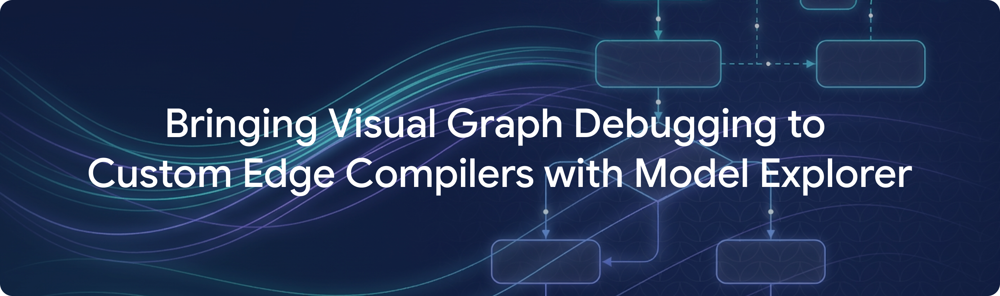
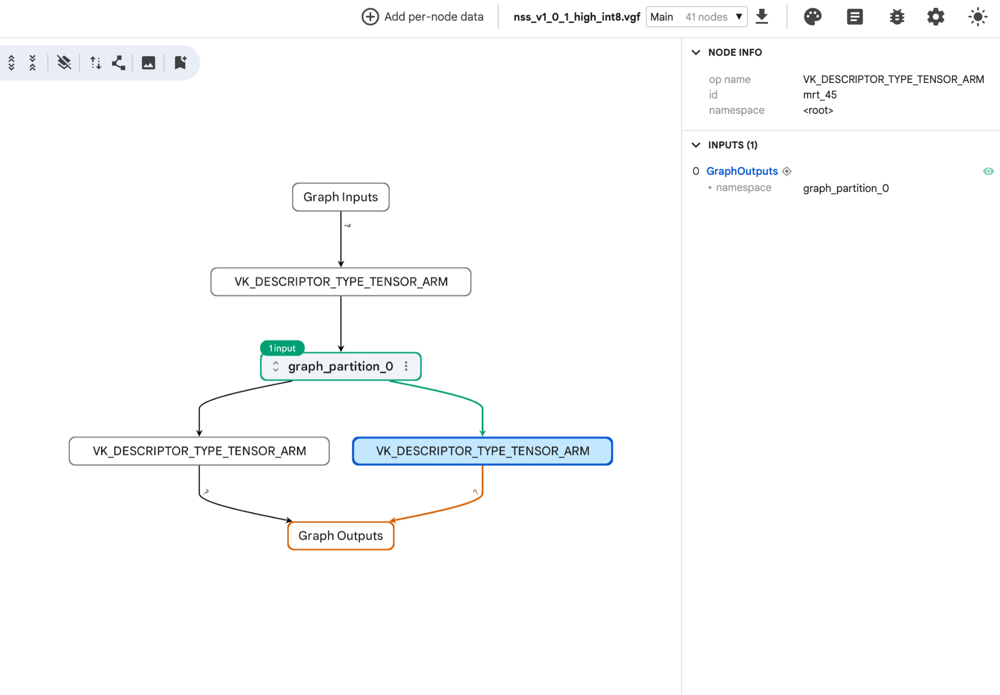
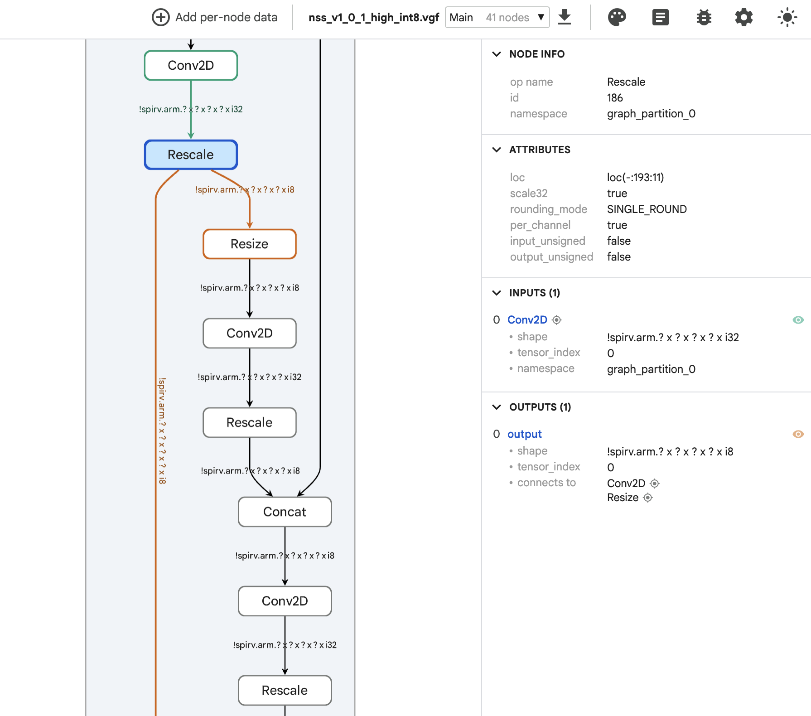
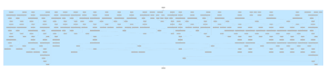
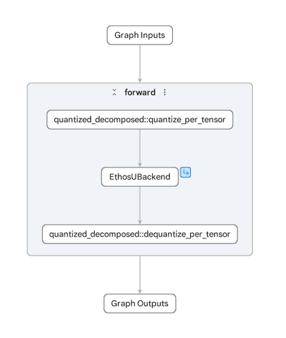
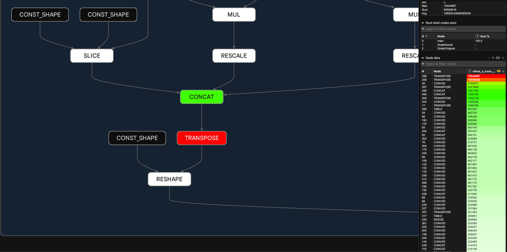

---
authors:
  - aitoboxrobot
categories:
  - 工具教程
date: 2026-10-21
hide:
  - navigation
tags:
  - Arm
  - Google AI Edge
  - Model Explorer
  - 端侧 AI
  - 编译器优化
title: "借助 Model Explorer 为定制端侧编译器引入可视化计算图调试"
---

# 借助 Model Explorer 为定制端侧编译器引入可视化计算图调试

> # Bringing Visual Graph Debugging to Custom Edge Compilers with Model Explorer

**发布日期：** 2026 年 10 月 20 日  
**作者：** Eric Yang (Software Engineer), Alan Ma (Staff Software Engineer)  
**标签：** Mobile, AI, Case Studies, Learn, Explore  

> **Published:** October 20, 2026  
> **Authors:** Eric Yang (Software Engineer), Alan Ma (Staff Software Engineer)  
> **Tags:** Mobile, AI, Case Studies, Learn, Explore  

---

### 文章背景与核心概要
将现代机器学习模型部署到各类低功耗边缘设备时，通常需要经历量化、图下沉 (Graph Lowering)、算子融合与硬件委派 (Delegation) 等复杂的编译链路。然而，编译器底层生成的中间表示 (Intermediate Representation, IR) 往往极其晦涩，工程师过去只能通过解析生硬的二进制 Flatbuffers 或海量文本日志来排查算子异常和硬件回退，过程繁琐且极易出错。为此，Arm 团队与 Google 深度合作，借助 Google AI Edge Model Explorer 的层级图可视化与插件架构，开发了一系列针对 TOSA、VGF 和 PTE 等专用中间格式的开源适配器。本文详细介绍了 Arm 如何通过分屏对照、节点级性能追踪热力图等可视化调试工作流，秒级定位意外引入的转置算子、精准验证 NPU 硬件加速委派，并一目了然地捕捉时钟周期级的硬件延迟瓶颈。

---

## 摘要

> ## Summary

Model Explorer 的能力不仅限于展示高层级模型计算图，更能为本地端侧机器学习部署流水线提供深度的可视化洞察。本文将深入探讨 Arm 如何将 Google AI Edge Model Explorer 与定制编译器中间表示 (Intermediate Representation, IR)——例如 TOSA、VGF 和 PTE 等深度集成，从而通过并排分屏比对验证 NPU 硬件委派情况，并将周期级 (Cycle-level) 性能剖析追踪数据直接映射至底层执行图中。

> Model Explorer extends beyond high-level model graphs to provide deep visibility into local edge machine learning pipelines. This article explores how Arm integrated Google AI Edge Model Explorer with custom compiler intermediate representations (IRs)—such as TOSA, VGF, and PTE—to verify NPU hardware delegation side-by-side and map cycle-level profiling traces directly onto execution graphs.

---

## 前言

> ## Introduction

从低功耗边缘设备、游戏显卡到具身物理 AI 系统，机器学习模型正运行在日益多样化的本地硬件环境之中。要在这些目标平台上实现高效推理，离不开一系列关键的编译步骤，例如模型量化、图下沉 (Graph Lowering)、算子融合以及针对专用加速器的硬件委派。

> Machine learning models run locally on a wide range of hardware, from low-power edge devices to gaming graphics and physical AI systems. Running models efficiently on these targets requires compilation steps such as quantization, graph lowering, operator fusion, and hardware delegation.

为了让开发者能够对这些复杂的流水线拥有清晰的可视化掌控力，Arm 引入了 **[Google AI Edge Model Explorer](https://developers.google.com/edge/model-explorer)**。依托 Model Explorer 出色的分层计算图可视化能力与灵活的插件架构，Arm 打造了多款开源适配器，让端侧模型的各项编译转换过程变得直观易审。

> Arm used **[Google AI Edge Model Explorer](https://developers.google.com/edge/model-explorer)** to give developers visibility into these pipelines. With Model Explorer's hierarchical graph visualization and plugin architecture, Arm built several open-source adapters that make edge model transformations easier to inspect.

---

## 核心痛点与挑战

> ## The Challenge

在将模型部署至端侧硬件的过程中，上游框架的细微改动或算子约束条件的微调，都可能导致最终导出的执行图结构发生剧烈变化。工程师往往必须回答以下三个关键问题：

> When deploying a model to edge hardware, a framework change or operator constraint can alter the exported execution graph. Engineers often need to answer three critical questions:

* **图结构完整性 (Structural integrity)**：图下沉编译过程是否意外引入了多余算子（例如未经计划的布局转置算子）？
* **硬件加速委派 (Hardware delegation)**：模型是否已全量委派至 NPU 或 GPU 硬件加速器运行？还是有部分不被支持的子图悄悄回退 (Fallback) 到了 CPU 上？
* **时钟周期级性能瓶颈 (Cycle-level bottlenecks)**：在下沉后的执行图中，究竟是哪些计算节点消耗了最多的硬件时钟周期？

> * **Structural integrity:** Did graph lowering introduce unintended operators such as extra layout transposes?
> * **Hardware delegation:** Is the model fully delegated to the NPU or GPU, or are unsupported subgraphs falling back to the CPU?
> * **Cycle-level bottlenecks:** Which nodes in the lowered graph take the most compute cycles?

以往仅凭肉眼阅读原始 Flatbuffers 二进制结构或滚动翻阅海量文本日志来解答这些问题，不仅效率极其低下，而且面对大语言模型 (Large Language Model, LLM) 以及深层神经网络时更是如同大海捞针。Arm 迫切需要一款直观的可视化工具，用于深入审查 Arm 特有的中间表示与底层硬件性能分析追踪。

> Answering these questions by reading raw flatbuffers or text logs takes time, especially for large language models (LLMs) and neural networks. Arm needed a visual tool to inspect Arm-specific intermediate representations and hardware profiling traces.

---

## Arm 如何构建 Model Explorer 可视化调试工作流

> ## How Arm Used Model Explorer's Visual Debugging Workflows

为了攻克上述端侧部署难题，Arm 为 Google AI Edge Model Explorer 量身开发了多款定制适配器，全面支持多种关键模型格式（如 **[TOSA](https://www.mlplatform.org/tosa/tosa_spec.html)**、**[VGF](https://docs.pytorch.org/executorch/stable/tutorial-arm-vgf.html)** 和 **[PTE](https://docs.pytorch.org/executorch/stable/pte-file-format.html)**），从而建立起一套端到端设备端优化可视化工作流。借助这些扩展，工程团队可以直接在模型计算图上校验导出流水线、核验硬件加速委派状态，并秒级锁定周期级性能瓶颈：

> To address these deployment challenges, Arm developed custom adapters for Google AI Edge Model Explorer to support several model formats (i.e., **[TOSA](https://www.mlplatform.org/tosa/tosa_spec.html)**, **[VGF](https://docs.pytorch.org/executorch/stable/tutorial-arm-vgf.html)**, and **[PTE](https://docs.pytorch.org/executorch/stable/pte-file-format.html)**), establishing a comprehensive visual workflow for on-device optimization. Using these extensions, engineering teams can validate exported pipelines, verify accelerator delegation, and pinpoint cycle-level performance bottlenecks directly on the model graph:

### 1. 敏锐捕捉 VGF 导出中隐蔽的性能回退

> ### 1. Catching hidden export regressions in VGF

Arm 工程师借助 Model Explorer 对一个使用 PyTorch 训练的[神经超采样 (NSS) 模型](https://huggingface.co/Arm/neural-super-sampling)进行了深度校验。该模型通过 ExecuTorch Arm 后端导出为面向 Vulkan ML 扩展的 VGF 格式文件。在深入审查该 VGF 计算图时，团队迅速发现图中意外混入了非预期的 `TRANSPOSE` 转置算子——这正是 ExecuTorch Arm 后端的一处更新引入的隐蔽性能回退。

> Arm engineers used Model Explorer to validate a PyTorch-trained [Neural Super Sampling (NSS) model](https://huggingface.co/Arm/neural-super-sampling) exported through the ExecuTorch Arm backend as a VGF file for Vulkan ML Extensions. While inspecting the VGF graph, the team found unintended `TRANSPOSE` operators introduced by a change in the ExecuTorch Arm backend.

  
*图 1: VGF 格式下导出的 NSS 模型整体结构概览，展示了计算图分区及其与模型输入输出间的连接拓扑。*

> *Figure 1: Overview of the exported NSS model in VGF format, showing the graph partition and its connections to the model inputs and outputs.*

Model Explorer 支持用户深入检查模型图中的任意独立节点，例如下图中选中的 `rescale` 算子，工具清晰展示了该算子的各项属性参数以及 SPIR-V 张量输入输出连接。正是这一强大的交互功能，帮助 Arm 团队完全脱离了翻阅底层日志的手工苦力，迅速定位并修复了该性能回退问题。

> Model Explorer enables users to inspect individual nodes of the model graph, such as the `rescale` operator depicted below, which displays the operator's attributes and SPIR-V tensor connections. This functionality assisted the Arm team in identifying and resolving the regression without requiring manual analysis of raw log files.

  
*图 2: NSS 计算图细节特写，展示了选中的 rescale 算子及其详细属性配置、SPIR-V 输入与输出连接关系。*

> *Figure 2: Detailed view of the NSS graph, showing a selected rescale operator with its attributes and SPIR-V input and output connections.*

### 2. 通过分屏视图对比验证 NPU 委派与 CPU 回退

> ### 2. Verifying NPU delegation vs. CPU fallback with Split-Pane View

为了针对 [Arm Ethos-U85 NPU](https://www.arm.com/products/silicon-ip-cpu/ethos/ethos-u85) 等专用加速芯片充分优化视觉模型，Arm 工程师利用 **Model Explorer** 提供的[分屏视图功能](https://github.com/google-ai-edge/model-explorer/wiki/2.-User-Guide#split-pane-view)，对一个 Ultralytics YOLO 模型的 CPU 执行图与 NPU 委派执行图进行了并排同屏比对。

> To optimize vision models for accelerators like the [Arm Ethos-U85 NPU](https://www.arm.com/products/silicon-ip-cpu/ethos/ethos-u85), Arm engineers used **Model Explorer's** [split-pane view](https://github.com/google-ai-edge/model-explorer/wiki/2.-User-Guide#split-pane-view) to compare CPU and NPU-delegated graphs side-by-side for an Ultralytics YOLO model.

分屏视图直观揭示了两者在结构上的本质差异：CPU 对应的执行图展示了每一个松散的独立计算层；而在 NPU 图中，整个网络被高度融合成了一个被夹在 `quantize` (量化) 与 `dequantize` (反量化) 节点之间的单体 `EthosUBackend` 巨型算子块。对于在 **LiteRT** 或 **ExecuTorch** 中尚未被完全加速的部分支持模型，这种分屏比对能够极大加速找出哪些算子未被成功委派以及子图在哪里被打散回退。

> The split-pane view showed the structural difference: the CPU graph displays each individual layer, while the NPU graph groups the network into a single `EthosUBackend` block between `quantize` and `dequantize` nodes. For partially supported models in **LiteRT** or **ExecuTorch**, this view helps identify un-delegated operators and split subgraphs.

  
*图 3a: 在分屏视图下展示的 Ultralytics YOLO 模型 CPU 执行图*

> *Figure 3a: Ultralytics YOLO model CPU graph in split-pane view*

  
*图 3b: 在分屏视图下展示的 Ultralytics YOLO 模型 NPU 执行图*

> *Figure 3b: Ultralytics YOLO model NPU graph in split-pane view*

### 3. 基于节点级性能追踪图层精确定位硬件瓶颈

> ### 3. Pinpointing Hardware Bottlenecks with Per-node Trace Overlays

为了精准找出 Ethos-U NPU 上的延迟 (Latency) 瓶颈，Arm 将编译好的模型放置于其专属的[固定虚拟平台 (FVP)](https://www.arm.com/products/development-tools/simulation/fixed-virtual-platforms) 仿真模拟器上进行运行，并借助 **Model Explorer** 的[节点数据插件 (Node Data Plugin)](https://github.com/google-ai-edge/model-explorer/wiki/4.-API-Guide#custom-node-data)，将精确到时钟周期的底层执行追踪数据覆盖回显至计算图之上。色彩斑斓的热力图一眼就揭示了真相：一个孤立的 `TRANSPOSE` 算子节点正是引发整体执行延迟的主要元凶。

> To find latency bottlenecks on the Ethos-U NPU, Arm ran their model on their [Fixed Virtual Platform (FVP)](https://www.arm.com/products/development-tools/simulation/fixed-virtual-platforms) simulator and used **Model Explorer's** [node data plugin](https://github.com/google-ai-edge/model-explorer/wiki/4.-API-Guide#custom-node-data) to overlay cycle-accurate execution traces onto the graph. Color-coded heatmaps showed that a single `TRANSPOSE` node was the main latency bottleneck.

  
*图 4: 高亮呈现的性能数据覆盖图层，一目了然地指出了延迟瓶颈所在的具体算子节点。*

> *Figure 4. Highlighted performance data overlay that clearly shows where the bottleneck is.*

---

## 快速上手指南

> ## How to Get Started

即日起，你便可以通过 PyPI 或 GitHub 在本地轻松部署 Google AI Edge Model Explorer，并配合 Arm 提供的多款开源适配器，深度审查和调优属于你自己的设备端机器学习模型：

> You can use Google AI Edge Model Explorer along with Arm's open-source adapters today to inspect and optimize your own on-device models locally via PyPI or GitHub.

1. [安装 Google AI Edge Model Explorer](https://github.com/google-ai-edge/model-explorer/wiki/1.-Installation)；
2. 安装适配器并针对你的目标模型格式启动 Model Explorer：
   * [LiteRT 适配器](https://github.com/google-ai-edge/model-explorer/tree/main/src/builtin-adapter/adapters/litert) (官方内置)
   * [PyTorch 适配器](https://github.com/google-ai-edge/model-explorer/blob/main/src/server/package/src/model_explorer/builtin_pytorch_exportedprogram_adapter.py) (官方内置)
   * [Hugging Face Transformers 适配器](https://github.com/google-ai-edge/model-explorer/tree/main/src/server/package/src/model_explorer/hfgraph) (官方内置)
   * [TOSA 适配器](https://github.com/arm/tosa-adapter-model-explorer) (Arm 官方插件)
   * [VGF 适配器](https://github.com/arm/vgf-adapter-model-explorer) (Arm 官方插件)
   * [PTE 适配器](https://github.com/arm/pte-adapter-model-explorer) (Arm 官方插件)
3. 查阅[用户使用手册 (User Guide)](https://github.com/google-ai-edge/model-explorer/wiki/2.-User-Guide) 并上手体验核心调试功能：
   * [计算图导航 (Graph Navigation)](https://github.com/google-ai-edge/model-explorer/wiki/2.-User-Guide#graph-navigation)
   * [并排分屏比对 (Split View Side by Side)](https://github.com/google-ai-edge/model-explorer/wiki/2.-User-Guide#split-pane-view)

> 1. [Install Google AI Edge Model Explorer](https://github.com/google-ai-edge/model-explorer/wiki/1.-Installation)
> 2. Install adapter and launch Model Explorer for your model format:
>    * [LiteRT adapter](https://github.com/google-ai-edge/model-explorer/tree/main/src/builtin-adapter/adapters/litert) (built-in)
>    * [PyTorch adapter](https://github.com/google-ai-edge/model-explorer/blob/main/src/server/package/src/model_explorer/builtin_pytorch_exportedprogram_adapter.py) (built-in)
>    * [Hugging Face Transformers adapter](https://github.com/google-ai-edge/model-explorer/tree/main/src/server/package/src/model_explorer/hfgraph) (built-in)
>    * [TOSA adapter](https://github.com/arm/tosa-adapter-model-explorer) (Arm plugin)
>    * [VGF adapter](https://github.com/arm/vgf-adapter-model-explorer) (Arm plugin)
>    * [PTE adapter](https://github.com/arm/pte-adapter-model-explorer) (Arm plugin)
> 3. See the [User Guide](https://github.com/google-ai-edge/model-explorer/wiki/2.-User-Guide) and try out major features:
>    * [Graph Navigation](https://github.com/google-ai-edge/model-explorer/wiki/2.-User-Guide#graph-navigation)
>    * [Split View Side by Side](https://github.com/google-ai-edge/model-explorer/wiki/2.-User-Guide#split-pane-view)

---

## 致谢

> ## Acknowledgements

特别感谢来自 Arm 与 Google AI Edge 团队的各位杰出贡献者，感谢他们在开发适配器与推进系统深度集成中所做出的卓越贡献：

> Special thanks to the contributors across the Arm and Google AI Edge teams for their work on these adapters and integrations:

* **Arm 工程师：** Narumol Prangnawarat, Joshua Slater, Stefana Simion, Adam Hodson, Alona Enraght-Moony, Áron Virginás-Tar, Carey Williams, Gleb Vinnychenko, Hamza Arslan, Marco Domingo, Matthew Sloyan, Michael Mc Curtin, Mitch Bailey, Richard Burton, Robert Hughes, Robert Taylor, Tomás Agustín González Orlando
* **Google 工程师：** Alan Ma, Eric Yang, Jing Jin, Na Li
* **产品经理：** Charlie Stokes (Arm), Derek Bekebrede (Google)
* **设计师：** Ami Kubota, Ioannis Politis (Arm), Kathleen Low, Philip Watson (Arm)
* **资深赞助人：** Bala Gattu (Arm), Cormac Brick, Joe Alderson (Arm), Matthias Grundmann, Sharbani Roy (Arm)

> * **Arm Engineers:** Narumol Prangnawarat, Joshua Slater, Stefana Simion, Adam Hodson, Alona Enraght-Moony, Áron Virginás-Tar, Carey Williams, Gleb Vinnychenko, Hamza Arslan, Marco Domingo, Matthew Sloyan, Michael Mc Curtin, Mitch Bailey, Richard Burton, Robert Hughes, Robert Taylor, Tomás Agustín González Orlando
> * **Google Engineers:** Alan Ma, Eric Yang, Jing Jin, Na Li
> * **Product Managers:** Charlie Stokes (Arm), Derek Bekebrede (Google)
> * **Designers:** Ami Kubota, Ioannis Politis (Arm), Kathleen Low, Philip Watson (Arm)
> * **Senior Sponsors:** Bala Gattu (Arm), Cormac Brick, Joe Alderson (Arm), Matthias Grundmann, Sharbani Roy (Arm)
