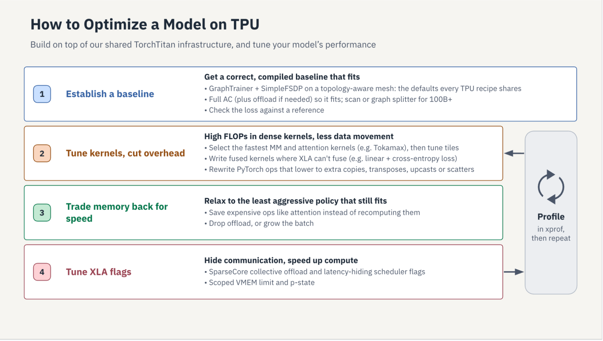
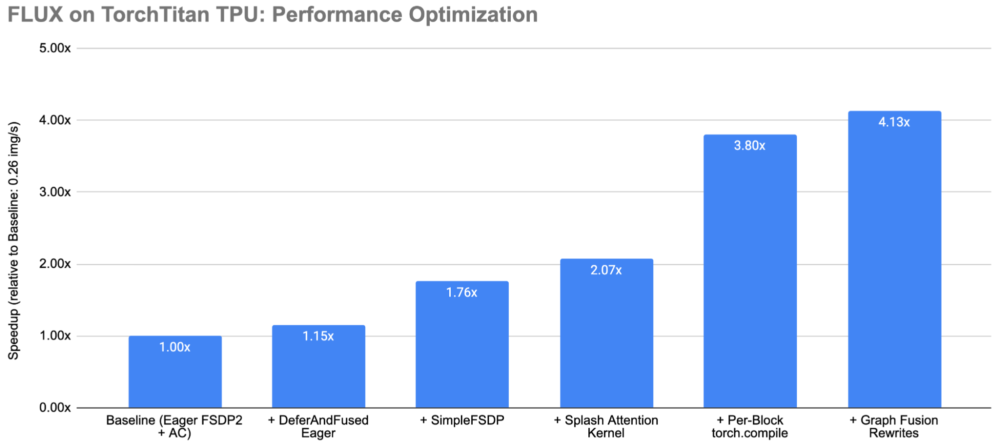
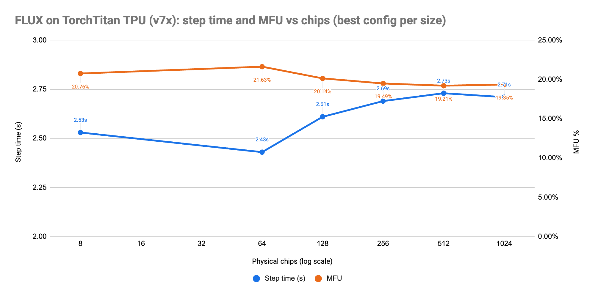
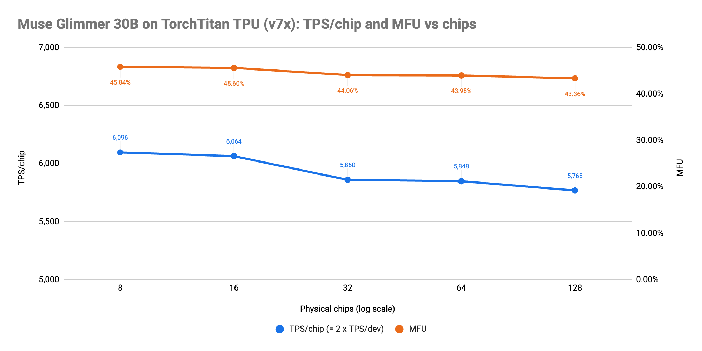
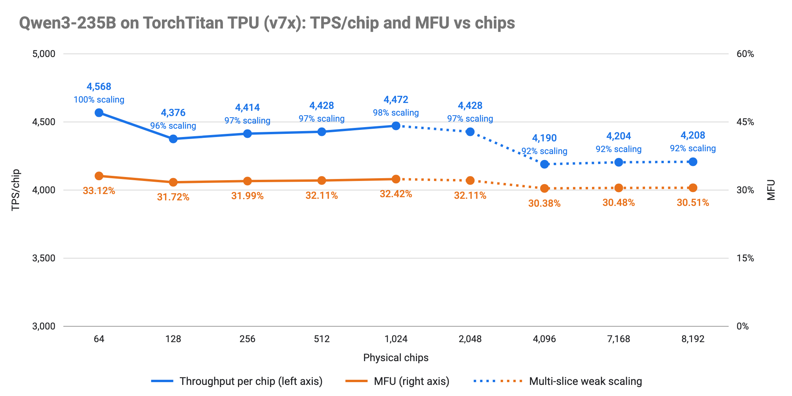

---
authors:
- aitoboxrobot
categories:
- arXiv论文
date: 2026-10-21
hide:
- navigation
tags:
- TorchTitan
- TorchTPU
- PyTorch
- TPU
- 分布式训练
title: 将 TorchTPU 深度集成至 TorchTitan：TPU 上的大模型训练与全链路性能优化实战
---
# 将 TorchTPU 深度集成至 TorchTitan：TPU 上的大模型训练与全链路性能优化实战

> # Integrating TorchTPU into TorchTitan and Optimizing Models for TPU

**发布日期：** 2026 年 10 月 20 日  
**作者：** Aleksey Vlasenko (Software Engineer), Rob Torres (Senior Product Manager), Will Constable (Meta)  

> **Published:** Oct. 20, 2026  
> **Authors:** Aleksey Vlasenko (Software Engineer), Rob Torres (Senior Product Manager), Will Constable (Meta)  

---

### 文章背景与核心概要
在现代生成式人工智能研发中，大规模基础模型的预训练与微调极度依赖高效、可扩展的分布式计算集群。过去，开发者若想在 Google Cloud TPU 上训练 PyTorch 模型，往往面临两难：要么将整个代码库彻底重构为 JAX，要么受困于复杂的 `torch_xla` 适配工作。为了彻底打通这一壁垒，Google 与 Meta 联合推出了 **TorchTPU** 并深度集成到 **TorchTitan** 中，正式将 TPU 作为原生设备 (`torch.device("tpu")`) 接入 PyTorch 核心架构。通过引入全计算图捕获的 Graph Trainer、对编译器极为友好的 SimpleFSDP 并行机制以及基于 Pallas 的专用高性能算子内核（如 Splash Attention），在 Llama 3、FLUX.1 及 Qwen3 等顶尖大模型上实现了比肩甚至超越 JAX 的极致训练性能与吞吐量。这一重大突破为广大 PyTorch 开发者在大规模 TPU 算力集群上进行前沿模型的高效训练与对齐提供了生产级参考标杆。

---

## 执行概要

> ## Executive Summary

本文详细介绍了将 **TorchTPU** 深度集成至 Meta 旗下分布式训练框架 **TorchTitan** 的全过程，为在 Google Cloud TPU 上训练大规模生成式 AI (Generative AI) 模型构建了原生 PyTorch 后端 (`torch.device("tpu")`)。通过双方联合研发的 TPU 原生执行优化通道 (Execution Passes)、对编译器极为友好的 `SimpleFSDP` 实现方案、全训练步计算图捕获 (Full Training-step Graph Capture)，以及针对 TPU 深度优化的 Pallas 算子内核（例如 Splash Attention），开发者如今能够在 Llama 3、FLUX.1 和 Qwen3 等代表性旗舰模型上，获得与 JAX 旗鼓相当的高性能表现。

> This article details the integration of **TorchTPU** into Meta’s **TorchTitan**, establishing a native PyTorch backend (`torch.device("tpu")`) for training large-scale generative AI models on Google Cloud TPUs. By leveraging co-developed TPU-native execution passes, compile-friendly implementations like `SimpleFSDP`, full training-step graph capture, and optimized Pallas kernels (such as Splash Attention), developers can now achieve near-parity performance with JAX on flagship models like Llama 3, FLUX.1, and Qwen3.

---

## 引言

> ## Introduction

过去数年间，Meta 打造的 **TorchTitan** 已发展成为 PyTorch 生态中最顶尖的“净室”参考基准平台，专为超大规模生成式 AI 模型的分布式训练而生。TorchTitan 完全基于 PyTorch 原生的扩展原语构建，不仅免去了繁杂的外部依赖，还提供了高度模块化的架构范例，用于预训练诸如 Llama 3、Qwen 3 和 FLUX 等主流稠密模型以及混合专家模型 (Mixture-of-Experts, MoE)。

> Over the past years, Meta’s **TorchTitan** has emerged as the PyTorch ecosystem’s premier clean-room reference platform for large-scale generative AI model training. Built entirely on PyTorch-native scaling primitives, TorchTitan provides an unencumbered, highly modular showcase for pre-training flagship dense and Mixture-of-Experts (MoE) architectures like Llama 3, Qwen 3, and FLUX.

在以往，想要在 **Google Cloud TPU** 上训练 PyTorch 模型的开发者往往面临着艰难抉择：要么将全部代码重写为 JAX 语言，要么硬着头皮去调试老旧复杂的 `torch_xla` 框架。如今，这一技术困境已成为历史。随着 **TorchTPU** 的正式发布，Cloud TPU 拥有了直接集成在 PyTorch 核心接口中的原生后端 (`torch.device("tpu")`)。训练脚本若想调用 TPU 硬件，只需对设备初始化代码进行微小的改动即可。

> Historically, developers looking to train PyTorch models on **Google Cloud TPUs** faced some challenges: either undertake a complete codebase rewrite into JAX, or grapple with legacy `torch_xla`. That paradigm has officially shifted. With the launch of **TorchTPU**, Cloud TPUs now feature a native backend (`torch.device("tpu")`) integrated directly into PyTorch's core interface. Enabling a training script to use TPUs now only requires minimal changes to your device initialization code. 

然而，实现硬件设备的兼容只是打赢了“上半场”；开发者在实际生产中更迫切需要的，是开箱即用、高性能且经过实战检验的分布式训练方案 (Distributed Training Recipes)。这正是 **TorchTitan on TPU** 的核心使命。**TorchTitan TPU** 是基于 Meta 官方 TorchTitan 代码库专为适配 Google Cloud TPU 模型训练而深度定制的开源分支，项目已开源托管至 [https://github.com/google-pytorch/torchtitan/](https://github.com/google-pytorch/torchtitan/)。

> Providing device compatibility, however, is only half the battle; developers also need high-performance, production-grade, distributed training recipes. This is where **TorchTitan on TPU** comes in. **TorchTitan TPU** is a fork of Meta’s TorchTitan implementation adapted to enable model training on Google Cloud TPUs, available at [https://github.com/google-pytorch/torchtitan/](https://github.com/google-pytorch/torchtitan/).

## 为什么选择 TorchTitan on TPU

> ## Why TorchTitan on TPU

工程团队不再需要从零开始发明定制化的 TPU 模型切分策略 (Sharding Strategies)，也无需手动编写底层的 XLA 通信优化通路。Google 与 Meta 团队直接在 TorchTitan 内部深度联合研发了 TPU 原生执行通道。TorchTitan 顺理成章地成为了在 Google Cloud TPU 上扩展 PyTorch 训练规模的权威核心载体。

> Rather than requiring engineering teams to invent custom TPU sharding strategies or hand-craft low-level XLA communication passes from scratch, Google and Meta co-developed TPU-native execution passes directly inside TorchTitan. TorchTitan serves as the definitive vehicle for scaling PyTorch on Google Cloud TPUs.

### 专为大规模预训练与后训练打造

> ### Designed to Demonstrate Pre- and Post-Training at Scale

TorchTitan 提供了官方维护、经过充分实战压力测试的训练方案，支持预训练超大规模稠密模型（如 Llama 3 70B/405B、Qwen 3 8B/32B）、混合专家模型（如 Qwen 3 235B MoE）以及扩散 Transformer (Diffusion Transformers，如 FLUX.1 12B)。

> TorchTitan provides official, battle-tested recipes for pre-training large dense models (such as Llama 3 70B/405B and Qwen 3 8B/32B), Mixture-of-Experts (such as Qwen 3 235B MoE), and diffusion transformers (such as FLUX.1 12B).

除了基础的预训练任务，TorchTitan 还能无缝充当后训练流水线中的高扩展性训练执行引擎，例如在 VeRL 中用于组相对策略优化 (Group Relative Policy Optimization, GRPO) 与强化学习 (Reinforcement Learning, RL) 对齐微调。在这些工作流中，TorchTitan 专注于高效处理模型参数更新步骤，同时与 vLLM-TorchTPU 等高吞吐推理服务引擎实现实时的权重同步。

> Beyond initial pre-training, TorchTitan serves as the scalable trainer inside post-training pipelines like VeRL for Group Relative Policy Optimization (GRPO) and Reinforcement Learning (RL) alignment. In these workflows, TorchTitan handles the parameter update step while synchronizing weights with high-throughput serving engines like vLLM-TorchTPU.

### 模型结构定义与并行切分完全解耦

> ### Model Definition Decoupled from Model Partitioning

TorchTitan 中的模型定义完全采用纯粹的单设备原生 PyTorch (`nn.Module`) 编写，不包含任何特定于 CUDA 的硬编码。分布式通信集合算子 (Collectives) 可以通过可组合的框架层（如 FSDP）、声明式的切分计划（如张量并行 Tensor Parallelism）或特定后端的插件机制（如 MoE 层）灵活注入。TorchTPU 全面支持 C10D 集合通信 API 与 PyTorch 的 `DeviceMesh` 抽象。二者紧密配合，使 TPU 执行分支能够根据模型架构自由选择应用何种并行维度以及采用何种具体实现方案。

> Model definitions in TorchTitan are written in pure, single-device PyTorch (`nn.Module`) with no CUDA-specific code. Collectives are inserted either by a composable framework layer (e.g., FSDP), by declarative sharding plans (e.g., tensor-parallelism), or as backend-specific plugins (e.g., MoE layers). TorchTPU supports C10D collective APIs and the PyTorch `DeviceMesh` abstraction. Together, this allows the TPU path to choose which parallelisms to apply for a model, and which implementations to use.

### 高度灵活的可插拔架构

> ### Pluggable Architecture

TorchTitan 在构建模型时依托于一套完整的配置树 (Configuration Tree)，而这棵配置树在模型实例化之前允许进行灵活重写。这为开发者提供了一种干净优雅的机制：无需修改模型的核心定义或共享的训练主循环，就能将模型中的个别子模块替换为在 TPU 上运行效率更高的定制实现。

> TorchTitan builds a model from a configuration tree, and that tree can be rewritten before the model is constructed. This offers a clean way to replace individual blocks of a model with versions that run better on TPU, without touching the model definition or the shared trainer loop.

我们在实战中深度运用了这一特性。TPU 专属方案中，我们将标准注意力机制替换为 **Splash Attention**——这是一个由 Pallas 编写的定制内核，能够在不显式物化注意力矩阵的前提下高效处理因果掩码、滑动窗口掩码以及文档打包掩码；同时将最终的线性投影与交叉熵损失替换为融合的 Pallas 内核，避免将庞大的完整 Logits 张量写回高带宽内存 (High Bandwidth Memory, HBM)；还将 MoE 专家矩阵乘法替换为分组 Pallas 内核。每一个算子内核本质上都是一个 JAX 函数，并通过 TorchTPU 的 `torch.tpu.pallas.jax_op` 装饰器被封装为 PyTorch 自定义算子 (Custom Op)。每一个算子替换都可以通过配置开关一键开启，并能与纯 PyTorch 原生分支进行严谨的单元测试对照。这些内核均可直接复用来自 OpenXLA 面向 TPU 和 GPU 的开源算子库 [tokamax](https://github.com/openxla/tokamax)。

> We use this actively. The TPU recipes replace standard attention with **Splash Attention**, a Pallas kernel that handles causal, sliding-window and packed-document masks without materializing the attention matrix; replace the final projection and cross-entropy loss with a fused Pallas kernel that never writes the full logits tensor to HBM; and replace MoE expert matmuls with grouped Pallas kernels. Each kernel is a JAX function turned into a PyTorch custom op by TorchTPU's `torch.tpu.pallas.jax_op` decorator. Each replacement is a config flag, so a recipe can turn it on, and a test can compare it against the plain PyTorch path it replaces. Kernels can come from [tokamax](https://github.com/openxla/tokamax), the OpenXLA kernel library for TPU and GPU.

### 面向编译器深度优化的 SimpleFSDP 实现

> ### Compile-Friendly FSDP Implementation

原生的 FSDP2 是紧密围绕 GPU 的执行模型构建的。它的全收集 (All-gather) 与规约散射 (Reduce-scatter) 集合通信是通过模块钩子 (Module Hooks) 发出的显式函数调用，其与计算重叠 (Overlap) 的实现方式是借助于通过事件 (Events) 同步的独立 CUDA 流 (Streams)。然而，在 XLA 编译器眼中，这套逻辑完全是不可见的：集合通信操作游离在计算图追踪区域之外，导致在 TPU 上运行 `torch.compile` 时会在每个 FSDP 钩子处被迫中断，根本无法捕获整个训练步的完整图。TorchTPU 提供了空操作 (no-op) 的流和事件对象，仅仅是为了让 FSDP2 能勉强跑通；但由于 XLA 是依靠数据依赖来调度任务的，这些流与事件对 XLA 而言毫无优化价值。

> FSDP2 is built around the GPU execution model. Its all-gathers and reduce-scatters are issued from module hooks as explicit collective calls, and overlap with compute comes from running them on dedicated CUDA streams synchronized with events. None of that is visible to a compiler: the collectives sit outside the traced region, so on TPU a `torch.compile` region breaks at every FSDP hook and a whole-step graph cannot be captured at all. TorchTPU provides no-op stream and event objects only so that FSDP2 runs; XLA has no use for them, since it schedules work from data dependencies.

而 [SimpleFSDP](https://github.com/google-pytorch/torchtitan/blob/main/torchtitan/experiments/graph_trainer/simple_fsdp.py) 则站在编译器的视角重新设计了切分逻辑。参数切分被抽象为 `DTensor` 的参数化表达：读取模块权重时，会在内部执行从“分片”到“全量复制”的重分布操作（即 All-gather），而其自动微分的反向传播过程则自然对应着 Reduce-scatter。整个过程不依赖任何钩子或显式集合调用，因此两项集合通信操作都成为了被追踪图中的普通计算节点。XLA 编译器得以在单个编译程序内部，提前将 All-gather 调度到需要它们的矩阵乘法之前，并将 Reduce-scatter 与反向计算完美重叠。混合精度训练也依托于同一套机制实现——只需在该重分布上配置 Gather 的数据类型（bf16 权重参数）与 Reduce 的数据类型（fp32 或 bf16 梯度）。面对跨机架多切片 (Multislice) 的混合切分 (Hybrid Sharding)，相同的代码可以在二维网格上轻松展开：切片内部通过高速芯片间互连 (Inter-Chip Interconnect, ICI) 进行参数分片，跨切片之间则通过数据中心网络 (Data Center Network, DCN) 进行全量复制。

> [SimpleFSDP](https://github.com/google-pytorch/torchtitan/blob/main/torchtitan/experiments/graph_trainer/simple_fsdp.py) takes the compiler's view instead. Parameter sharding is a `DTensor` parametrization: reading a module's weight performs a redistribute from sharded to replicated (the all-gather), and its autograd backward is the reduce-scatter. There are no hooks and no explicit collective calls, so both collectives are ordinary nodes in the traced graph. The XLA compiler schedules the all-gathers ahead of the matmuls that need them and overlaps the reduce-scatters with the backward compute, inside one program. Mixed precision is part of the same mechanism—a policy that sets the gather dtype (bf16 parameters) and the reduce dtype (fp32 or bf16 gradients) on that redistribute. Hybrid sharding for multislice is the same code on a 2-D mesh: shard within a slice over ICI, replicate across slices over DCN.

在 FLUX 模型的训练实测中，正是得益于这项突破，TorchTitan 的吞吐性能达到了 JAX MaxDiffusion 的 99%：在 SimpleFSDP 模块下，每一层的 HLO（高级优化器表示）都被编译为单个计算模块，权重 All-gather、矩阵乘法、注意力机制以及归一化层全部紧密融合在一起。

> On FLUX this is what brought TorchTitan to 99% performance parity with JAX MaxDiffusion: the per-layer HLO for a SimpleFSDP block is a single module with the weight all-gathers, matmuls, attention and norms fused together.

### Graph Trainer：捕获完整的单步训练图

> ### Graph Trainer: Capturing the Entire Training Step

许多 PyTorch 训练框架要么在动态图 (Eager Mode) 下借助 CUDA 图来降低算子发射开销，要么只能将 `torch.compile` 应用于局部的网络区域。由于 TorchTPU 暂未完全支持 PyTorch 的 `torch.Stream` 多流抽象，这直接制约了基于 Eager 的 FSDP2 与逐层 `torch.compile` 的混用。而 SimpleFSDP 通过一种与编译器完全兼容的表征形式解决了参数切分问题。

> Many PyTorch trainers either run in eager mode with CUDA graphs to cut launch overhead, or apply `torch.compile` to isolated regions. TorchTPU does not yet support the PyTorch `torch.Stream` abstraction, which limits mixing eager-based FSDP2 with layer-wise `torch.compile`. SimpleFSDP helps by expressing parameter sharding in a way compatible with compilation.

TorchTitan 的 Graph Trainer 实现了对完整训练步（涵盖前向计算、损失计算与反向传播）的全图捕获，利用 PyTorch 的 `make_fx` 追踪器预先生成单一的 FX 计算图。Graph Trainer 还能在此基础上运行全图优化通道——例如基于图分析的激活值内存策略，智能决定哪些张量应当保留、重计算 (Recompute) 或卸载 (Offload)。最终，整个训练步将作为一个统一的 XLA 程序在硬件上高效运行。

> TorchTitan's Graph Trainer provides full training-step capture (forward, loss, and backward), producing one FX graph ahead of time with PyTorch's `make_fx` tracer. GraphTrainer also runs optimization passes—such as a graph-based activation memory policy that decides what to save, recompute, or offload. The train step then executes as a single XLA program.

借助跨层扫描 (Scan over layers，即将全部解码器层编译为单一循环体) 与图切分器 (Graph Splitter，将训练步拆分为独立编译的前向和反向程序，同时将中间激活值卸载至主机内存)，该优化路径在 Qwen3 235B 上斩获了超过 29% 的模型浮点运算利用率 (Model FLOPs Utilization, MFU)。此外，函数式的 AdamW 权重更新 (`functional_adamw_step`) 也可以直接追踪融合进单步训练图中，在 Qwen3-8B 模型上实现了高达 51% 至 52% 的 MFU。

> Using scan over layers (running decoder layers as a single loop body) and the graph splitter (cutting the step into separately compiled forward/backward programs with activations offloaded to host memory), this path reaches 29%+ MFU on Qwen3 235B. A functional AdamW update (`functional_adamw_step`) can also be traced directly into the train-step, reaching 51–52% MFU on Qwen3-8B.

---

## TPU 模型优化实战秘籍

> ## TPU Model Optimization Playbook

下文总结的每一项优化手段均已在 [TorchTitan TPU 优化指南](https://github.com/google-pytorch/torchtitan/blob/main/torchtitan/experiments/tpu/torch-tpu-optimization-guide.md) 中详细说明，并且绝大多数已经深度集成到了现成的 [训练方案 (Recipes)](https://github.com/google-pytorch/torchtitan/tree/main/torchtitan/experiments/tpu/recipes) 中。

> Every lever below is described in the [TorchTitan TPU optimization guide](https://github.com/google-pytorch/torchtitan/blob/main/torchtitan/experiments/tpu/torch-tpu-optimization-guide.md), and nearly all of them are already wired into [the recipes](https://github.com/google-pytorch/torchtitan/tree/main/torchtitan/experiments/tpu/recipes).

### 1. 确立基线基准

> ### 1. Establish a Baseline

* **选择执行模式：** 动态图 (Eager Mode) 非常适合模型初步搭建与逻辑调试，但在性能表现上并不占优势。TorchTPU 的 [延迟融合动态图模式 (Deferred-and-Fused Eager Mode)](https://github.com/google-pytorch/torch_tpu/blob/main/docs/markdown/2_in_depth_4_torchtpu_execution_modes.md)（配置参数 `--tpu_config.eager_mode=DEFER_AND_FUSE`）允许 XLA 跨越算子边界进行融合，从而显著挽回性能损失。开启 [逐块 torch.compile](https://docs.pytorch.org/docs/stable/torch.compiler.html)（配置参数 `--compile.enable`）可将调试配置直接升级为高性能训练配置。而 [Graph Trainer 则更进一步](https://github.com/google-pytorch/torchtitan/tree/main/torchtitan/experiments/graph_trainer)（配置参数 `--tpu_config.use_graph_trainer`），它能够将整个训练步捕获为单个编译程序。
* **利用 SimpleFSDP 与混合精度策略进行切分：** [SimpleFSDP 将切分逻辑](https://arxiv.org/abs/2411.00284) 直接转化为计算图内部的集合通信（配置参数 `--parallelism.use_simple_fsdp`）。推荐搭配 bf16 权重参数以及 fp32 梯度规约 (Gradient Reduction)。
* **针对超大模型 (~100B+ 参数)，启用 Scan 循环或切分计算图，并卸载激活值：** [跨层扫描 (Scan over layers)](https://github.com/google-pytorch/torchtitan/blob/main/torchtitan/experiments/tpu/torch-tpu-optimization-guide.md)（配置参数 `--tpu_config.use_scan_layers`）将解码器循环折叠执行。[图切分器 (Graph Splitter)](https://github.com/google-pytorch/torchtitan/blob/main/torchtitan/experiments/tpu/torch-tpu-optimization-guide.md)（配置参数 `--tpu_config.use_graph_split`）则分别编译前向与反向传播，同时将显存中的激活值卸载至主机内存。

> * **Choose execution mode:** Eager mode is great for bringing up models and debugging, but not for performance. TorchTPU's [deferred-and-fused eager mode](https://github.com/google-pytorch/torch_tpu/blob/main/docs/markdown/2_in_depth_4_torchtpu_execution_modes.md) (`--tpu_config.eager_mode=DEFER_AND_FUSE`) recovers performance by letting XLA fuse across op boundaries. Enabling [per-block torch.compile](https://docs.pytorch.org/docs/stable/torch.compiler.html) (`--compile.enable`) turns a debug config into a performant one. [Graph Trainer goes further](https://github.com/google-pytorch/torchtitan/tree/main/torchtitan/experiments/graph_trainer) (`--tpu_config.use_graph_trainer`) by capturing the entire training step as one program.
> * **Shard with SimpleFSDP and a mixed-precision policy:** [SimpleFSDP expresses](https://arxiv.org/abs/2411.00284) sharding as collectives inside the traced graph (`--parallelism.use_simple_fsdp`). Pair it with bf16 parameters and fp32 gradient reduction.
> * **For large models (~100B+ parameters), enable scan or split the graph, and offload activations:** [Scan over layers](https://github.com/google-pytorch/torchtitan/blob/main/torchtitan/experiments/tpu/torch-tpu-optimization-guide.md) (`--tpu_config.use_scan_layers`) runs the decoder as a single loop body. [The graph splitter](https://github.com/google-pytorch/torchtitan/blob/main/torchtitan/experiments/tpu/torch-tpu-optimization-guide.md) (`--tpu_config.use_graph_split`) compiles forward and backward passes separately while offloading activations.

### 2. 调优计算与算子内核

> ### 2. Tune Compute and Kernels

* **开启 Pallas 算子内核：** [Splash Attention](https://github.com/google-pytorch/torchtitan/blob/main/torchtitan/experiments/tpu/kernels/splash_attention.py)（配置参数 `--splash_attention_kernel.use_splash_attention_kernel`）能够有效规避完整注意力矩阵的显式物化。[融合线性交叉熵损失 (Fused Linear Cross-Entropy Loss)](https://github.com/google-pytorch/torchtitan/blob/main/torchtitan/experiments/tpu/kernels/linear_softmax_cross_entropy_loss.py) 每次针对词表的分块分片计算 LM-head 矩阵乘法、Softmax 与损失值。对于 MoE 架构模型，建议使用分组专家矩阵乘法以及配对的 Gate/Up 内核（配置参数 `use_pallas_paired_grouped_mm`）。
* **调优内核分块尺寸 (Tile Sizes)：** 依据具体的模型维度与 TPU 硬件世代，在限定的作用域 VMEM 预算 (`xla_tpu_scoped_vmem_limit_kib`) 内精细调整分块大小 (`sa_block_*`)。

> * **Turn on Pallas kernels:** [Splash attention](https://github.com/google-pytorch/torchtitan/blob/main/torchtitan/experiments/tpu/kernels/splash_attention.py) (`--splash_attention_kernel.use_splash_attention_kernel`) avoids materializing the full attention matrix. The [fused linear cross-entropy loss](https://github.com/google-pytorch/torchtitan/blob/main/torchtitan/experiments/tpu/kernels/linear_softmax_cross_entropy_loss.py) computes LM-head matmul, softmax, and loss one vocabulary tile at a time. For MoE models, use grouped expert matmuls and paired gate/up kernels (`use_pallas_paired_grouped_mm`).
> * **Tune kernel tile sizes:** Adjust block sizes (`sa_block_*`) within the scoped VMEM budget (`xla_tpu_scoped_vmem_limit_kib`) based on model shape and TPU generation.

### 3. 优化显存占用与批处理大小

> ### 3. Optimize Memory and Batch Size

* **提升批处理大小 (Batch Size)：** 充分利用融合损失与注意力内核所节省下来的宝贵显存，调大每芯片批处理尺寸，直至模型训练达到 HBM 带宽瓶颈上限。

> * **Raise the batch size:** Push the per-chip batch size until the model becomes HBM-bound, leveraging the memory saved by fused losses and attention kernels.

### 4. 编译器调优、通信优化与性能分析

> ### 4. Tune Compiler, Communication, and Profile

* **微调 XLA 与 libtpu 参数：** 借助训练方案中提供的预设参数组合，配置能够隐藏延迟的调度器以及层次化 Reduce-scatter 通信。务必严密检查第 1 步的损失值与梯度范数，以确保数值结果在位级别上完全一致或仅产生可接受的微小舍入误差。
* **性能剖析 (Profile)：** 在稳态运行步骤中通过开启性能分析器（配置参数 `--profiler.enable_profiling`）抓取 `xprof` 追踪日志，以精准定位系统性能瓶颈。

> * **Tune XLA and libtpu flags:** Use the flag bundles provided in recipes to configure latency-hiding schedulers and hierarchical reduce-scatters. Always check step-1 loss and gradient norms to ensure bit-identity or acceptable rounding changes.
> * **Profile:** Capture an `xprof` trace over steady-state steps (`--profiler.enable_profiling`) to identify bottlenecks.

---

## 实践案例分析

> ## Case Studies

### FLUX.1

> ### FLUX.1

[FLUX.1](https://github.com/google-pytorch/torchtitan/tree/main/torchtitan/experiments/tpu/flux) 是一个拥有 120 亿参数的扩散 Transformer 模型，在单台 TPU v6e-8 上以 1024x1024 分辨率进行训练。从最初的 Eager 动态图模式逐步迁移至延迟融合 Eager 模式，再进一步引入 SimpleFSDP、Splash Attention 与逐块 `torch.compile`，单步训练耗时从 11.49 秒大幅下降至 3.02 秒。随后的局部模型重写（包括拆分融合投影、简化旋转位置编码以及优化 Q/K/V 拆包）更进一步将单步耗时压缩至 2.78 秒——**相比初始基线提速达到 4.1 倍**，并成功达到了 JAX MaxDiffusion 约 99% 的吞吐效率。

> [FLUX.1](https://github.com/google-pytorch/torchtitan/tree/main/torchtitan/experiments/tpu/flux) is a 12-billion-parameter diffusion transformer trained at 1024x1024 resolution on a TPU v6e-8. Moving from eager mode to deferred-and-fused eager, then to SimpleFSDP, Splash Attention, and per-block `torch.compile`, reduced step times from 11.49s to 3.02s. Local model rewrites (splitting fused projections, simplifying rotary embeddings, and optimizing Q/K/V unpacking) further brought the step time down to 2.78s—**4.1x faster than the starting point** and achieving ~99% throughput of JAX MaxDiffusion.

在结合混合切分 (HSDP) 将 FLUX 训练规模从 8 颗芯片扩展至 1,024 颗 v7x 芯片的过程中，展现出了高达 **93% 的弱扩展效率 (Weak-scaling Efficiency)**。

> Scaling FLUX from 8 to 1,024 v7x chips with hybrid sharding (HSDP) demonstrated **93% weak-scaling efficiency**.

### MuseGlimmer

> ### MuseGlimmer

[Muse Glimmer 30B](https://github.com/google-pytorch/torchtitan/tree/main/torchtitan/experiments/tpu/muse_glimmer) 是一个拥有 52 层的稠密解码器大模型，采用了窗口化 SDPA 内部注意力以及带软截断 (Soft-capping) 的融合交叉熵内核。在 64 颗 v7x 芯片上以 16,384 的上下文序列长度运行，并启用 Graph Trainer、SimpleFSDP 与 fp32 梯度规约，其单芯片吞吐量达到 **每秒 5,848 个 Token，MFU 约为 44%**。

> [Muse Glimmer 30B](https://github.com/google-pytorch/torchtitan/tree/main/torchtitan/experiments/tpu/muse_glimmer) is a 52-layer dense decoder featuring windowed SDPA inner attention and a fused cross-entropy kernel with soft-capping. Running on 64 v7x chips at a sequence length of 16,384 using Graph Trainer, SimpleFSDP, and fp32 gradient reductions, it reaches **5,848 tokens per second per chip at ~44% MFU**.

### Qwen3 235B

> ### Qwen3 235B

[Qwen3-235B-A22B](https://github.com/google-pytorch/torchtitan/tree/main/torchtitan/experiments/tpu/qwen3) 是一个具有 94 层的超大规模混合专家 (MoE) 模型。通过结合跨层扫描、主机激活值卸载、`libtpu` 调度参数调优、tokamax Splash Attention 以及分组矩阵乘法内核，该模型在 256 颗 v7x 芯片上运行时，**MFU 达到了约 32%**。通过多切片 HSDP 测试扩展至 8,192 颗芯片时，展现了近乎线性的扩展能力，在芯片总数暴增 128 倍的极端情况下，整体吞吐性能衰减仅为 8%。

> [Qwen3-235B-A22B](https://github.com/google-pytorch/torchtitan/tree/main/torchtitan/experiments/tpu/qwen3) is a 94-layer Mixture-of-Experts model. Using layer scanning and host activation offloading, along with `libtpu` scheduling flags, tokamax splash attention, and grouped-matmul kernels, the model runs at **~32% MFU on 256 v7x chips**. Testing up to 8,192 chips via multi-slice HSDP demonstrated near-linear scaling, with throughput dropping by only 8% across a 128x increase in chip count.

---

## 生态集成与未来路线图

> ## Ecosystem Integration and Roadmap

### Hugging Face Transformers 模型接入后端

> ### Hugging Face Transformers Modeling Backend

对于希望直接迁移自己拥有的 Hugging Face 模型权重的工程团队，[Transformers 建模后端](https://github.com/google-pytorch/torchtitan/blob/main/torchtitan/experiments/transformers_modeling_backend/README.md) 允许模型直接在 TorchTitan 的训练器与并行框架下无缝运转，完全无需重写底层模型代码。系统会自动为其套用 SimpleFSDP、逐块 `torch.compile`、Splash Attention 以及融合 Pallas 交叉熵算子。

> For teams bringing their own Hugging Face checkpoints, the [Transformers modeling backend](https://github.com/google-pytorch/torchtitan/blob/main/torchtitan/experiments/transformers_modeling_backend/README.md) allows models to run through TorchTitan's trainer and parallelism without rewriting model code. It applies SimpleFSDP, per-block `torch.compile`, Splash Attention, and fused Pallas cross-entropy automatically.

### 智能体辅助的模型适配接入

> ### Agent-Assisted Model Onboarding

该项目代码库还附带了一套专为编程智能体打造的 [模型接入技能 (Model-onboarding Skill)](https://github.com/google-pytorch/torchtitan/tree/main/torchtitan/experiments/tpu/.claude/skills/tpu_model_onboarding)，旨在引导 AI 编程智能体一步步协助工程师系统化完成全新模型架构的迁移适配与深度调优。

> The repository includes a [model-onboarding skill](https://github.com/google-pytorch/torchtitan/tree/main/torchtitan/experiments/tpu/.claude/skills/tpu_model_onboarding) designed for coding agents to walk engineers through porting and optimizing new architectures systematically.

### 未来路线图

> ### Roadmap

TorchTitan TPU 的后续开发演进将聚焦于五大核心支柱：

> TorchTitan TPU development focuses on five key pillars:

1. **生产级就绪度 (Production Readiness)：** 在 GKE（Google Kubernetes Engine）上深度集成 ML 有效吞吐统计 (Goodput Measurement) 与多层级检查点存储 (Multi-Tier Checkpointing)。
2. **精度拓展 (Precision)：** 将 `float8` 低精度训练方案从 Llama 3 70B 拓展至更多模型架构。
3. **前沿硬件适配 (Hardware)：** 支持即将推出的第八代 TPU 芯片（TPU 8t 与 TPU 8i）。
4. **先进并行度 (Parallelism)：** 针对 MoE 内核与超长上下文 (Long-context) 训练实现专家并行 (Expert Parallelism)。
5. **超大模型扩展 (Models)：** 全面支持并扩展至 2 万亿 (2T+) 参数规模的顶尖架构，例如 Qwen3.8-Max 与 Kimi K3。

> 1. **Production Readiness:** Integration with ML Goodput Measurement and Multi-Tier Checkpointing on GKE.
> 2. **Precision:** Expanding `float8` recipes beyond Llama 3 70B.
> 3. **Hardware:** Support for upcoming eighth-generation TPUs (TPU 8t and TPU 8i).
> 4. **Parallelism:** Implementing expert parallelism for MoE kernels and long-context training.
> 5. **Models:** Scaling up to 2T+ parameter architectures like Qwen3.8-Max and Kimi K3.

---

## 总结

> ## Conclusion

TorchTitan on TPU 成功抹平了纯粹易读的 PyTorch 代码与前沿极致的 TPU 硬件性能之间的鸿沟。无论是直接开箱采用 TorchTitan 的原生训练方案，还是将 SimpleFSDP、Graph Trainer 以及 Pallas 内核等独立组件灵活拆分融入现有的研发工作流，广大开发者如今都拥有了一条强大、高效且面向生产的必由之路，在 Google Cloud TPU 上从容扩展生成式 AI 的训练与对齐。

> TorchTitan on TPU bridges the gap between clean PyTorch code and state-of-the-art TPU performance. Whether adopting TorchTitan's native recipes or integrating individual building blocks—like SimpleFSDP, Graph Trainer, and Pallas kernels—into existing workflows, developers now have a robust, high-performance path to scale generative AI training on Google Cloud TPUs.
