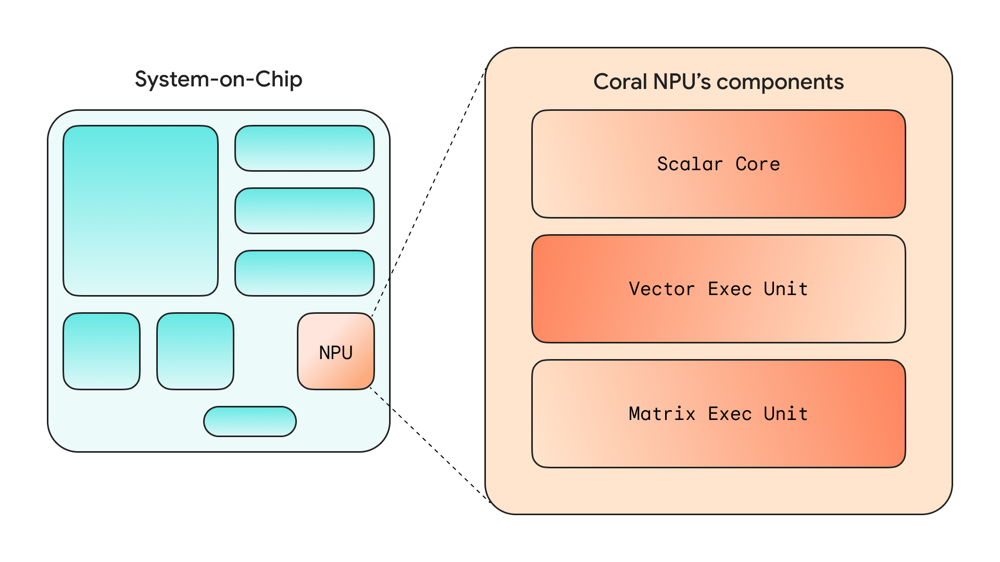
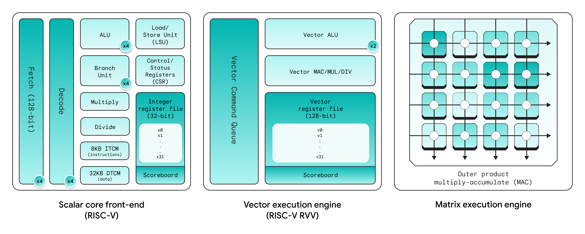
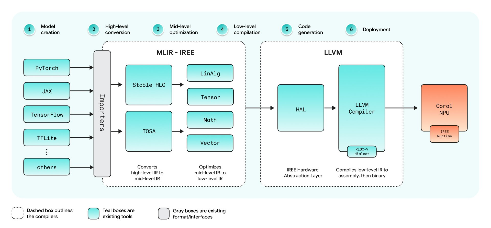

---
authors:
  - aitoboxrobot
categories:
  - 产品发布
date: 2026-10-21
hide:
  - navigation
tags:
  - Coral NPU
  - 端侧AI
  - Google Research
  - RISC-V
  - IREE
title: "统一端侧 AI：Coral NPU 开放标准如何打通从模型到底层芯片的高能效智能"
---

# 统一端侧 AI：Coral NPU 开放标准如何打通从模型到底层芯片的高能效智能

> # Unifying Edge AI: How Coral NPU’s open standard brings portable, energy-viable intelligence from model to silicon

**发布日期：** 2026 年 10 月 20 日  
**作者：** Billy Rutledge (Engineering Director, Google Research)  

> **Published:** October 20, 2026  
> **Author:** Billy Rutledge, Engineering Director, Google Research  

---

### 文章背景与核心概要
在以大模型为核心的人工智能浪潮中，云端算力基础设施已高度标准化，然而端侧 AI (Edge AI) 领域却长期面临着数百种专有芯片架构与互不兼容的编译器工具链割裂的困境，这就是开发者苦不堪言的“碎片化税”。为了打破这一行业桎梏，Google Research 正式推出了 **Coral NPU** 开源软硬件统一标准。本次重磅进展标志着完整 32 位 Coral NPU 硬件架构规范的正式收官，同步发布了首个生产级 v1.0 IREE/MLIR 统一编译器工具链，并联合 Synaptics 推出 Astra SR200 商用级低功耗芯片与全新 Coralboard 开发板。该标准让开发者只需一次调优，即可将轻量大模型无缝部署在各类极低功耗的边缘智能终端与可穿戴设备中，推动端侧通用智能迎来跨硬件平台的新时代。

---

## 执行概要

> ## Executive Summary

当今的云端 AI 基础设施已经高度收敛于成熟的标准软件栈之上，但端侧 AI (Edge AI) 领域却依然深陷于数百种专有芯片架构与互不兼容的编译工具链的严重碎片化泥潭中。为了彻底消除这一阻碍技术落地的“碎片化税 (Fragmentation Tax)”，Google Research 正式推出了 **Coral NPU**——这是一套专为统一端侧计算生态而设计的开放软硬件标准。

> While cloud AI infrastructure has converged around standardized software stacks, edge AI remains heavily fragmented across hundreds of proprietary chip architectures and incompatible toolchains. To solve this "fragmentation tax," Google Research introduced the **Coral NPU**—an open hardware and software standard designed to unify the edge. 

本文重点梳理了 Coral 生态系统近期达成的重大里程碑，包括：32 位 Coral NPU 硬件架构的全面竣工、v1.0 版本 IREE/MLIR 统一编译器的正式发布、Synaptics 打造的全新商用芯片，以及进一步拓展的 Coralboard 开发者套件。这些突破性的软硬件进展，让机器学习 (ML) 开发者只需对模型进行一次调优，即可轻松跨越不同的硬件平台与功耗约束进行无缝部署。

> This post highlights major milestones in the Coral ecosystem, including the completion of the 32-bit Coral NPU architecture, the release of the v1.0 IREE/MLIR compiler, new silicon from Synaptics, and expanded Coralboard developer kits. These advancements allow ML developers to optimize a model once and seamlessly deploy it across diverse hardware targets and power envelopes.

---

## 软硬件协同设计：在精准的功耗区间内释放极致性能

> ## Co-designing Silicon and Software: The Right Performance at the Right Power Envelope

端侧 AI 是云端计算架构不可或缺的重要补充：它通过模型级联 (Model Cascading) 机制，能够为用户提供超低延迟、强隐私保护以及离线可靠的实时计算体验。然而，长期以来，面向边缘设备开发 AI 一直饱受芯片架构碎片化的严重拖累——但凡遇到专用硬件不支持的神经网络算子，系统就只能无奈退回至通用 CPU 上执行，从而导致电池电量急剧消耗、响应延迟成倍飙升。

> Edge AI complements cloud infrastructure by providing ultra-low-latency, private, and reliable real-time processing through model cascading. However, building for the edge has historically been hindered by chip fragmentation, where unsupported neural network layers fall back to general-purpose CPUs, draining batteries and increasing latency. 

为此，Google 在设计 Coral NPU 硬件架构的同时，同步推进了对应编译器的协同研发。我们不再盲目追求芯片规格书上那些虚高的峰值算力指标，而是将全部重心聚焦于**具备实际能效价值的可用算力 (Energy-viable Compute)**——在严苛受限的功耗区间内，交付最贴合实际应用场景的最佳性能。

> Google designed the Coral NPU architecture and its compiler concurrently. Rather than chasing inflated peak-compute metrics on spec sheets, the focus is on **energy-viable compute**—delivering optimal performance within strict power envelopes.

---

## 32 位 Coral NPU 硬件架构全面收官

> ## Completing the Coral NPU 32-bit Architecture

随着**矩阵执行单元 (Matrix Execution Unit，里程碑 4)** 的正式发布，完整的 32 位 Coral NPU 硬件架构现已正式定型。该架构的演进历程涵盖四大关键里程碑：

> With the release of the **Matrix Execution Unit (Milestone 4)**, the complete 32-bit Coral NPU architecture is finalized. The milestones comprise:

1. **里程碑 1 (Milestone 1)：** 支持 C 语言直接编程的 RISC-V 标量前端，用于灵活的控制流调度；
2. **里程碑 2 (Milestone 2)：** 支持 RVV v1.0 规范的矢量协处理器，用于高效执行 SIMD (单指令多数据流) 运算；
3. **里程碑 3 (Milestone 3)：** 具备浮点运算原生支持的高速紧耦合内存子系统；
4. **里程碑 4 (Milestone 4)：** 矩阵执行单元（遵循 VME 规范），配备专用的外积乘加 (MAC) 硬件引擎，能够在局部寄存器内部单周期完成完整的 2D 分块计算（每时钟周期可执行 256 次乘加运算）。

> 1. **Milestone 1:** A C-programmable RISC-V scalar frontend for control flow.
> 2. **Milestone 2:** An RVV v1.0 vector co-processor for SIMD operations.
> 3. **Milestone 3:** A tightly coupled memory subsystem with floating-point support.
> 4. **Milestone 4:** The Matrix Execution Unit (VME specification), featuring a dedicated outer-product multiply-accumulate (MAC) engine capable of computing a full 2D tile (256 MACs per cycle) inside local registers.

在低于 10 毫瓦 (sub-10 mW) 的极致微功耗区间下，该架构能够仅依靠微型电池供电，持续稳定运行各类多模态 (Multimodal) 复杂工作负载——例如 Gemma 等轻量级 Transformer 大模型、端侧实时语音翻译，以及高保真空间音频降噪滤波等。目前，完整的 [32 位 RTL 硬件描述代码已在 GitHub 全面开源](https://github.com/google-coral/coralnpu)。

> Operating under a sub-10 mW power envelope, this architecture enables continuous multimodal workloads—such as compact transformer models like Gemma, real-time voice translation, and spatial audio filtering—on small batteries. The complete [32-bit RTL is available on GitHub](https://github.com/google-coral/coralnpu).

---

## 借助 v1.0 IREE/MLIR 编译器打通“算法模型至物理芯片”的桥梁

> ## Bridging Models to Silicon with the v1.0 IREE/MLIR Compiler

为了让开发者彻底告别繁琐痛苦的手写汇编编码，Google 正式推出了其 [开源 MLIR/IREE 编译器工具链](https://github.com/google-coral/coralnpu-compiler) 的 v1.0 基石版本。

> To eliminate the need for custom assembly coding, Google is releasing the v1.0 foundation of its [open-source MLIR/IREE compiler toolchain](https://github.com/google-coral/coralnpu-compiler). 

该工具链能够将基于 JAX、PyTorch 和 TensorFlow 等主流框架构建的模型（通过 StableHLO 与 TOSA 中间表示）直接编译并映射至 Coral NPU 硬件上运行。编译器会自动接管算子工作负载切分、算子融合以及矩阵分块调优，使其精准匹配片上局部 SRAM 与累加器的物理规格。结合开源的 MPACT 仿真器与参考 FPGA 设计方案，研发团队在物理芯片流片之前，即可对模型运行表现进行全面基准评测，并对芯片硬件配置进行精细微调。

> This toolchain brings models from frameworks like JAX, PyTorch, and TensorFlow (via StableHLO and TOSA) directly to the Coral NPU. It handles workload partitioning, operator fusion, and matrix tiling to fit local SRAM and accumulators. Combined with the open-source MPACT simulator and reference FPGA designs, teams can benchmark models and tune silicon configurations prior to fabrication.

---

## 产业生态落地：商用芯片与硬件载体齐头并进

> ## The Ecosystem in Action: Commercial Silicon and Hardware

要将一项开放硬件标准真正推向全球市场，离不开半导体全产业链的深度合作与协同创新：

> Bringing an open standard to market requires deep collaboration across the semiconductor supply chain:

* **晶圆代工与设计服务合作：** 携手 VeriSilicon 推进设计实现与验证工作，并与 GlobalFoundries 合作基于其 12LP+ FinFET 先进制程进行流片制造。
* **Synaptics Astra® SR200 系列芯片：** 已成功完成流片并于本月正式发布，该芯片深度集成了第二代 Coral NPU IP，在面向可穿戴设备与工业传感器的超低功耗微控制器 (MCU) 封装中，提供了高达 400 GOPS 的算力输出。
* **Coralboard™ SR 开发板：** 搭载 Astra SR200 系列芯片的全新开发套件，专为具身智能 (Physical AI) 与端侧边缘计算的快速原型开发量身打造。
* **Coralboard™ SL 开发板（全球正式商用发售）：** 核心采用 Astra SL2619 处理器，内嵌算力达 1 TOPS 的 Torq™ / Coral NPU 子系统，目前已通过 [DigiKey](https://www.digikey.com/en/products/detail/synaptics-coralboard/720-KDVSL2619-11/29784108) 面向全球市场全面现货发售。

> * **Foundry Partnerships:** Partnering with VeriSilicon for design implementation and verification, and working with GlobalFoundries on their 12LP+ FinFET process.
> * **Synaptics Astra® SR200 Series:** Taped out and launching this month, integrating second-generation Coral NPU IP to deliver 400 GOPS in an ultra-low-power MCU package for wearables and industrial sensors.
> * **Coralboard™ SR:** A new developer kit powered by the Astra SR200 series for rapid Physical AI and Edge prototyping.
> * **Coralboard™ SL (General Availability):** Powered by the Astra SL2619 processor with a 1 TOPS Torq™ / Coral NPU subsystem, now generally available worldwide via [DigiKey](https://www.digikey.com/en/products/detail/synaptics-coralboard/720-KDVSL2619-11/29784108).

---

## 开启 Coral NPU 开发之旅

> ## Start Building with Coral NPU

随着 32 位架构规范与 v1.0 编译器软件栈的全面确立，新一代 64 位 Coral NPU 硬件架构以及具备 CHERI 内存安全机制支持的研发工作已全面启动。

> With the 32-bit architecture and v1.0 compiler stack established, development is already underway for a 64-bit Coral NPU architecture and CHERI security support. 

* **阅读官方文档：** 访问 [developers.google.com/coral](https://developers.google.com/coral) 获取架构指南与上手教程。
* **探索开源代码：** 访问 GitHub 获取 [32 位 RTL 硬件代码](https://github.com/google-coral/coralnpu)、[v1.0 IREE/MLIR 编译器](https://github.com/google-coral/coralnpu-compiler) 以及 [MPACT 硬件仿真器](https://github.com/google-coral/coralnpu-mpact)。
* **选购开发套件：** 在 DigiKey 选购 [Synaptics Coralboard SL](https://www.digikey.com/en/products/detail/synaptics-coralboard/720-KDVSL2619-11/29784108)，并通过 [Synaptics Coralboard 开发者专区](https://www.synaptics.com/coralboard-developer) 深入了解 Astra SR200 系列。

> * **Read the Docs:** Visit [developers.google.com/coral](https://developers.google.com/coral) for architecture guides and tutorials.
> * **Explore the Code:** Access the [32-bit RTL](https://github.com/google-coral/coralnpu), [v1.0 IREE/MLIR compiler](https://github.com/google-coral/coralnpu-compiler), and [MPACT simulator](https://github.com/google-coral/coralnpu-mpact) on GitHub.
> * **Get a Devkit:** Order the [Synaptics Coralboard SL](https://www.digikey.com/en/products/detail/synaptics-coralboard/720-KDVSL2619-11/29784108) on DigiKey and explore the Astra SR200 series via the [Synaptics Coralboard Developer page](https://www.synaptics.com/coralboard-developer).

---

**发布栏目：** 移动终端、人工智能、官方发布、行业动态、解决方案、探索发现、前沿影响、问题解决  
**原文标签：** 物联网 (IoT)、Google Research、OpenXLA、Coral NPU、Synaptics Astra、MLIR、Gemma、机器学习、可穿戴设备、端侧 AI、RISC-V、IREE、开源生态、设备端 AI、Coralboard

> **Posted in:** Mobile, AI, Announcements, Industry Trends, Solutions, Explore, Influence, Solve  
> **Tags:** IoT, Google Research, OpenXLA, Coral NPU, Synaptics Astra, MLIR, Gemma, Machine Learning, Wearables, Edge AI, RISC-V, IREE, Open Source, on-device AI, Coralboard
