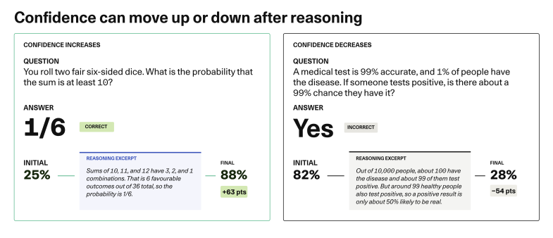
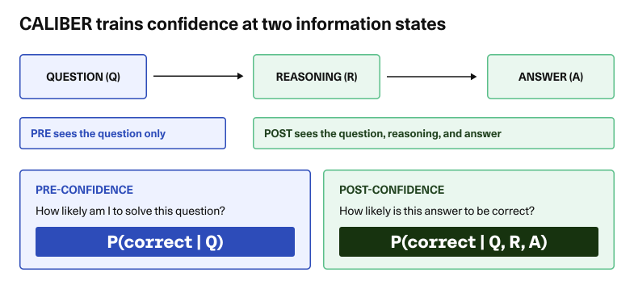
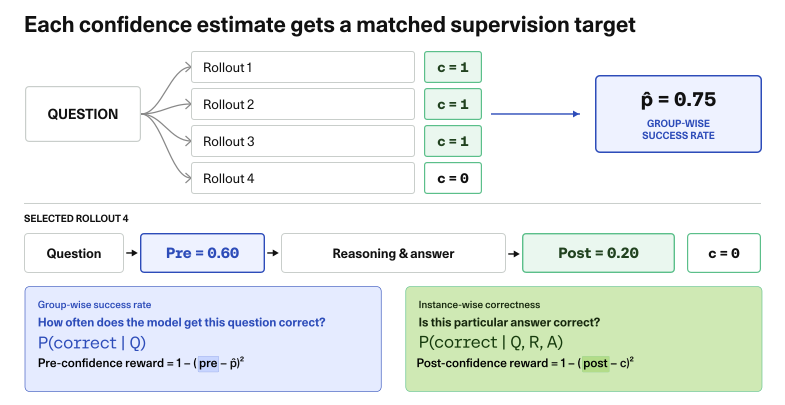
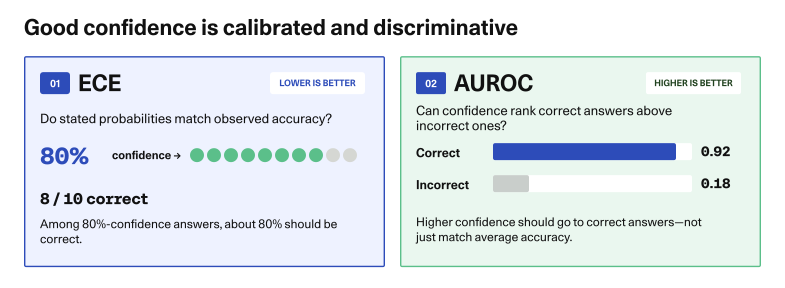
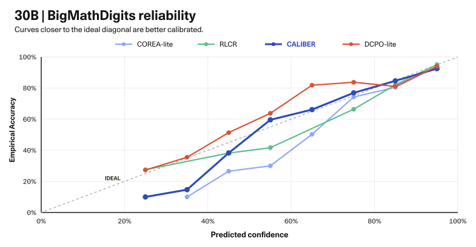

---
authors:
- aitoboxrobot
categories:
- arXiv论文
date: 2026-10-21
hide:
- navigation
tags:
- CALIBER
- 推理模型
- 置信度校准
- 模型评估
- 深度学习
title: 重思推理模型的置信度：CALIBER 让 AI 学会准确评估自身不确定性
---
# 重思推理模型的置信度：CALIBER 让 AI 学会准确评估自身不确定性

> # Rethinking Confidence in Reasoning Models

> **Paper / arXiv:** [2606.24281](https://arxiv.org/abs/2606.24281)  
> **Title:** Rethinking Confidence in Reasoning Models  
> **Method:** CALIBER (Dual-Confidence Calibration for Reasoning Models)

### 文章背景与核心概要

当前主流的推理模型即便能够输出详尽严密的“思维链”步骤，往往也无法可靠地感知并表达自己答案的把握程度 —— 容易出现“一本正经地胡说八道”或盲目自信的问题。针对这一痛点，研究团队提出了创新的置信度校准方法 CALIBER。该方法训练推理模型在解题全流程中给出两个解耦的置信度评分：解题前评估问题难易度的“初始置信度”，以及推导完成后评估答案正确性的“最终置信度”。实验表明，通过协同奖励正确答案与精准的不确定性感知，CALIBER 在数学和通用问答基准测试上将校准误差大幅削减了一半以上，显著增强了大模型“心中有数”的自我认知与差错识别能力。

---

## 核心概述

> ## Summary

传统的推理模型常常难以可靠地评估并传达自身的不确定性，即使在生成极其详尽的逐步逻辑推导时也是如此。本文提出了 **CALIBER**，一种训练推理模型输出两个独立置信度得分的全新方法：一是在着手解题前评估整体掌控度的**初始置信度** (Initial Confidence)，二是在完成逻辑推理后评估最终输出正确率的**最终置信度** (Final Confidence)。通过同时对准确答案与校准后的不确定性进行奖励，CALIBER 显著降低了校准误差，并在数学及通用问答基准测试中大幅提升了模型区分正确答案与潜在错误的能力。

> Standard reasoning models often struggle to reliably assess and communicate their own uncertainty, even when producing detailed step-by-step logic. This article introduces **CALIBER**, a novel method that trains reasoning models to provide two distinct confidence scores: an **initial confidence** score before solving a problem (judging overall manageability) and a **final confidence** score evaluated after reasoning (assessing the correctness of the final output). By rewarding both accurate answers and calibrated uncertainty, CALIBER significantly reduces calibration error and improves the model's ability to distinguish correct answers from mistakes across math and general question-answering benchmarks.

---

## 引言

> ## Introduction

你掷出两枚质地均匀的六面骰子。它们的点数之和至少为 10 的概率是多少？

> 💬 [原文引用 / Original Quote]:
> *You roll two fair six-sided dice. What is the probability that their sum is at least 10?*

面对这个问题，模型起初可能会略显迟疑。随后它开始盘点所有可能的情况：点数和为 10 的情况有 3 种，和为 11 的情况有 2 种，和为 12 的情况有 1 种。在总计 36 种可能的结果中共有 6 种符合要求。*最终答案是 1/6*。

> A model might hesitate at first. Then it counts the possibilities: three ways to roll 10, two ways to roll 11, and one way to roll 12. Six outcomes out of 36. *The answer is 1/6*.

在这个直观示例中，模型刚看到题目时的初始置信度仅为 25%，而在推导完毕后置信度跃升到了 88%。这些百分比描述的是模型对“自己给出正确答案”的把握程度，而非掷骰子事件本身的概率。逐步推演问题的全过程彻底改变了它对自己表现的判断。

> In our illustrative example, the model starts at 25% confidence and finishes at 88%. Those percentages describe its confidence in getting the answer right, not the probability of the dice outcome. Working through the problem has changed its assessment.

置信度的变化当然也可能走向相反的方向。在仔细推敲一道初看十分简单的题目时，深入推导可能会暴露出原本隐含的错误假设或逻辑矛盾。一个真正实用的置信度评估机制，应当能够敏锐捕捉并反映出这种心路历程的变化，即便模型最终依然可能给出错误答案。然而，现有的标准推理模型通常并不具备这种能力：能够生成详尽的推导过程，并不等同于模型能可靠地感知并传达自身的不确定性。

> Confidence can move the other way, too. Reasoning through a solution that initially looks straightforward may reveal a mistaken assumption or a contradiction. A useful confidence estimate should be able to reflect that change, even when the model still gives the wrong answer. However, standard reasoning models do not necessarily come with this ability: producing a detailed reasoning process does not guarantee that a model can reliably assess and communicate its uncertainty.

这正是我们提出 [CALIBER](https://arxiv.org/abs/2606.24281) 方法的核心初衷：训练推理模型在动笔前先预估自己的成功概率，并在完成具体解答后重新评估该答案的可靠性。在我们的数学基准测试 (Benchmark) 中，经过校准的 7B 模型在该指标上将校准误差降低了一半以上，大幅超越表现最优的单置信度基线。其关键诀窍在于：这两个置信度评估回答的其实是截然不同的两个问题。

> This is the idea behind our method [CALIBER](https://arxiv.org/abs/2606.24281): train a reasoning model to estimate its chance of success before it begins, then assess its particular answer afterwards. On our math benchmark, the calibrated 7B model reduces calibration error by more than half compared with the best single-confidence baseline on this metric. The key is that the two confidence estimates answer different questions.

---

## 单一置信度掩盖了两个核心问题

> ## One Confidence Score Hides Two Questions

在正式推理前，大语言模型 (Large Language Model, LLM) 仅浏览了题目内容。它能够识别该问题所属的领域主题，并判断这道题对自己而言是否可控。此时的置信度回答的是：*“我有多大把握能解出这道题？”*

> Before reasoning, the model has only seen the question. It can recognise the topic and judge whether the problem looks manageable. Its confidence answers: *“How likely am I to solve this?”*

而在推理完成之后，模型有了更加具体的评估对象：它自己实际推导出的解答过程。此时面临的问题转变成了：*“这个推导出的答案有多大可能是正确的？”*

> After reasoning, it has something more specific to assess: the solution it actually produced. Now the question is: *“How likely is this answer to be correct?”*

这两个预测维度虽然紧密相关，但承担的职能截然不同。初始置信度向用户表明模型是否预期自己能顺利拿下该任务；最终置信度则帮助用户研判产出的具体答案是否需要进一步严密审查。模型在平时可能常常做对同类问题，但在这次尝试中依然可能偶尔失手；反之，它也可能在面对一道棘手难题时起初十分谨慎，随后却找到了一条逻辑闭环、可供自查的精妙解法。

> These predictions are related, but they serve different purposes. Initial confidence gives an indication of whether the model expects to handle the question successfully. Final confidence helps a user judge whether the resulting answer needs closer scrutiny. A model might often solve this kind of problem and still make a mistake on this attempt. Or it might approach a difficult question cautiously, then find a solution it can check.

[CALIBER](https://arxiv.org/abs/2606.24281) 训练模型在同一次回复中完整呈现两项评估：初始置信度、逐步推理、最终答案以及最终置信度。由于推理过程为模型注入了全新的评估信息，前后两个数值完全可以不一致。该机制的终极目标，是让这些置信度打分具有实质的参考价值，从而辅助用户或下游系统科学决策：是直接采纳答案、进行验证复核，还是主动寻求人类专家或外部工具协助。

> [CALIBER](https://arxiv.org/abs/2606.24281) trains the model to report both estimates in one response: initial confidence, reasoning, an answer, and final confidence. The two numbers can disagree because reasoning gives the model new information to assess. The goal is to make these estimates meaningful enough to support decisions about when to accept an answer, verify it, or seek help.

---

## 明确置信度学习的目标信号

> ## Teaching Confidence What to Predict

为了训练模型的初始置信度，我们让模型对同一道题目进行多次尝试。如果在 10 次尝试中有 7 次答对，那么 70% 就会作为初始置信度的训练目标值。这准确刻画了当前模型在尚未明确具体解答步骤前，解决该问题的整体命中率。

> To train initial confidence, we let the model try the same question several times. If seven out of ten attempts succeed, 70% becomes the training target. That captures how often the current model can solve the question, before we know which particular attempt it will produce.

而最终置信度瞄准的目标则截然不同：即该次具体解答到底是对还是错。针对同一道题目的成功推演与失败推演，共享相同的初始置信度目标，但其最终置信度目标完全不同。下图清晰展示了这一工作机制。

> Final confidence gets a different target: whether that individual answer is correct. A successful and an unsuccessful attempt at the same question share an initial-confidence target, but receive different final-confidence targets. The figure below shows how this works.

在此示例中，4 次尝试中有 3 次成功解出，对应的初始置信度目标值为 75%。第 4 次尝试得出了错误答案，因此其最终置信度目标为 0。图中展示的 60% 与 20% 是模型给出的预测值。训练过程通过奖励机制促使这些预测值更加逼近各自对应的真实目标。

> In this example, three of four attempts succeed, giving an initial-confidence target of 75%. The fourth attempt produces a wrong answer, so its final-confidence target is 0. The displayed 60% and 20% are the model’s predictions. Training rewards it for moving those predictions closer to their respective targets.

我们将上述置信度奖励与回答正确性的奖励相结合。模型既被激励努力解对题目，又被鼓励精准评估自己的胜算。即使回答错误，只要模型准确识别到了推导的不确定性并调低置信度，也能获得一部分置信度奖励，但它无法获得正确答案的高额奖励。这种设计旨在让置信度更加具备实用参考价值，同时确保模型始终将解题正确性放在首位。

> We combine these confidence rewards with a reward for answering correctly. The model is encouraged both to solve the problem and to assess its chances accurately. Recognizing uncertainty about a wrong answer can improve its confidence reward, but it does not earn the reward for a correct solution. The aim is to make confidence more useful while keeping the model focused on getting the answer right.

---

## 为什么每次都说“70% 把握”毫无意义

> ## Why Saying 70 Percent Every Time Is Not Enough

设想有这样一个模型：它回答问题的综合正确率为 70%，并且对每一次作答都一律汇报 70% 的置信度。从统计学上看，它的置信度与全局平均准确率完美契合。但如果你时间有限，只能抽检少数几个答案，这种千篇一律的分数根本无法为你提供任何筛选依据。

> Imagine a model that answers 70% of questions correctly and reports 70% confidence every time. Its confidence matches its overall accuracy perfectly. But if you only have time to check a few answers, those identical scores give you no way to choose.

现在设想另一个具备同等全局准确率的模型：它对其中一半的答案给出 90% 的置信度，对另一半给出 50% 的置信度。如果这两个子集实际对应的准确率恰好分别为 90% 和 50%，那么这个模型同样是校准的。但显然，后者的置信度要实用得多：它能帮助你将审核精力精准聚焦在最可能出现纰漏的作答上。

> Now imagine another model with the same overall accuracy. It assigns 90% confidence to half its answers and 50% to the other half. If those groups are correct 90% and 50% of the time, respectively, this model is also calibrated. Its confidence is more useful, though: it helps you focus your checks on the answers more likely to contain mistakes.

因此，我们在评估模型时综合考察两项指标：

* **期望校准误差 (Expected Calibration Error, ECE)**：衡量置信度与实际观察到的准确率是否吻合 —— 在被赋予约 80% 置信度的所有答案中，约 80% 应当是真正正确的。
* **AUROC**：衡量正确答案获得的置信度是否普遍高于错误答案的置信度。

> We therefore evaluate two properties together:
> * **Expected Calibration Error (ECE)** measures whether confidence matches observed accuracy: among answers assigned roughly 80% confidence, roughly 80% should be correct. 
> * **AUROC** measures whether correct answers tend to receive higher confidence than incorrect ones. 

ECE 越低越好，而 AUROC 越高越好。两项指标相辅相成，共同揭示了置信度数值本身是否足够真实可靠，以及它们能否有效帮助用户甄别潜在的错误。

> Lower ECE and higher AUROC are better. Together, they show whether the confidence values are reliable and whether they help identify likely errors.

---

## 在数学及更广泛基准上的卓越表现

> ## Better Confidence on Math and Beyond

我们在 30,000 道数学题上对 7B 和 30B 参数规模的模型进行了训练，并在 1,000 道保留测试题以及 3 个通用问答基准测试上进行了全面评估。所有对比模型均采用相同的训练配置；“lite”基线则是对早期前人方法的轻量化改进版本。对于 CALIBER，文中报告的校准指标均基于模型的最终置信度进行计算。

> We trained 7B and 30B models on 30,000 math problems and evaluated them on 1,000 held-out problems, plus three question-answering benchmarks. Our comparisons use a shared training setup; the *“lite”* baselines are simplified adaptations of earlier methods. For CALIBER, the reported calibration metrics evaluate final confidence.

在 BigMathDigits 基准上，7B 模型的 ECE 指标从表现最强的单置信度基线的 0.059 骤降至 CALIBER 的 0.028 —— **降幅高达 52.5%**。与此同时，CALIBER 还斩获了最优的 AUROC (0.806) 与 Brier 评分 (0.130)，这表明置信度不仅与实际准确率契合得更紧密，其区分正误的能力也大幅提升。

> On BigMathDigits, the 7B model’s ECE falls from 0.059 for the strongest single-confidence baseline to 0.028 for CALIBER – **a 52.5% reduction**. CALIBER also achieves the best AUROC (0.806) and Brier score (0.130), showing improvements both in how closely confidence matches accuracy and in how well it distinguishes correct answers from mistakes.

这种能力的飞跃并不局限于数学领域。在未进行任何额外训练或任务特定检查点筛选的情况下，与各数据集上表现最强的单置信度基线相比，7B 模型的校准误差在 **GPQA 上降低了 26.8%，TriviaQA 上降低了 32.2%，SimpleQA 上降低了 36.2%**。

> The improvements extend beyond math. Without further training or task-specific checkpoint selection, the 7B model reduces calibration error by **26.8% on GPQA, 32.2% on TriviaQA, and 36.2% on SimpleQA**, compared with the strongest single-confidence baseline on each dataset.

30B 模型的测试结果则有力证明了为何这两个指标必须协同参考。在 BigMathDigits 上，CALIBER 的 ECE 为 0.022，仅略微优于 CoCA-lite 的 0.023。然而 CALIBER 的 AUROC 达到了 0.797，相比之下 CoCA-lite 仅有 0.508 —— 两者在区分正确答案与错误答案的能力上展现出了天壤之别。其他基线在 AUROC 上虽然略高于 CALIBER，但综合效益完全取决于我们衡量的核心侧重点。

> The 30B results show why the metrics matter together. On BigMathDigits, CALIBER’s ECE of 0.022 is only slightly better than CoCA-lite’s 0.023. But its AUROC is 0.797, compared with 0.508 for CoCA-lite: a large difference in how well confidence distinguishes correct from incorrect answers. Other baselines achieve slightly higher AUROC than CALIBER, so the benefit depends on which property we measure.

<figcaption class="mt-3 font-body text-web3-12">30B 模型在 BigMathDigits 上的置信度与实际观察准确率对比。曲线越贴近对角虚线，说明校准效果越优异。</figcaption>

---

## 置信度的动态变化揭示了什么

> ## What a Change in Confidence Tells Us

引入双重评估机制使我们能够直观观察到模型在经历推导后，是如何修正自身判断的。在 BigMathDigits 上，针对回答正确的题目，7B 模型的平均置信度从初始的 78.5% 攀升至 83.5%；而针对回答错误的题目，其平均置信度则从 62.6% 跌落至 54.5%。在其他数据集上，模型在推理后有时会对两类题目的置信度均有所下调，但错误作答的下调幅度显著更大。

> Having two estimates lets us see whether the model revises its assessment after reasoning. On BigMathDigits, the 7B model’s mean confidence rises from 78.5% to 83.5% for correct answers and falls from 62.6% to 54.5% for incorrect answers. On other datasets, it sometimes lowers confidence for both groups, with a larger decrease for incorrect answers.

因此，置信度的上升或下降是一个背景线索，而非最终判决。两份最终置信度均为 70% 的解答，表达的都是该答案有相同的正确预估概率，哪怕其中一份是从低分上升而来，另一份是从高分滑落而至。最终估值评估的是答案本身；而估值的动态变化则揭示了模型评估心智的演进过程。

> A rise or fall is therefore context, not a verdict. Two answers that finish at 70% confidence express the same estimated probability of correctness, even if one estimate rose and the other fell. The final estimate assesses the answer; the change tells us how the model’s assessment evolved.

在本次实验中，我们主要在单次推理过程的前后进行了测算。随之而来的下一个核心问题是：可靠的置信度动态更新，是否能够有效引导模型自主决策何时进行验证核查、何时检索更多外部信息，亦或何时主动弃权弃答？我们在本项工作中尚未对此类扩展应用进行验证。CALIBER 提供了一个坚实的全新起点：训练置信度以真实反映模型在推理各个阶段所能感知的客观状态。

> Our experiments take this measurement before and after a single reasoning process. A next question is whether reliable confidence updates could help a model decide when to verify, retrieve more information, or abstain. We have not tested those uses here. CALIBER provides a starting point: confidence trained to reflect what the model can assess at each stage of reasoning.

想要了解完整的实验设置与基准数据，请参阅原论文：[CALIBER](https://arxiv.org/abs/2606.24281)。

> Read the paper for the full experimental setup and results: [CALIBER](https://arxiv.org/abs/2606.24281).
