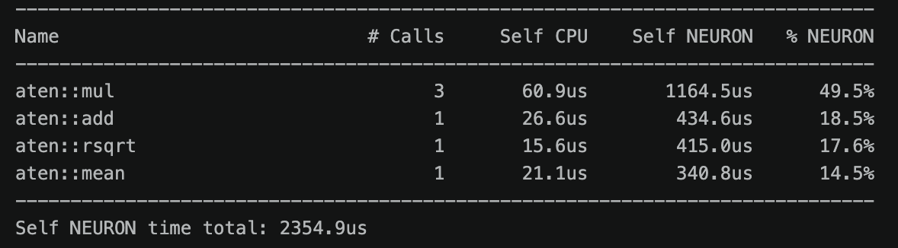
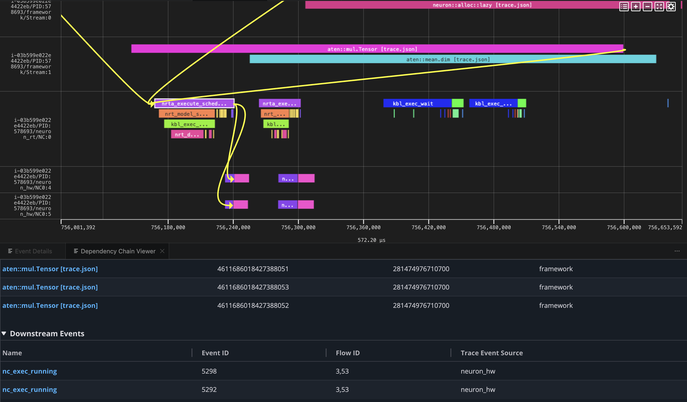
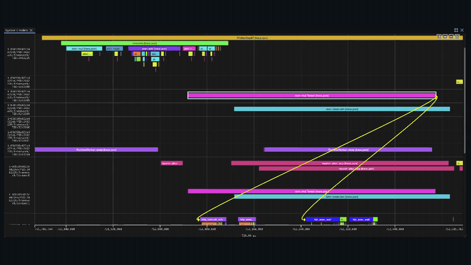
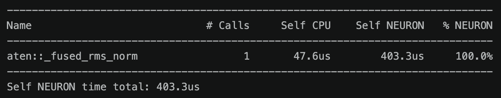
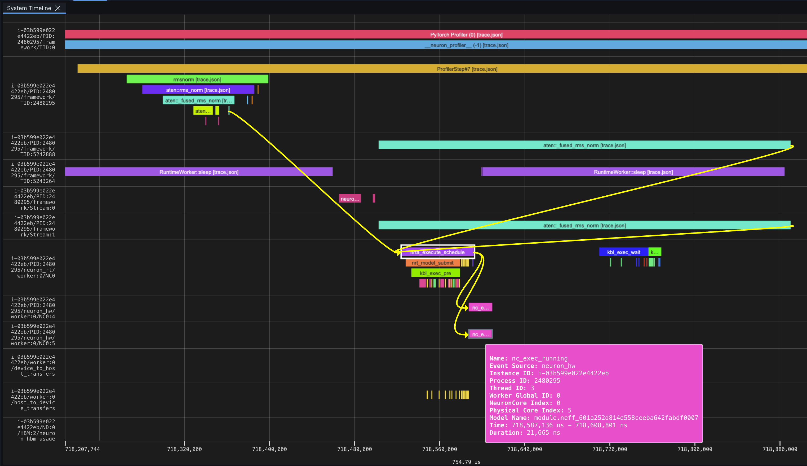
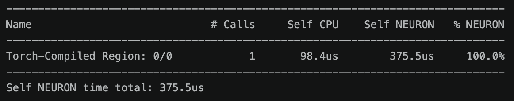
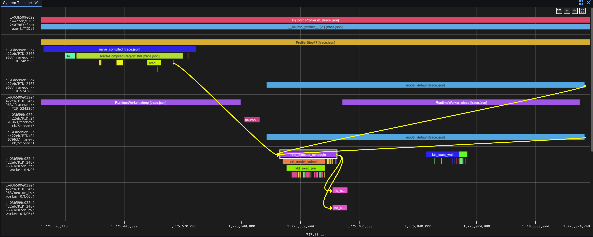

---
authors:
  - aitoboxrobot
categories:
  - 工具教程
date: 2026-10-22
hide:
  - navigation
tags:
  - TorchNeuron
  - AWS Trainium
  - 性能分析
  - PyTorch
  - 算子融合
title: "TorchNeuron 性能分析 (一)：AWS Trainium 系统级性能剖析"
---

# TorchNeuron 性能分析 (一)：AWS Trainium 系统级性能剖析

> # Profiling TorchNeuron (Part 1): System-level profiling on AWS Trainium

**发布日期：** 2026 年 10 月 21 日  
**作者：** Josh Longenecker (Amazon)

> **Published:** October 21, 2026  
> **Author:** Josh Longenecker (Amazon)

---

### 文章背景与核心概要

在机器学习与大模型工业化落地的过程中，仅仅让模型成功跑通代码只是打下了地基，要想真正压榨硬件算力、降低推理与训练成本，就必须建立系统化的性能分析 (Profiling) 能力以探查瓶颈根因。本文作为系列实战教程的第一篇，深入讲解了如何在 AWS 自研 AI 加速芯片 Trainium 上，借助其开源原生 PyTorch 后端 TorchNeuron 开展系统级性能剖析。文章完整演示了如何通过标准 `torch.profiler` 捕获设备级耗时、利用 `key_averages()` 表格定位热点算子，并在可视化分析套件 Neuron Explorer 中层层穿透从上层框架调度、运行时管理到物理硬件执行的完整流转轨迹。最后，文章以 RMSNorm 算子为例进行基准测试，揭示了从普通即时执行到内置融合算子与 `torch.compile` 图优化带来的约 6 倍性能飞跃，为云端定制芯片上的深度性能调优提供了坚实可依的实践指南。

---

## 执行摘要

> ## Executive Summary

想方设法让机器学习模型跑得飞快往往只是优化工作的一半；更关键的是在模型变慢时，能够清晰洞察其背后的根因，而这离不开系统化的性能剖析。在本文作为该系列的第一部分中，我们将探索如何借助 **TorchNeuron**（**AWS Trainium** 芯片的原生开源 PyTorch 后端）来深入分析模型推理性能。本指南将带你完整实践：如何正确配置 `torch.profiler`、如何通过 `key_averages()` 表格快速揪出执行瓶颈、如何在 **Neuron Explorer** 中直观审查执行轨迹 (Traces)，并横向对比未经优化的朴素即时模式 (Eager) 算子、原生内置融合算子 (`torch.rms_norm`) 与基于计算图编译 (`torch.compile`) 三者之间的显著性能差异。

> Understanding how to make machine learning models run fast is only half the battle; knowing *why* a model is slow requires systematic profiling. In Part 1 of this series, we explore how to analyze inference performance on **AWS Trainium** using **TorchNeuron** (its native open-source PyTorch backend). This guide walks you through configuring `torch.profiler`, analyzing execution bottlenecks via `key_averages()`, visualizing traces in **Neuron Explorer**, and comparing the performance differences between naive eager operations, built-in fused operators (`torch.rms_norm`), and compiled graphs (`torch.compile`).

---

## Neuron 作为 PyTorch 后端

> ## Neuron as a PyTorch Backend

在正式开始对工作负载进行性能分析之前，先理清 [Neuron](https://awsdocs-neuron.readthedocs-hosted.com/en/latest/index.html) 与 PyTorch 之间的整合机制大有裨益。

> Before profiling workloads, it helps to understand how [Neuron](https://awsdocs-neuron.readthedocs-hosted.com/en/latest/index.html) integrates with PyTorch. 

Neuron 后端充分借助了 PyTorch 官方提供的 `PrivateUse1` 扩展机制。该机制允许第三方硬件加速芯片原生无缝地融入 PyTorch 生态，而无需在上游框架内核中硬编码专有的分发调度键 (Dispatch Key，如传统针对 GPU 的 `cuda`)。`torch_neuronx` 扩展包与上游 PyTorch 紧密配合，将 Neuron 正式注册为一个原生的执行目标设备。欲深入了解这一扩展机制的实现细节，可参阅 PyTorch 官方教程：[借助 PrivateUse1 简化新后端集成 (Facilitating New Backend Integration by PrivateUse1)](https://docs.pytorch.org/tutorials/advanced/privateuseone.html)。

> The Neuron backend leverages PyTorch's `PrivateUse1` extension point. This mechanism allows accelerators to integrate natively into the framework without requiring a dedicated dispatch key (such as `cuda`). The `torch_neuronx` package works alongside upstream PyTorch to register Neuron as a native execution target. For more information on this extension mechanism, refer to the official PyTorch guide on [Facilitating New Backend Integration by PrivateUse1](https://docs.pytorch.org/tutorials/advanced/privateuseone.html).

---

## 配置性能分析器

> ## Set Up the Profiler

对 Neuron 计算任务进行性能采样与分析主要依赖两个核心模块：

> Profiling a Neuron workload relies on two primary components:

1. **`NeuronConfig`**：负责精细控制所需采集的数据流与具体的 NeuronCore 核心，并指定分析结果的输出存储路径。该配置对象通过 `experimental_config` 参数传递给 `torch.profiler.profile`。
2. **`NeuronProfiler`**：接收并解析 `NeuronConfig` 配置，对外暴露 `export_trace` 回调函数，以便在导出上层深度学习框架跟踪数据 (`trace.json`) 的同时，同步写出底层的系统硬件级跟踪轨迹。

> 1. **`NeuronConfig`**: Controls which data streams and NeuronCores to capture, specifying the output destination. Passed to `torch.profiler.profile` via `experimental_config`.
> 2. **`NeuronProfiler`**: Consumes the `NeuronConfig` and exposes an `export_trace` callback to write out the framework trace (`trace.json`) alongside low-level system traces.

```python
nc = NeuronConfig(
    modes=[ProfileMode.DEVICE, ProfileMode.RUNTIME],
    profile_output_dir=OUTPUT_DIR,
    capture_enabled_for_nc='0',
    correlate_device_time=True,
)
exporter = NeuronProfiler(nc)
```

将 `correlate_device_time=True` 启用后，分析器会自动把设备端的实际底层执行耗时直接关联映射到 `key_averages()` 统计表中，从而让开发者能够一目了然地横向对比 CPU 端调度与 Neuron 硬件设备端计算的各自开销。关于所有可配置参数的详细说明，可查阅 [NeuronConfig 分析模式文档 (NeuronConfig Profile Modes documentation)](http://awsdocs-neuron.readthedocs-hosted.com/en/latest/tools/neuron-explorer/how-to-profile-workload.html#neuronconfig-profile-modes)。

> Setting `correlate_device_time=True` correlates the device-level time directly into the `key_averages()` table, enabling side-by-side comparison of CPU and Neuron device execution costs. For comprehensive parameter details, consult the [NeuronConfig Profile Modes documentation](http://awsdocs-neuron.readthedocs-hosted.com/en/latest/tools/neuron-explorer/how-to-profile-workload.html#neuronconfig-profile-modes).

---

## 可视化分析利器：Neuron Explorer

> ## Tooling: Neuron Explorer

**Neuron Explorer** 是一款可通过浏览器进行交互的可视化效能诊断工具，专为审查系统级执行轨迹、硬件设备时间线以及底层执行引擎瓶颈而设计。开发者不仅可以通过 SSH 端口转发直接在本地浏览器中打开它，也可以通过专属的 VS Code 扩展进行集成查看。

> **Neuron Explorer** is a browser-accessible utility designed to inspect system traces, device timelines, and engine-level bottlenecks. It can be accessed via an SSH tunnel or a VS Code extension.

在完成性能分析之后，输出目录中会生成系统级跟踪数据，以及通过统一哈希特征关联配对的 `.neff` (Neuron 可执行文件格式，Neuron Executable File Format) 和 `.ntff` (硬件底层指令跟踪文件，Hardware Instruction Trace) 文件。有关如何在 Web 界面中启动工具及上传分析文件的图文步骤，请参阅 [步骤 5：在 Neuron Explorer 中上传您的分析文件 (Step 5: Upload your profile in Neuron Explorer)](https://awsdocs-neuron.readthedocs-hosted.com/en/latest/tools/neuron-explorer/get-started.html#step-5-upload-your-profile)。

> After profiling, the output directory includes system traces and matching `.neff` (Neuron Executable File Format) and `.ntff` (hardware instruction trace) files linked by a shared hash. For detailed instructions on launching and uploading files to the UI, see [Step 5: Upload your profile in Neuron Explorer](https://awsdocs-neuron.readthedocs-hosted.com/en/latest/tools/neuron-explorer/get-started.html#step-5-upload-your-profile).

---

## 实战分析案例：RMSNorm 算子

> ## Profile RMSNorm

为了生动形象地演示系统级性能分析流程，我们选取了 **RMSNorm** 作为切入点——这是一个计算结构极为轻量且规整的算子，包含了一段规律非常明确的规约计算与逐元素 (Element-wise) 算术运算。我们在基准测试中对比了三种截然不同的实现方式：

> To demonstrate system-level profiling, we examine **RMSNorm**—a lightweight operation containing a predictable sequence of reductions and element-wise arithmetic. We test three distinct implementations:

1. **朴素 RMSNorm 实现 (Naive RMSNorm)**：完全由离散的 PyTorch 基础算子手动拼装实现 (包括乘法、求均值、加法和平方根倒数)。
2. **`torch.rms_norm()`**：PyTorch 原生提供的内置标准函数，在 Neuron 硬件平台下会自动下沉为单个高度融合、高度优化的设备端内核 (Kernel)。
3. **结合 `torch.compile` 的朴素 RMSNorm**：依然采用由离散算子拼装的代码逻辑，但通过声明 `@torch.compile(backend="neuron")` 由编译器自动进行计算图追踪与内核融合优化。

> 1. **Naive RMSNorm**: Written with discrete PyTorch operations (multiplication, mean, addition, reciprocal square root).
> 2. **`torch.rms_norm()`**: PyTorch’s built-in function lowered to a single optimized, fused kernel on Neuron.
> 3. **Naive RMSNorm with `torch.compile`**: The discrete sequence compiled automatically using `@torch.compile(backend="neuron")`.

所有评测脚本均使用完全一致的输入张量维度形状与分析器配置。可供复现的完整代码均已归档于 [torch-neuronx 官方示例仓库 (torch-neuronx examples directory)](https://github.com/aws-neuron/torch-neuronx/tree/main/examples/hf_profiling_blog_pt1)。

> All scripts use identical shapes and profiler configurations. Reproducible code can be found in the [torch-neuronx examples directory](https://github.com/aws-neuron/torch-neuronx/tree/main/examples/hf_profiling_blog_pt1).

---

## 分析场景 1：朴素 PyTorch 基础算子拼装

> ## Profile 1: Naive PyTorch Operations

使用基础的 PyTorch 离散算子拼装 RMSNorm 计算逻辑，会在运行时产生大量不必要的中间张量，并反复触发昂贵的框架级调度与分发事件：

> Writing RMSNorm out using primitive PyTorch operations creates intermediate tensors and multiple dispatch events:

```python
device = torch.device('neuron')

x = torch.randn(4, 512, dtype=torch.bfloat16, device=device)
weight = torch.ones(512, dtype=torch.bfloat16, device=device)

def rms_norm_fn(t):
    x_sq = t * t                                    # square
    mean_sq = x_sq.mean(dim=-1, keepdim=True)       # mean of squares
    rms = torch.rsqrt(mean_sq + 1e-6)               # 1 / sqrt(mean_sq + eps)
    return t * rms * weight                         # normalize + scale
```

我们通过配置 `ProfilerActivity.PrivateUse1` 这一活动类型，并将预先初始化的 `NeuronConfig` 实例传入分析器：

> We configure the profiler using `ProfilerActivity.PrivateUse1` and pass `NeuronConfig`:

```python
with torch.profiler.profile(
    activities=[ProfilerActivity.CPU, ProfilerActivity.PrivateUse1],
    experimental_config=nc,
    record_shapes=False,
    on_trace_ready=exporter.export_trace,
    schedule=torch.profiler.schedule(wait=2, warmup=1, active=1),
) as prof:
    for step in range(4):
        with torch.no_grad():
            _ = rms_norm_fn(x)
        torch.neuron.synchronize()
        prof.step()
```

*(注：在循环中显式加入 `torch.neuron.synchronize()` 能够确保硬件设备在导出轨迹数据之前彻底完成所有运算排队，从而避免分析报表中出现设备耗时列全为空白的情况。)*

> *(Note: Including `torch.neuron.synchronize()` ensures the device completes operations before trace export, avoiding empty device time columns.)*

将分析生成的汇总表按照设备端执行总耗时进行降序排序，主要的性能瓶颈便立刻浮出水面：

> Sorting the summary table by device time highlights the performance bottlenecks:

```python
print(prof.key_averages().table(sort_by="self_privateuse1_time_total", row_limit=4))
```

[](./images/af39c8c42d9a.png)

*核心平均值汇总表显示，三次 aten::mul 调用占据了 Neuron 设备端耗时的最大份额。*

> *The key averages table shows that three aten::mul calls account for the largest share of Neuron device time.*

| 算子名称 (Name) | 调用次数 (# Calls) | 自身 CPU 耗时 (Self CPU) | 自身 NEURON 耗时 (Self NEURON) | NEURON 耗时占比 (% NEURON) |
| :--- | :--- | :--- | :--- | :--- |
| `aten::mul` | 3 | 60.9 μs | 1,164.5 μs | 49.5% |
| `aten::add` | 1 | 26.6 μs | 434.6 μs | 18.5% |
| `aten::rsqrt` | 1 | 15.6 μs | 415.0 μs | 17.6% |
| `aten::mean` | 1 | 21.1 μs | 340.8 μs | 14.5% |

> | Name | # Calls | Self CPU | Self NEURON | % NEURON |
> | :--- | :--- | :--- | :--- | :--- |
> | `aten::mul` | 3 | 60.9 μs | 1,164.5 μs | 49.5% |
> | `aten::add` | 1 | 26.6 μs | 434.6 μs | 18.5% |
> | `aten::rsqrt` | 1 | 15.6 μs | 415.0 μs | 17.6% |
> | `aten::mean` | 1 | 21.1 μs | 340.8 μs | 14.5% |

*自身 NEURON 设备端总执行耗时：2.355 ms*

> *Self NEURON total: 2.355 ms*

[](./images/09da1436bc0c.png)

*Neuron Explorer 完整追踪了 aten::mul 操作从框架分发、运行时调度到在 Neuron 物理硬件泳道上执行的全链路流程。*

> *Neuron Explorer follows an aten::mul operation from framework dispatch through runtime scheduling to execution on the Neuron hardware lanes.*

### 在 Explorer 中解读执行轨迹

> ### Read the Trace in Explorer

在 Neuron Explorer 的时间线视图中，每个具体算子的生命周期均遵循从上到下、自左往右的时序，依次跨越以下四个专属系统泳道 (Lanes)：

> In Neuron Explorer, individual operations travel from top to bottom and left to right across specific system lanes:

| 系统泳道 (Lane) | 标签后缀 (Label Suffix) | 功能描述 (Description) |
| :--- | :--- | :--- |
| **框架调度泳道 (Framework Dispatch)** | `framework/TID:<id>` | 按线程 ID 分组展示的 ATen 算子分发事件。 |
| **框架设备交互泳道 (Framework Device)** | `framework/Stream:<n>` | 按流 (Stream) 分组呈现的设备驱动交互事件。 |
| **Neuron 运行时泳道 (Neuron Runtime)** | `neuron_rt/NC:<n>` | 针对每个逻辑 NeuronCore 核心所发起的运行时 API 调度。 |
| **Neuron 硬件执行泳道 (Neuron Hardware)** | `neuron_hw/NC<n>:<id>` | 芯片物理计算核心上的真实硬件执行时间线 (`nc_exec_running`)。 |

> | Lane | Label Suffix | Description |
> | :--- | :--- | :--- |
> | **Framework Dispatch** | `framework/TID:<id>` | ATen operator dispatch events grouped by thread ID. |
> | **Framework Device** | `framework/Stream:<n>` | Device interaction/driver events grouped by stream. |
> | **Neuron Runtime** | `neuron_rt/NC:<n>` | Runtime API invocation per logical NeuronCore. |
> | **Neuron Hardware** | `neuron_hw/NC<n>:<id>` | Physical core execution tracks (`nc_exec_running`). |

[](./images/69a21700cf3c.gif)

*依赖链透视视图生动展示了单个计算算子在框架层、运行时层和物理硬件泳道上的完整生命周期。*

> *The dependency chain viewer highlights the lifecycle of one operation across the framework, runtime, and hardware lanes.*

---

## 分析场景 2：原生内置算子 torch.rms_norm

> ## Profile 2: torch.rms_norm

改用 PyTorch 原生内置的 `torch.rms_norm` 替代手动拼凑的算子，可以将整段归一化逻辑下沉 (Lowering) 为单个在硬件设备端一体化执行的融合内核：

> Replacing manual operators with PyTorch's native `torch.rms_norm` lowers the routine into a single fused device execution:

```python
def rms_norm_fn(t):
    return torch.rms_norm(t, [512], weight)
```

[](./images/4d09216611cf.png)

*在核心平均值汇总表中，融合 RMSNorm 仅作为单独一个设备端算子出现。*

> *The fused RMSNorm appears as one device operation in the key averages table.*

| 算子名称 (Name) | 调用次数 (# Calls) | 自身 CPU 耗时 (Self CPU) | 自身 NEURON 耗时 (Self NEURON) | NEURON 耗时占比 (% NEURON) |
| :--- | :--- | :--- | :--- | :--- |
| `aten::_fused_rms_norm` | 1 | 47.6 μs | 403.3 μs | 100% |

> | Name | # Calls | Self CPU | Self NEURON | % NEURON |
> | :--- | :--- | :--- | :--- | :--- |
> | `aten::_fused_rms_norm` | 1 | 47.6 μs | 403.3 μs | 100% |

*自身 NEURON 设备端总执行耗时：403.3 μs*

> *Self NEURON total: 403.3 μs*

[](./images/14b89d454511.png)

*融合后的 RMSNorm 只需穿透一次框架到硬件的调度路径，彻底告别了对各个基础算术算子逐一分发的繁琐流程。*

> *The fused RMSNorm follows one framework-to-hardware path instead of dispatching each arithmetic operation separately.*

### 对比算子下沉路径

> ### Compare the Lowering Path

在原始朴素实现中，每个算子都必须各自跨越上层框架与底层硬件之间的分界线；而融合内核则截然不同，它将整组计算逻辑一次性打包封装为单个综合图实体进行分发，从而彻底根除了相邻内核之间因调度排队产生的延迟空档。

> Unlike the naive approach—where each operation individually crosses the framework-to-hardware boundary—the fused kernel dispatches a single comprehensive graph entity, entirely eliminating inter-kernel latency gaps.

---

## 分析场景 3：结合 torch.compile 优化朴素实现

> ## Profile 3: Naive PyTorch with torch.compile

直接对最初手动编写的朴素 Python 函数应用 `torch.compile`，能让 PyTorch 与底层的 Neuron 编译器自动侦测计算图依赖并自动生成融合优化路径：

> Using `torch.compile` on the original naive Python function allows PyTorch to automatically detect and fuse optimization paths:

```python
@torch.compile(backend='neuron', fullgraph=True)
def naive_compiled(t):
    x_sq = t * t
    mean_sq = x_sq.mean(dim=-1, keepdim=True)
    rms = torch.rsqrt(mean_sq + 1e-6)
    return t * rms * weight
```

[](./images/fd5a93af4644.png)

*在核心平均值汇总表中，编译后的函数聚合呈现为一个统一的 Torch-Compiled Region 编译区域。*

> *The compiled function appears as one Torch-Compiled Region in the key averages table.*

| 算子名称 (Name) | 调用次数 (# Calls) | 自身 CPU 耗时 (Self CPU) | 自身 NEURON 耗时 (Self NEURON) | NEURON 耗时占比 (% NEURON) |
| :--- | :--- | :--- | :--- | :--- |
| `Torch-Compiled Region: 0/0` | 1 | 98.4 μs | 375.5 μs | 100% |

> | Name | # Calls | Self CPU | Self NEURON | % NEURON |
> | :--- | :--- | :--- | :--- | :--- |
> | `Torch-Compiled Region: 0/0` | 1 | 98.4 μs | 375.5 μs | 100% |

*自身 NEURON 设备端总执行耗时：375.5 μs*

> *Self NEURON total: 375.5 μs*

[](./images/a32167b9bcec.png)

*编译后的计算图在运行时调度与硬件实际执行中均沿着单一清晰的流水线高效行进。*

> *The compiled graph follows one path through runtime scheduling and hardware execution.*

---

## 横向对比与性能汇总

> ## Side-by-Side Summary

| 实现方案 (Variant) | NEURON 设备耗时 (NEURON Time) | 自身 CPU 耗时 (Self CPU Time) | 算子调用次数 (Operator Calls) |
| :--- | :--- | :--- | :--- |
| **朴素基础算子 (Naive ops)** | 2,355 µs | ~125 µs | 6 |
| **内置算子 `torch.rms_norm`** | 403 µs | ~48 µs | 1 |
| **朴素实现 + `torch.compile`** | 376 µs | ~98 µs | 1 |

> | Variant | NEURON Time | Self CPU Time | Operator Calls |
> | :--- | :--- | :--- | :--- |
> | **Naive ops** | 2,355 µs | ~125 µs | 6 |
> | **`torch.rms_norm`** | 403 µs | ~48 µs | 1 |
> | **Naive + `torch.compile`** | 376 µs | ~98 µs | 1 |

相较于未经优化的即时执行模式，无论是通过内置算子 `torch.rms_norm` 还是声明 `torch.compile` 引入内核融合，均能带来接近 **6 倍** 的显著性能提速。这一飞跃的奥秘在于：融合内核彻底消除了在片外内存与缓存之间频繁申请、搬运中间张量的高昂开销，并抹平了内核之间漫长的调度等待间隙。

> Kernel fusion via `torch.rms_norm` or `torch.compile` accelerates execution roughly **6x** compared to unoptimized eager implementations by avoiding intermediate tensor memory allocations and execution gaps.

---

## 总结与展望

> ## Conclusion

借助 `key_averages()` 统计表与 **Neuron Explorer** 可视化工具所构建的系统级性能分析能力，完美弥合了高层模型代码与底层硬件芯片实际执行之间的信息鸿沟。

> System-level profiling via `key_averages()` and **Neuron Explorer** bridges the gap between high-level code and hardware execution. 

在接下来的**第二篇**中，我们将把剖析视角进一步推进到芯片设备级底层：深入解剖编译后的 NEFF 结构文件、细致分析张量引擎 (TensorEngine)、向量引擎 (VectorEngine) 和直接内存访问 (Direct Memory Access, DMA) 引擎的实际利用率，并引入屋顶模型 (Roofline Model) 精确定位模型在物理核心上到底属于显存带宽受限 (Memory-bound) 还是算力瓶颈 (Compute-bound)。

> In **Part 2**, we will shift focus to device-level profiles: opening the compiled NEFF, analyzing the TensorEngine, VectorEngine, and DMA engine utilization, and applying roofline modeling to diagnose memory- vs. compute-bound characteristics.

---
*特别鸣谢 Aritra Roy Gosthipaty 为本系列内容带来的灵感启发，并衷心感谢 Pinak Panigrahi、Samir Araujo、Akhil Azhikodan 与 Esha Lakhotia 诸位专家在技术内容审阅上的宝贵贡献。*

> *Special thanks to Aritra Roy Gosthipaty for inspiring this series, and to reviewers Pinak Panigrahi, Samir Araujo, Akhil Azhikodan, and Esha Lakhotia.*
