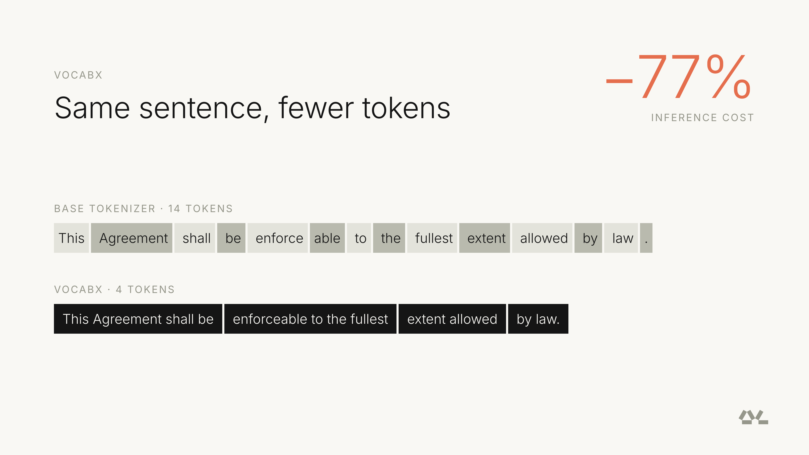
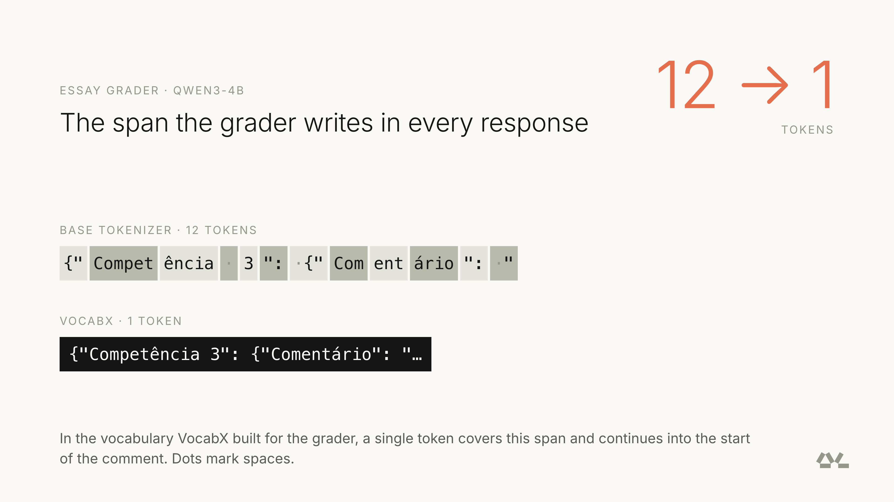
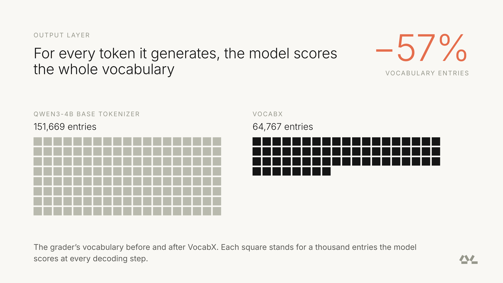
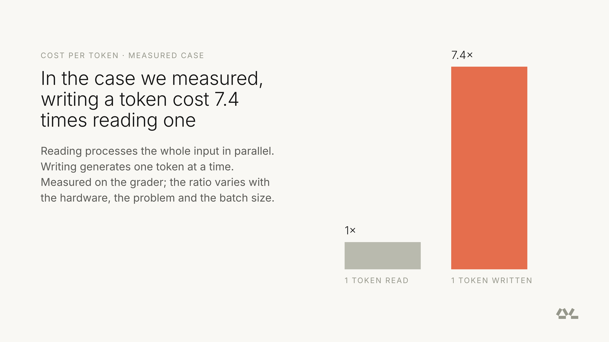
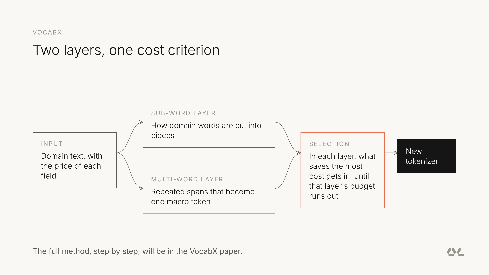
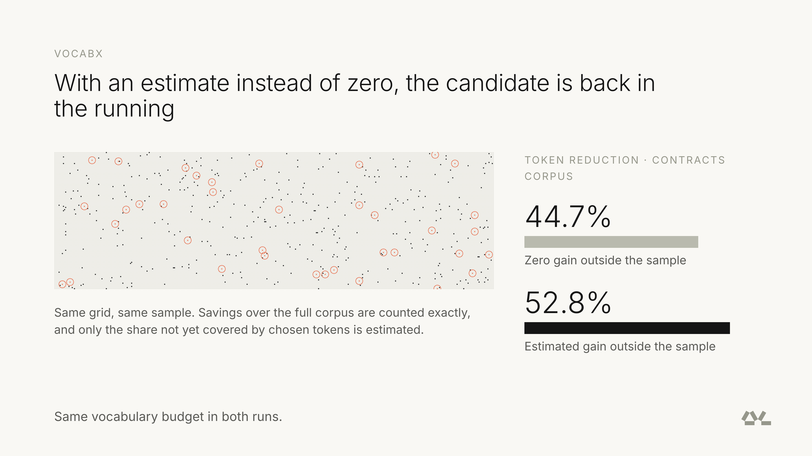
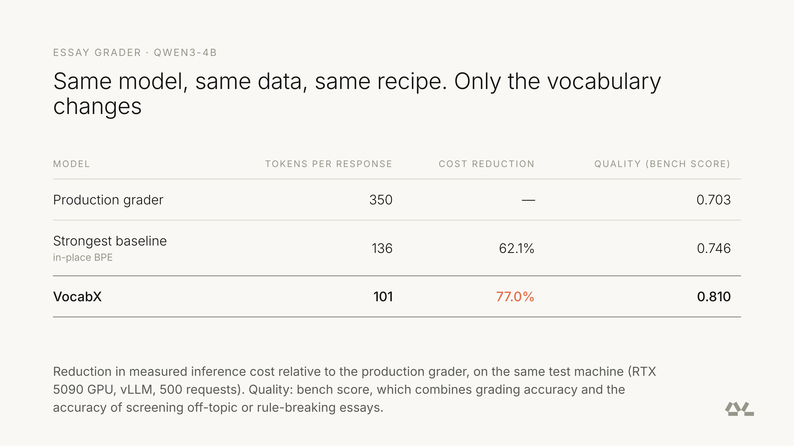
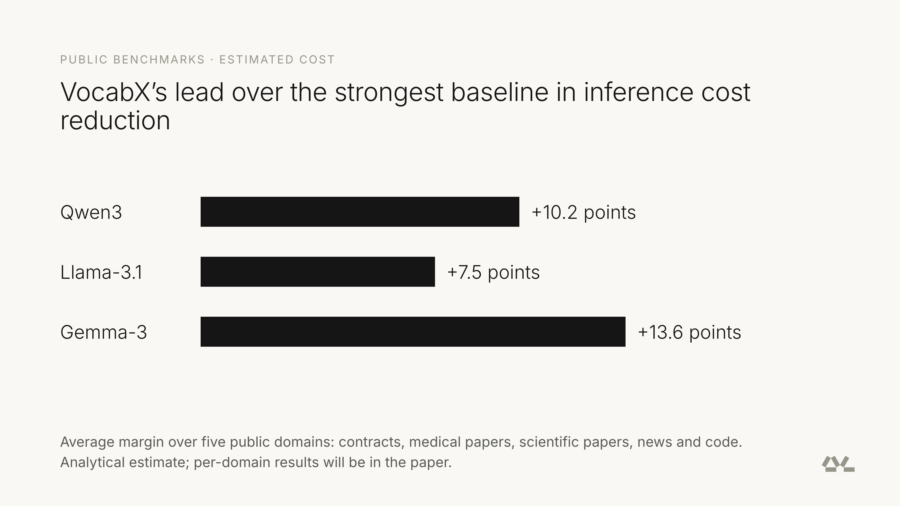

---
authors:
- aitoboxrobot
categories:
- arXiv论文
date: 2026-10-22
hide:
- navigation
tags:
- 小语言模型
- 模型推理优化
- 词表定制
title: 专精化小语言模型词表：实际应用中如何削减 77% 推理成本
---
# 专精化小语言模型词表：实际应用中如何削减 77% 推理成本

> # How Specializing the Vocabulary of SLMs Can Cut Inference Cost by 77% in Real Applications

**发布日期：** 2026 年 10 月 21 日  
**作者团队：** Bernardo França de Aguiar, Gabriel Pimenta de Freitas Cardoso, Bruno Duarte, Francisco de Almeida Rocha Alves (Dharma-AI)

> **Published:** October 21, 2026  
> **Authors:** Bernardo França de Aguiar, Gabriel Pimenta de Freitas Cardoso, Bruno Duarte, Francisco de Almeida Rocha Alves (Dharma-AI)

### 文章背景与核心概要

通用开源大模型通常配备覆盖全领域与多语言的庞大分词器 (Tokenizer)，但在具体的垂直业务落地中，这种“大而全”的通用词表不仅会导致领域高频短语被切碎成过多微小 Token，更会在解码阶段浪费宝贵的显存带宽去为数十万个毫不相干的词条计算概率。来自 Dharma-AI 的团队推出了创新的小语言模型 (Small Language Model, SLM) 词表定制技术 VocabX，打破了以往单纯依据词频统计的传统思路，首次以底层硬件的“实际 Token 生成成本”为导向重构与裁剪词表。在完全不改动基础模型权重与训练配方的前提下，VocabX 不仅使葡萄牙语作文批改模型的输出 Token 数量压缩超 70%，更将端到端实测推理成本骤降 77%，同时基准测试准确率逆势提升了 15%。这项技术突破向业界证明：领域专精化不必拘泥于模型参数与微调数据，在分词器阶段对词表进行精准“量体裁衣”，同样能以极低代价释放惊人的能效红利。

---

## 执行摘要

> ## Executive Summary

通用开源模型（如 Qwen 和 Gemma）通常依赖面向全领域和跨语言文本构建的分词器。但当它们被微调用于单一垂直任务（例如自动化作文阅卷）时，这种通用词表就会暴露出巨大的能效短板：特定领域的常用词组被生硬地切碎为过多微小的 Token，模型更被迫浪费宝贵的显存带宽，在每一次生成时为数十万个毫不相干的无效 Token 计算概率分布。

> General open-source models (such as Qwen and Gemma) rely on tokenizers built for universal domains and cross-lingual text. When fine-tuned for a single task—such as an automated essay grader—this general vocabulary leads to massive inefficiencies: domain-specific phrases are fragmented into excessive tokens, and the model wastes memory calculating probabilities for hundreds of thousands of irrelevant tokens.

本文介绍了 **VocabX**，这是一种用于专精化小语言模型词表的新方法。与以往单纯依据原始词频统计的做法不同，它开创性地以**实际 Token 生成成本**作为核心优化指标。在完全不改动基础模型权重的前提下，VocabX 围绕子词 (Sub-word) 合并与宏 Token (Macro Token) 重新重塑了词表结构，在实际测试中**成功将实测推理成本降低高达 77%**，同时在基准测试 (Benchmark) 中的综合表现反而实现了提升。

> This article previews **VocabX**, a novel method for specializing a Small Language Model's (SLM) vocabulary based on *token generation cost* rather than mere raw frequency. By reshaping the vocabulary around sub-word merging and macro tokens without modifying the base model's weights, VocabX **cuts measured inference costs by up to 77%** while simultaneously *increasing* benchmark performance.

---

## 引言

> ## Introduction

```
[Base Tokenizer]  -> 14 tokens for a standard phrase
[VocabX Tokenizer]->  4 tokens for the same phrase
```

[](./images/09e935c19314.png)

通常情况下，人们普遍将分词器视为预训练基础模型不可分割的固有属性。然而在面向特定领域的专用模型中，分词器却是一个至关重要的成本杠杆——而且这个杠杆在模型正式开始训练之前就已经完全定型了。

> Typically, tokenizers are viewed as fixed properties of a pre-trained base model. However, for a domain-specific model, the tokenizer is one of the largest cost levers, set entirely before training begins.

以基于 Qwen3-4B 构建的葡萄牙语自动化作文批改系统为例。尽管该模型体积小巧且经过了针对性微调，但它依然沿用了原生包含 151,669 个词条的分词器——而这个庞大的词表最初是为通用的多语言应用场景设计的。这种“水土不服”带来了两大结构性瓶颈：

> Consider an automated Portuguese essay grader built on Qwen3-4B. While the model is compact and fine-tuned, it retained its original 151,669-entry tokenizer meant for general multi-lingual applications. This introduced two structural bottlenecks:

1. **领域常用文本消耗了过多的 Token**；
2. **每次生成一个 Token 时，模型都必须在庞大的词表中进行概率计算**，即便其中绝大部分词条在阅卷任务中永远不会被用到。

> 1. Frequent domain text required excessive tokens.
> 2. The model evaluated a massive vocabulary for every single generated token, even though many entries were never used.

在保持训练数据、基础模型和微调策略完全一致的前提下，我们仅仅通过 VocabX 重建了词表，就让整个模型架构获得了立竿见影的能效飞跃。

> By rebuilding the vocabulary using VocabX while keeping the data, base model, and training recipe identical, we achieved dramatic architectural efficiencies.

---

## 为通用大众设计的词表：专精领域的隐形负担

> ## A Vocabulary Built for Everyone

通用基础模型的分词器通常是在覆盖代码、法律合同以及数十种语言的海量互联网文本上训练而成的。对于无所不包的通用聊天机器人而言，这种设计自然无可挑剔；但当模型被落地部署在特定垂直领域时，这种“面面俱到”的做法就会引发两类严重的算力浪费：

> General-purpose model tokenizers are trained on massive, broad web text collections spanning code, contracts, and multiple languages. While ideal for universal chatbots, this approach causes two major types of waste when deployed in specialized domains:

* **碎片化 (Fragmentation)**：分词器会将领域内高频重复的固定句式生硬地拆解成大量微小的子词。例如在我们批改作文的场景中，固定的 JSON 包装外壳、能力维度名称以及评价术语，都被无端切碎成了若干个零散的 Token。
* **冗余冗繁 (Excess)**：词表中保留了成千万个永远用不到的多余条目。例如一个批改生物考试的模型，在每生成一步时居然都要为生僻的汉字计算一次概率分布，白白耗费了巨大的显存带宽。

> * **Fragmentation:** The tokenizer breaks down repetitive domain phrasing into tiny sub-words. In our essay grader, boilerplate JSON envelopes, competency names, and evaluation phrases were shattered into multiple tokens. 
> * **Excess:** The vocabulary retains tens of thousands of unused entries. A biology exam grader computes probabilities for Chinese characters at every step, wasting memory bandwidth.

[](./images/bf09d7c55b11.png)

*左图：基础分词器需要占用 12 个 Token。右图：VocabX 仅需 1 个 Token。*

> *Left: 12 tokens with base tokenizer. Right: 1 token with VocabX.*

[](./images/4e119eca29d9.png)

*大幅缩减词表体积，可显著降低模型在解码过程中的显存开销。*

> *Reducing vocabulary size lowers memory overhead during decoding.*

---

## 读便宜，写昂贵：拆解大模型的生成成本

> ## Reading Is Cheap, Writing Is Expensive

想要理解为什么生成不同 Token 的成本会有天壤之别，我们必须深入剖析大语言模型推理 (Inference) 的两个阶段：

> To understand why token generation costs scale disproportionately, examine inference phases:

* **预填充阶段 (Prefill)**：一次性并行处理所有输入的 Prompt Token，属于典型的算力受限 (Compute-bound) 阶段。
* **解码阶段 (Decode)**：逐字串行生成回复，属于典型的显存带宽受限 (Memory-bandwidth bound) 阶段。

> * **Prefill:** Processes input tokens in a single pass; compute-bound.
> * **Decode:** Generates responses sequentially; memory-bandwidth bound. 

[](./images/66c0eef7445b.png)

在我们的作文批改模型实测中，**“写”一个 Token（解码输出）的硬件开销，竟是“读”一个 Token（预填充输入）的 7.4 倍之多**！此外，负责将隐藏状态映射到词表概率得分的语言模型头 (Language Modeling Head, LM Head) 层，占据了一个 4B 模型约 10% 的总参数量。词表矩阵中每多出一行，都会在解码的每一步带来额外的显存数据搬运开销。而 VocabX 将该批改模型的输出层从约 152,000 行大刀阔斧地精简到了约 65,000 行。

> In our essay grader configuration, **writing a single token cost 7.4 times more than reading one**. Furthermore, the Language Modeling (LM) head layer (which maps hidden states to vocabulary scores) accounts for roughly 10% of a 4B model's parameters. Every extra row in the vocabulary matrix adds memory movement overhead at every decode step. VocabX shrinks the grader's output layer from ~152,000 rows to ~65,000 rows.

---

## 为何现有解决方案功亏一篑

> ## Why Existing Solutions Fell Short

此前业界探索的基准方法——如快速词表迁移 (Fast Vocabulary Transfer, FVT)、多词分词 (Multi-Word Tokenization, MWT) 以及 Liquid AI 提出的就地分词器扩展方案，主要存在两大硬伤：

> Prior reference methods like Fast Vocabulary Transfer (FVT), Multi-Word Tokenization (MWT), and Liquid AI's in-place tokenizer expansion exhibit two main weaknesses:

1. **基于词频而非成本进行筛选 (Frequency-based rather than cost-based selection)**：这些方法仅仅根据 Token 出现的绝对频率进行优化，却完全忽视了该 Token 究竟是处于低成本的“输入阶段”，还是高成本的“生成阶段”。
2. **单层优化的局限性 (Single-layer limitation)**：它们要么仅专注于子词的切分调整，要么仅针对短语层面的合并，极少能在统一的优化框架下兼顾两者。

> 1. **Frequency-based rather than cost-based selection:** They optimize for how often a token appears, ignoring whether it is part of a high-cost generation phase.
> 2. **Single-layer limitation:** They handle either sub-word segmentation or phrase merging, but rarely both under a unified optimization scheme.

---

## 破局之道：VocabX 的技术实现

> ## How We Solved It: VocabX

VocabX 通过三大核心机制精准化解了上述难题：

> VocabX resolves these issues through three core mechanisms:

### 1. 成本加权优化

> ### 1. Cost-Weighted Optimization

VocabX 并没有简单地去最小化表面的 Token 计数，而是直接针对系统运行时间与底层硬件成本进行优化。算法会根据候选 Token 所处的具体上下文语境（系统提示词、用户输入还是模型生成输出）赋予不同的成本权重。

> Instead of minimizing raw token counts, VocabX optimizes for runtime and hardware cost. Each token candidate is weighted by the specific context it occupies (system prompt, user input, or model output).

### 2. 双层 Token 合并机制

> ### 2. Dual-Layer Token Merging

VocabX 同时统筹了子词切分与多词宏 Token。借助五组专门设计的挖掘器（分别针对长单词、常用短语、整行文本、完整句子以及像 JSON 标签这类的结构化标点），将业务中反复出现的高频结构整体压缩为统一的宏 Token。

> VocabX addresses both sub-word cuts and multi-word macro tokens simultaneously. Using five specialized miners (targeting long words, expressions, whole lines, complete sentences, and structural punctuation like JSON tags), recurring structures are condensed into unified macro tokens.

[](./images/66117c2783d0.gif)

[](./images/6b742ff760b7.png)

### 3. 未见语料模式的统计预估

> ### 3. Estimating Unseen Corpus Patterns

如果仅基于有限的常规文档样本去评估候选 Token，往往会漏掉那些罕见却在垂直领域具有高度重复性的专有术语。VocabX 引入了针对未见模式的统计估计模型，而非简单粗暴地将其出现概率默认为零，从而使 Token 削减率得到了显著跃升（例如在法律合同数据集上，Token 削减率从 44.7% 一举飞跃至 52.8%）。

> Evaluating candidate tokens via standard document samples often misses rare but highly repetitive domain-specific terminology. VocabX applies statistical estimation models for unseen occurrences instead of defaulting to zero, driving token reduction rates up significantly (e.g., jumping from 44.7% to 52.8% on contracts datasets).

[](./images/ddcd249b7723.png)

---

## 作文批改模型脱胎换骨的实测成果

> ## What Changed in the Grader

我们使用完全相同的随机数种子和训练数据集，仅通过更换分词器训练了七个版本的作文批改模型。在配备 NVIDIA RTX 5090 显卡并使用 vLLM 推理框架的严谨基准测试中，结果令人震撼：

> We trained seven versions of the essay grader using identical seeds and datasets, varying only the tokenizer. Benchmarking via an RTX 5090 and vLLM revealed:

[](./images/536daab0e67f.png)

* **回复生成长度**：平均生成的 Token 数量从 350 个骤降至仅 101 个；
* **推理成本**：端到端推理开销大幅**降低了 77.0%**；
* **基准测试得分**（综合衡量批改打分准确性与规则遵循能力）：**从 0.703 稳步提升至 0.810**。

> * **Response length** dropped from an average of 350 tokens down to 101 tokens.
> * **Inference cost** dropped by **77.0%**.
> * **Bench score** (measuring grading accuracy and rule compliance) **rose from 0.703 to 0.810**.

*注：在最初的尝试中，我们将评分等级直接与 JSON 宏 Token 融合成一体，但这种过于僵硬的结构反而导致了模型输出质量下滑。随后我们为评分保留了独立的 Token，虽然稍微增加了极少量的 Token 数量，却在实现运行时成本断崖式下降的同时，将任务准确率拉到了极致。*

> *Note: Initial trials that fused grades directly into JSON macro tokens dropped quality due to structural inflexibility. Giving grades independent tokens slightly increased token counts while maximizing task accuracy and runtime cost reduction.*

---

## 走出批改场景：更广泛的领域泛化验证

> ## Beyond the Grader

为了验证泛化能力，我们在五个主流公开垂直领域（法律合同、医学论文、科学学术文献、新闻资讯和 Python 代码）以及三种代表性模型架构（Qwen3、Llama-3.1、Gemma-3）上进行了交叉测试。实验表明，VocabX 的性能表现全面超越了现有的各类业界基准方案。

> Testing across five public domains (contracts, medical papers, scientific papers, news, and Python code) and three model architectures (Qwen3, Llama-3.1, Gemma-3) showed that VocabX consistently outperformed standard reference alternatives.

[](./images/6cfec8dff33d.png)

在总共 15 组交叉评估组合中，VocabX 在每一组里都斩获了更为极致的文本压缩率，并取得了显著更低的预估推理成本。

> VocabX achieved superior compression and lower estimated inference costs across all 15 evaluated combinations.

---

## 结语：只为真正有价值的 Token 买单

> ## Paying Only for the Tokens That Matter

VocabX 的成功实践雄辩地证明：领域的专精化绝不仅限于模型权重和数据集这一层，它完全可以提前一步，在分词器阶段就拉开序幕。通过根除碎片化的冗余分词，并精准裁剪掉臃肿庞杂的无效词表矩阵，真实生产业务便能在毫发不损模型智商的前提下，实现令行业瞩目的推理成本大跳水。

> VocabX proves that domain specialization doesn't just happen at the weights and dataset layers—it can start one step earlier in the tokenizer. By eliminating redundant tokenization and trimming unnecessary vocabulary matrices, production workloads can achieve massive cost reductions without sacrificing model intelligence.

---

## 参考文献

> ## Sources

* Dharma-AI. "VocabX: Cost-Weighted Vocabulary Adaptation for Domain-Specific Language Models." In preparation (2026).
* Gee, Leonidas, et al. "[Fast vocabulary transfer for language model compression](https://aclanthology.org/2022.emnlp-industry.41/)." EMNLP Industry Track (2022).
* Gee, Leonidas, et al. "Multi-word tokenization for sequence compression." EMNLP Industry Track (2023).
* Smith, Jimmy T.H., et al. "[In-Place Tokenizer Expansion for Pre-trained LLMs](https://arxiv.org/abs/2607.15232)." arXiv:2607.15232 (2026).

> * Dharma-AI. "VocabX: Cost-Weighted Vocabulary Adaptation for Domain-Specific Language Models." In preparation (2026).
> * Gee, Leonidas, et al. "[Fast vocabulary transfer for language model compression](https://aclanthology.org/2022.emnlp-industry.41/)." EMNLP Industry Track (2022).
> * Gee, Leonidas, et al. "Multi-word tokenization for sequence compression." EMNLP Industry Track (2023).
> * Smith, Jimmy T.H., et al. "[In-Place Tokenizer Expansion for Pre-trained LLMs](https://arxiv.org/abs/2607.15232)." arXiv:2607.15232 (2026).

---

## 延伸阅读

> ## Further Reading

* [相同算力集群利用率暴增 33 点：逆转一切的竟是调度次序](https://huggingface.co/blog/Dharma-AI/gpu-management-pt2)
* [GPU 管理：为什么闲置的 GPU 就像停飞在停机坪的客机](https://huggingface.co/blog/Dharma-AI/gpu-management)
* [为什么垂直专精化是不可阻挡的历史必然](https://huggingface.co/blog/Dharma-AI/why-specialization-is-inevitable)
* [专精化超越规模：大多数 AI 采购决策忽略的战略变量](https://huggingface.co/blog/Dharma-AI/specialization-beats-scale)
* [文本退化：绝大多数基准测试尚未追踪的生产环境隐形故障](https://huggingface.co/blog/Dharma-AI/text-degeneration-a-production-failure-mode)

> * [Same Cluster, 33 Points More Utilization: What Changed Was the Order](https://huggingface.co/blog/Dharma-AI/gpu-management-pt2)
> * [GPU Management: Why Idle GPUs Are the New Grounded Aircraft](https://huggingface.co/blog/Dharma-AI/gpu-management)
> * [Why Specialization Is Inevitable](https://huggingface.co/blog/Dharma-AI/why-specialization-is-inevitable)
> * [Specialization Beats Scale: A Strategic Variable Most AI Procurement Decisions Overlook](https://huggingface.co/blog/Dharma-AI/specialization-beats-scale)
> * [Text Degeneration: A Production Failure Mode That Most Benchmarks Do Not Track](https://huggingface.co/blog/Dharma-AI/text-degeneration-a-production-failure-mode)

*欢迎在 [Hugging Face 上探索 Dharma AI](https://huggingface.co/Dharma-AI)，体验演示 Demo、下载开源模型，亲身感受在实际企业级应用中，专精化 AI 系统如何全面超越通用大模型。*

> *Explore [Dharma AI on Hugging Face](https://huggingface.co/Dharma-AI) to try our demos, download our open models, and see how specialized AI systems outperform general-purpose models in real enterprise applications.*
