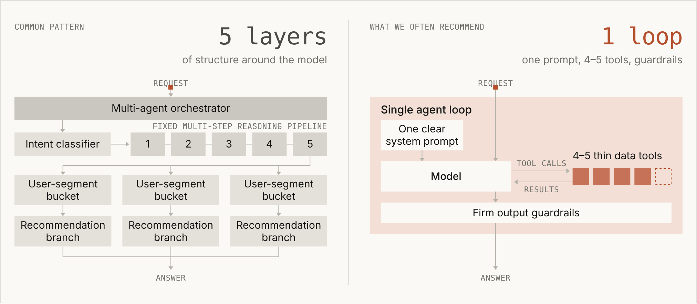
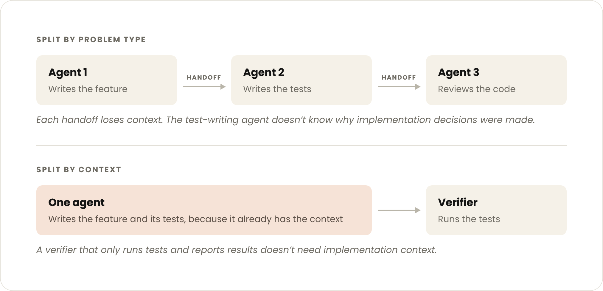

---
authors:
  - aitoboxrobot
categories:
  - 研究解读
date: 2026-10-23
hide:
  - navigation
tags:
  - AI 智能体
  - 子智能体
  - 单智能体循环
  - 架构设计
  - Anthropic
title: "构建智能体：何时应当将子智能体合并回主智能体循环"
---

# 构建智能体：何时应当将子智能体合并回主智能体循环

> # Building agents: When to fold subagents into your main agent loop

### 文章背景与核心概要

在构建复杂的 AI 智能体 (AI Agent) 系统时，开发者和企业往往习惯于模仿人类团队架构，将任务拆散并分派给大量各司其职的独立子智能体 (Subagents)。然而，随着以 Anthropic Claude 为代表的前沿大语言模型推理与自我纠错能力突飞猛进，多智能体系统在工业落地的实战中逐渐暴露出信息有损传递、交互延迟翻倍、提示词规则冲突以及治理失控等严峻瓶颈。为此，Anthropic 提出了反直觉但极具前瞻性的极简架构范式：将分流器、规划器及细分领域的子智能体重新收敛合并为“单智能体循环 (Single Agent Loop)”，配合基于技能 (Skills) 与工具搜索 (Tool Search) 的渐进式上下文披露 (Progressive Disclosure) 机制。实践评估表明，精炼的单循环架构不仅在任务质量与完成度上显著领跑，还能将端到端延迟降低高达 50%，为高可靠、易维护的企业级智能体工程落地提供了切实可行的演进路线图。

---

> 💡 **迁移工具包现已发布：** 如果您已在 Claude Platform 中构建了包含多个子智能体的系统，可以借助我们的 [迁移工具包 (Migration Kit)](https://github.com/anthropics/single-agent-loop-kit) 来评估将哪些子智能体合并回主智能体循环最为合理。该工具包提供了一套引导式工作流，能够识别现有的架构模式、评估替代方案并验证最佳解法，同时还附带了针对模拟系统的完整演示示例。

> > **Migration Kit Available:** If you’ve built an agent in Claude Platform that includes multiple subagents, see which may make sense to fold into the main agent loop using our [migration kit](https://github.com/anthropics/single-agent-loop-kit). It runs a guided workflow to identify your patterns, evaluate alternatives, and verify the best approach, complete with a demo for mock systems.

---

## 📌 执行摘要

> ## Executive Summary

尽管由中央协调器统一编排调度的子智能体（即拥有独立上下文窗口、专有工具集和专属指令的智能体）在结果交叉验证、高度并行任务以及模块化权限隔离方面表现出众，但近期的企业级实际部署却揭示了一个深刻的技术转变。将分流路由器 (Routers)、规划器 (Planners) 和细分领域的专精子智能体重新合并到**单智能体循环 (Single Agent Loop)** 中，往往在输出质量、成本效益以及端到端响应延迟方面全面超越复杂的多智能体架构。

> While subagents (agents with isolated context windows, tools, and instructions orchestrated by a coordinator) are powerful for verification, parallel workloads, and modular permissions, recent enterprise deployments reveal a major shift. Folding routers, planners, and domain subagents into a **single agent loop** frequently outperforms complex multi-agent architectures in output quality, cost efficiency, and latency.

与其生搬硬套人类企业的组织架构图去堆砌脆弱易碎的多智能体系统，现代智能体架构设计更倾向于顺应基础模型日益强大的推理与通用能力，依托**技能 (Skills)**、**工具 (Tools)** 以及共享上下文循环，采用精巧的“渐进式披露 (Progressive Disclosure)”机制。

> Rather than copying organizational charts into brittle multi-agent systems, modern development favors leveraging increasingly capable models through progressive disclosure via **skills**, **tools**, and shared context loops.

---

## 深入理解子智能体及其技术局限

> ## Understanding Subagents and Their Limitations

在探索前沿技术的研究阶段，子智能体依然具备无可替代的独特价值，特别是在以下特定场景中仍是首选方案：

> Subagents remain effective at the research frontier and should be used specifically when:

* **上下文膨胀引发性能下降**：当单智能体循环因上下文体积过大而出现可测量的性能衰减时；
* **需要高度并行的纯净上下文**：多项独立任务需要以全新、一次性的隔离上下文窗口实现并行并发执行；
* **工具选择困难或指令冲突**：单个智能体在面对海量工具时难以精准筛选，或者面临相互冲突的系统指令。

> * A single agent loop suffers measurable performance degradation from context bloat.
> * Multiple tasks require parallel execution with fresh, disposable context windows.
> * A single agent struggles to select appropriate tools or faces conflicting system instructions.

然而在企业级应用中，团队往往极易陷入康威定律 (Conway's Law) 的陷阱：将现实中盘根错节的组织部门层级，机械化地映射为一张庞杂臃肿、四处蔓延的子智能体协作网络。

> However, enterprises frequently fall into the trap of Conway’s Law: mapping their exact organizational chart into a sprawling network of subagents.

### 大型组织中常见的失效模式

> ### Common Failure Modes in Large Organizations

1. **上下文管理失真 (Context Management)**：在不同子智能体之间来回移交任务时，极易丢失至关重要的细节与背景信息。
2. **子智能体肆意蔓延 (Subagent Sprawl)**：各个独立团队各自为战，上线了数百个功能重叠的子智能体，缺乏统一的技术标准，也难以确立明确的主责归属。
3. **“提示词科学怪人” (The "Frankenprompt")**：多个团队不断向系统提示词中追加修修补补的微调规则，层层堆叠引发指令严重冲突，导致品牌形象与交互口吻四分五裂。
4. **局部评估缺乏全局视角 (Unvetted Evals)**：过于局限于孤立子任务的局部评估，反而掩盖了端到端的整体业务表现，让决策者无法看清全局系统水准。
5. **响应延迟严重恶化 (Latency)**：繁复的架构编排带来了严重的性能拖累；评测数据反复表明，单智能体循环的运行速度往往比多智能体编排框架**快达 2 倍**。

> 1. **Context Management:** Valuable details are frequently lost during back-and-forth handoffs between agents.
> 2. **Subagent Sprawl:** Independent teams ship hundreds of overlapping subagents with no enforced standards or singular ownership.
> 3. **The "Frankenprompt":** Accumulating system prompt adjustments from multiple teams introduces conflicting rules and an inconsistent brand voice.
> 4. **Unvetted Evals:** Overly localized subtask evaluations obscure global performance metrics from leadership.
> 5. **Latency:** Architectural complexity introduces severe drag; evaluations frequently show single-agent loops running up to **2x faster** than multi-agent harnesses.

---

## 破局之道：具备渐进式披露能力的单智能体循环

> ## The Alternative: Single Agent Loops with Progressive Disclosure

与其费心编排僵硬刻板的多智能体流水线，一种远为高效的架构策略是：**通过技能 (Skills) 渐进式披露上下文**，并**借助工具搜索 (Tool Search) 按需动态呈现工具**。在初始阶段，模型仅需感知简明扼要的摘要说明；只有当真正需要执行某项专门任务时，完整的操作规范与业务指令才会被按需加载进上下文。

> Instead of orchestrating rigid multi-agent pipelines, a more effective design **progressively discloses context via skills** and **tools via tool search**. Short descriptions remain visible, while full instructions load only when explicitly required.

### 为何单循环架构能全面超越多智能体？

> ### Why Single Loops Outperform Multi-Agent Architectures

* **共享上下文孕育更优质的回答**：长期运行的智能体能够完整保留跨多个连续任务的历史信息，在避免“有损信息传递”的前提下，获得更连贯、深刻的洞察。
* **渐进式披露有效遏制上下文臃肿**：团队无需在初始阶段一股脑注入冗长庞杂的系统提示词，就能打造出功能全能的单智能体。（例如，Claude Code 借助这一技术将其先进模型的系统提示词体积压缩了 80% 以上）。
* **基础模型推理能力突飞猛进**：现代前沿模型（例如 Opus 4.5/5.5 与 Fable 5.1）原生即可驾驭复杂的多步执行循环，能够清晰陈述自身进展并在运行中实时自我纠错——让笨重繁复的外部编排框架彻底沦为多余。

> * **Shared Context Produces Better Answers:** Long-running agents benefit from maintaining history across multiple sequential tasks, enabling richer insights without lossy handoffs.
> * **Progressive Disclosure Prevents Context Bloat:** Teams can build versatile single agents without front-loading massive system prompts. (For example, Claude Code reduced its advanced model system prompt size by over 80% using this technique).
> * **Models Are Increasingly Capable:** Modern models (such as Opus 4.5/5.5 and Fable 5.1) natively manage complex, multi-step loops, narrate their progress, and self-correct on the fly—rendering rigid harness structures redundant.

---

## 实战指南：如何将子智能体合并回主循环

> ## How to Fold Subagents Into the Main Agent Loop

要将现有的“协调器-子智能体”架构平滑演进为极简高效的单智能体工作流，建议遵循以下三个演进阶段：

> To migrate from an orchestrator-subagent layout to a streamlined single-agent workflow, follow these stages:

1. **建立任务完成度评估基准 (Establish Task-Completion Evals)**：构建一套全局统一的基准测试集，辅以细粒度的技能专项评估。评估核心应当关注端到端的最终任务成功率，而非过分纠结于中间的路由分发准确率。
2. **渐进式收敛精简 (Progressive Reduction)**：逐步合并相近领域的智能体，在过渡期将子智能体当作普通工具来调用，并最终将其业务逻辑彻底重构为原生技能 (Skills) 与 MCP 工具。
3. **重构合并领域专精智能体 (Refactor Domain Agents)**：针对那些输出强依赖、上下游链式调用或共享相同数据访问模式的专家智能体，将其果断合并为同一上下文环境。

> 1. **Establish Task-Completion Evals:** Create a centralized evaluation baseline combined with smaller skill-specific evals. Track end-to-end task success over routing accuracy.
> 2. **Progressive Reduction:** Gradually merge domain agents, execute subagents temporarily as tools, and ultimately replace their logic with native skills and MCP tools.
> 3. **Refactor Domain Agents:** Merge tightly coupled specialists that chain off each other's outputs or share data access patterns.

### 单智能体循环的核心架构设计

> ### Designing the Single-Agent Loop

* **核心基础架构 (Core Structure)**：由单一模型与独立上下文窗口构成开放式工具循环，外部框架严格设定交互轮次、Token 成本以及写入预算作为风控防线。
* **自主任务规划 (Planning)**：模型在首轮交互中直接在自身上下文窗口内编写执行计划，并在后续执行中进行动态迭代更新。
* **上下文组件分层 (Context Components)**：
  * **执行顺序与领域业务规程**：沉淀为**技能 (Skills)**；
  * **硬性约束限制、校验门禁与数据检索**：交由**工具 (Tools)** 统一把关；
  * **底层机械代码解析**（例如报文解析、实体解析映射）：完全由工具内部的代码逻辑处理，不占用大语言模型的思考预算。

> * **Core Structure:** One model and context window running an open-ended tool loop, governed by strict turn, cost, and write budgets in the harness.
> * **Planning:** The model writes and dynamically updates its execution plan directly within its context window on the first turn.
> * **Context Components:**
>   * *Ordering and domain procedures* move into **Skills**.
>   * *Hard limits, validation gates, and lookups* move into **Tools**.
>   * *Mechanical plumbing* (payload parsing, entity resolution) remains handled by code inside tools.

---

## 多团队跨部门协同研发的新模式

> ## Collaborative Contributions Across Multiple Teams

在大型组织中规模化拓展智能体能力，绝不意味着每个团队都必须拥有独立的子智能体。相反，职责划分应转向更加模块化的原子构建基元：

> Scaling an agent across a large organization doesn't require separate subagents per team. Instead, ownership shifts to modular primitives:

* **MCP 工具 (MCP Tools)**：非常适用于离散操作、实时数据读取或返回结构化输出。建议根据用户意图对工具进行分组（每组定义保持在 30 至 50 项以内），并启用延迟**工具搜索 (Tool Search)** 机制。
* **技能 (Skills)**：最适合承载标准作业程序 (SOP)、专家级决策判断逻辑以及多步骤复杂工作流。可通过内部自动化工具保持技能库的高效精简：
  * 使用 `/skill-creator` 编写与安全审计；
  * 使用 `/skill-doctor` 追踪 Token 消耗成本并及时剔除废弃资产。
* **知识库 (Knowledge Bases)**：事实性参考资料与技术文档应通过搜索工具或参考文件动态按需读取，切忌生硬地硬编码塞入应用层提示词中。

> * **MCP Tools:** Ideal for discrete actions, live data reads, or returning structured output. Group tools by user intent (keeping definitions under 30–50 items) and utilize deferred **tool search**.
> * **Skills:** Ideal for documenting standard operating procedures, expert judgment calls, and multi-step workflows. Maintain libraries cleanly using internal tooling:
>   * `/skill-creator` for authoring and auditing.
>   * `/skill-doctor` for tracking usage costs and pruning unused assets.
> * **Knowledge Bases:** Reference facts and documentation loaded dynamically through search tools or reference files rather than injected via rigid application code.

---

## 助力架构平滑迁移的官方工具链

> ## Tools to Accelerate Migration

Anthropic 开源的 [single-agent-loop-kit](https://github.com/anthropics/single-agent-loop-kit) 工具包及其配套的 Claude API 命令，可全自动化加速这一迁移过程：

> Anthropic’s [single-agent-loop-kit](https://github.com/anthropics/single-agent-loop-kit) and associated Claude API commands automate the transition process:

* **`/claude-api build-eval`**：自动生成基础的端到端评测集与技能专精评测集。
* **`/claude-api prompt-audit`**：全面筛查提示词、技能和工具中的遗留过时指令，并提供现代化的差异补丁 (Diffs) 建议。
* **`/claude-api hillclimb`**：针对实时评估基准，自动化迭代优化系统提示词、技能描述与工具配置。
* **`/claude-api cost-optimize`**：对 API 调用流量进行全方位画像剖析，给出上下文缓存、Token 精简以及模型选型优化建议。

> * **`/claude-api build-eval`**: Generates foundational end-to-end and skill-specific evaluation sets.
> * **`/claude-api prompt-audit`**: Identifies legacy instructions across prompts, skills, and tools, proposing modern diffs.
> * **`/claude-api hillclimb`**: Iteratively optimizes system prompts, skill descriptions, and tool configurations against active evals.
> * **`/claude-api cost-optimize`**: Profiles API traffic to recommend caching, token trimming, and model-choice efficiencies.

**核心架构准则：** 始终以实测数据说话，单次只变更一个变量，坚定保留那些在实际运行中最具韧性的架构设计。随着大模型的能力不断实现质的飞跃，与其迷信层峦叠嶂的庞大子智能体体系，不如坚决拥抱大道至简的单智能体循环。

> **Core Principle:** Measure performance, change one element at a time, and keep whatever architecture proves most resilient. As models grow increasingly capable, favor simple loops over sprawling subagent hierarchies.
