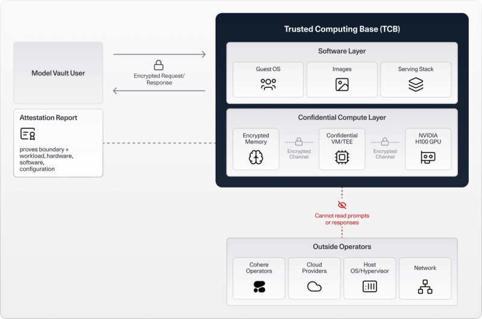

---
authors:
  - aitoboxrobot
categories:
  - 研究解读
date: 2026-10-23
hide:
  - navigation
tags:
  - Cohere Model Vault
  - 机密计算
  - 可验证推理
  - NVIDIA GPU
  - OHTTP
title: "深入 Cohere Model Vault：构建可验证的机密 AI 推理技术"
---

# 深入 Cohere Model Vault：构建可验证的机密 AI 推理技术

> # Inside Cohere Model Vault: Building a Verifiable Confidential AI Inference

### 文章背景与核心概要

随着企业与开发者将越来越多的核心业务逻辑与高价值私有数据接入云端大模型，数据隐私泄露与越权访问成为了阻碍 AI 规模化落地的核心顾虑。传统的加密手段主要保护“静态存储”与“网络传输”阶段的数据，然而一旦数据进入服务器内存被模型推理调用，便不可避免地暴露在云厂商、底层操作系统以及运维人员面前。Cohere 联合 Microsoft Azure 与 NVIDIA 推出的 Model Vault，开创性地将机密计算 (Confidential Computing) 拓展至现代 GPU 加速推理场景，通过硬件级隔离、不透明 HTTP (Oblivious HTTP, OHTTP) 载荷加密以及远程证明 (Remote Attestation) 机制，建立起“先验证、后信任”的密码学防护屏障。这一技术突破消除了用户对托管云基础设施的盲目信任依赖，在确保极致推理性能的同时实现了敏感数据的全程机密隔离，为医疗、金融等合规严苛领域的云端 AI 应用树立了全新的安全标杆。

---

## 核心内容摘要

> ## Summary

Cohere 推出的 Model Vault (目前在 Microsoft Azure 平台上结合 NVIDIA GPU 处于公开测试阶段) 为 AI 推理任务打造了一个高安全性的执行环境。与以往仅仅对传输中的数据实施加密不同，Model Vault 旨在通过硬件级物理隔离、针对 GPU 的 NVIDIA 机密计算 (Confidential Computing) 、保护请求数据载荷的不透明 HTTP (Oblivious HTTP, OHTTP) 以及远程证明 (Remote Attestation) 等技术，最大限度降低企业客户对底层云基础设施的信任依赖。这在业内构建起一套基于密码学的“先验证、后信任”机制，在完全不牺牲云端全托管服务极致性能的前提下，确保了数据在被模型计算处理全过程中的绝对安全。

> Cohere's Model Vault (currently in public beta with NVIDIA GPUs on Microsoft Azure) provides a secure environment for AI inference. Rather than simply encrypting data in transit, Model Vault aims to minimize the infrastructure trust required by customers by leveraging hardware isolation, NVIDIA confidential computing on GPUs, Oblivious HTTP (OHTTP) for request payload protection, and remote attestation. This creates a cryptographic "verify-before-you-trust" mechanism that ensures data safety during processing without sacrificing managed platform performance.

---

## 从机密硬件迈向机密推理

> ## From Confidential Hardware to Confidential Inference

机密计算的核心使命，是在应用程序或模型主动处理数据时，严密保护处于**使用中 (data in use)** 的数据。这套安全体系建立在两大核心基石之上：

> Confidential computing protects **data in use** while an application or model actively processes it. At its foundation are two core properties:

* **硬件隔离 (Isolation)**：利用硬件层面的强制访问控制技术，严密阻隔外部基础设施对计算工作负载内存的窥探；
* **环境证明 (Attestation)**：生成带有密码学数字签名的真实环境凭据，使外部机构能够在放行敏感数据之前，对计算环境的安全状态进行严格评估与审计。

> * **Isolation:** Uses hardware-enforced controls to protect workload memory from external infrastructure.
> * **Attestation:** Produces cryptographically signed evidence regarding the environment so that external parties can evaluate it before releasing sensitive data.

在 AI 推理场景下，单纯对 CPU 实施机密防护是远远不够的，因为现代大模型的大量矩阵运算都发生在专用加速硬件上。**NVIDIA GPU 机密计算 (Confidential Computing on NVIDIA GPUs)** 不仅牢牢锁定了 GPU 高速显存，还对 CPU 与 GPU 之间的高速通信总线进行了端到端加密，确保机密计算的安全边界完整贯穿了从数据输入到模型计算的整条推理流水线。

> For AI inference, CPU-only protection is insufficient because substantial model computation occurs on accelerators. **Confidential Computing on NVIDIA GPUs** secures GPU memory and encrypts communication between the CPU and GPU, ensuring the confidential boundary successfully spans the entire inference pipeline.

---

## 深入机密 Model Vault 内部架构

> ## Inside a Confidential Model Vault

Model Vault 围绕专属的模型部署实例，构建了多重纵深防御控制机制：

> Model Vault integrates several controls around a dedicated model deployment:

* **CPU 与 GPU 的全栈机密执行 (Confidential CPU and GPU Execution)**：模型服务软件栈整体运行在机密虚拟机 (Confidential VM) 之内。依托硬件级隔离，操作系统、底层驱动程序以及推理服务器内存都得到了硬件级安全防护，严密的安全策略更是从根源上杜绝了云平台运维人员发起任何交互式登录与访问操作。
* **请求载荷加密 (Request Payload Encryption, OHTTP)**：为了杜绝任何网络中间人或代理节点在数据传输过程中截获明文，Model Vault 采用了**不透明 HTTP (Oblivious HTTP, OHTTP)** 协议。敏感的请求内容会使用与经认证机密环境直接绑定的公钥进行加密，整个网络链路中只有机密环境内部的 OHTTP 网关才有权解密。
* **主动式远程证明 (Remote Attestation)**：机密环境会自动生成包含密码学数字签名的测量凭证，详细列明当前硬件、固件以及软件运行栈的真实指纹配置。客户端在发出受保护的业务数据载荷**之前**，必须先对照预先批准的安全基准策略对该凭据进行严格核验——从而将远程证明转化为一道主动生效的前置安全拦截机制。

> * **Confidential CPU and GPU Execution:** The serving stack operates inside a confidential virtual machine. Hardware-backed isolation safeguards the OS, drivers, and inference server memory, while policy constraints prevent interactive operator access.
> * **Request Payload Encryption (OHTTP):** To prevent intermediaries from accessing plaintext data in transit, Model Vault uses **Oblivious HTTP (OHTTP)**. Sensitive request contents are encrypted using a public key associated with the attested environment, allowing only the internal OHTTP gateway to decrypt them.
> * **Remote Attestation:** The confidential environment generates cryptographically signed evidence detailing its hardware, firmware, and software configuration. Clients check this evidence against an approved policy **before** sending protected payloads—turning attestation into an active security enforcement mechanism.

---

## 信任边界与威胁模型

> ## The Trust Boundary and Threat Model

### 依然需要给予信任的组件

> ### What Remains Trusted

* 底层硬件厂商提供的机密计算芯片与硬件架构；
* 运行在机密安全环境内部的固件以及经过完整性测量的软件代码；
* 参考测量基准值以及负责验证的远程证明基础设施。

> * Underlying confidential computing hardware
> * Firmware and measured software inside the confidential environment
> * Reference measurements and attestation infrastructure

### 处于严密保护之下的资产

> ### What Is Protected

* 用户输入的提示词 (Prompts) 、检索参考文档、模型生成的响应内容以及模型运行时的计算状态；
* 有效抵御来自宿主操作系统、虚拟机监视器 (Hypervisor) 、云服务提供商以及 Cohere 内部运维人员的内存窥探与数据窃取行为；
* 跨越所有中间网络基础设施通道的端到端数据传输加密保护。

> * Prompts, documents, responses, and model execution
> * Protection against host OS, hypervisor, cloud provider, and Cohere operator memory snooping
> * End-to-end encryption across intermediary infrastructure paths

### 处于防护边界之外的风险

> ### What Remains Outside the Protection Boundary

* **物理攻击与侧信道攻击 (Physical and Side-Channel Attacks)**：例如基于时间分析或硬件物理特征推断数据信息的微架构侧信道潜在风险；
* **系统可用性保障 (Availability)**：机密计算并不负责防范拒绝服务攻击 (DoS) 或因运维故障导致的服务不可用风险；
* **应用层安全漏洞 (Application-Level Vulnerabilities)**：提示词注入 (Prompt Injections) 、不安全的外接工具调用逻辑以及越权授权缺陷等，依然必须在应用软件架构层严格防范；
* **可被观测的网络元数据 (Observable Metadata)**：请求发送的精确时间、数据包体积大小、网络流量负载以及路由参数等元数据信息，在数据载荷之外依然可被外部观察到。

> * **Physical and Side-Channel Attacks:** Risks such as timing or hardware behavior inferences.
> * **Availability:** Confidential computing does not prevent denial-of-service (DoS) attacks or operator-induced delays.
> * **Application-Level Vulnerabilities:** Prompt injections, insecure tool usage, and authorization flaws must still be managed at the software level.
> * **Observable Metadata:** Request timing, message size, traffic volume, and routing parameters remain visible outside the payload.

---

## 厘清认知：机密计算不是什么

> ## What Confidential Computing Is Not

* **它不是应用层安全防护的替代品**：无法自动防御软件自身的业务漏洞与安全设计缺陷；
* **它不是数据驻留合规工具**：机密计算严格约束的是数据在计算处理过程中的内存访问权限，而非数据存储所处的地理管辖边界；
* **它不是法律合规契约的代名词**：底层的技术隔离措施并不能直接免除企业应履行的合规与法律责任；
* **它不是同态加密 (Homomorphic Encryption)**：在受保护的安全硬件边界内部，模型依然是在明文状态下进行高速矩阵计算。

> * Not a replacement for application security.
> * Not a data-residency mechanism (it governs access during computation, not jurisdiction).
> * Not a substitute for compliance or legal contracts.
> * Not homomorphic encryption (models still operate on plaintext inside the secured boundary).

---

## 拥抱开源：消除黑盒疑虑

> ## Built in the Open

为了彻底消除业界对于安全方案沦为不可信“黑盒”的疑虑，Model Vault 深度依托 **Kata Containers** 与 **Confidential Containers** 等成熟开源技术构建。Cohere 计划对整套机密推理软件技术栈进行开源，以便企业客户与独立安全研究人员能够随时自主审查安全策略细节，并亲手复现环境的度量验证基准。

> To eliminate "black box" concerns, Model Vault builds on open-source technologies like **Kata Containers** and **Confidential Containers**. Cohere intends to open-source the confidential inference stack to let customers and security researchers independently inspect policies and reproduce verification measurements.

---

## 未来展望与演进路线

> ## What's Next

目前，Model Vault 的公开测试版已在 **Microsoft Azure 平台的 NVIDIA H100 GPU** 上平稳运行。在迈向正式商用发布 (General Availability, GA) 之前，Cohere 还将引入对下一代 **NVIDIA Blackwell 架构 (包括 B200 GPU)** 的全面支持。

> The current public beta runs on **NVIDIA H100 GPUs on Microsoft Azure**, with upcoming support for **NVIDIA Blackwell infrastructure (including B200 GPUs)** ahead of general availability.

* **了解更多**：[Model Vault 机密计算产品发布公告](https://docs.google.com/document/d/1BvbHFNbT-GjlvSG7UMaaahsM4OX3A4YtZPp_330XT0g/edit?tab=t.0)
* **查阅技术文档**：[Model Vault 官方文档](https://docs.cohere.com/docs/model-vault)
* **立即上手体验**：[vault.cohere.com](http://vault.cohere.com)

> * **Learn more:** [Confidential Computing on Model Vault Product Announcement](https://docs.google.com/document/d/1BvbHFNbT-GjlvSG7UMaaahsM4OX3A4YtZPp_330XT0g/edit?tab=t.0)
> * **Explore documentation:** [Model Vault Documentation](https://docs.cohere.com/docs/model-vault)
> * **Get started:** [vault.cohere.com](http://vault.cohere.com)
