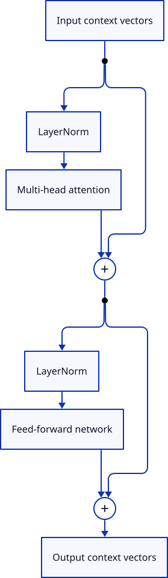
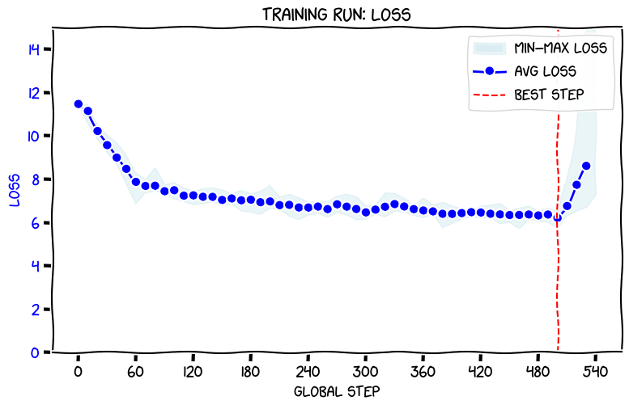
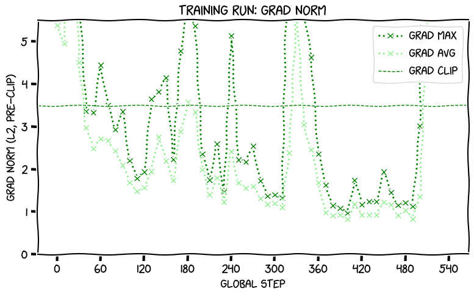

---
authors:
  - aitoboxrobot
categories:
  - 工具教程
date: 2026-10-24
hide:
  - navigation
tags:
  - RMSNorm
  - LayerNorm
  - PyTorch
  - Transformer
  - 模型训练
title: "深入理解与实现 LLM 中的 RMSNorm：从数学原理到 PyTorch 实战"
---

# 深入理解与实现 LLM 中的 RMSNorm：从数学原理到 PyTorch 实战

> # Understanding and Implementing RMSNorm in LLMs

### 文章背景与核心概要

归一化是现代大语言模型 (Large Language Model, LLM) 稳定训练的“定海神针”，没有它，梯度爆炸与数值崩溃会在数百步之内彻底摧毁模型训练。传统以 GPT-2 为代表的模型普遍采用层归一化 (LayerNorm) ，而现代开源主流大模型却纷纷拥抱了均方根归一化 (Root Mean Square Normalization, RMSNorm) 。RMSNorm 的核心诀窍在于完全摒弃均值计算与中心化操作，仅依靠均方根缩放，在数学上更简练纯粹。然而，真实的训练基准测试揭示了一个关键真相：RMSNorm 与 LayerNorm 本身的理论算力差异其实微乎其微，真正让训练速度产生质的飞跃（提速超过 10%）的，是 PyTorch 底层经过算子融合的高性能 CUDA 核函数。

---

## 总结概述

> ## Summary

归一化是大语言模型 (LLM) 中不可或缺的核心组件，它能够稳定神经元的统计特性、防止梯度消失或爆炸，并确保深层模型依然具备良好的可训练性。尽管像 GPT-2 这样的经典架构传统上依赖 **LayerNorm** ，但如今许多现代开源模型已经纷纷转向使用 **RMSNorm** (Root Mean Square Normalization) 。

> Normalization is an essential component of Large Language Models (LLMs) that helps stabilize statistical properties, prevents vanishing or exploding gradients, and ensures models remain trainable. While classic architectures like GPT-2 traditionally rely on **LayerNorm**, many modern open models use **RMSNorm** (Root Mean Square Normalization) instead. 

本文将深入探讨 LayerNorm 与 RMSNorm 之间的数学与架构差异，带领大家一步步在 PyTorch 中手写实现它们的代码，对比手写实现与 PyTorch 内置融合模块的性能差异，并通过在 1.63 亿参数的 GPT-2 Small 模型上进行完整训练实验，验证 RMSNorm 是否真能带来速度或性能上的实质优势。

> This post explores the mathematical and architectural differences between LayerNorm and RMSNorm, walks through code implementations in PyTorch, evaluates hand-rolled vs. built-in fused PyTorch modules, and analyzes training runs of 163M-parameter GPT-2 small models to determine whether RMSNorm provides a genuine speed or performance advantage.

---

## 1. 归一化的基本原理

> ## 1. The Principle of Normalization

在一个典型的 GPT-2 风格 Transformer 模块中，归一化操作部署在以下几个至关重要的节点：
* 在输入的上下文向量进入多头注意力 (Multi-Head Attention, MHA) 模块之前；
* 在计算结果传入前馈网络 (Feed-Forward Network, FFN) 之前；
* 在通过最终输出头将上下文向量投影到词表空间之前，再执行一次归一化。

> In a GPT-2-style Transformer block, normalization occurs at several critical points:
> * Just before incoming context vectors enter the multi-head attention (MHA) module.
> * Just before the results are fed through the feed-forward network (FFN).
> * Once more right before projecting context vectors into vocabulary space via the output head.

<p></p>

如果完全移除归一化，模型训练通常会在 100 步左右彻底崩溃，损失值 (Loss) 会骤升到未初始化时的失控水平。然而，归一化并不一定非得使用 LayerNorm。要理解 RMSNorm 如今为何备受青睐，我们需要仔细审视这两者的底层运作机制。

> Without normalization, training typically collapses within roughly 100 steps, causing the loss to spike to uninitialized levels. However, normalization does not strictly *have* to be LayerNorm. To understand why RMSNorm has become popular, we must look closely at how both operate.

---

### LayerNorm 与 RMSNorm 的机制对比

> ### LayerNorm vs. RMSNorm

#### 层归一化 (LayerNorm)

> #### LayerNorm

LayerNorm 会独立处理每一个上下文向量，主要分为两大核心步骤：
1. **重新中心化与方差归一化**：对上下文向量进行归一化，使其均值调整为 0，方差调整为 1；
2. **缩放与平移**：逐元素应用可学习的缩放 (Scale / 权重 Weight) 和平移 (Shift / 偏置 Bias) 向量。

> LayerNorm processes each context vector separately by performing two main steps:
> 1. **Re-centering and Normalizing Variance:** Normalizing the context vector so its mean is zero and its variance is one.
> 2. **Scaling and Shifting:** Applying trainable scale (weight) and shift (bias) vectors element-wise.

对于给定的上下文向量，计算 LayerNorm 的完整链路包括：求均值、减去均值（重新中心化）、计算差值的平方以获取方差、将方差转换为标准差 (Standard Deviation, SD) 、除以标准差，最后进行线性缩放和平移。这需要在每个向量上执行大量的加法、减法、除法、乘法以及开平方运算。

> For a given context vector, calculating LayerNorm involves determining the mean, subtracting it (re-centering), squaring the differences to find the variance, converting it to standard deviation (SD), dividing by the SD, and finally scaling and shifting. This requires a substantial number of addition, subtraction, division, multiplication, and square-root operations.

#### 均方根归一化 (RMSNorm)

> #### RMSNorm

RMSNorm 大刀阔斧地简化了这一流程——它**彻底跳过了均值计算**，完全不做上下文向量的重新中心化。相反，它直接依据向量自身的均方根 (Root Mean Square, RMS) 将其缩放到统一尺度，每个元素直接除以该 RMS，随后仅通过一个可学习的缩放向量进行逐元素缩放（通常不包含平移/偏置）。

> RMSNorm simplifies this process by **skipping the mean calculation entirely**—it does not re-centre the context vectors. Instead, it scales them down to a uniform length based on their Root Mean Square (RMS), divides each element by the RMS, and then applies an element-wise scale via a trainable scale vector (typically without a shift/bias).

通过完全省去均值中心化这一步，RMSNorm 大幅减少了每个上下文向量所需的加法和减法运算次数，从而带来了更轻量的计算开销。

> By omitting the mean-centering step, RMSNorm reduces the number of required addition and subtraction operations per context vector significantly, yielding a lighter computational footprint.

---

## 2. 代码实现

> ## 2. Code Implementation

### 在 PyTorch 中手写实现 RMSNorm

> ### Hand-Rolled RMSNorm in PyTorch

```python
class RMSNorm(nn.Module):

    def __init__(self, emb_dim):
        super().__init__()

        self.emb_dim = emb_dim
        self.scale = nn.Parameter(torch.ones(self.emb_dim))
        self.eps = RMSNORM_EPS

    def forward(self, xs):
        squares = xs**2
        mean_squares = squares.mean(dim=-1, keepdim=True)
        rms = torch.sqrt(self.eps + mean_squares)
        return (xs / rms) * self.scale
```

### 灵活的归一化工厂函数

> ### Flexible Normalization Factory

为了便于对不同方案进行基准测试，我们设计了一个工厂函数 (`make_norm`) ，用于在手写变体、PyTorch 内置模块 (`nn.LayerNorm` 与 `nn.RMSNorm`) 以及无归一化基线 (`nn.Identity()`) 之间自由切换：

> To easily benchmark different approaches, a factory function (`make_norm`) was used to swap between hand-rolled variants, built-in PyTorch modules (`nn.LayerNorm` and `nn.RMSNorm`), and an unnormalized baseline (`nn.Identity()`):

```python
def make_norm(cfg):
  norm_type = cfg.get("norm_type", "handrolled_layernorm")
  if norm_type == "handrolled_layernorm":
    return LayerNorm(cfg["emb_dim"])
  elif norm_type == "pytorch_layernorm":
    return nn.LayerNorm(normalized_shape=cfg["emb_dim"], eps=LAYERNORM_EPS)
  elif norm_type == "handrolled_rmsnorm":
    return RMSNorm(cfg["emb_dim"])
  elif norm_type == "pytorch_rmsnorm":
    return nn.RMSNorm(
        normalized_shape=cfg["emb_dim"],
        eps=RMSNORM_EPS,
        elementwise_affine=True,
    )
  elif norm_type == "no_norm":
    return nn.Identity()
  else:
    raise Exception(f"Unknown norm_type of {norm_type!r}")
```

---

## 3. 训练实验与结果分析

> ## 3. Training Runs and Results

为了检验真实场景下的表现，我们在一个 8 张 A100 GPU 的集群上，从零开始训练了参数量约为 1.63 亿的 GPT-2 Small 风格模型，并遵循 Chinchilla 最优数据配比（每个参数对应约 20 个 Token）进行充分训练。

> To test real-world behavior, GPT-2 small-style models (~163M parameters) were trained from scratch using Chinchilla-optimal token counts (~20 tokens per parameter) across an 8x A100 GPU cluster.

### 无归一化基线实验

> ### The No-Normalization Baseline

在没有任何归一化的情况下训练模型，数值稳定性迅速崩塌。仅仅进行到第 530 步，训练损失就持续记录为 `NaN`（非数字异常），模型梯度彻底失控爆炸：

> Training a model without any normalization quickly destabilized. By step 530, training loss logged consistent `NaN` values, and gradients exploded off the chart:

<p></p>

<p></p>

---

### 对比基准测试结果

> ### Comparative Benchmark Results

| 模型 (Model) | 训练耗时 (秒) | 每秒处理 Token 数 (Tokens/sec) | 测试集损失 (Test loss) |
| :--- | :--- | :--- | :--- |
| [`gpjt/8xa100m40-rmsnorm-1-hand-layernorm`](https://huggingface.co/gpjt/8xa100m40-rmsnorm-1-hand-layernorm) | 9,358 | 348,364 | 3.595336 |
| [`gpjt/8xa100m40-rmsnorm-2-pytorch-layernorm`](https://huggingface.co/gpjt/8xa100m40-rmsnorm-2-pytorch-layernorm) | 8,324 | 391,659 | 3.571158 |
| [`gpjt/8xa100m40-rmsnorm-3-hand-rmsnorm`](https://huggingface.co/gpjt/8xa100m40-rmsnorm-3-hand-rmsnorm) | 9,134 | 356,899 | 3.601292 |
| [`gpjt/8xa100m40-rmsnorm-4-pytorch-rmsnorm`](https://huggingface.co/gpjt/8xa100m40-rmsnorm-4-pytorch-rmsnorm) | 8,289 | 393,294 | 3.572383 |

> | Model | Training time (s) | Tokens/sec | Test loss |
> | :--- | :--- | :--- | :--- |
> | [`gpjt/8xa100m40-rmsnorm-1-hand-layernorm`](https://huggingface.co/gpjt/8xa100m40-rmsnorm-1-hand-layernorm) | 9,358 | 348,364 | 3.595336 |
> | [`gpjt/8xa100m40-rmsnorm-2-pytorch-layernorm`](https://huggingface.co/gpjt/8xa100m40-rmsnorm-2-pytorch-layernorm) | 8,324 | 391,659 | 3.571158 |
> | [`gpjt/8xa100m40-rmsnorm-3-hand-rmsnorm`](https://huggingface.co/gpjt/8xa100m40-rmsnorm-3-hand-rmsnorm) | 9,134 | 356,899 | 3.601292 |
> | [`gpjt/8xa100m40-rmsnorm-4-pytorch-rmsnorm`](https://huggingface.co/gpjt/8xa100m40-rmsnorm-4-pytorch-rmsnorm) | 8,289 | 393,294 | 3.572383 |

---

## 4. 关键结论

> ## 4. Key Takeaways

1. **训练速度 (Training Speed)**：
   * 手写实现的 RMSNorm 相比手写实现的 LayerNorm 大约**提速 2.5%**；
   * 然而，当切换到 PyTorch 内置的原生模块时，两者的差距缩小到了仅有 **0.5%**；
   * **真正的性能飞跃**其实来自 PyTorch 内置的融合 CUDA 核函数 (Fused CUDA Kernels) ——与 Python 自定义实现的执行开销相比，它将总体训练耗时削减了约 **10% 到 11%**，其实际影响远远超过了归一化公式本身所带来的细微差异。

> 1. **Training Speed:** 
>    * Hand-rolled RMSNorm was roughly **2.5% faster** than hand-rolled LayerNorm. 
>    * However, when shifting to built-in PyTorch modules, the difference shrank to just **0.5%**.
>    * The **true performance leap** came from using PyTorch's built-in fused CUDA kernels, which reduced training times by roughly **10% to 11%** compared to Python-loop implementations, completely overshadowing the choice of normalization math itself.

2. **模型质量（测试集损失 / Test Loss）**：
   * RMSNorm 取得了与 LayerNorm 几乎完全一致的测试集损失（两者微弱差异仅在 0.001 到 0.006 之间），有力证明了 RMSNorm 在模型表征能力上与 LayerNorm 旗鼓相当；
   * 有趣的是，PyTorch 内置实现的模型测试集损失始终略优于手写版本，不过要确定这是算子精度带来的系统性提升还是随机初始化噪声的影响，还需要进一步的验证。

> 2. **Model Quality (Test Loss):**
>    * RMSNorm achieved test losses nearly identical to LayerNorm (a minor delta of ~0.001 to 0.006), reinforcing that RMSNorm is just as capable as LayerNorm.
>    * Interestingly, the built-in PyTorch implementations consistently yielded slightly better test losses than hand-rolled equivalents, though further validation is required to separate systematic improvement from random initialization noise.

3. **RMSNorm 为何如此广受欢迎？**
   * 尽管其节省的计算量随模型的隐藏层宽度和深度呈线性增长，但在更大规模的架构中（计算主体完全被复杂度为 $O(d_{\text{emb}}^2)$ 的 FFN 前馈计算和 $O(n^2)$ 的注意力机制所主导），归一化带来的算力节省占比其实相对有限；
   * 归根结底，RMSNorm 在开源大模型中的广泛流行，主要得益于其概念上的极致精炼、与“无偏置 (Bias-Free) ”现代化架构理念的高度契合，以及能够无缝即插即用、开箱即用的出色稳定性。

> 3. **Why is RMSNorm Popular?**
>    * While its computational savings scale linearly with model width and depth, its relative impact on larger architectures (which are dominated by $O(d_{\text{emb}}^2)$ FFN calculations and $O(n^2)$ attention mechanisms) is modest. 
>    * Ultimately, RMSNorm's widespread adoption in open-source models is likely driven by its conceptual simplicity, its alignment with bias-free design choices, and its seamless plug-and-play drop-in performance.
