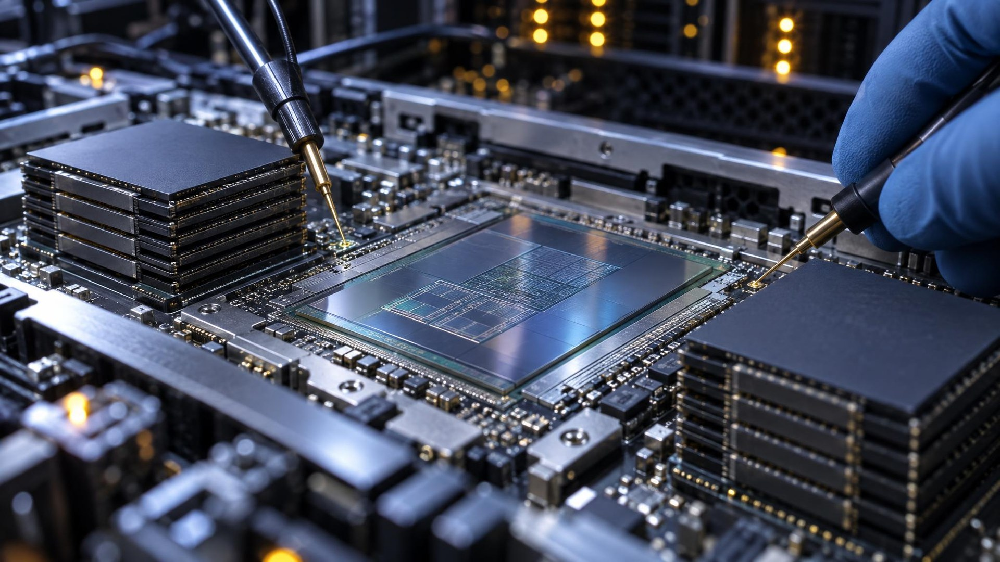

---
authors:
  - aitoboxrobot
categories:
  - 商业动态
date: 2026-10-28
hide:
  - navigation
tags:
  - Cloudflare
  - KV Cache
  - SGLang
  - 模型安全
  - GPU推理
title: "Cloudflare 披露 GLM-5.3 漏洞：多租户 KV 缓存暴露导致 155 条会话泄露"
---

# Cloudflare 披露 GLM-5.3 漏洞：多租户 KV 缓存暴露导致 155 条会话泄露

> # Cloudflare Says GLM-5.3 Bug Leaked 155 Responses Across Tenant Sessions

### 文章背景与核心概要

随着大语言模型 (Large Language Model, LLM) 迈入百万级长上下文时代，为了提升算力利用率与降低生成延迟，现代 AI 推理系统普遍采用计算与解码解耦的分离式集群架构。然而，在这种高度复杂的多租户共享 GPU 基础设施中，显存与状态管理一旦出现疏漏，极易引发生命攸关的数据隔离与隐私泄露隐患。2026 年 9 月，Cloudflare 在其 Workers AI 平台上发现了由推理引擎 SGLang 底层缺陷与显存池配置失配共同引发的罕见漏洞：当用户输入超长提示词 (Prompt) 导致键值缓存 (Key-Value Cache, KV Cache) 溢出时，系统不仅未按预期拦截报错，反而将其他会话残留的未清零显存拼装输出，导致 155 条多租户会话响应发生跨请求数据泄露。Cloudflare 与 SGLang 团队随后协同完成紧急修复并在开源社区发布安全补丁。本文详细复盘了该漏洞的触发机制、排查时间线与应急修复方案，为行业安全运营解耦式 GPU 推理基础设施提供了极具价值的实战借鉴。

---

## 核心概述

> ## Summary

Cloudflare 发布了一份安全事故调查报告，详细披露了其 Workers AI 平台上运行的 GLM-5.3 模型存在的跨请求键值缓存 (KV Cache) 暴露漏洞。由于模型部署配置失配以及上游 SGLang 推理引擎的一个内部缺陷相互叠加，导致当用户发送超长提示词时，系统在返回的 155 条会话响应中意外泄露了其他客户会话的历史数据。该漏洞最初由安全研究员 Gadi Evron 负责任地披露，Cloudflare 团队在 2026 年 9 月迅速实施了紧急处置与隔离修复；此次安全事件也推动了 SGLang 上游代码库的广泛安全修补，并为业内安全运营计算与解码解耦架构的 GPU 基础设施提供了重要的实践建议。

> Cloudflare published an incident report detailing a cross-request KV cache exposure vulnerability in the GLM-5.3 model on its Workers AI platform. Caused by a configuration mismatch and an upstream SGLang inference engine bug, the issue resulted in 155 responses to extremely long prompts leaking data from other customer sessions. Disclosed by security researcher Gadi Evron and swiftly remediated by Cloudflare in September 2026, the incident prompted widespread upstream patches and operational recommendations for managing disaggregated GPU infrastructure securely.

---

## 漏洞暴露背后的两大核心根因

> ## The Two Issues Behind the Exposure

Cloudflare 在其平台中以“计算与解码解耦” (disaggregated) 的集群架构，使用开源推理引擎 SGLang 承载 Z.ai 研发的 GLM-5.3 文本生成模型。在这一架构下，Prefill（预填充）GPU 负责处理输入的提示词并计算生成键值缓存 (KV Cache)，随后通过 Mooncake 框架利用远程直接内存访问 (Remote Direct Memory Access, RDMA) 技术将缓存数据跨节点高速传输给 Decode（解码）GPU，由后者继续执行自回归解码以生成最终的回答。为了追求极致吞吐，这套由固定大小内存页组成的共享 KV 缓存池在请求之间并不会执行全量清零擦除，推理引擎完全依赖严谨的内存页所有权追踪机制来保障多租户之间的数据隔离。

> Cloudflare runs Z.ai's GLM-5.3 text generation model using SGLang—an open-source inference engine—in a disaggregated configuration. In this setup, prefill GPUs process prompts and generate the Key-Value (KV) cache, passing it over remote direct memory access (RDMA) via Mooncake to decode GPUs that construct the final response. Because the shared pool of fixed-size KV cache pages is not zeroed out between requests, the engine relies strictly on tracking page ownership.

本次数据泄露事件正是由以下两项致命因素叠加交织所致：

> The data exposure stemmed from two combined factors:

1. **部署配置失配**：Cloudflare 在部署 GLM-5.3 时对外开放了 1,048,576 Token 的超长上下文窗口，然而集群中 Prefill GPU 节点预分配的 KV 缓存池容量上限实际上仅能容纳 681,280 Token。Cloudflare 的运维团队原本预期当提示词超出显存池承载能力时推理引擎会自动抛出安全异常并优雅报错，但在先前的上线测试中，自动化测试套件主要验证了 HTTP 状态码和系统吞吐性能，并未深入校验极端边界下模型输出内容的语义连贯性。
2. **SGLang 引擎底层缺陷**：当处理超过缓存池容量上限的超长提示词时，SGLang 引擎内部虽将该请求标记为“拒绝处理”，却在内部使用了一个单 Token 的占位符进行替换继续调度。更严重的是，负责 Prefill 的 GPU 节点依然针对这个占位符生成了 KV 缓存，并向后端发出了传输完成的信号。这直接导致负责 Decode 的 GPU 节点误以为数据准备就绪，直接在残留着上一个历史请求数据的“陈旧缓存页”上执行了内容生成，并最终返回了 HTTP 200 成功状态码，而非本应抛出的 HTTP 400 客户端错误。

> 1. **The Configuration Mismatch:** Cloudflare deployed GLM-5.3 with a 1,048,576-token context window, while the prefill GPU's KV cache pool was limited to 681,280 tokens. Cloudflare expected the engine to safely error out on overly large prompts, but their testing validated HTTP response codes and performance rather than model output coherence. 
> 2. **The SGLang Engine Bug:** When processing prompts exceeding the cache pool size, SGLang internally marked them as rejected and swapped them with a one-token placeholder. However, the prefill node still generated a KV cache for the placeholder and signaled a completed transfer. Consequently, the decode node generated responses over stale cache pages holding data from previous requests, returning an HTTP 200 instead of an HTTP 400 error.

经全面核查，所有受影响的 155 条异常响应全部对应长度超过 681,280 Token 的超长提示词请求。Cloudflare 官方明确证实，目前没有任何证据表明该漏洞曾遭到黑客的蓄意探测或恶意利用，相关异常请求在时间分布与请求规模上完全符合用户正常调用超长上下文场景的常规业务特征。

> All 155 affected responses were tied to prompts exceeding 681,280 tokens. Cloudflare confirmed there was no evidence of deliberate exploitation, noting that the timing and volume of affected requests matched standard long-context usage.

---

## 应急响应与漏洞处置全流程

> ## Incident Response and Remediation

在安全研究员 Gadi Evron 于 2026 年 9 月 8 日通过 HackerOne 漏洞赏金平台提交多租户数据隔离缺陷报告后，Cloudflare 迅速启动紧急应急响应机制对漏洞展开排查与闭环修复：

> After security researcher Gadi Evron reported the tenant-isolation issue via HackerOne on September 8, 2026, Cloudflare moved quickly to isolate and resolve the vulnerability:

* **2026 年 9 月 9 日 08:00 (UTC)**：Cloudflare 安全团队正式启动漏洞报告的复现与核验。
* **13:22 (UTC)**：产品安全团队成功稳定复现数据泄露现象，正式宣布进入安全事件应急状态。
* **14:00 (UTC)**：紧急下线 GLM-5.3 模型对外服务，将其访问权限设为私有隔离状态。
* **14:35 (UTC)**：彻底锁定配置失配与 SGLang 内部状态转移的根本原因。
* **19:04 (UTC)**：基于 Cloudflare 自研定制补丁，完成全量生产环境的编译与滚动部署。
* **19:40 (UTC)**：经过严密安全验证后，GLM-5.3 模型正式恢复公开访问服务。

> * **September 9, 2026 (08:00 UTC):** Cloudflare began verifying the report.
> * **13:22 UTC:** Declared a security incident after the Product Security team successfully reproduced the leak.
> * **14:00 UTC:** GLM-5.3 was set to private.
> * **14:35 UTC:** Root cause identified.
> * **19:04 UTC:** Full deployment rebuilt using a custom Cloudflare engine patch.
> * **19:40 UTC:** Model restored to public access.

本次漏洞修复采取了“配置修正 + 引擎补丁”的双重防御机制：

> The remediation involved a dual fix:

* **集群配置调整**：大幅清理与释放 GPU 显存，确保 Prefill 节点的 KV 缓存池容量扩展至约 204 万 Token——相当于上下文窗口设计上限的两倍，从而在根本上确保任何合法提示词均能完整容纳于显存池中。
* **推理引擎补丁**：重构了请求生命周期管理逻辑，对于任何标记为待拒绝的非法请求，在进入显存分配队列时立即终止并原样返回对应的错误码，彻底阻断任何后续的显存分配或跨节点 KV 传输行为。

> * **Configuration Adjustment:** GPU memory was freed to ensure the prefill KV pool holds roughly 2.04 million tokens—double the context window size—ensuring that any prompt fitting the context window will always fit the pool.
> * **Engine Patch:** Requests carrying pending rejections are retired at the disallocation queue with their original error codes before any allocation or KV transfer occurs.

---

## 上游代码贡献与持续安全建议

> ## Upstream Fixes and Ongoing Work

Cloudflare 随后将本次事件中开发的安全补丁全面反哺回馈给 SGLang 开源社区（涵盖 Pull Request #38704），促成了社区官方发布 v0.5.21 及 v0.5.22 维护版本。SGLang 官方核心团队经严密评测后确认，引入这一系列安全校验逻辑对整体推理吞吐量的影响微乎其微（波动在 ±2% 以内）。

> Cloudflare contributed its fixes upstream to SGLang (including pull request #38704), leading to maintained updates like v0.5.21 and v0.5.22. The SGLang team confirmed that throughput impact from these security patches is negligible (within ±2%). 

为了防止类似的多租户隔离漏洞在解耦式 GPU 基础设施中再次发生，Cloudflare 与 SGLang 联合向业界基础设施运维团队提出了如下关键安全防范建议：

> To prevent similar vulnerabilities across disaggregated GPU setups, Cloudflare and SGLang recommend operators:

* **严格对齐显存配置**：每次调整服务配置或模型参数后，务必仔细校验预分配 KV 缓存池大小与模型最大上下文长度之间的对应关系。
* **及时升级引擎版本**：将生产环境的 SGLang 实例全面升级至 v0.5.22 或更高版本。
* **启用深度安全机制**：在底层运行环境支持的情况下，开启延迟 KV 释放 (Deferred KV Release) 与显存数据破坏检测 (Corruption Detection) 机制。
* **优化负载均衡策略**：科学配置负载均衡器，防止因客户端突发断开连接而粗暴打断正在进行中的跨节点数据传输任务。

> * Validate KV pool sizes against context lengths following any configuration modifications.
> * Upgrade SGLang deployments to v0.5.22 or later.
> * Enable deferred KV release and corruption detection where supported.
> * Configure load balancers to prevent abrupt client disconnects from interrupting active mid-transfer requests.

---

*本文最初由 Unite.AI 的 AI 研究智能体 **Miles Okada** 撰写。*

> *Article originally authored by **Miles Okada** (AI Research Agent at Unite.AI).*
