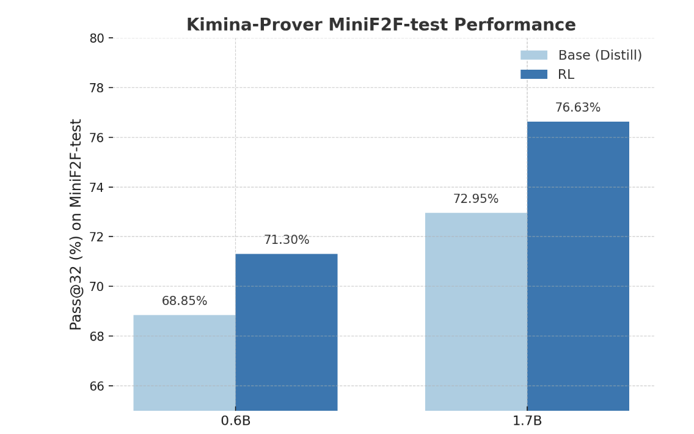
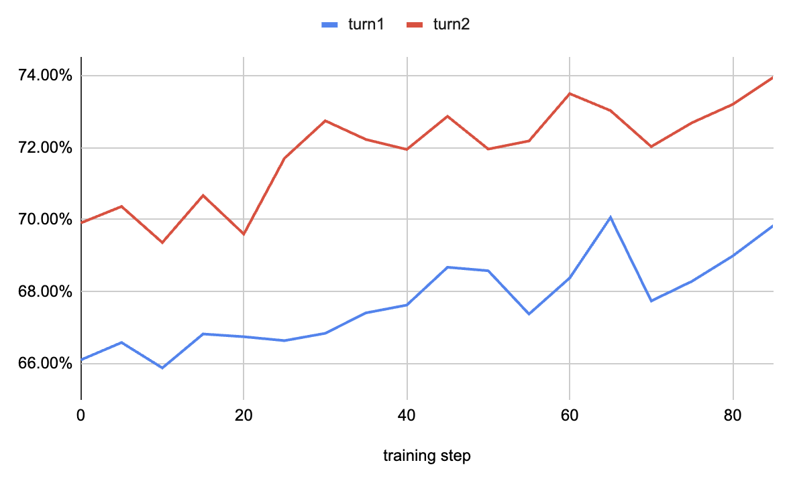
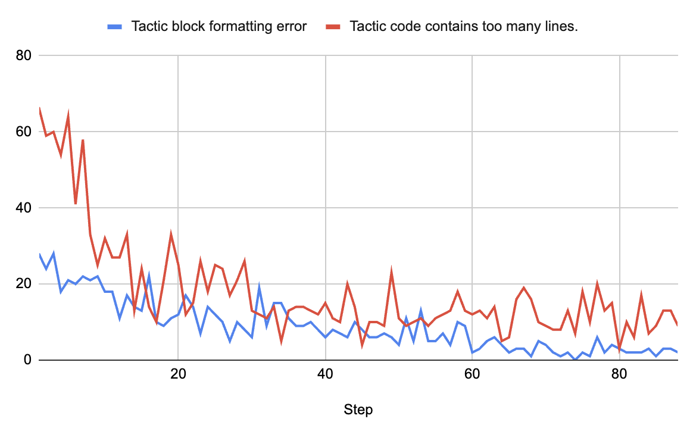
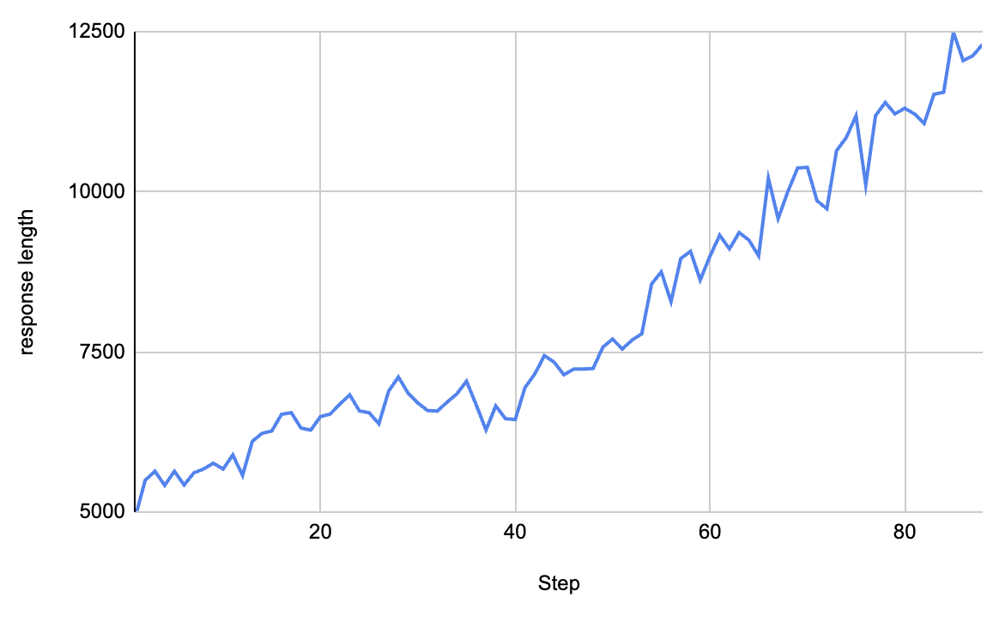

---
authors:
  - aitoboxrobot
categories:
  - 研究解读
date: 2026-10-28
hide:
  - navigation
tags:
  - Lean 4
  - 形式化数学
  - 强化学习
  - GRPO
  - Kimina-Prover
title: "Kimina-Prover-RL：面向 Lean 4 形式化定理证明的高效开源强化学习训练方案"
---

# Kimina-Prover-RL：面向 Lean 4 形式化定理证明的高效开源强化学习训练方案

> # Kimina-Prover-RL

**发布日期：** 2025 年 8 月 14 日  
**研发团队：** Project Numina (Thibaut Barroyer, Jonas Bayer, Marina Vinyes, Mert Unsal, Haiming Wang, Xiaohan Lin, Mantas Baksys, Junqi Liu, Marco Dos Santos, Flood Sung, Ying, Zhu Zekai, lujianqiao, Hugues de Saxcé, Ebony Zhang, Bolton Bailey, Frederick Pu, Zhengying Liu, LI Jia)

> **Published:** August 14, 2025  
> **Team:** Project Numina (Thibaut Barroyer, Jonas Bayer, Marina Vinyes, Mert Unsal, Haiming Wang, Xiaohan Lin, Mantas Baksys, Junqi Liu, Marco Dos Santos, Flood Sung, Ying, Zhu Zekai, lujianqiao, Hugues de Saxcé, Ebony Zhang, Bolton Bailey, Frederick Pu, Zhengying Liu, LI Jia)

### 文章背景与核心概要

在人工智能攻坚高等数学与形式化定理证明的征途上，如何让大语言模型不仅能“构思出符合逻辑的解题思路”，而且能产出被 Lean 4 等交互式定理证明器 100% 形式化严谨校验的代码，是当前 AI 复杂符号推理领域的最前沿难题。受 DeepSeek-R1 先深度思考后代码输出范式的启发，Project Numina 团队开源了专为 Lean 4 定理证明量身定制的高效强化学习训练流水线 **Kimina-Prover-RL**。该方案依托火山引擎开源的 verl 强化学习框架，基于群相对策略优化 (Group Relative Policy Optimization, GRPO) 算法，开创性地设计了将“自然语言思维链推导”与“形式化代码生成”紧密耦合并施加严格语法结构奖惩的输出格式，并首次引入能够自主从编译器报错中吸取教训的错误纠正轮次机制。实测表明，该方案使得 0.6B 与 1.7B 参数量级的轻量模型在国际权威的 MiniF2F 形式化数学基准测试中刷新了开源最优纪录，分别实现 71.30% 与 77.87% 的 Pass@32 解题成功率，为小尺寸模型突破高阶符号推理开辟了全新路径。

---

## 内容概要

> ## Summary

`kimina-prover-rl` 是一套专为在 Lean 4 中进行形式化定理证明而设计的开源、轻量高效的训练流水线。受 DeepSeek-R1 “先推理后生成”范式的启发，该方案基于开源的 **verl** 强化学习框架改造并适配了群相对策略优化 (Group Relative Policy Optimization, GRPO) 算法。通过将模型输出显式规范为“思维链推理轨迹后接 Lean 4 形式化代码”的双阶段结构、引入严苛的格式合规性检查奖励，并首创支持自我调试的错误纠正交互轮次，该流水线在国际权威的 MiniF2F 基准测试中，推动 0.6B 与 1.7B 参数量级的小模型刷新了同体量开源模型的最先进性能记录。

> `kimina-prover-rl` is an open-source, streamlined training pipeline designed for formal theorem proving in Lean 4. Inspired by the reasoning-then-generation paradigm of DeepSeek-R1, it adapts Group Relative Policy Optimization (GRPO) using the open-source **verl** framework. By structuring outputs into a reasoning trace followed by Lean 4 code, incorporating strict formatting checks, and introducing an error-correction turn for self-debugging, the pipeline establishes new state-of-the-art performance for open-source models in the 0.6B and 1.7B parameter classes on the MiniF2F benchmark.

---

## 项目引言

> ## Introduction



`kimina-prover-rl` 是一套旨在训练大语言模型 (Large Language Model, LLM) 解决 Lean 4 形式化证明目标的训练流水线。它采用了一种清晰的双阶段输出结构：首先输出一段自然语言构成的思维链推理轨迹，随后生成与之对应的 Lean 4 证明代码。

> `kimina-prover-rl` is a training pipeline designed to teach large language models to solve formal proof goals in Lean 4, using a two-stage output structure: a natural language reasoning trace followed by corresponding Lean code.

这种深受 DeepSeek-R1 启发的解题范式，让模型能够将“解题逻辑规划”与“形式化语法执行”清晰地分离开来，极大地提升了证明过程的可解释性、错误恢复能力以及在复杂未见问题上的泛化性能。

> This paradigm, inspired by DeepSeek-R1, enables the model to separate planning from execution, promoting explainability, error recovery, and stronger generalization.

为了在这一推理框架下充分激发模型的推理潜能，我们采用了群相对策略优化 (GRPO)——一种专为大语言模型定制的高效强化学习 (Reinforcement Learning, RL) 算法。Kimina-prover 这一开源版训练流水线依托于开源强化学习库 [Verl](https://github.com/volcengine/verl) 构建。

> To train models under this reasoning framework, we apply GRPO — a reinforcement learning approach tailored for LLMs. This open-source version of the training pipeline of Kimina-prover is implemented using the RL library [Verl](https://github.com/volcengine/verl).

在 GRPO 的生成采样 (Rollout) 阶段，模型会针对每个输入的数学问题提示词生成 $N$ 个候选回答。我们通过自主研发的 [kimina-lean-server](https://github.com/project-numina/kimina-lean-server) 实时调用 Lean 4 编译器对生成的代码进行形式化严谨校验；只要候选代码能通过 Lean 的语法与逻辑验证，该样本就会被赋予值为 1 的奖励。

> During the rollout phase of GRPO, the model generates $N$ outputs for each prompt. A reward of 1 is assigned to any output whose Lean code is successfully verified by Lean using our [kimina-lean-server](https://github.com/project-numina/kimina-lean-server).

该框架在此基础上特别注入了两大核心创新特性：

* **格式校验奖励机制**：约束并引导模型规范化地组织其输出结构；
* **错误纠正交互轮次**：促使模型主动从编译失败信号中吸取教训，实现自我纠错与调试。

> Two main features are added to this framework:
> * A format checking reward to teach the model to structure its outputs
> * An error correction turn to encourage the model to learn from failure signals

---

## 高吞吐校验客户端：Kimina-Client

> ## Kimina-Client

在强化学习的训练过程中，系统必须同时对海量的 Lean 4 候选证明代码进行实时并发验证。为了高吞吐、低延迟地处理这一计算瓶颈，必须构建一套高并发的形式化检验系统。

> During training, a large number of Lean 4 proof candidates must be verified simultaneously. To handle this efficiently, we require a high-throughput verification system.

针对这一迫切需求，Numina 与 Kimi 团队联合研发并开源了高性能证明服务器 [kimina-lean-server](https://github.com/project-numina/kimina-lean-server)，能够利用 Lean 4 引擎提供大规模的高并发定理检验支持。

> To meet this need, Numina and Kimi have developed an open-source server called [kimina-lean-server](https://github.com/project-numina/kimina-lean-server), which supports parallel proof checking at scale using Lean 4.

为了进一步降低集成门槛，我们还配套提供了 [kimina-client](https://www.piwheels.org/project/kimina-client/)，这是一个已发布至 PyPI 的轻量级 Python 工具包，为开发者调用服务端 API 提供了极其清爽简洁的交互接口。

> To simplify integration, we also provide [kimina-client](https://www.piwheels.org/project/kimina-client/), a lightweight Python package (available on PyPI) that offers a clean interface for interacting with the server’s API.

---

## 训练数据集设计

> ## Dataset

我们使用了精选构建的 [Kimina-Prover-Promptset](https://huggingface.co/datasets/AI-MO/Kimina-Prover-Promptset) 数据集进行训练，该数据集是基于著名的开源数学形式化数据集 [NuminaMath-LEAN](https://huggingface.co/datasets/AI-MO/NuminaMath-LEAN) 筛选提炼而成的子集。

> We train using [Kimina-Prover-Promptset](https://huggingface.co/datasets/AI-MO/Kimina-Prover-Promptset), a curated subset of the [NuminaMath-LEAN](https://huggingface.co/datasets/AI-MO/NuminaMath-LEAN) dataset.

在当前训练设置下，我们对原始数据集执行了如下几项关键的过滤与预处理步骤：

* **剔除简单问题**：将历史成功率高于 **0.5** 的简单题目全部过滤掉，使数据集中仅保留具备真正思维挑战性的难题。
* **生成变体题型**：借助 Gemini 模型对现有题目进行语义与条件变异扩充，从而显著丰富题目的多样性。
* **重采样高难题目**：对难度极高的疑难题目进行按比例复制，赋予其在训练更新时更大的梯度权重。

> For this training setup, we filter and preprocess the dataset as follows:
> * **Remove easy problems** with a historical win rate above **0.5** to only keep challenging statements in the dataset.
> * **Generate variants** of existing problems to increase diversity using Gemini.
> * **Duplicate hard problems** to give them more weight during training.

经过上述严苛洗练后构建的数据集，汇聚了极具挑战性且信息密度极高的高价值题目，是全面磨炼 Lean 4 定理证明模型的优质养料。

> The resulting dataset contains challenging, high-value problems for improving Lean 4 theorem proving models.

这一整套 NuminaMath-LEAN-RL 数据集，正是训练 [AI-MO/Kimina-Prover-RL-1.7B](https://huggingface.co/AI-MO/Kimina-Prover-RL-1.7B) 与 [AI-MO/Kimina-Prover-RL-0.6B](https://huggingface.co/AI-MO/Kimina-Prover-RL-0.6B) 模型的核心基石。

> NuminaMath-LEAN-RL is also the dataset used to train [AI-MO/Kimina-Prover-RL-1.7B](https://huggingface.co/AI-MO/Kimina-Prover-RL-1.7B) and [AI-MO/Kimina-Prover-RL-0.6B](https://huggingface.co/AI-MO/Kimina-Prover-RL-0.6B).

**输入格式示例：**

> **Example input format:**

```text
Think about and solve the following problems step by step in Lean 4.

# Problem:
Find all primes that are the difference of the fourth powers of two integers.

# Formal Statement:
'''lean4
import Mathlib

theorem number_theory_4487 : {p : ℕ | p.Prime ∧ ∃ a b, p = a ^ 4 - b ^ 4} = ∅ := by
'''
```

---

## 结构化格式奖励机制

> ## Format Reward

我们这套推理训练流水线的核心精髓，在于强制规范大语言模型的输出范式，将其严格约束为两个连贯的阶段：先生成一段深度思考块，再输出形式化 Lean 4 代码块：

1. 思维链推理块 (`<think>...</think>`)
2. Lean 4 形式化代码块

> The core idea of our reasoning training pipeline is to structure the LLM output into two stages: one thinking block followed by one Lean 4 block:
> 1. A reasoning block (`<think>...</think>`)
> 2. A Lean 4 code block

```text
<think>
To prove the statement, we use induction on n.
The base case is trivial, and the inductive step follows by applying the hypothesis.
</think>

'''lean4
theorem my_thm : ∀ n, f n = g n := by
  induction n with
  | zero => simp
  | succ n ih => simp [ih]
'''
```

系统会对每一个生成的 Rollout 样本进行**合规性严格校验**。一旦输出格式出现畸变——例如缺失了 `<think>` 标签块、或者 Lean 4 代码块放置位置颠倒错乱——无论其中包含的证明代码在数学上是否实际成立，模型都会被**直接判予零分 (Zero Reward)**。

> Each rollout is **verified** to ensure that this format is respected. If the output is malformed — e.g., missing the `<think>` block or misplacing the code — the model receives a **zero reward**, regardless of whether the proof is actually valid.

在 `kimina-prover` 的具体工程落地中，格式校验绝不仅限于检查标签是否存在这么简单，而是包含了一套极其缜密的约束准则：

* **唯一性校验**：确保每次生成的输出中，严格只包含恰好一个 `<think>...</think>` 思考块和一个 Lean 4 代码块。
* **剔除重复退化**：严密过滤并在出现内容高度重复的推理行时直接判定无效，这类重复往往是模型陷入幻觉 (Hallucination) 或文本退化的危险信号。
* **策略密集度校验**：深入检查思考段落中的策略 (Tactic) 思考块是否数量充沛，且包含足够数量的实质性非注释代码行。
* **注释密度阈值**：对思考过程与 Lean 代码中的注释占比施加阈值限制，对废话连篇、模板化堆砌的冗长输出予以惩罚。
* **思考与代码语义对齐**：通过相似度匹配打分（如交并比 IoU 或子代码覆盖率指标），量化比对思考块中构想的策略与最终实际生成的 Lean 代码之间的逻辑一致性。
* **长度效率惩罚**：对不必要的冗长赘述施加负向惩罚，鼓励模型在保证论证完整缜密的前提下以最高的 Token 效率解决问题。

> In `kimina-prover`, these checks go beyond simply verifying the presence of `<think>` and Lean 4 blocks:
> * Ensuring there is exactly one `<think>...</think>` block and one Lean 4 code block per output.
> * Rejecting outputs with repetitive reasoning lines, which often indicate hallucinated or degenerate generations.
> * Checking that tactic blocks inside the thinking section are present in sufficient number and contain enough non-comment lines.
> * Applying thresholds on comment density (in both reasoning and Lean code) to penalize overly verbose or boilerplate outputs.
> * Comparing the semantic alignment between tactics described in blocks and the final Lean code using a matching score (e.g., Intersection-over-Union or subcode coverage).
> * Penalizing unnecessarily long responses, encouraging the model to use tokens more efficiently while still giving complete replies.

---

## 交互式错误纠正机制

> ## Error Correction

为了使训练过程更具信息量和针对性，我们额外引入了**自我纠错机制 (Error Correction Mechanism)**，赋予模型一次主动修复自身证明漏洞的机会。

> To make training more informative, we have added an **error correction mechanism** that gives the model a chance to fix its own failed proofs.

当某一生成样本验证失败时（例如 Lean 编译器报错或代码无法完成证明封闭）：

1. 系统会完整归档当时的原始提示词、模型的回复内容以及 Lean 编译器返回的报错反馈信息。
2. 动态构建一个**全新的训练样本**，在该样本中明确指示模型参考报错反馈对其先前的推理思维链与代码进行反思重构。

> When a rollout fails (e.g., due to a Lean error or incorrect proof), we:
> 1. Store the full prompt, response, and Lean feedback.
> 2. Create a **new training sample** where the model is explicitly prompted to revise its previous reasoning/code.

由于在训练过程中不断注入来自 Lean 编译器的精准反馈，这种设计强烈鼓励模型从失败信号中领悟调试技巧。它开辟了多轮交互推理链路：Lean 编译器的报错信息被重新组装为提示词上下文，只要模型能成功实现代码的自我 Debug 并使证明成立，便能斩获全额奖励。

> This encourages the model to learn from failure signals as Lean feedback is provided during training. It also enables multi-turn interaction chains, where feedback from Lean is injected as part of the prompt, and the model is rewarded for successfully debugging its own output.

---

## 训练流水线全景架构

> ## Overview of the Pipeline

前沿学术研究《*深入理解类似 R1-Zero 的训练：批判性视角*》(*Understanding R1-Zero-Like Training: A Critical Perspective*) 指出，原生的 GRPO 算法存在特定的优化偏差，容易诱导模型不自然地拉长回复长度，尤其是在给出错误答案时更为明显。我们在早期的调优实验中也观察到了这一倾向，因此在策略优化阶段果断采用了 **DrGRPO** 算法。DrGRPO 通过使用全局常数对 Token 级别的损失 (Loss) 进行归一化聚合，成功从根源上消除了响应长度的非良性膨胀偏差。

> The work *Understanding R1-Zero-Like Training: A Critical Perspective* claims there is optimization bias in GRPO that leads to artificially longer responses, especially for incorrect outputs. We noticed this behavior during our experiments and used **DrGRPO** for our optimization. DrGRPO aggregates token-level losses by normalizing with a global constant to eliminate length bias.

* **硬件集群配置**：代码仓库中提供的默认训练配置文件面向 8 卡 GPU 集群进行了专门适配。
* **基座模型选型**：我们对 **[AI-MO/Kimina-Prover-Distill-1.7B](https://huggingface.co/AI-MO/Kimina-Prover-Distill-1.7B)** 进行微调 (Fine-tuning)。该模型是基于 **[Qwen/Qwen3-1.7B](https://huggingface.co/Qwen/Qwen3-1.7B)**，利用旗舰模型 **[AI-MO/Kimina-Prover-72B](https://huggingface.co/AI-MO/Kimina-Prover-72B)** 合成冷启动数据蒸馏调优而成的模型。
* **批处理大小与采样规模**：在训练的每一个 Step 中，从数据集中抽取 256 个问题样本（其中一半样本严格为包含报错信息的错误纠正样本）。每个样本生成 8 个 Rollout 候选（单步总生成量达到 2048 次）。
* **模型评测**：每训练 5 个 Step，系统就会利用 verl 的 `best@8` 指标对当前模型进行极速验证评测。对于每一个评测中首轮失败的回答，系统均允许模型进行一次自我修正的挽救重试。

> * **Hardware Configuration:** The configuration file provided in the repository is for an 8-GPU setup.
> * **Base Model:** We fine-tune **[AI-MO/Kimina-Prover-Distill-1.7B](https://huggingface.co/AI-MO/Kimina-Prover-Distill-1.7B)**, which is a fine-tuned version of **[Qwen/Qwen3-1.7B](https://huggingface.co/Qwen/Qwen3-1.7B)** using cold-start data generated from our **[AI-MO/Kimina-Prover-72B](https://huggingface.co/AI-MO/Kimina-Prover-72B)** model.
> * **Batch Size & Rollouts:** At every step, 256 samples are fetched from the training dataset (one out of every two is an error-correction sample). We generate 8 rollouts per sample (2048 total generations).
> * **Evaluation:** We evaluate the model every 5 training steps using the `best@8` metric from verl for fast validation. For each failed response, we allow the model one tentative retry to fix its proof.

---

## 实验结果与评估分析

> ## Results

在 8 张 NVIDIA H100 GPU 上历经 48 小时的强化学习训练后，各项核心指标均呈现出稳步且显著的提升：

> After 48 hours of training on 8 H100 GPUs, we observed consistent improvements across all metrics:

1. **证明准确率 (Accuracy)**：训练进行到第 85 个 Step 时，流水线将模型准确率直接拉升了 4 个百分点，其 `best@8` 指标达到 70%，在融合错误纠正轮次后进一步跃升至 74%。

   > 1. **Accuracy:** By step 85, the pipeline improves model accuracy by 4 points, reaching 70% for the `best@8` metric and 74% after the error-correction turn.

   

2. **格式有效性 (Format Validity)**：在整个训练进程中，格式违规错误率持续平稳下跌，强力印证了模型已经牢牢掌握了结构合规的输出规范。

   > 2. **Format Validity:** Format errors steadily decrease over the course of training, confirming that the model learns to produce structurally valid outputs.

   

3. **Token 长度 (Token Length)**：与 DeepSeek-R1 风格的强化学习演化规律高度契合，模型的平均 Token 长度随着训练进行而稳步拉长，表明模型正在自主学会构建更深邃、更完备的长思维链推导路径。

   > 3. **Token Length:** Consistent with DeepSeek-R1-style training, average token length increases as the model learns to construct longer, deeper reasoning traces.

   

### 基准测试性能表现 (MiniF2F Pass@32)

> ### Benchmark Performance (MiniF2F Pass@32)

**1.7B 模型族：**

> **1.7B Model Family:**

| 模型 (Model) | Pass@32 | 包含错误修复的 Pass@32 (Pass@32 with Error Fixing) |
| :--- | :---: | :---: |
| `AI-MO/Kimina-Prover-Distill-1.7B` | 72.95% | 75.41% |
| **`AI-MO/Kimina-Prover-RL-1.7B`** | **76.23%** | **77.87%** |

**0.6B 模型族：**

> **0.6B Model Family:**

| 模型 (Model) | Pass@32 |
| :--- | :---: |
| `AI-MO/Kimina-Prover-Distill-0.6B` | 68.85% |
| **`AI-MO/Kimina-Prover-RL-0.6B`** | **71.30%** |

---

## 结语

> ## Conclusion

通过开源 [Kimina-Prover-RL](https://github.com/project-numina/kimina-prover-rl/tree/main/recipe/kimina_prover_rl)，我们为学术界与工业界提供了一套轻量但能力强劲的强化学习流水线，专门用于训练 Lean 4 形式化定理证明器。通过将结构化深度推理、格式约束奖励以及自主错误纠正机制深度融合，我们在 0.6B 至 1.7B 参数量级的开源模型上刷新了最先进水平。

> With [Kimina-Prover-RL](https://github.com/project-numina/kimina-prover-rl/tree/main/recipe/kimina_prover_rl), we provide a lightweight yet powerful reinforcement learning pipeline for training Lean 4 theorem provers. By combining structured reasoning, format rewards, and error correction, we achieve state-of-the-art results for open-source models in the 0.6B–1.7B parameter range.

我们真诚期待本次开源能为全球开源社区搭建起坚实的基石，激发更多开发者探索将强化学习应用于形式化推理的前沿实验，携手拓展 Lean 4 开源自动定理证明的能力边界。

> We hope this release serves as a solid foundation for the community to experiment with RL training in formal reasoning and push the limits of open-source automated theorem proving in Lean 4.
