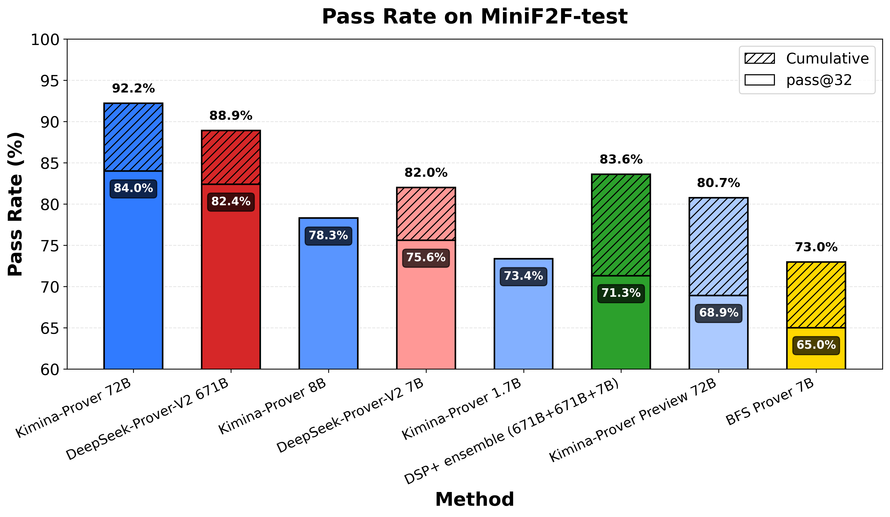
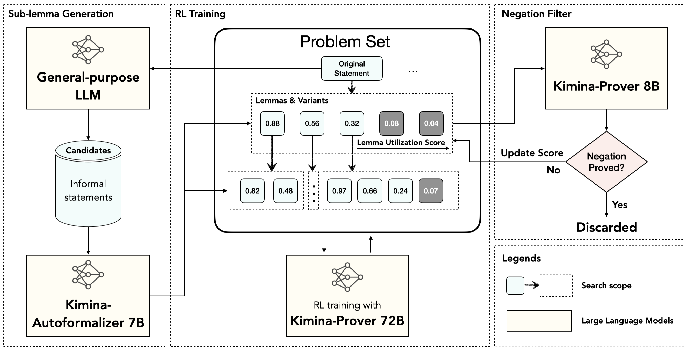
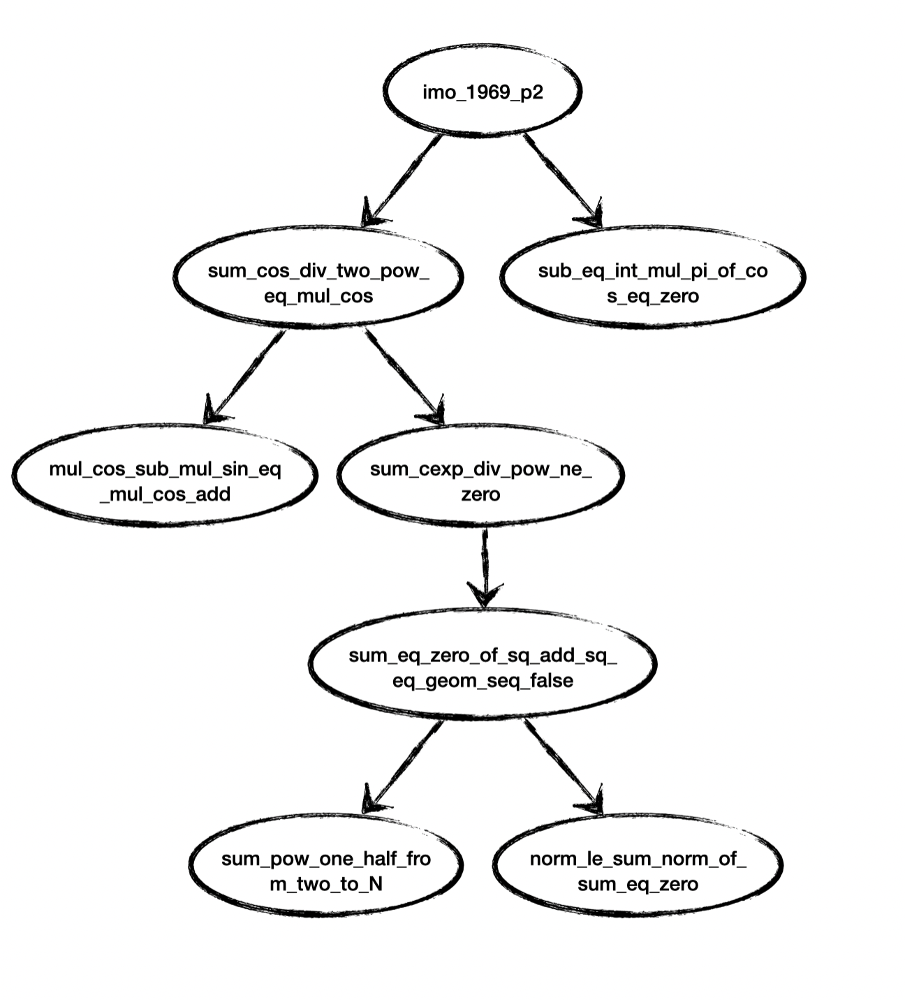

---
authors:
- aitoboxrobot
categories:
- arXiv论文
date: 2026-10-28
hide:
- navigation
tags:
- 形式化证明
- 强化学习
- Lean 4
- 智能推理
- Kimina-Prover
title: Kimina-Prover：在大型形式化推理模型中引入测试时强化学习搜索
---
# Kimina-Prover：在大型形式化推理模型中引入测试时强化学习搜索

> # Kimina-Prover: Applying Test-time RL Search on Large Formal Reasoning Models

> **Numina & Kimi Team**  
> [Models](https://huggingface.co/collections/AI-MO/kimina-prover-686b72614760ed23038056c5) | [Demo](https://demo.projectnumina.ai/) | [GitHub](https://github.com/MoonshotAI/Kimina-Prover-Preview/tree/master/kimina_prover_demo)

---

### 文章背景与核心概要

随着大语言模型在数学与逻辑推理领域的飞速演进，将 AI 应用于 Lean 4 形式化定理证明已成为检验大模型深度推理能力的标杆试金石。由 Numina 与 Kimi 团队联合研发的 **Kimina-Prover** 打破了传统单次生成证明的局限，创新性地提出了**测试时强化学习搜索 (Test-Time Reinforcement Learning Search, TTRL)** 与**交互式错误纠正 (Error-Fixing)** 闭环机制。该框架能够自主发现并组合辅助引理、解析编译器错误反馈，在极具挑战性的 miniF2F 权威基准测试中取得了 92.2% 的通过率，刷新了开源形式化定理证明的最高纪录。

---

## 📌 执行概要

> ## 📌 Executive Summary

**Kimina-Prover** 是由 Numina 与 Kimi 团队联手研发的顶尖自动化定理证明 (Automated Theorem Proving, ATP) 框架。该系统构建在诸如 Qwen2.5-72B 及 Qwen3 系列等顶尖基础推理模型之上，依托 Kimi k1.5 强化学习训练管线，创新性地引入了**测试时强化学习搜索 (Test-Time Reinforcement Learning Search, TTRL)** 以及**交互式错误纠错能力**。

> **Kimina-Prover** is a state-of-the-art automated theorem proving framework developed by the Numina and Kimi teams. Built upon large foundational reasoning models (such as Qwen2.5-72B and Qwen3 variants) and trained using the Kimi k1.5 reinforcement learning pipeline, Kimina-Prover introduces **Test-Time Reinforcement Learning (TTRL) Search** and **Error-Fixing Capabilities**.

其核心技术突破包括：
* **TTRL 搜索框架**：能够递归式地探索、筛选并组合多个中间引理，以应对复杂的长程多阶段定理推导。
* **基于反馈的纠错闭环**：能够精准解析 Lean 4 编译器返回的报错信息并生成针对性的修复方案，大幅提升采样的有效性与证明成功率。
* **刷新 SOTA 表现**：在权威形式化数学基准 miniF2F 测试集上实现了领跑行业的 **92.2% 通过率**。

> Key breakthroughs include:
> * **TTRL Search Framework:** Recursively discovers, combines, and applies multiple lemmas to construct complex, multi-stage proofs.
> * **Error-Correcting Feedback Loops:** Interprets Lean 4 compiler error messages to propose targeted fixes, dramatically increasing sample efficiency.
> * **State-of-the-Art Performance:** Achieves a leading **92.2% pass rate** on the miniF2F benchmark dataset.

---


> **图 1:** *各定理证明模型在 miniF2F-test 测试集上的性能表现对比。*

---

## 🚀 引言与系统总览

> ## 🚀 Introduction & Overview

在 **Lean 4** 交互式证明语言中，自动化定理证明 (Automated Theorem Proving, ATP) 的核心愿景是让计算机全面接管严谨数学证明的构造流程。尽管此前已有 Google DeepMind 打造的 *AlphaProof*、开源领域的 *DeepSeek-Prover-V2* 以及结合神经符号机制的 *DSP+* 等标杆工作，但业界主流的单步端到端生成方式在面对深度嵌套、逻辑跨度极长的复杂数学论证时，依然常常力不从心。

> Automated theorem proving (ATP) in the **Lean 4** language aims to make formal mathematical proof construction machine-driven. While monumental strides have been made via systems like Google DeepMind's *AlphaProof*, open-source pipelines like *DeepSeek-Prover-V2*, and neuro-symbolic methods like *DSP+*, single-step proof generation often struggles with long, deeply nested mathematical arguments.

**Kimina-Prover** 系列通过跳出传统“一次性端到端生成”的窠臼，成功化解了这一瓶颈：
1. **Kimina-Prover-72B**：以 Qwen2.5-72B 为骨干打造的旗舰级模型。
2. **Kimina-Prover-Distill-8B & 1.7B**：基于 Qwen3-8B 和 Qwen3-1.7B 蒸馏得到的轻量化高效版本。

> The **Kimina-Prover** series addresses this limitation by moving beyond simple generation paradigms:
> 1. **Kimina-Prover-72B:** The flagship model based on Qwen2.5-72B.
> 2. **Kimina-Prover-Distill-8B & 1.7B:** Lightweight distilled variations based on Qwen3-8B and Qwen3-1.7B.

### 性能基准评测 (miniF2F-test)

> ### Performance Benchmark (miniF2F-test)

| 模型 (Model) | pass@1 | pass@32 | pass@1024 |
| :--- | :---: | :---: | :---: |
| **Kimina-Prover-1.7B** | 46.7 | 73.4 | — |
| **DSP+** | 52.5 | 71.3 | 80.7 |
| **DeepSeek-Prover-V2-7B** | 58.6 | 75.6 | 79.9 |
| **Kimina-Prover-8B** | 61.1 | 78.3 | — |
| **DeepSeek-Prover-V2-671B** | 61.9 | 82.4 | 86.6 |
| **Kimina-Prover-72B** | **63.9** | **84.0** | **87.7** |

> **表 1:** *等效采样预算下的性能表现对比。在所有采样配置下，Kimina-Prover-72B 均树立了全新的一流基准 (SOTA)。*

---

## 🛠️ 核心方法论

> ## 🛠️ Methodology

### 1. 引导式引理注入模式 (Lemma-Enabled Pattern)

> ### 1. Lemma-Enabled Pattern

为了引导模型学会自主设定并利用中间子目标：
* 在强化学习训练阶段，系统会在原始问题提示词前随机拼接 1–3 个形式化引理候选。
* 这些引理先由通用大语言模型初步提炼，随后通过专门训练的 `Kimina-Autoformalizer-7b` 自动转化为符合 Lean 4 语法的严谨形式化表述。
* 系统引入基于偏好的奖励塑形 (Reward Shaping) 机制：对完全无视有效引理的方案施加惩罚，对巧妙运用引理的生成过程给予强化奖励，从而将引理实际利用率稳定拉升至 **30–40%**。

> To help the model harness intermediate subgoals:
> * A random subset of 1–3 formal lemmas is prepended to the problem context during RL training.
> * Lemmas are generated by a general-purpose LLM and translated into formal Lean statements via `Kimina-Autoformalizer-7b`.
> * A preference-based reward-shaping strategy penalizes solutions ignoring useful lemmas and rewards those that strategically leverage them, raising utilization to a stable **30–40%**.

### 2. 测试时强化学习搜索框架 (TTRL Search Framework)

> ### 2. TTRL Search Framework


> **图 2:** *测试时强化学习搜索 (TTRL Search) 框架运行架构图。*

**TTRL Search** 框架能够系统化地组织、过滤并串联候选引理：
* **动态搜索范围与评分机制**：动态追踪每个搜索子空间内的引理采纳得分。得分最高的引理将被注入到 60% 的输入提示变体中，其余 40% 的预算则用于探索全新的引理组合。
* **淘汰过滤机制**：在经历 50 次尝试后，若引理的使用率评分仍然低于 $\tau \ge 0.10$，系统将自动剔除该引理，防止搜索树过度膨胀。
* **递归搜索与子引理衍生**：若某条证明在 $N = 128$ 次尝试后仍未能成功闭环，系统将动态衍生出层级更细的子引理，从而在测试时实现推理算力的高效缩放 (Inference-Time Compute Scaling)。
* **反证检验过滤**：对系统新生成的引理，尝试直接证明其逻辑否定命题；若否定命题成立，则立刻剔除该虚假引理，彻底杜绝出现逻辑谬误或投机取巧的无效证明。

> The **TTRL Search** framework systematically organizes, filters, and composes candidate lemmas:
> * **Dynamic Search Scopes & Scoring:** Tracks lemma utilization scores within each search space. Top-performing lemmas drive 60% of input variants, while 40% explore novel combinations.
> * **Filtering Mechanisms:** Automatically prunes lemmas failing to achieve a utilization score $\tau \ge 0.10$ after 50 attempts.
> * **Recursive Search & Sublemma Generation:** If a proof fails after $N = 128$ attempts, new sub-lemmas are dynamically generated, enabling test-time reasoning scaling.
> * **Negation Filtering:** Proves the logical negation of newly generated lemmas to prevent unsound or trivially gamed proofs.

### 3. 赋予 Kimina-Prover 错误纠正能力 (Enabling Error-Fixing in Kimina-Prover)

> ### 3. Enabling Error-Fixing in Kimina-Prover

Kimina-Prover 成功消弭了单向静态生成与多轮交互式环境反馈之间的鸿沟：
* **SFT 监督微调数据构建**：借助 *Claude 3.7 Sonnet* 构建三元组训练数据集，每个样本均由 `(错误证明代码, 编译器报错反馈, 正确修复代码)` 构成，并附带详尽的逐步骤推导思维链。
* **批量失败样本回放机制 (Batched Failure Replay)**：收集第 $N$ 轮迭代中失败的证明样本，将其注入第 $N+1$ 轮训练批次中与常规提示词共同训练。这种机制显著平滑了极度稀疏的强化学习奖励信号，保障了训练收敛的稳定性。

> Kimina-Prover bridges the gap between static generation and interactive feedback:
> * **SFT Data Generation:** Utilizes *Claude 3.7 Sonnet* to construct a supervised fine-tuning (SFT) dataset composed of `(incorrect proof, compiler feedback, correct proof)` triplets accompanied by explicit step-by-step reasoning chains.
> * **Batched Failure Replay:** Collects failed proofs from iteration $N$ and merges them into iteration $N+1$'s training batch alongside standard prompts, smoothing out sparse reinforcement rewards and stabilizing training.

| 求解策略 (Strategy) | 16+16 尝试并修复 (16+16 attempt-and-fix) | 32×1 暴力重复 (32×1 brute-force) | 32+32 尝试并修复 (32+32 attempt-and-fix) |
| :--- | :---: | :---: | :---: |
| **kimina-prover** | **35.6** | 28.8 | **44.1** |

> **表 2:** *在 MiniF2F 选取的 59 道低胜率攻坚难题上的解题性能对比。数据表明，相较于盲目堆叠采样次数的暴力试错，引入编译器反馈的交互式纠错策略展现出了远为卓越的样本效率。*

### 4. 其他系统与架构层面的优化 (Other Architectural Improvements)

> ### 4. Other Architectural Improvements

* **精细化数学题目集清洗**：将原始 30 万道庞杂题目集通过动态多重过滤精简至 9 万道聚焦高难度竞赛（重点涵盖各类奥林匹克数学真题）的高质量题库。
* **持续预训练 (Continuous Pre-training, CPT)**：在预训练阶段注入了 60 亿 Token 的高质量 Lean 4 领域语料，包括 GitHub 开源仓库、经编译器校验的策略展开序列 (Rollouts)，以及结构化的 `state-tactic-error` 映射数据。
* **随机证明截断数据增强 (Random Proof Cut Data Augmentation)**：综合运用证明前缀截断 (Proof Truncation) 与内部空缺填补 (Proof Infilling，将中间过程替换为 `sorry`)，训练模型熟练掌握对人类既有数学论证进行续写、补全与修复的能力。
* **非证明类数学问题求解转化**：打破解题与证明的壁垒，要求模型不仅计算出最终的数学数值答案，而且必须在单次前向推理中立刻给出经 Lean 4 严格校验的严密推导过程。

> * **Prompt Set Curation:** Refined from 300K down to 90K competition-focused problems (emphasizing Olympiad benchmarks) with dynamic filtering.
> * **Continuous Pre-training (CPT):** Injected 6B tokens of Lean data (GitHub repositories, compiler-validated rollouts, and structured `state-tactic-error` mappings).
> * **Random Proof Cut Data Augmentation:** Utilizes *proof truncation* and *proof infilling* (replacing blocks with `sorry`) to train models on how to extend or mend existing human-annotated proofs.
> * **Non-proof Problem Solving:** Merges answer-generation with formal proofs by requiring the model to deduce the final answer and immediately verify it via a formal Lean proof within a single inference pass.

---

## 📝 证明案例展示

> ## 📝 Sample Proof Cases

### TTRL 搜索证明案例：IMO 1969 P2

> ### TTRL Search Proof Example: IMO 1969 P2

系统通过 TTRL 搜索将原问题递归分解为四层引理结构，最终生成了一份长达 520 行、在 **Mathlib v4.15** 环境下能够完全通过编译校验的严谨形式化证明。

> The system recursively decomposed the problem into four lemma layers using TTRL search, producing a rigorous 520-line formal proof valid under **Mathlib v4.15**.


> **图 3:** *针对 `imo_1969_p2` 问题的证明依赖关系有向图，清晰勾勒出引理间的引用层级与调用路径。*

<details>
<summary><b>点击展开 IMO 1969 P2 的完整 Lean 4 形式化证明代码 (Click to expand Lean 4 Code for IMO 1969 P2)</b></summary>

```lean4
import Mathlib

open Finset in
theorem norm_le_sum_norm_of_sum_eq_zero {N : ℕ} (hN : N > 0) (z : ℕ → ℂ)
    (hsum : ∑ i ∈ range N, z i = 0) :
    ‖z 0‖ ≤ ∑ i ∈ Icc 1 (N - 1), ‖z i‖ := by
  by_cases h : N > 1
  ·
    have h6 : ∑ i in range N, z i = z 0 + ∑ i in Icc 1 (N - 1), z i := by
      have h10 : range N = {0} ∪ Icc 1 (N - 1) := by
        ext x
        simp
        omega
      rw [h10]
      rw [sum_union]
      ·
        simp
      ·
        apply disjoint_left.mpr
        intro x hx1 hx2
        simp at hx1
        simp [hx1] at hx2
    have h3 : z 0 = - (∑ i ∈ Icc 1 (N - 1), z i) := by
      have h4 : ∑ i in range N, z i = 0 := hsum
      rw [h6] at h4
      calc
        z 0 = (z 0 + ∑ i in Icc 1 (N - 1), z i) - ∑ i in Icc 1 (N - 1), z i := by ring
        _ = (0 : ℂ) - ∑ i in Icc 1 (N - 1), z i := by rw [h4]
        _ = - (∑ i in Icc 1 (N - 1), z i) := by ring
    have h11 : ‖z 0‖ = ‖(∑ i ∈ Icc 1 (N - 1), z i : ℂ)‖ := by
      rw [h3]
      simp [norm_neg]
    have h12 : ‖(∑ i ∈ Icc 1 (N - 1), z i : ℂ)‖ ≤ ∑ i ∈ Icc 1 (N - 1), ‖z i‖ := by
      apply norm_sum_le
    linarith [h11, h12]
  ·
    have h5 : N = 1 := by
      omega
    rw [h5]
    have h6 : ∑ i in range 1, z i = 0 := by
      have h7 : N = 1 := h5
      have h8 : ∑ i in range N, z i = 0 := hsum
      rw [show N = 1 by omega] at h8
      simpa using h8
    have h7 : z 0 = 0 := by
      simp at h6
      all_goals
        try tauto
    rw [show z 0 = (0 : ℂ) by exact h7]
    simp

open Finset in
theorem sum_pow_one_half_from_two_to_N {N : ℕ} (hN : 0 < N) :
    ∑ j ∈ Icc 1 (N - 1), (1 / 2 : ℝ) ^ (j + 1) = 1 / 2 - 1 / 2 ^ N := by
  have h2 : ∀ (k : ℕ), ∑ j in Icc 1 (k), (1 / 2 : ℝ) ^ (j + 1) = 1 / 2 - 1 / 2 ^ (k + 1 : ℕ) := by
    intro k
    induction k with
    | zero =>
      simp
    | succ k ihk =>
      rw [sum_Icc_succ_top (by linarith)]
      rw [ihk]
      field_simp at *
      ring_nf
  have h4 : ∑ j in Icc 1 (N - 1), (1 / 2 : ℝ) ^ (j + 1) = 1 / 2 - 1 / 2 ^ (N : ℕ) := by
    have h5 : ∑ j in Icc 1 (N - 1), (1 / 2 : ℝ) ^ (j + 1) = 1 / 2 - 1 / 2 ^ ((N - 1 : ℕ) + 1 : ℕ) := by
      apply h2 (N - 1)
    rw [h5]
    have h6 : (N - 1 : ℕ) + 1 = N := by
      omega
    rw [h6]
  exact h4

open Complex Finset in
theorem sum_eq_zero_of_sq_add_sq_eq_geom_seq_false {N : ℕ} (hN : 0 < N) (x y : Fin N → ℝ)
    (hxsum : ∑ i : Fin N, x i = 0) (hysum : ∑ i : Fin N, y i = 0)
    (hxy : ∀ j : Fin N, (x j)^2 + (y j)^2 = (1/4)^(j.1+1)) :
    False := by
  let z : ℕ → ℂ := fun i => if h : i < N then (x ⟨i, h⟩ : ℂ) + (y ⟨i, h⟩ : ℂ) * I else 0
  have hsumz : ∑ i in range N, z i = 0 := by
    have h4 : ∑ i in range N, z i = (∑ i : Fin N, ((x i : ℂ) + (y i : ℂ) * I)) := by
      simp [z, Finset.sum_fin_eq_sum_range, Finset.sum_congr]
    rw [h4]
    simp [Complex.ext_iff, Finset.sum_congr, hxsum, hysum]
  have hz0 : ‖z 0‖ ≤ ∑ i ∈ Icc 1 (N - 1), ‖z i‖ := norm_le_sum_norm_of_sum_eq_zero hN z hsumz
  have h2 : ‖z 0‖ = (1 / 2 : ℝ) := by
    have h6 : z 0 = (x ⟨0, by omega⟩ : ℂ) + (y ⟨0, by omega⟩ : ℂ) * I := by
      have h7 : (0 : ℕ) < N := by omega
      simp [z, h7]
    rw [h6]
    have h7 : ((x ⟨0, by omega⟩ : ℝ) ^ 2 + (y ⟨0, by omega⟩ : ℝ) ^ 2) = (1 / 4 : ℝ) := by
      have h8 := hxy (⟨0, by omega⟩)
      norm_num at h8 ⊢
      nlinarith
    have h8 : ‖((x ⟨0, by omega⟩ : ℂ) + (y ⟨0, by omega⟩ : ℂ) * I)‖ = Real.sqrt ((x ⟨0, by omega⟩ : ℝ) ^ 2 + (y ⟨0, by omega⟩ : ℝ) ^ 2) := by
      simp [Complex.norm_eq_abs, Complex.abs, Complex.normSq]
      all_goals
        ring_nf
    rw [h8, h7]
    have h9 : Real.sqrt ((1 / 4 : ℝ)) = (1 / 2 : ℝ) := by
      rw [Real.sqrt_eq_iff_mul_self_eq] <;> norm_num
    rw [h9]
  have h3 : ∑ i ∈ Icc 1 (N - 1), ‖z i‖ = ∑ i ∈ Icc 1 (N - 1), (1 / 2 : ℝ) ^ (i + 1 : ℕ) := by
    apply Finset.sum_congr
    .
      rfl
    .
      intro i hi
      have h10 : i ≥ 1 := by
        have h11 : i ∈ Icc (1 : ℕ) (N - 1) := by
          simpa using hi
        simp at h11 ⊢
        omega
      have h11 : i ≤ N - 1 := by
        have h12 : i ∈ Icc (1 : ℕ) (N - 1) := by
          simpa using hi
        simp at h12 ⊢
        omega
      have h12 : i < N := by
        omega
      have h13 : z i = (x ⟨i, by omega⟩ : ℂ) + (y ⟨i, by omega⟩ : ℂ) * I := by
        have h14 : i < N := by omega
        simp [z, h14]
      have h14 : ‖z i‖ = (1 / 2 : ℝ) ^ (i + 1 : ℕ) := by
        rw [h13]
        have h14 : ((x ⟨i, by omega⟩ : ℝ) ^ 2 + (y ⟨i, by omega⟩ : ℝ) ^ 2) = (1 / 4 : ℝ) ^ (i + 1 : ℕ) := by
          have h15 := hxy (⟨i, by omega⟩)
          norm_num at h15 ⊢
          nlinarith
        have h15 : ‖((x ⟨i, by omega⟩ : ℂ) + (y ⟨i, by omega⟩ : ℂ) * I)‖ = Real.sqrt ((x ⟨i, by omega⟩ : ℝ) ^ 2 + (y ⟨i, by omega⟩ : ℝ) ^ 2) := by
          simp [Complex.norm_eq_abs, Complex.abs, Complex.normSq]
          all_goals
            ring_nf
        rw [h15]
        have h16 : Real.sqrt ((x ⟨i, by omega⟩ : ℝ) ^ 2 + (y ⟨i, by omega⟩ : ℝ) ^ 2) = (1 / 2 : ℝ) ^ (i + 1 : ℕ) := by
          have h17 : ((x ⟨i, by omega⟩ : ℝ) ^ 2 + (y ⟨i, by omega⟩ : ℝ) ^ 2) = (1 / 4 : ℝ) ^ (i + 1 : ℕ) := h14
          rw [h17]
          have h18 : Real.sqrt ((1 / 4 : ℝ) ^ (i + 1 : ℕ)) = (1 / 2 : ℝ) ^ (i + 1 : ℕ) := by
            have h19 : ((1 / 4 : ℝ) : ℝ) = (1 / 2 : ℝ) ^ (2 : ℕ) := by norm_num
            rw [h19]
            have h20 : Real.sqrt (((1 / 2 : ℝ) ^ (2 : ℕ)) ^ (i + 1 : ℕ)) = (1 / 2 : ℝ) ^ (i + 1 : ℕ) := by
              have h21 : ((1 / 2 : ℝ) ^ (2 : ℕ)) ^ (i + 1 : ℕ) = ((1 / 2 : ℝ) ^ (i + 1 : ℕ)) ^ 2 := by
                have h22 : ((1 / 2 : ℝ) ^ (2 : ℕ)) ^ (i + 1 : ℕ) = (1 / 2 : ℝ) ^ (2 * (i + 1 : ℕ) : ℕ) := by
                  rw [← pow_mul]
                  all_goals ring_nf
                have h23 : ((1 / 2 : ℝ) ^ (i + 1 : ℕ)) ^ 2 = (1 / 2 : ℝ) ^ (2 * (i + 1 : ℕ) : ℕ) := by
                  ring_nf
                rw [h22, h23]
              rw [h21]
              have h22 : Real.sqrt (((1 / 2 : ℝ) ^ (i + 1 : ℕ)) ^ 2) = (1 / 2 : ℝ) ^ (i + 1 : ℕ) := by
                rw [Real.sqrt_sq (show (1 / 2 : ℝ) ^ (i + 1 : ℕ) ≥ 0 by positivity)]
              rw [h22]
            exact h20
          exact h18
        exact h16
      linarith
  rw [h3] at hz0
  rw [h2] at hz0
  have h6 : ∑ i ∈ Icc 1 (N - 1), (1 / 2 : ℝ) ^ (i + 1 : ℕ) = (1 / 2 - 1 / 2 ^ N : ℝ) := by
    have h7 : ∑ i ∈ Icc 1 (N - 1), (1 / 2 : ℝ) ^ (i + 1 : ℕ) = (1 / 2 - 1 / 2 ^ N : ℝ) := sum_pow_one_half_from_two_to_N hN
    linarith
  rw [h6] at hz0
  have h7 : (1 / 2 ^ N : ℝ) > 0 := by
    have h10 : (1 / 2 ^ N : ℝ) > 0 := by
      have h11 : (1 / 2 ^ N : ℝ) = (1 / 2 : ℝ) ^ N := by
        ring_nf
      rw [h11]
      positivity
    linarith
  have h11 : (1 / 2 - 1 / 2 ^ N : ℝ) < (1 / 2 : ℝ) := by
    have h12 : (1 / 2 ^ N : ℝ) > 0 := h7
    linarith
  linarith

open BigOperators Real Nat Topology Rat in
theorem sum_cexp_div_pow_ne_zero {N : ℕ} (hN : N > 0) (a : Fin N → ℝ) :
    ((∑ j : Fin N, cos (a j) / 2 ^ (j : ℕ))^2 +
     (∑ j : Fin N, sin (a j) / 2 ^ (j : ℕ))^2) > 0 := by
  by_contra h
  push_neg at h
  have h1 : (∑ j : Fin N, cos (a j) / 2 ^ (j : ℕ)) ^ 2 ≥ 0 := by
    apply sq_nonneg
  have h2 : (∑ j : Fin N, sin (a j) / 2 ^ (j : ℕ)) ^ 2 ≥ 0 := by
    apply sq_nonneg
  have h3 : (∑ j : Fin N, cos (a j) / 2 ^ (j : ℕ)) ^ 2 = 0 := by
    linarith
  have h4 : (∑ j : Fin N, sin (a j) / 2 ^ (j : ℕ)) ^ 2 = 0 := by
    linarith
  have h5 : (∑ j : Fin N, cos (a j) / 2 ^ (j : ℕ)) = 0 := by
    nlinarith
  have h6 : (∑ j : Fin N, sin (a j) / 2 ^ (j : ℕ)) = 0 := by
    nlinarith
  let x : Fin N → ℝ := fun j => cos (a j) / 2 ^ (j.1 + 1 : ℕ)
  let y : Fin N → ℝ := fun j => sin (a j) / 2 ^ (j.1 + 1 : ℕ)
  have hxsum : ∑ i : Fin N, x i = 0 := by
    have eq2 : ∑ i : Fin N, x i = (∑ i : Fin N, (cos (a i) / 2 ^ (i.1 : ℕ) : ℝ)) / 2 := by
      have eq3 : ∑ i : Fin N, x i = ∑ i : Fin N, (cos (a i) / 2 ^ (i.1 + 1 : ℕ) : ℝ) := by
        congr
      rw [eq3]
      have eq4 : ∑ i : Fin N, (cos (a i) / 2 ^ (i.1 + 1 : ℕ) : ℝ) = (∑ i : Fin N, (cos (a i) / 2 ^ (i.1 : ℕ) : ℝ)) / 2 := by
        calc
          ∑ i : Fin N, (cos (a i) / 2 ^ (i.1 + 1 : ℕ) : ℝ)
            = ∑ i : Fin N, ((cos (a i) / 2 ^ (i.1 : ℕ) : ℝ) / 2) := by
              apply Finset.sum_congr
              .
                rfl
              intro i hi
              have h12 : (cos (a i) / 2 ^ (i.1 + 1 : ℕ) : ℝ) = (cos (a i) / 2 ^ (i.1 : ℕ) : ℝ) / 2 := by
                have h11 : (2 : ℝ) ^ (i.1 + 1 : ℕ) = (2 : ℝ) ^ (i.1 : ℕ) * 2 := by
                  ring_nf
                rw [h11]
                field_simp
                all_goals ring
              exact h12
          _ = (∑ i : Fin N, (cos (a i) / 2 ^ (i.1 : ℕ) : ℝ)) / 2 := by
            simp [Finset.sum_div]
      exact eq4
    rw [eq2]
    rw [show ∑ i : Fin N, (cos (a i) / 2 ^ (i.1 : ℕ) : ℝ) = (0 : ℝ) by simpa using h5]
    all_goals norm_num
  have hysum : ∑ i : Fin N, y i = 0 := by
    have eq2 : ∑ i : Fin N, y i = (∑ i : Fin N, (sin (a i) / 2 ^ (i.1 : ℕ) : ℝ)) / 2 := by
      have eq3 : ∑ i : Fin N, y i = ∑ i : Fin N, (sin (a i) / 2 ^ (i.1 + 1 : ℕ) : ℝ) := by
        congr
      rw [eq3]
      have eq4 : ∑ i : Fin N, (sin (a i) / 2 ^ (i.1 + 1 : ℕ) : ℝ) = (∑ i : Fin N, (sin (a i) / 2 ^ (i.1 : ℕ) : ℝ)) / 2 := by
        calc
          ∑ i : Fin N, (sin (a i) / 2 ^ (i.1 + 1 : ℕ) : ℝ)
            = ∑ i : Fin N, ((sin (a i) / 2 ^ (i.1 : ℕ) : ℝ) / 2) := by
              apply Finset.sum_congr
              .
                rfl
              intro i hi
              have h12 : (sin (a i) / 2 ^ (i.1 + 1 : ℕ) : ℝ) = (sin (a i) / 2 ^ (i.1 : ℕ) : ℝ) / 2 := by
                have h11 : (2 : ℝ) ^ (i.1 + 1 : ℕ) = (2 : ℝ) ^ (i.1 : ℕ) * 2 := by
                  ring_nf
                rw [h11]
                field_simp
                all_goals ring
              exact h12
          _ = (∑ i : Fin N, (sin (a i) / 2 ^ (i.1 : ℕ) : ℝ)) / 2 := by
            simp [Finset.sum_div]
      exact eq4
    rw [eq2]
    rw [show ∑ i : Fin N, (sin (a i) / 2 ^ (i.1 : ℕ) : ℝ) = (0 : ℝ) by simpa using h6]
    all_goals norm_num
  have hxy : ∀ j : Fin N, (x j) ^ 2 + (y j) ^ 2 = (1 / 4 : ℝ) ^ (j.1 + 1 : ℕ) := by
    intro j
    have h11 : cos (a j) ^ 2 + sin (a j) ^ 2 = 1 := by
      exact Real.cos_sq_add_sin_sq (a j)
    simp [x, y]
    have h12 : (4 : ℝ) ^ (j.1 + 1 : ℕ) = (2 : ℝ) ^ (2 * (j.1 + 1 : ℕ)) := by
      have h13 : (4 : ℝ) = (2 : ℝ) ^ (2 : ℕ) := by norm_num
      rw [h13]
      rw [← pow_mul]
    have h13 : (2 : ℝ) ^ (2 * (j.1 + 1 : ℕ)) = ((2 : ℝ) ^ (j.1 + 1 : ℕ)) ^ 2 := by
      ring_nf
    field_simp [h11, h12, h13]
    all_goals
      ring_nf
  have h12 : False := sum_eq_zero_of_sq_add_sq_eq_geom_seq_false (show 0 < N by omega) x y hxsum hysum hxy
  tauto

open BigOperators Real Nat Topology Rat in
theorem mul_cos_sub_mul_sin_eq_mul_cos_add (C S : ℝ) (h : C ^ 2 + S ^ 2 ≠ 0) :
    ∃ R α : ℝ, R > 0 ∧ ∀ x : ℝ, C * cos x - S * sin x = R * cos (x + α) := by
  have h1 : C ^ 2 + S ^ 2 > 0 := by
    by_contra h2
    push_neg at h2
    have h3 : C ^ 2 ≥ 0 := sq_nonneg C
    have h4 : S ^ 2 ≥ 0 := sq_nonneg S
    have h5 : C ^ 2 + S ^ 2 = 0 := by nlinarith
    tauto
  have h2 : ∃ R : ℝ, R > 0 ∧ R ^ 2 = C ^ 2 + S ^ 2 := by
    use Real.sqrt (C ^ 2 + S ^ 2)
    constructor
    · apply Real.sqrt_pos.mpr
      linarith
    · rw [Real.sq_sqrt]
      positivity
  rcases h2 with ⟨R, hR_pos, hR_sq⟩
  have h12 : (C / R) ^ 2 + (S / R) ^ 2 = 1 := by
    have h14 : R ≠ 0 := by linarith
    have h15 : R ^ 2 = C ^ 2 + S ^ 2 := hR_sq
    field_simp at *
    nlinarith
  have h13 : ∃ α : ℝ, Real.cos α = C / R ∧ Real.sin α = S / R := by
    have h9 : (C / R) ^ 2 + (S / R) ^ 2 = 1 := h12
    by_cases hC : C ≥ 0
    · use Real.arcsin (S / R)
      constructor
      · have h14 : Real.cos (Real.arcsin (S / R)) = Real.sqrt (1 - (S / R) ^ 2) := by
          rw [Real.cos_arcsin]
        have h15 : Real.sqrt (1 - (S / R) ^ 2) = C / R := by
          have h151 : (C / R) ^ 2 = 1 - (S / R) ^ 2 := by
            linarith [h9]
          have h161 : Real.sqrt (1 - (S / R) ^ 2) = Real.sqrt ((C / R) ^ 2) := by
            rw [show 1 - (S / R) ^ 2 = (C / R) ^ 2 by linarith [h9]]
          rw [h161]
          have h171 : Real.sqrt ((C / R) ^ 2) = C / R := by
            apply Real.sqrt_sq (show 0 ≤ C / R by
              have h211 : R > 0 := hR_pos
              apply div_nonneg
              linarith
              linarith
            )
          rw [h171]
        rw [h14, h15]
      · have h20 : -1 ≤ S / R := by
          have h6 : (S / R) ^ 2 ≤ 1 := by nlinarith [h9]
          nlinarith [sq_nonneg (S / R - 1), sq_nonneg (S / R + 1)]
        have h21 : S / R ≤ 1 := by
          have h6 : (S / R) ^ 2 ≤ 1 := by nlinarith [h9]
          nlinarith [sq_nonneg (S / R - 1), sq_nonneg (S / R + 1)]
        have h18 : Real.sin (Real.arcsin (S / R)) = S / R := by
          apply Real.sin_arcsin
          all_goals linarith
        rw [h18]
    · have hC2 : C < (0 : ℝ) := by linarith
      have hC3 : C / R < 0 := by
        have hR_pos1 : R > 0 := hR_pos
        apply div_neg_of_neg_of_pos hC2 (by linarith)
      use Real.pi - Real.arcsin (S / R)
      constructor
      · have h28 : Real.cos (Real.pi - Real.arcsin (S / R)) = - Real.sqrt (1 - (S / R) ^ 2) := by
          have h1 : Real.cos (Real.pi - Real.arcsin (S / R)) = - Real.cos (Real.arcsin (S / R)) := by
            rw [Real.cos_pi_sub]
          have h2 : Real.cos (Real.arcsin (S / R)) = Real.sqrt (1 - (S / R) ^ 2) := by
            rw [Real.cos_arcsin]
          rw [h1, h2]
        have h29 : Real.sqrt (1 - (S / R) ^ 2) = - (C / R) := by
          have h301 : (C / R) ^ 2 = 1 - (S / R) ^ 2 := by
            linarith [h9]
          have h311 : Real.sqrt (1 - (S / R) ^ 2) = Real.sqrt ((C / R) ^ 2) := by
            rw [show 1 - (S / R) ^ 2 = (C / R) ^ 2 by linarith [h9]]
          rw [h311]
          have h321 : Real.sqrt ((C / R) ^ 2) = - (C / R) := by
            have h331 : C / R < 0 := hC3
            have : Real.sqrt ((C / R) ^ 2) = - (C / R) := by
              rw [Real.sqrt_sq_eq_abs]
              rw [abs_of_neg h331]
            linarith
          linarith
        rw [h28, h29]
        all_goals nlinarith
      · have h30 : Real.sin (Real.pi - Real.arcsin (S / R)) = Real.sin (Real.arcsin (S / R)) := by
          rw [Real.sin_pi_sub]
        have h31 : Real.sin (Real.arcsin (S / R)) = S / R := by
          have h20 : -1 ≤ S / R := by
            have h6 : (S / R) ^ 2 ≤ 1 := by nlinarith [h9]
            nlinarith [sq_nonneg (S / R - 1), sq_nonneg (S / R + 1)]
          have h21 : S / R ≤ 1 := by
            have h6 : (S / R) ^ 2 ≤ 1 := by nlinarith [h9]
            nlinarith [sq_nonneg (S / R - 1), sq_nonneg (S / R + 1)]
          apply Real.sin_arcsin
          all_goals linarith
        rw [h30, h31]
  rcases h13 with ⟨α, h14, h15⟩
  use R, α
  constructor
  · linarith
  · intro x
    have h21 : Real.cos (x + α) = Real.cos x * Real.cos α - Real.sin x * Real.sin α := by
      rw [Real.cos_add]
    have h22 : Real.cos α = C / R := by
      linarith [h14]
    have h23 : Real.sin α = S / R := by
      linarith [h15]
    calc
      C * Real.cos x - S * Real.sin x
        = R * (Real.cos x * (C / R) - Real.sin x * (S / R)) := by
          field_simp [show R ≠ 0 by linarith]
          all_goals ring
      _ = R * (Real.cos x * Real.cos α - Real.sin x * Real.sin α) := by
        rw [show Real.cos α = C / R by linarith [h14], show Real.sin α = S / R by linarith [h15]]
      _ = R * Real.cos (x + α) := by
        rw [h21]

theorem sum_cos_div_two_pow_eq_mul_cos (N : ℕ) (a : ℕ → ℝ) (hN : N > 0) :
    ∃ R0 α : ℝ, R0 > 0 ∧ ∀ x : ℝ, ∑ j : Fin N, Real.cos (a j + x) / 2 ^ j.1 =
    (R0 : ℝ) * Real.cos (x + α) := by
  have h2 : ((∑ j : Fin N, Real.cos (a j) / 2 ^ (j : ℕ)) ^ 2 + (∑ j : Fin N, Real.sin (a j) / 2 ^ (j : ℕ)) ^ 2) > 0 := by
    apply sum_cexp_div_pow_ne_zero (by omega) (fun j : Fin N => a j)
  have h4 : (∑ j : Fin N, Real.cos (a j) / 2 ^ (j : ℕ)) ^ 2 + (∑ j : Fin N, Real.sin (a j) / 2 ^ (j : ℕ)) ^ 2 ≠ 0 := by
    linarith
  have h5 : ∃ R α : ℝ, R > 0 ∧ ∀ x : ℝ, (∑ j : Fin N, Real.cos (a j) / 2 ^ (j : ℕ)) * Real.cos x - (∑ j : Fin N, Real.sin (a j) / 2 ^ (j : ℕ)) * Real.sin x = R * Real.cos (x + α) := by
    apply mul_cos_sub_mul_sin_eq_mul_cos_add (∑ j : Fin N, Real.cos (a j) / 2 ^ (j : ℕ)) (∑ j : Fin N, Real.sin (a j) / 2 ^ (j : ℕ)) (by
      exact h4
    )
  rcases h5 with ⟨R0, α, hR0_pos, h_eq⟩
  use R0, α
  constructor
  . exact hR0_pos
  . intro x
    have h_eq2 : ∑ j : Fin N, Real.cos (a j + x) / 2 ^ j.1 = (∑ j : Fin N, Real.cos (a j) / 2 ^ (j : ℕ)) * Real.cos x - (∑ j : Fin N, Real.sin (a j) / 2 ^ (j : ℕ)) * Real.sin x := by
      have h8 : ∀ j : Fin N, Real.cos (a j + x) / (2 : ℝ) ^ (j : ℕ) = (Real.cos (a j) * Real.cos x - Real.sin (a j) * Real.sin x) / (2 : ℝ) ^ (j : ℕ) := by
        intro j
        have h9 : Real.cos (a j + x) = Real.cos (a j) * Real.cos x - Real.sin (a j) * Real.sin x := by
          rw [Real.cos_add]
        rw [h9]
      have h10 : ∑ j : Fin N, Real.cos (a j + x) / 2 ^ j.1 = ∑ j : Fin N, ((Real.cos (a j) * Real.cos x - Real.sin (a j) * Real.sin x) / (2 : ℝ) ^ (j : ℕ)) := by
        apply Finset.sum_congr
        . rfl
        . intro j hj
          have h9 : Real.cos (a j + x) / (2 : ℝ) ^ (j : ℕ) = (Real.cos (a j) * Real.cos x - Real.sin (a j) * Real.sin x) / (2 : ℝ) ^ (j : ℕ) := h8 j
          simpa using h9
      rw [h10]
      have h11 : ∑ j : Fin N, ((Real.cos (a j) * Real.cos x - Real.sin (a j) * Real.sin x) / (2 : ℝ) ^ (j : ℕ)) =
        (∑ j : Fin N, Real.cos (a j) / (2 : ℝ) ^ (j : ℕ)) * Real.cos x - (∑ j : Fin N, Real.sin (a j) / (2 : ℝ) ^ (j : ℕ)) * Real.sin x := by
        have h12 : ∀ j : Fin N, ((Real.cos (a j) * Real.cos x - Real.sin (a j) * Real.sin x) / (2 : ℝ) ^ (j : ℕ)) =
          (Real.cos (a j) / (2 : ℝ) ^ (j : ℕ)) * Real.cos x - (Real.sin (a j) / (2 : ℝ) ^ (j : ℕ)) * Real.sin x := by
          intro j
          ring_nf
        calc
          ∑ j : Fin N, ((Real.cos (a j) * Real.cos x - Real.sin (a j) * Real.sin x) / (2 : ℝ) ^ (j : ℕ))
            = ∑ j : Fin N, ((Real.cos (a j) / (2 : ℝ) ^ (j : ℕ)) * Real.cos x - (Real.sin (a j) / (2 : ℝ) ^ (j : ℕ)) * Real.sin x) := by
                apply Finset.sum_congr
                . rfl
                . intro j hj
                  specialize h12 j
                  linarith
          _ = (∑ j : Fin N, (Real.cos (a j) / (2 : ℝ) ^ (j : ℕ)) * Real.cos x) - (∑ j : Fin N, (Real.sin (a j) / (2 : ℝ) ^ (j : ℕ)) * Real.sin x) := by
              rw [Finset.sum_sub_distrib]
          _ = (∑ j : Fin N, Real.cos (a j) / (2 : ℝ) ^ (j : ℕ)) * Real.cos x - (∑ j : Fin N, Real.sin (a j) / (2 : ℝ) ^ (j : ℕ)) * Real.sin x := by
              rw [Finset.sum_mul, Finset.sum_mul]
      exact h11
    rw [h_eq2]
    specialize h_eq x
    linarith

open Real Set in
theorem sub_eq_int_mul_pi_of_cos_eq_zero :
    ∀ (θ₁ θ₂ : ℝ), cos θ₁ = 0 → cos θ₂ = 0 → ∃ m : ℤ, θ₂ - θ₁ = m * π := by
  intro θ₁ θ₂ h₁ h₂
  have h1 : ∃ k : ℤ, θ₁ = Real.pi / 2 + k * Real.pi := by
    rw [Real.cos_eq_zero_iff] at h₁
    rcases h₁ with ⟨k, hk⟩
    use k
    linarith
  rcases h1 with ⟨k, hk1⟩
  have h2 : ∃ l : ℤ, θ₂ = Real.pi / 2 + l * Real.pi := by
    rw [Real.cos_eq_zero_iff] at h₂
    rcases h₂ with ⟨l, hl⟩
    use l
    linarith
  rcases h2 with ⟨l, hl2⟩
  use l - k
  rw [hl2, hk1]
  field_simp at *
  <;> ring_nf <;> norm_num

open BigOperators Real Nat Topology Rat in
theorem imo_1969_p2 (m n : ℝ) (k : ℕ) (a : ℕ → ℝ) (y : ℝ → ℝ) (h₀ : 0 < k)
    (h₁ : ∀ x, y x = ∑ i in Finset.range k, Real.cos (a i + x) / 2 ^ i) (h₂ : y m = 0)
    (h₃ : y n = 0) : ∃ t : ℤ, m - n = t * Real.pi := by
  have h4 : y m = ∑ i in Finset.range k, Real.cos (a i + m) / 2 ^ i := by
    specialize h₁ m
    simpa using h₁
  have h5 : y n = ∑ i in Finset.range k, Real.cos (a i + n) / 2 ^ i := by
    specialize h₁ n
    simpa using h₁
  rw [h4] at h₂
  rw [h5] at h₃
  have h9 : ∃ R0 α : ℝ, R0 > 0 ∧ ∀ x : ℝ, ∑ j : Fin k, Real.cos (a j + x) / 2 ^ j.1 = R0 * Real.cos (x + α) := by
    apply sum_cos_div_two_pow_eq_mul_cos k (fun (j : ℕ) => a j) (by omega)
  rcases h9 with ⟨R0, α, hR0, h_eq3⟩
  have h10 : ∑ i in Finset.range k, Real.cos (a i + m) / 2 ^ i = R0 * Real.cos (m + α) := by
    have h11 : ∑ i in Finset.range k, Real.cos (a i + m) / 2 ^ i = ∑ j : Fin k, Real.cos (a j + m) / 2 ^ j.1 := by
      simp [Finset.sum_range]
    rw [h11]
    specialize h_eq3 m
    simpa using h_eq3
  have h11 : ∑ i in Finset.range k, Real.cos (a i + n) / 2 ^ i = R0 * Real.cos (n + α) := by
    have h12 : ∑ i in Finset.range k, Real.cos (a i + n) / 2 ^ i = ∑ j : Fin k, Real.cos (a j + n) / 2 ^ j.1 := by
      simp [Finset.sum_range]
    rw [h12]
    specialize h_eq3 n
    simpa using h_eq3
  have h10' : R0 * Real.cos (m + α) = 0 := by
    have h_eq10 : ∑ i in Finset.range k, Real.cos (a i + m) / 2 ^ i = 0 := by
      linarith [h₂, h10]
    linarith [h10, h_eq10]
  have h11' : R0 * Real.cos (n + α) = 0 := by
    have h_eq11 : ∑ i in Finset.range k, Real.cos (a i + n) / 2 ^ i = 0 := by
      linarith [h₃, h11]
    linarith [h11, h_eq11]
  have h12 : Real.cos (m + α) = 0 := by
    apply (mul_left_inj' (ne_of_gt hR0)).mp
    linarith
  have h13 : Real.cos (n + α) = 0 := by
    apply (mul_left_inj' (ne_of_gt hR0)).mp
    linarith
  have h14 : ∃ m1 : ℤ, (n + α) - (m + α) = m1 * Real.pi := by
    apply sub_eq_int_mul_pi_of_cos_eq_zero (m + α) (n + α) h12 h13
  rcases h14 with ⟨m1, hm1⟩
  use -m1
  have hm4 : (m : ℝ) - (n : ℝ) = - (m1 * Real.pi) := by
    have hm3 : (n + α : ℝ) - (m + α : ℝ) = (m1 : ℝ) * Real.pi := by
      linarith [hm1]
    nlinarith
  have hm5 : (-m1 : ℤ) * Real.pi = - (m1 * Real.pi) := by
    simp
  rw [hm5]
  linarith [hm4]
```
</details>


---

### 交互纠错案例展示

> ### Error Fixing Example

最初生成的证明因为直接通过 `simp` 展开高次幂计算而超时，造成编译器搜索状态空间爆炸。通过将其拆解为逐步的中间计算步骤 ($z^3$, $z^6$, $z^{12}$)，显著降低了编译器的推导负担并顺利通过。

> The initial proof timed out because evaluating higher powers directly via `simp` created excessive search complexity. Breaking it down via step-by-step intermediate calculations ($z^3$, $z^6$, $z^{12}$) reduced the compiler burden.

<details>
<summary><b>点击展开纠错前后证明对比 (Click to expand Proof Comparison Before & After Error Fixing)</b></summary>

#### 纠错前的初始证明 (Proof Before Error Fixing)
```lean4
import Mathlib

theorem algebra_299086 {z : ℂ} (hz : z = (Real.sqrt 3 / 2) + (1 / 2) * .I) : z ^ 2016 = 1 := by
  have h1 : z = (Real.sqrt 3 / 2) + (1 / 2) * Complex.I := hz
  -- Prove z^12 = 1
  have h2 : z ^ 12 = 1 := by
    rw [h1]
    have h3 : ((Real.sqrt 3 / 2 : ℂ) + (1 / 2) * Complex.I) ^ 12 = 1 := by
      simp [pow_succ, pow_zero, Complex.ext_iff, Complex.I_mul_I, mul_add, add_mul, mul_comm, mul_assoc, pow_two, pow_three, pow_succ, Real.sqrt_sq]
      field_simp [Complex.ext_iff, mul_add, add_mul, pow_two, pow_three]
      <;> ring_nf <;> norm_num [Real.sqrt_sq] 
    exact h3
  calc
    z ^ 2016 = (z ^ 12) ^ 168 := by ring
    _ = 1 ^ 168 := by rw [h2]
    _ = 1 := by norm_num
```

#### 编译器报错信息 (Compiler Error Message)
```text
Error message: 
Lean process timed out
```

#### 纠错后的成功证明 (Proof After Error Fixing)
```lean4
import Mathlib

theorem algebra_299086 {z : ℂ} (hz : z = (Real.sqrt 3 / 2) + (1 / 2) * .I) : z ^ 2016 = 1 := by
  have h1 : z = (Real.sqrt 3 / 2) + (1 / 2) * Complex.I := by
    exact_mod_cast hz
  have h2 : z ^ 3 = Complex.I := by
    rw [h1]
    simp [pow_three, Complex.ext_iff, Complex.add_re, Complex.add_im, Complex.mul_re, Complex.mul_im, mul_add, add_mul, pow_two, mul_comm, mul_assoc]
    field_simp
    <;> ring_nf <;> norm_num
  have h3 : z ^ 6 = -1 := by
    calc
      z ^ 6 = (z ^ 3) ^ 2 := by ring
      _ = Complex.I ^ 2 := by rw [h2]
      _ = -1 := by simp [Complex.I_sq]
  have h4 : z ^ 12 = 1 := by
    calc
      z ^ 12 = (z ^ 6) ^ 2 := by ring
      _ = (-1) ^ 2 := by rw [h3]
      _ = 1 := by norm_num
  calc
    z ^ 2016 = (z ^ 12) ^ 168 := by
      ring_nf
    _ = (1) ^ 168 := by
      rw [h4]
    _ = 1 := by
      norm_num
```
</details>

---

## 📖 论文引用

> ## 📖 Citation

如果在学术研究中使用了 Kimina-Prover，请引用其预览版论文：

> If you use Kimina-Prover in your research, please cite the preview paper:

```bibtex
@article{kimina_prover_2025,
    title = {Kimina-Prover Preview: Towards Large Formal Reasoning Models with Reinforcement Learning},
    author = {Wang, Haiming and Unsal, Mert and Lin, Xiaohan and Baksys, Mantas and Liu, Junqi and Santos, Marco Dos and Sung, Flood and Vinyes, Marina and Ying, Zhenzhe and Zhu, Zekai and Lu, Jianqiao and Saxcé, Hugues de and Bailey, Bolton and Song, Chendong and Xiao, Chenjun and Zhang, Dehao and Zhang, Ebony and Pu, Frederick and Zhu, Han and Liu, Jiawei and Bayer, Jonas and Michel, Julien and Yu, Longhui and Dreyfus-Schmidt, Léo and Tunstall, Lewis and Pagani, Luigi and Machado, Moreira and Bourigault, Pauline and Wang, Ran and Polu, Stanislas and Barroyer, Thibaut and Li, Wen-Ding and Niu, Yazhe and Fleureau, Yann and Hu, Yangyang and Yu, Zhouliang and Wang, Zihan and Yang, Zhilin and Liu, Zhengying and Li, Jia},
    year = {2025},
    url = {http://arxiv.org/abs/2504.11354},
}
```

---

## 📚 参考文献

> ## 📚 References

1. Team, Kimi, et al. "Kimi k1.5: Scaling reinforcement learning with llms." *arXiv preprint arXiv:2501.12599* (2025).
2. Qwen, et al. "Qwen2.5 Technical Report" *arXiv preprint arXiv:2412.15115* (2024).
3. Yang, An, et al. "Qwen3 technical report." *arXiv preprint arXiv:2505.09388* (2025).
4. [Google DeepMind: AI Solves IMO Problems](https://deepmind.google/discover/blog/ai-solves-imo-problems-at-silver-medal-level/)
5. Ren, Z. Z., et al. "Deepseek-prover-v2: Advancing formal mathematical reasoning via reinforcement learning for subgoal decomposition." *arXiv preprint arXiv:2504.21801* (2025).
6. Cao, Chenrui, et al. "Reviving DSP for Advanced Theorem Proving in the Era of Reasoning Models." *arXiv preprint arXiv:2506.11487* (2025).
7. Wang, Haiming, et al. "Kimina-prover preview: Towards large formal reasoning models with reinforcement learning." *arXiv preprint arXiv:2504.11354* (2025).
8. [Claude 3.7 Sonnet System Card](https://assets.anthropic.com/m/785e231869ea8b3b/original/claude-3-7-sonnet-system-card.pdf)
9. Li, Jia, et al. "Numinamath: The largest public dataset in ai4maths with 860k pairs of competition math problems and solutions." *Hugging Face repository* 13 (2024): 9.
10. Liu, Junqi, et al. "CombiBench: Benchmarking LLM capability for combinatorial mathematics." *arXiv preprint arXiv:2505.03171* (2025).
