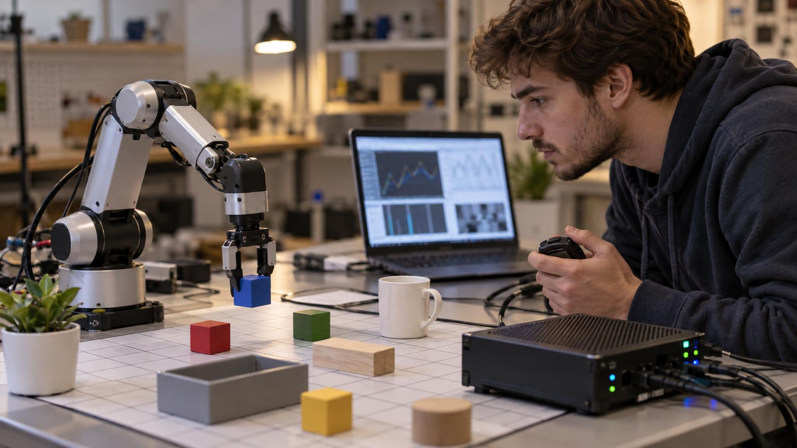

---
authors:
  - aitoboxrobot
categories:
  - 产品发布
date: 2026-10-28
hide:
  - navigation
tags:
  - Liquid AI
  - LFM3
  - 多模态大模型
  - 端侧AI
  - 开源模型
title: "Liquid AI 发布 LFM3 系列：六款 2B 级多模态全能开源权重基座模型"
---

# Liquid AI 发布 LFM3 系列：六款 2B 级多模态全能开源权重基座模型

> # Liquid AI Launches LFM3 Family of Six Open-Weight 2B-Class Models

### 文章背景与核心概要

在大语言模型 (Large Language Model, LLM) 与多模态技术竞相追求数百亿乃至千亿超大参数的浪潮下，如何在计算资源严苛受限的端侧设备、智能手机和边缘终端上高效运行全功能 AI，已成为工业界与学术界共同探索的技术前沿。2026年10月27日，前沿 AI 独角兽 Liquid AI 重磅揭晓了全新一代开源权重液体基座模型 (Liquid Foundation Models) **LFM3** 系列，一口气推出了涵盖纯文本、视觉、音频、全模态及专业决策等六款 20 亿 (2B) 参数级模型。该系列颠覆了传统单一纯 Transformer 架构，采用由门控短卷积、滑动窗口注意力与全局全量注意力深度交织的“三混合 (Tri-Hybrid)”创新架构，并通过真实物理硬件闭环优化大幅削减显存占用与推理延迟。其 4-bit 量化版本物理内存开销仅需约 1 GB，上下文窗口一举跨越至 256K Token，并在仅用 1/3 到 1/6 算力规模的情况下越级战胜了诸多大尺寸主流基座模型，为端侧与高性价比 AI 的规模化落地提供了强有力的开源利器。

---

## 核心概要

> ## Summary

2026年10月27日，Liquid AI 正式发布了新一代开源权重液体基座模型 **LFM3**。该系列将文本、视觉、音频、全模态 (Omni) 以及决策推理能力全部统一收束在同一个共享骨干网络之上。首批亮相的模型包含 6 款 20 亿 (2B) 参数级别的轻量化模型，采用基于硬件在环 (Hardware-in-the-Loop) 自动化搜索定制的创新“三混合 (Tri-Hybrid)”架构打造。凭借超长上下文支持、更强悍的多模态交互处理能力以及极佳的能效比，该系列模型可无缝跨越各种硬件生态流畅运行——从最底层的边缘物联网终端、主流智能手机，一直覆盖至企业级大型云端算力集群。

> On October 27, 2026, Liquid AI announced **LFM3**, a new generation of open-weight Liquid Foundation Models unifying text, vision, audio, omni, and decision capabilities onto a single shared backbone. The initial release features six models in the 2-billion-parameter range, built using an innovative "tri-hybrid" architecture designed via hardware-in-the-loop optimization. Offering massive context lengths, enhanced multimodal processing, and high efficiency, these models are designed to run across diverse hardware—from edge devices and smartphones to enterprise-grade cloud clusters.

---

## 同一共享骨干网络孕育的六大模型

> ## Six Models on One Shared Backbone

LFM3 家族中的每一款模型都源自同一颗技术基石——基础骨干模型 `LFM3-1.7B-Base` 分化衍生而来：

> Every model in the LFM3 family branches from the foundational `LFM3-1.7B-Base`:

* **LFM3-1.7B**：标准文本输入、文本输出的基座模型 (拥有 17.3 亿参数、256K Token 的超长上下文窗口、12.8 万词表容量，支持 16 种自然语言)。
* **LFM3-VL-2B**：支持图文混合的多模态视觉语言模型 (Vision-Language Model, VLM)，能够灵活接收文本、单张/多张图像以及连续视频输入。
* **LFM3-Audio-2B**：专注于音频交互的多模态模型，支持文本或音频语音直接输入，并能跨 18 种语言生成自然流畅的文本或高保真语音回复。
* **LFM3-Omni-2B**：Liquid AI 推出的首款真正意义上的全模态 (Omni) 原生模型，可同时混合接收文本、图像、视频和语音多模态输入，并端到端直接输出文本与语音。
* **决策模型 (`d1-2B` 与 `d1-omni-2B`)**：直接源自视觉与全模态架构的高阶专业决策模型，专门经过强化调优，旨在输出校准准确、带明确类型标记 (Typed) 的高精度确定性判定结果，而非发散性的长篇文本生成。

> * **LFM3-1.7B:** Standard text-in, text-out model (1.73B parameters, 256K-token context length, 128K vocabulary, supporting 16 languages).
> * **LFM3-VL-2B:** Multimodal vision-language model accepting text, images, and video.
> * **LFM3-Audio-2B:** Audio-focused model taking text or audio inputs and responding with text or speech across 18 languages.
> * **LFM3-Omni-2B:** Liquid AI's first true omni model, accepting text, images, video, and audio inputs and producing text and speech.
> * **Decision Models (`d1-2B` and `d1-omni-2B`):** Specialized models derived from the vision and omni architectures optimized to output calibrated, typed answers rather than generated text.

所有的基础模型以及后训练模型均完全开放权重，并在 LFM Open License v1.0 协议下正式上架 Hugging Face 社区，同时在 Liquid AI Playground 在线体验平台和云端 API 中同步开放。该系列模型的首发首日 (Day-0) 生态合作伙伴阵容极其强大，包括 Ambarella、AMD、Arm、Intel (OpenVINO)、NVIDIA、OpenRouter、Qualcomm 以及 Vercel，并在发布前获得了来自 Mercedes-Benz 和 Shopify 的深度预发评测支持。

> The base and post-trained models are open-weight and available on Hugging Face under the LFM Open License v1.0, as well as via the Liquid AI Playground and API. Day-0 launch partners include Ambarella, AMD, Arm, Intel (OpenVINO), NVIDIA, OpenRouter, Qualcomm, and Vercel, with pre-release evaluation support from Mercedes-Benz and Shopify.

---

## 三混合创新架构与训练流程

> ## Tri-Hybrid Architecture and Training

作为家族骨干的 `LFM3-1.7B-Base` 模型整体共包含 24 层网络结构：

> The architecture of `LFM3-1.7B-Base` incorporates 24 layers:

* **13 层门控短卷积 (Gated Short Convolutions)** (采用长度为 7 的卷积核大小)。
* **5 层滑动窗口注意力机制 (Sliding-Window Attention)** (窗口尺寸为 256 个 Token)。
* **6 层全局全量注意力机制 (Global Attention)**。

> * **13 gated short convolutions** (using a kernel size of 7).
> * **5 sliding-window attention layers** (256-token window).
> * **6 global attention layers**.

该架构的关键技术突破亮点主要涵盖以下几个层面：

> Key architectural innovations include:

* **按注意力头门控机制 (Head-wise Gated Attention)**：巧妙借助 Sigmoid 门控单元动态缩放每个注意力头的输出分布，从而强力抑制那些在模型量化过程中经常破坏数值稳定性的激活值离群异常值 (Activation Outliers)。
* **部分旋转位置编码 (Partial RoPE)**：在全局注意力层中，仅将旋转位置编码 (Rotary Position Embedding, RoPE) 施加在每个注意力头最高频的一半维度上；而在滑动窗口注意力层中，则继续保持完整的全维度 RoPE 编码。
* **三明治归一化 (Sandwich Norm)**：在每个网络功能块的输入端与输出端双管齐下施加归一化处理，大幅提升深度训练的平稳度。

> * **Head-wise gated attention:** Uses a sigmoid gate to scale each attention head's output, suppressing activation outliers that disrupt quantization.
> * **Partial RoPE:** Global attention layers apply Rotary Position Embedding (RoPE) only to the highest-frequency half of each head, while sliding-window layers maintain full RoPE.
> * **Sandwich norm:** Normalizes both the input and output of each block.

这套高度精简而强悍的架构设计，完全诞生自基于真实物理硬件闭环 (Hardware-in-the-Loop) 的网络架构自动搜索。搜索空间广泛覆盖了多达 14 种代表性边缘终端设备与底层计算后端的组合，涵盖现代智能手机 (如 Samsung Galaxy S26 Ultra、OnePlus 15)、树莓派 (Raspberry Pi 5)、高端笔记本电脑 (如搭载 Apple M4 Max 芯片与 AMD Ryzen AI 处理器的设备)，以及专用的 Qualcomm Hexagon 神经处理单元 (Neural Processing Unit, NPU)。

> This design emerged from hardware-in-the-loop architecture searches spanning 14 device and backend combinations, including smartphones (Samsung Galaxy S26 Ultra, OnePlus 15), Raspberry Pi 5, laptops (Apple M4 Max, AMD Ryzen AI), and the Qualcomm Hexagon NPU.

### 训练流程阶段划分

> ### Training Phases

* **预训练 (Pre-training)**：全量在高达 22 万亿 (22 Trillion) Token 的海量多语言多模态语料上进行训练，并以包含 3.5 万亿 Token 的高质量精选中间训练阶段 (Mid-training) 收尾 (重点注入高密度的 AI 智能体执行轨迹与工具调用样本)，从而一举将有效上下文窗口无损延展至 256K Token。
* **后训练 (Post-training)**：严谨历经四大独立后训练阶段，包括基于 1.75 万亿 Token 的监督微调 (Supervised Fine-Tuning, SFT)、混合强化学习 (Mixed RL)、从六位高阶强化学习专家教师模型中汲取知识的多领域同策略蒸馏 (Multi-domain On-policy Distillation)，以及在真实 AI 智能体运行沙盒容器中完成的智能体专项强化学习 (Agentic RL)。

> * **Pre-training:** Trained on 22 trillion tokens, ending with a 3.5T token mid-training stage using curated data (high agentic traces/tool calls) which expanded the context window to 256K tokens.
> * **Post-training:** Four distinct stages including supervised fine-tuning (1.75T tokens), mixed reinforcement learning, multi-domain on-policy distillation from six specialist reinforcement-learning teachers, and agentic reinforcement learning within real agent harnesses.

全新的混合架构使得 LFM3-1.7B 仅需其上一代前身 (`LFM2.5-2.6B`) 约 65% 的参数量 (参数减少了 35%)，却能在基准性能上全面反超，且在 8K 上下文长度下的端到端推理速度提升了约 25%。在经过 4-bit 量化低精度压缩后，纯文本模型在物理运行时的内存开销仅需惊人的 1 GB 左右。

> The new architecture enables LFM3-1.7B to outperform its predecessor (`LFM2.5-2.6B`) using 35% fewer parameters while delivering ~25% faster inference speeds with an 8K context. At 4-bit precision, the text model consumes roughly 1 GB of memory.

---

## 官方实测基准表现与垂直领域特化

> ## Company-Reported Performance and Specialization

* **文本处理与智能体交互 (Text & Agents)**：LFM3-1.7B 在权威的 WebArena-Verified 评测中一举斩获 38.42 的高分 (而其前身 LFM2.5-2.6B 仅为 3.02)。不过官方也坦诚指出，受限于其极为小巧的 2B 级参数体量，目前尚不推荐将其用于重度的高阶代码生成或超复杂的多步数理逻辑推演。
* **视觉理解与长视频分析 (Vision & Video)**：LFM3-VL-2B 全新引入了对原生连续视频输入的直接支持，在跨越 62 个视觉评测基准的综合平均分上，从上一代 LFM2.5-VL-3B 的 57.6 分跃升至 71.4 分。它仅凭自研的全新 1.64 亿参数紧凑型视觉编码器，便足以跨级匹敌相当于自身体积 6 倍的重型模型 (如 120 亿参数的 Gemma 4 12B)。
* **音频交互与全模态体验 (Audio & Omni)**：LFM3-Audio-2B 在 UTMOSv2 语音自然度评测中斩获 3.83 分 (上一代为 3.22 分)，首个 Token 生成延迟 (Time-To-First-Token, TTFT) 最低仅需 50 毫秒。而全模态衍生版本在音视频混合多模态基准测试中的综合成绩，甚至超越了参数规模高达 107 亿的大型模型 (例如 Qwen2.5-Omni-7B)。
* **高精度决策模型 (Decision Models)**：专用的 `d1-2B` 决策模型以减少 33% 的参数量全面替代了旧版的 `d1-3B`，在 ImajevBench 基准测试中的得分从 64.0 分强势跃升至 75.5 分。
* **具身智能与机器人特化 (Robotics Adaptation)**：研发团队还基于 LFM3-VL-2B 针对机器人领域进行了特化演化，涵盖多任务调度、复杂空间导航与机械臂精细操控。在仅依赖单块 NVIDIA Jetson AGX Orin 边缘计算芯片的情况下，该特化模型在 LIBERO 机器人评测套件中斩获了 96.2% 的惊人成功率，在 RoboCasa-GR1 桌面操作任务中亦取得了 45.7% 的卓越成绩。

> * **Text & Agents:** LFM3-1.7B scores 38.42 on WebArena-Verified (compared to 3.02 for LFM2.5-2.6B). However, due to its compact size, it is not recommended for heavy agentic coding or complex multi-step reasoning.
> * **Vision & Video:** LFM3-VL-2B introduces native video input support, raising the 62-benchmark vision average from 57.6 to 71.4 compared to LFM2.5-VL-3B. It matches models six times its size (like Gemma 4 12B) while relying on a new 164M-parameter in-house vision encoder.
> * **Audio & Omni:** LFM3-Audio-2B achieves a speech quality score of 3.83 on UTMOSv2 (up from 3.22) with a time-to-first-token latency as low as 50 ms. The omni variant outperforms models up to 10.7B parameters (such as Qwen2.5-Omni-7B) on audio-visual benchmarks.
> * **Decision Models:** The `d1-2B` model replaces `d1-3B` with 33% fewer parameters, scoring 75.5 on ImajevBench (up from 64.0).
> * **Robotics Adaptation:** LFM3-VL-2B has also been specialized into robotics models for orchestration, navigation, and manipulation, scoring 96.2% on LIBERO suites and 45.7% on RoboCasa-GR1 tabletop tasks via a Jetson AGX Orin.

尤为难能可贵的是，LFM3 家族中的任何一款模型均支持在单张普通消费级或数据中心 GPU 上轻松完成微调。Liquid AI 官方同步提供了极其完备的 Jupyter Notebook 教程，完整覆盖了监督微调 (SFT)、直接偏好优化 (Direct Preference Optimization, DPO)、群体相对策略优化 (Group Relative Policy Optimization, GRPO) 以及领域持续预训练 (Continued Pre-training) 全流程。在工程落地部署方面，该系列对主流轻量化推理框架 `llama.cpp`、`MLX` 以及 `vLLM` 提供了开箱即用的原生支持，跨越 Apple、AMD、NVIDIA 与 Qualcomm 等主流芯片硬件生态实现无缝高效落地。

> Every LFM3 model can be fine-tuned on a single GPU. Liquid AI provides comprehensive notebooks covering supervised fine-tuning, DPO, GRPO, and continued pre-training. Native deployment support is included for `llama.cpp`, `MLX`, and `vLLM` across Apple, AMD, NVIDIA, and Qualcomm hardware ecosystems.
