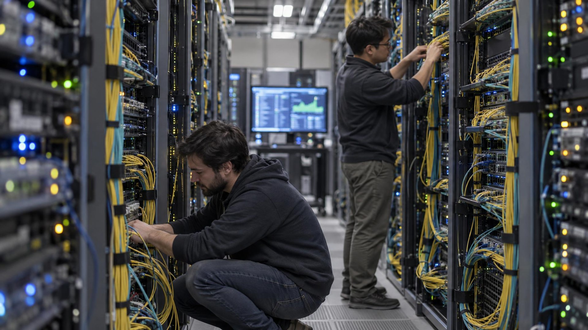

---
authors:
  - aitoboxrobot
categories:
  - 产品发布
date: 2026-10-28
hide:
  - navigation
tags:
  - Oracle Cloud
  - RDMA
  - AI网络
  - 智能网卡
  - 容错架构
title: "Oracle Acceleron 新增前端 RDMA 与多平面容错架构加速 AI 网络"
---

# Oracle Acceleron 新增前端 RDMA 与多平面容错架构加速 AI 网络

> # Oracle Acceleron Adds Front-End RDMA and Multiplanar Failover for AI

### 文章背景与核心概要

在万卡级大模型分布式训练与超大规模 AI 推理集群中，底层的网络通信往往是最脆弱的木桶短板——任何一个节点微小的网络拥塞或单点光纤链路故障，都可能导致全局计算任务陷入长久等待甚至全面瘫痪。为此，Oracle 在拉斯维加斯举办的 Oracle AI World 大会上，对其专为 AI 算力设计的云原生网络架构套件 **Oracle Acceleron** 进行了重磅升级。本次更新首次将远程直接内存访问 (Remote Direct Memory Access, RDMA) 技术引入前端计算网络，使 NVMe 块存储性能狂飙高达 3 倍，并重磅推出了 Oracle 集合通信库 (Oracle Collective Communications Library, OCCL) 与透明前端多平面容错网络架构。这套新方案不仅彻底打破了传统网络中 CPU 参与数据搬运的性能瓶颈，更能在硬件链路发生抖动或中断时，以应用层无感知的亚毫秒级速度动态重路由流量，为大规模分布式 AI 基础设施构筑了坚如磐石的高速容错网络基石。

---

## 核心概要

> ## Summary

在拉斯维加斯举办的 Oracle AI World 大会上，Oracle 正式发布了其专为严苛 AI 工作负载定制的 **Oracle Acceleron** 云网络套件的重大更新。本次升级引入了前端 RDMA 直连能力，通过扩展的 NVMe 块存储挂载选项实现了最高达 3 倍的性能飞跃，并同步推出了 Oracle 集合通信库 (Oracle Collective Communications Library, OCCL) 以及透明前端多平面网络架构 (Transparent Front-End Multiplanar Networking)。这些技术突破旨在消除分布式集群中的网络传输瓶颈，在硬件出现单点故障时动态将流量重定向绕行，从而安全地横向扩展超大规模 AI 算力基础设施。

> At Oracle AI World in Las Vegas, Oracle announced major updates to its **Oracle Acceleron** cloud networking suite designed for demanding AI workloads. The updates introduce front-end RDMA connectivity, up to 3x performance improvements via expanded NVMe block-storage options, the Oracle Collective Communications Library (OCCL), and Transparent Front-End Multiplanar Networking. These enhancements are built to prevent network bottlenecks, dynamically reroute traffic around failures, and securely scale large-scale AI infrastructure.

---

## 方案介绍

> ## Introduction

2026年10月27日，Oracle 在拉斯维加斯的 Oracle AI World 大会上揭晓了专为 AI 工作负载打造的全新 Oracle Acceleron 云网络功能。这套重磅更新引入了前端 RDMA 连接能力，推出了据 Oracle 称性能最高提升达 3 倍的扩展 NVMe 块存储挂载选项，并为其多平面网络 (Multiplanar Networks) 配备了全新的专属集合通信库。

> Oracle announced new Oracle Acceleron cloud networking capabilities for AI workloads at Oracle AI World in Las Vegas on October 27, 2026. The updates introduce front-end RDMA connectivity, expanded NVMe block-storage options that Oracle said improve performance up to 3x, and a collective communications library for its multi-planar networks.

Oracle Acceleron 是 Oracle 云基础设施 (Oracle Cloud Infrastructure, OCI) 推出的一整套高性能网络与基础设施技术体系，专门保障严苛 AI 任务能够高可靠、高安全且大规模地顺畅运行。它将专用网络交换拓扑 (Fabric)、更直接的数据直通路径、融合网卡 (Converged NIC) 与主机级零信任路由及多平面容错设计深度整合，兼顾超高安全性与集群韧性。此次发布的全新能力主要涵盖三大核心维度：
* AI 数据高速流转
* 分布式 AI 通信协同
* 安全多租户 AI 基础设施

> Oracle Acceleron is Oracle Cloud Infrastructure’s (OCI) suite of networking and infrastructure technologies for running demanding AI workloads reliably, securely, and at scale. It combines dedicated network fabrics, more direct data paths, and a converged NIC, with host-level zero-trust routing and multi-planar designs for security and resilience. The new capabilities span three areas: 
> * AI data movement
> * Distributed AI communication
> * Secure multi-tenant AI infrastructure

“当成千上万张加速计算芯片协同作业时，任何一条路径的拥塞或故障，所造成的后果都会远远超出单一连接本身的范畴，” OCI 计算与 AI 基础设施执行副总裁 Pradeep Vincent 在 [Oracle 的官方公告](https://www.prnewswire.com/news-releases/oracle-unveils-new-cloud-networking-innovations-for-ai-302920240.html) 中指出。

> 💬 [原文引用 / Original Quote]:
> *"When thousands of accelerators are working together, one congested or failed path can have consequences far beyond a single connection,"* said Pradeep Vincent, executive vice president of Compute and AI Infrastructure at OCI, in [Oracle’s announcement](https://www.prnewswire.com/news-releases/oracle-unveils-new-cloud-networking-innovations-for-ai-302920240.html). 

Pradeep Vincent 特别强调，Acceleron 架构的原生设计正是为了实现动态实时响应：它能够在遇到链路故障时瞬时绕障重路由，快速自愈，从而帮助客户实现安全从容的集群算力扩容。

> Vincent noted that Acceleron is built to respond dynamically by rerouting traffic, recovering from failures, and helping customers scale securely.

---

## 前端 RDMA 与 NVMe 存储加速

> ## Front-End RDMA and NVMe Storage

首项新能力名为 **Oracle Acceleron 高性能网络交换拓扑 (Oracle Acceleron High-Performance Fabric)**，它首次将远程直接内存访问 (RDMA) 扩展到了 OCI 的前端计算节点，助力客户以更出色的性能部署大规模推理、分布式存储以及高性能计算 (High-Performance Computing, HPC) 任务。第二项突破则是大幅丰富了跨 Oracle Acceleron 裸金属服务器及虚拟机的 NVMe 块存储挂载形态，直接将面向 AI、现代数据库以及其他高密度数据吞吐型负载的综合性能提升了高达 **3 倍**。

> The first new capability, **Oracle Acceleron High-Performance Fabric**, brings RDMA connectivity to OCI front-end compute, helping customers deploy inference, storage, and HPC workloads with greater performance. The second enhancement—expanded NVMe block-storage attachment options across Oracle Acceleron bare metal and virtual machine shapes—improves performance up to **3x** for AI, database, and other data-intensive workloads.

在 [Oracle 官方 OCI 技术博客的一篇长文](https://blogs.oracle.com/cloud-infrastructure/first-principles-networking-for-ai-scale) 中，技术作者将 RDMA 形象地描述为：允许数据在不同物理机之间的内存中极速直传，而几乎无需中央处理器 (CPU) 的深度介入。通过彻底绕过传统网络传输中繁重冗长的操作系统与内核协议栈软件开销，RDMA 不仅极大压缩了网络延迟、维系着顶格的高吞吐带宽，还能为关键应用程序释放出宝贵的 CPU 算力资源。

> In [a technical post on Oracle’s OCI blog](https://blogs.oracle.com/cloud-infrastructure/first-principles-networking-for-ai-scale), authors described RDMA as moving data directly between memory on different machines with minimal CPU involvement. By bypassing much of the operating-system and software processing standard in conventional transfers, RDMA reduces latency, sustains high throughput, and leaves more CPU capacity for applications. 

### 拥塞管理与公平调度机制

> ### Managing Congestion and Fairness

尽管 RDMA 在加速 GPU 间点对点通信、超高吞吐存储访问以及跨集群数据搬迁方面优势巨大，但在跨节点多租户共享、多种混合工作负载共存的复杂网络环境中，它对丢包、延迟抖动与瞬时拥塞却表现得极其敏感。

> While RDMA benefits GPU communication, storage access, and cross-cluster transfers, it is highly sensitive to congestion, latency, and packet loss across shared, mixed-workload networks. 

为了彻底解决不同协议间的“公平竞争”难题——即 RDMA 基于传输速率的流控调节容易与传统 TCP 基于拥塞窗口的控制策略产生激烈冲突——Oracle Acceleron 智能网卡 (SmartNIC) 创新性地引入了**分层令牌桶 (Hierarchical Token Buckets)** 调度机制：
* **父令牌桶 (Parent Bucket)**：统筹表征整体的可用共享带宽上限。
* **子令牌桶 (Child Bucket)**：独立细粒度追踪每一类流量类型与优先级的消耗状态。
* 随着可用令牌逐渐耗尽，SmartNIC 会对支持显式拥塞通知 (Explicit Congestion Notification, ECN) 的数据包进行概率性标记，或平滑丢弃失去响应的数据包，从而产生平缓渐进的拥塞降速信号。

> To resolve fairness issues—where RDMA's rate-based congestion control clashes with TCP's window-based control—Oracle Acceleron SmartNICs use **hierarchical token buckets**:
> * A **parent bucket** represents shared bandwidth.
> * **Child buckets** track each traffic class. 
> * As tokens deplete, the SmartNIC probabilistically marks ECN-capable packets or drops unresponsive packets to produce a gradual congestion signal.

针对数据中心内部网络架构可能出现的瞬时拥塞，OCI 在 Acceleron SmartNIC 内部硬化实现了**单向延迟拥塞控制 (One-Way-Delay Congestion Control)**。通过专门精确测量前向单程的传输延迟，成功避免了传统双向往返时间 (Round-Trip Time, RTT) 测量中常见的“误报拥塞”假象——此前哪怕仅仅是反向确认链路偶发拥塞，也会连带拖累前向数据流的速率。一旦某条传输流出现延迟升高的迹象，SmartNIC 会立刻在后台动态探测三条备选路径，并在发现更优线路时瞬间平滑切换。此外，OCI 的前端 RDMA 全面兼容所有主流队列对 (Queue Pair) 类型与核心动词 (Verbs)，企业现有的大规模业务代码无需任何重构修改即可直接无缝运行。

> For internal fabric congestion, OCI uses **one-way-delay congestion control** within the Acceleron SmartNICs. Measuring forward-path delay avoids the false congestion signals that round-trip measurements often trigger when only the reverse path is congested. If a flow shows elevated delay, the SmartNIC probes three alternate paths and relocates the flow if a better option is found. OCI’s front-end RDMA supports all queue pair types and verbs, allowing existing applications to run without modification.

---

## 集合通信库与多平面故障自愈

> ## Collective Communications and Multi-Planar Failover

针对超大规模分布式大模型训练常遇的通信瓶颈与单点停顿，Oracle 全面推出了 **Oracle 集合通信库 (Oracle Collective Communications Library, OCCL)** 与**透明前端多平面网络架构 (Transparent Front-End Multiplanar Networking)**。在物理链路发生网络故障时，OCCL 能够通过将集合通信流量智能切分并均衡分摊到 OCI 后端的多平面网络中，动态将流量调度至更健康的物理通路上，从而保障集群计算任务全程不中断、业务丝滑延续。

> To address distributed training hurdles, Oracle introduced the **Oracle Collective Communications Library (OCCL)** and **Transparent Front-End Multiplanar Networking**. OCCL maintains workload continuity during network path failures by distributing collective traffic across OCI’s backend Multiplanar Network, steering traffic toward healthier pathways.

### 为什么 OCCL 对大模型训练至关重要

> ### Why OCCL Matters

在分布式 AI 训练体系中，各计算节点需进行高度同步的参数梯度集合通信，整个集群的执行速度完全受制于木桶中最短的那块板——即通信最慢的链路。一条微小的链路拥塞便能拖慢甚至卡死数千张显卡的全局运算；而业界传统的等价多路径转发 (Equal-Cost Multi-Path, ECMP) 策略往往又非常容易把高密度数据流死板地钉死在同一条通路上，无法兼顾动态负载。

> In distributed AI training, synchronized jobs move only as fast as the slowest link in the chain. A single congested path can cause a workload-wide slowdown, while standard equal-cost multi-path forwarding often pins flows unevenly. 

OCCL 巧妙地以标准插件的形式深度集成到业界主流的集合通信库中：
* 根据实时观测到的网络拥塞度与链路健康状态，将密集流量弹性分发到多个硬件队列对上。
* 基于报文级 (Message-Level) 与数据块级 (Chunk-Level) 的细粒度负载均衡算法，主动将流量倾斜调度至更高吞吐的健康线路上。
* 原生支持网卡端口级与物理 NIC 硬件级的无缝故障转移，即使某条物理光纤或接口遭遇突发中断，分布式训练任务依然能够平稳推进，彻底告别了“一处链路掉线导致整个任务从头重跑”的噩梦。

> OCCL acts as a plugin for commonly adopted collective-communication libraries:
> * It distributes traffic across multiple queue pairs based on observed congestion and health.
> * It actively shifts traffic toward higher-throughput paths using message-level and chunk-level load balancing.
> * It supports port-level and NIC-level failover, allowing distributed training to continue without requiring a job restart after a link failure.

通过将网络故障转移、链路自愈以及拥塞感知负载均衡逻辑直接上移抽象至集合通信库 (CCL) 软件层，这些高可用核心能力得以与底层脆弱且黑盒的网络硬件固件完全解耦，从而无论在传统的单平面物理拓扑还是在前沿的多平面网络架构中，都能毫无违和地高效无缝运转。

> By moving failover, recovery, and congestion-aware load balancing into the CCL layer, these functions are decoupled from low-level network hardware and firmware, working seamlessly across both single-planar and multi-planar networks.

---

*本文由 Theo Nash 撰写 · AI 基础设施与计算 (Unite.AI)*

> *Authored by Theo Nash · AI Infrastructure & Compute (Unite.AI)*
