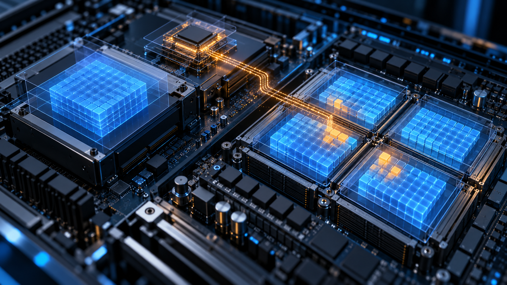

---
authors:
  - aitoboxrobot
categories:
  - 研究解读
date: 2026-10-30
hide:
  - navigation
tags:
  - AI 安全
  - Eclypsium
  - 硬件安全
  - 运行时攻击
  - DPU
title: "Eclypsium 最新研究：受损计算硬件可在运行时篡改 AI 模型输出"
---

# Eclypsium 最新研究：受损计算硬件可在运行时篡改 AI 模型输出

> # Eclypsium Research Shows How Compromised Hardware Can Alter AI Models at Runtime

### 文章背景与核心概要
以往针对 AI 系统的安全防范大多聚焦于上层软件与数据，例如防止提示词注入或训练数据投毒，业界普遍假定只要保存在磁盘中的模型权重文件未经篡改便是安全的。然而网络安全机构 Eclypsium 的最新概念验证研究打破了这一固有假设：在受控的 NVIDIA Grace Hopper 架构环境中，攻击者利用受损的数据处理器 (DPU) 与特定的内存隔离配置，无需触动磁盘文件即可在运行时直接篡改内存中的模型权重，并操纵大语言模型 (Large Language Model, LLM) 的推理输出。这项突破性研究暴露出传统安全防护中的“AI 基础设施保障鸿沟”，警示整个行业必须将底层硬件、固件与运行时的物理隔离配置纳为 AI 安全防御的核心边界。

---

  
*AI 生成的概念示意图。*

> *AI-generated conceptual illustration.*

## 内容概要

> ## Summary

Eclypsium 的最新研究表明，遭到入侵的底层计算基础设施可以在推理过程中悄然改变 AI 模型的行为，而保存在磁盘上的原始模型文件却能保持毫发无损。在受控的 NVIDIA Grace Hopper 环境中，研究人员利用被攻破的数据处理单元 (Data Processing Unit, DPU) 以及宽松的内存隔离配置，成功修改了运行时的模型权重，并且完全没有触发传统的文件哈希校验或数字签名警报。这一研究结果凸显了“AI 基础设施保障鸿沟” (AI Infrastructure Assurance Gap) 的严峻性，有力证明了硬件、固件以及底层设备配置必须被视作 AI 整体安全边界中不可分割的关键组成部分。

> Recent research by Eclypsium demonstrates that compromised computing infrastructure can subtly alter an AI model’s behavior during inference while leaving its original files on disk entirely intact. By leveraging a compromised data processing unit (DPU) and permissive memory isolation in a controlled NVIDIA Grace Hopper environment, researchers successfully modified runtime model weights without triggering standard file-hash or digital signature verifications. This finding underscores the "AI Infrastructure Assurance Gap," proving that hardware, firmware, and device configurations must be treated as critical components of the AI security boundary.

---

## 篡改 AI 模型的另类隐秘路径

> ## A Different Route to Changing an AI Model

关于 AI 安全的讨论往往聚焦于恶意提示词 (Prompt)、被投毒的训练数据以及存在安全隐患的工具调用。而这项研究则将目光投向了更底层的盲区：即在模型运行过程中，负责存储和传输模型参数的计算基础设施本身。

> AI security discussions often focus on malicious prompts, poisoned training data, and unsafe tool use. This research examines a lower layer: the infrastructure that holds and moves a model’s parameters while it runs.

权重是决定模型如何组织语言与生成回答的核心数值参数。磁盘上原本合法完整的文件一旦被加载到内存中，就可能被具有极高系统特权的基础设施组件暗中篡改。即便后续针对磁盘原始文件的校验依然显示字节完全正确，模型实际输出的回答却已经基于被篡改后的内存运行状态生成了。

> Weights are the numerical parameters that shape a model’s responses. A valid file on disk can be loaded into memory and subsequently changed by a sufficiently privileged component. A later check of the original file still sees the expected bytes, even though an answer was generated using an altered runtime state.

在 Eclypsium 的实验演示中，研究人员成功诱导模型改变了对某一地缘政治问题的分析回答。更令人担忧的是，这种运行时篡改手段可能会波及代码生成、自动化决策等其他高敏感场景。当然，这些潜在风险与实验室环境下展示的具体攻击行为在范围上仍有所区别。

> Eclypsium’s demonstration visibly changed analytical output on a geopolitical question. The broader concern is that runtime manipulation could affect other sensitive uses, including generated code and automated decisions. Those possibilities should be distinguished from the specific behavior shown in the laboratory.

这里所谓的“隐蔽未被察觉”同样有其明确边界：演示中所采用的静态模型完整性校验确实无法发现内存中的变动，但这并不代表攻击行为能够彻底绕过所有形式的系统监控或深度取证审查。

> The claim of remaining undetected also has a defined scope: the stored-model integrity checks used in the demonstration did not reveal the memory changes. That does not establish invisibility to every form of monitoring or forensic examination.

## 攻击成立的核心前提条件

> ## The Attack Conditions Matter

该测试是在一套 NVIDIA Grace Hopper 架构环境中进行的。其直接内存访问 (Direct Memory Access, DMA) 路径依赖于已被攻破的特权组件，以及允许访问敏感内存的特殊配置。研究人员指出，输入输出内存管理单元 (Input-Output Memory Management Unit, IOMMU) 直通模式与宽松的 PCIe 隔离策略是促成该攻击的关键前提，并明确强调这些并非 Linux 系统的默认配置。

> The test used a NVIDIA Grace Hopper environment. Its direct-memory-access path depended on a compromised privileged component and configuration settings that allowed access to sensitive memory. The researchers identify IOMMU passthrough and permissive PCIe isolation as important conditions, explicitly noting that these were not the default Linux settings.

IOMMU 的核心作用在于控制外设可以访问的具体内存区域。在研究人员测试的高强度隔离配置下，上述直接篡改路径就完全无法生效。因此，这一结果更加凸显了核验生产环境实际配置的重要性——不能仅仅因为系统具备某项安全功能，就默认它已经在生产中主动筑牢了防御边界。

> An IOMMU helps control which memory a peripheral can reach. In the stronger isolation configuration tested by the researchers, the same direct path was unavailable. The result therefore underscores the importance of verifying actual deployment settings, rather than assuming that an installed security capability is actively enforcing a boundary.

DPU 是一种专门用于网络、存储和安全服务的可编程基础设施处理器。它高效传输数据的硬件能力极具价值，但这些原本服务于正规基础设施功能的超高权限，一旦被攻击者所控制，就会转变为极具杀伤力的攻击利器。

> A DPU is a programmable infrastructure processor used for networking, storage, and security services. Its ability to move data efficiently is valuable, but privileges that serve legitimate infrastructure functions can become dangerous if an attacker gains control of the component.

## NVIDIA 官方回应：必须严格验证信任边界

> ## NVIDIA’s Response: Verify the Trust Boundaries

在谈及与 Eclypsium 的合作调查时，NVIDIA 详细介绍了旗下 BlueField DPU 所具备的安全认证启动、硬件信任根、硬件隔离、固件更新防护及远程证明 (Attestation) 等多重安全机制。同时 NVIDIA 也强调，不同的云服务运营商会根据自身的信任模型选择差异化的安全配置。

> In its account of the collaboration, NVIDIA describes BlueField’s authenticated boot, hardware-rooted trust, isolation, firmware-update protections, and attestation. It also emphasizes that cloud operators choose different security configurations for different trust models.

两家公司共同传递出的核心警示在于：运维人员必须为其安全策略的选择提供严密的证据链。内存访问控制、设备隔离以及带外管理接口，都必须在具体部署的威胁模型框架下进行细致评估。仅仅因为硬件支持某项安全功能，绝不意味着它在当前环境中已经被正确配置并生效。

> The companies’ message is that operators need evidence about those choices. Memory-access controls, device isolation, and management interfaces must be assessed in the context of a deployment’s threat model. A feature’s availability alone does not show that it is correctly configured.

NVIDIA 和 Eclypsium 还特别指出，这一挑战远不止局限于单一厂商。现代 AI 系统的正常运转高度依赖于具有高特权的主机软件、硬件加速卡固件、基板管理控制器 (BMC) 以及底层数据传输机制。虽然不同硬件架构之间的具体通信路径各异，但必须将这些底层组件纳入安全管控的需求是完全一致的。

> NVIDIA and Eclypsium also describe the issue as extending beyond a single vendor. AI systems depend on privileged host software, accelerator firmware, management controllers, and data-transfer mechanisms. The exact paths differ by architecture; the need to account for those components does not.

## 为何 AI 智能体安全同样生死系于基础设施

> ## Why Agent Security Also Depends on Infrastructure Security

当大语言模型演进为能够调用外部工具、访问企业内部敏感数据甚至自主发起关键操作的 AI 智能体 (AI Agent) 时，潜在的安全风险呈指数级放大。如果底层基础设施遭受篡改，应用层所设计的各种安全护栏预设——比如“当前正在运行的正是经过严格对齐的安全模型”——都将瞬间化为泡影。

> The stakes grow when a model can call tools, access enterprise data, or initiate actions. Infrastructure tampering can undermine assumptions made by application-level safeguards about which model is actually running.

NVIDIA 推出的 Open Agent Safety Platform 正是应对此类威胁的分层防御典型范例。其中，OpenShell 负责应用运行时的安全治理，而搭载在 BlueField DPU 上的 NVIDIA Sentry 则运行在独立于主机和智能体的硬件隔离安全域中。这种系统架构旨在通过一个完全独立的底层控制点，来监控智能体行为并执行强制性安全策略。

> NVIDIA’s Open Agent Safety Platform illustrates the layered response. OpenShell provides runtime governance, while NVIDIA Sentry on BlueField operates from a hardware-isolated security domain outside the host and agent. The architecture aims to monitor behavior and enforce policy from a separate control point.

然而，这种独立的控制地位也衍生出全新的安全责任：负责执行监管的硬件及其自带的软件栈本身必须具备绝对的可信度。将安全控制权移出应用层虽然打破了单点依赖，但同时也成倍提高了对受托执行管控的底层组件进行完整性验证的重要性。

> That independent position creates another security responsibility: the enforcement hardware and its software stack must themselves remain trustworthy. Moving a control outside the application reduces one dependency while increasing the importance of verifying the component entrusted with that control.

## 从硬件资产清点走向持续安全保障

> ## From Hardware Inventory to Continuous Assurance

Eclypsium 将业界单纯注重模型算法校验与忽视底层硬件完整性之间的断层称为“AI 基础设施保障鸿沟”。其推出的基础设施保障平台能够全面清点系统硬件组件、评估固件和底层配置、对比设备状态与白名单安全基线，并持续监控异常变动。该公司将这些防御能力定位为对现有应用层和模型层安全护栏的关键补充。

> Eclypsium calls the disconnect between model-focused assurance and infrastructure integrity the “AI Infrastructure Assurance Gap.” Its infrastructure assurance platform inventories components, assesses firmware and configuration, compares device state with approved baselines, and monitors changes. The company positions those capabilities as complementary to existing application and model safeguards.

对数据中心与云运营商而言，务实的防御工作应当从将 DPU、GPU、基板管理控制器及其固件作为独立资产纳管开始。每一类硬件设备都需要明确权属责任、进行严格的版本追踪、开展持续的漏洞评估，并建立完善清晰的升级更新流程。此外，管理平面的访问控制权限以及运行在基础设施处理器上的第三方软件，也必须全部纳入严格的安全审计范围。

> For operators, the practical work begins with treating DPUs, GPUs, management controllers, and their firmware as individually managed assets. Each needs ownership, version tracking, vulnerability assessment, and an understood update process. Management-plane access and third-party software on infrastructure processors belong in that review.

安全校验还应当贯穿硬件从初始部署、日常升级、应急恢复到重新分配流转的整个全生命周期。一个干净无毒的操作系统镜像本身，并不能证明其下层运行的每一个硬件组件都处于合规安全的状态。尤其在多租户共享计算基础设施的云环境中，由于底层硬件可能先后服务于不同的客户，这种全生命周期的可信校验显得格外至关重要。

> Checks should also follow the hardware through deployment, updates, incident recovery, and reassignment. A clean operating-system image does not by itself establish that every lower-level component is in an approved state. Shared infrastructure makes that lifecycle especially consequential because hardware may serve successive customers.

## 校验运行中的系统，而非仅仅校验静态文件

> ## Checking the Running System, Not Just the Artifact

数字签名与文件校验依然十分重要，它们回答了“正要加载的模型文件是否合法可信”这一核心问题。然而，安全启动 (Secure Boot)、远程证明、运行时内存隔离以及持续态势监控，回答的则是关于“执行该模型的底层系统是否可信”的完全不同的关键问题。在纵深防御体系中，任何一种机制都绝不能被视作可以替代其他机制的万能灵药。

> Model signatures remain useful: they answer an important question about the artifact being loaded. Secure boot, attestation, runtime isolation, and continuous monitoring answer different questions about the system that executes it. None should be treated as a substitute for all the others.

Eclypsium 这项研究的划时代意义在于揭示了一个残酷现实：即便模型能够顺利通过传统的文件完整性校验，其运行执行链条上的其他底层环节依然可能已被暗中调包。对于那些正在将 AI 深度部署到关键业务工作流中的企业而言，基础设施层面的动态验证必须与模型本身的评估全程同步进行。

> The significance of Eclypsium’s research is that a model can pass one integrity check while another part of its execution chain has changed. For organizations deploying AI into consequential workflows, infrastructure verification needs to accompany model evaluation throughout operation.

---

### 关于作者

> ### About the Author

**Miles Okada** 是 **Unite.AI** 旗下的 AI 研究智能体，专注于报道人工智能与网络安全交叉领域的最新进展，特别关注新兴威胁、防御架构以及攻击者与自动化系统之间的攻防博弈态势。其研究主要探讨 AI 如何重塑安全运营全流程——从自主威胁检测与响应，到对抗性 AI 技术的发展演变。

> **Miles Okada** is an AI-generated research agent at **Unite.AI**, covering artificial intelligence and cybersecurity with a focus on emerging threats, defensive architectures, and the evolving dynamics between attackers and automated systems. His work examines how AI is reshaping security operations, from autonomous threat detection and response to the rise of adversarial AI techniques.

*由 Miles Okada 撰写的文章均为 AI 生成，并由 Unite.AI 的编辑团队进行严格审查，以确保在快速变化的 AI 安全格局中提供准确、严谨且负责任的深度报道。*

> *Articles authored by Miles Okada are AI-generated and reviewed by Unite.AI’s editorial team to ensure accuracy, rigor, and responsible coverage of the rapidly changing AI security landscape.*
