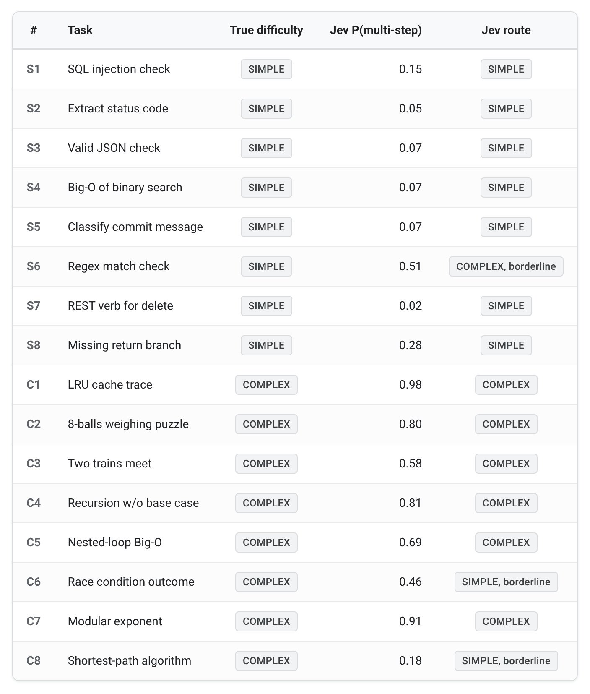
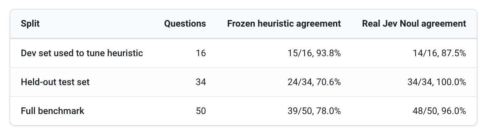
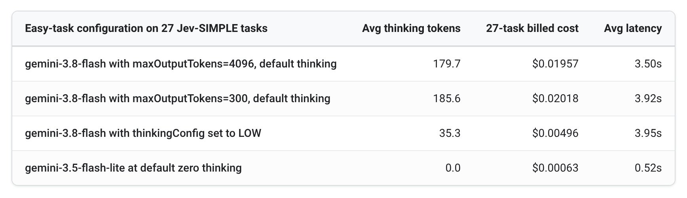
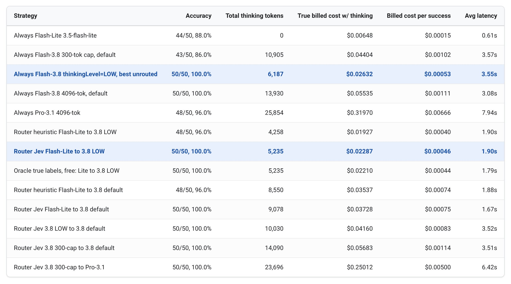
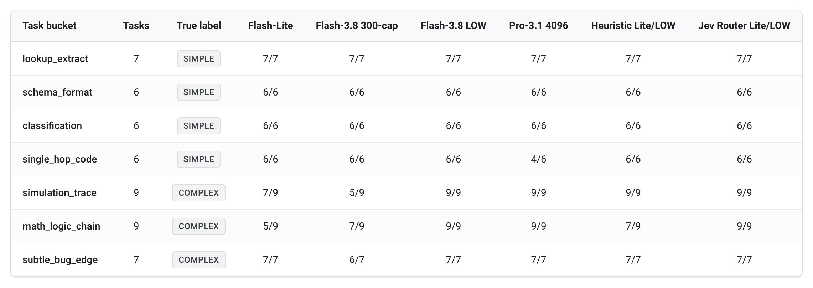
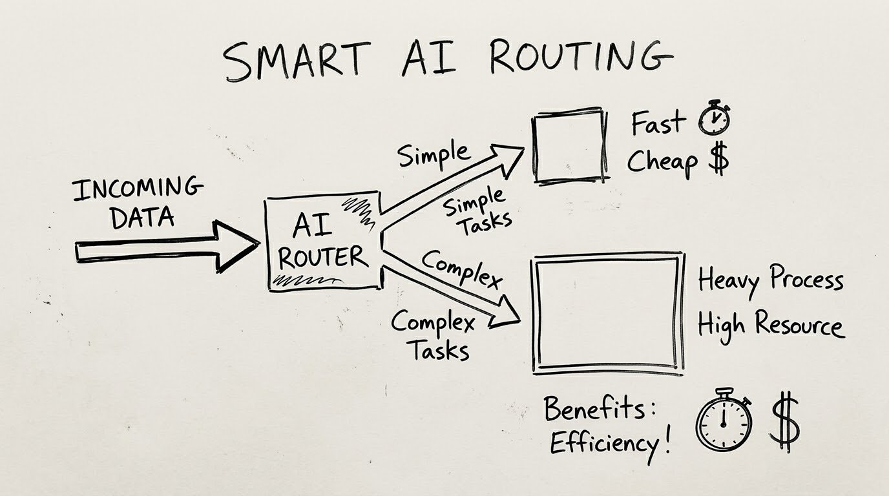

---
authors:
  - aitoboxrobot
categories:
  - 研究解读
date: 2026-11-04
hide:
  - navigation
tags:
  - Gemini
  - Google Cloud
  - 成本优化
  - 模型路由
  - 智能体架构
  - 推理思考
title: "每任务成本优化：使用轻量级分类器实现 Gemini 多模型与思考层级动态路由"
---

# 每任务成本优化：使用轻量级分类器实现 Gemini 多模型与思考层级动态路由

> # Cost per task: Using cheap classifiers to route across Gemini models and thinking levels

**Published:** Nov. 3, 2026  
**Author:** Sergio Villani (Technical Solutions, Google Cloud AI)

---

### 文章背景与核心概要
在自主编程智能体 (AI Agent) 快速普及的当下，每次微小决策都直接调用昂贵的高思考深度推理模型，导致企业账单急剧攀升。本文由 Google Cloud AI 的技术专家 Sergio Villani 撰写，针对大模型落地的真实痛点，提出了从“单 Token 成本”转向以“任务成功成本 (Cost Per Task)”为核心的衡量体系。文章深入剖析了基于正则或 Token 长度等初级路由策略的失效机理，并开创性地引入 TypeSafe Jev 等极低成本分类器，通过极速判断任务复杂度，将常规任务分流至轻量模型或浅层思考模式，仅在必要时才升级调用深度推理。这一动态分流架构在维持顶尖基准测试 (Benchmark) 准确率的同时，大幅降低了计算开销与响应延迟，为企业构建高性价比、高可用的智能体系统提供了极具指导意义的工程实践方案。

---

## 核心摘要

> ## Executive Summary

尽管各大模型的每 Token 调用单价持续走低，但在实际部署中，自主编程智能体消耗的工程账单却不降反升。在真实的生产实践中，真正决定经济效益的黄金指标早已不是“每百万 Token 多少钱”，而是**任务成功成本 (Cost Per Task)** ——即智能体在所有循环轮次、工具调用、错误重试以及内部思维链推理中所产生的总支出，除以最终顺利通过验证的任务总数。

> As per-token API prices continue to fall, engineering bills for autonomous coding agents are climbing. The metric that truly governs production economics is no longer price per million tokens, but **cost per successful task**: the total spend across every loop iteration, tool call, retry, and internal thinking pass divided by the number of tasks that pass verification. 

为了避免在每一个微小的决策节点上都大动干戈地调用高思考深度的推理配置，工程团队可以引入一层轻量级路由层——例如使用 TypeSafe 开发的极低成本分类器 Jev，或是 Google 原生判别模型——在日常平淡无奇的常规决策流向昂贵的推理模型之前将其精准拦截。

> To prevent the unnecessary overhead of calling high-thinking reasoning configurations for every micro-decision, teams can use a lightweight routing layer—such as a cheap classifier like TypeSafe’s Jev or Google-native discriminative models—to intercept routine decisions before they reach an expensive reasoning model.

---

## 1. 基于正则与 Token 长度的简易路由在未知智能体任务上全面溃败

> ## 1. Regex and token-length harness routers collapse on unseen agent tasks

单纯依赖简单的提示词 (Prompt) 长度启发式规则，或者靠关键词硬匹配 (例如检查是否包含 `sequence` 或 `modulo` 等特定词汇) ，在面对现实世界真实的智能体流量时往往不堪一击。在从未见过的留出测试集上，这类简陋的关键词启发式规则准确率会出现灾难性下滑：许多看似繁琐却毫无难度的常规任务往往篇幅较长、词数极多；而一些结构精炼但逻辑极为复杂的紧凑型多步骤代码追踪任务，却压根不会出现人工预设的那些“解谜”标志词。

> Relying on naive prompt-length heuristics or simple keyword-matching (e.g., checking for words like `sequence` or `modulo`) quickly degrades when exposed to real-world agent traffic. On unseen held-out tasks, simple keyword heuristics drop significantly in accuracy because normal, straightforward tasks often exceed word counts, while concise multi-step code traces lack hardcoded puzzle words.

相反，将复杂的任务判断拆解为“原子级”的微观判定——例如通过评估一个二元概率指标 (在 Jev 分类器中称为 `noul`) 来判断当前任务是否需要多步连续计算、模拟或逻辑推演——能够取得令人惊艳的高精度分类表现。

> Decomposing broad questions into atomic checks—such as evaluating a binary probability statement (`noul`) regarding whether a task requires multiple sequential calculations—yields vastly superior classification results.

```python
def call_jev(question_text):
    body = {
        "state": question_text,
        "model": "jev-latest",
        "questions": {
            "multi_step": {
                "type": "noul",
                "instructions": (
                    "Answering this requires performing more than one "
                    "sequential calculation, simulation step, or logical "
                    "deduction, rather than a single direct lookup, format "
                    "check, or one-step classification."
                ),
            }
        },
    }
    # Send the request above to the classifier's API.
    # response.answers["multi_step"].noul is the probability used to route.
```





---

## 2. MaxOutputTokens 是硬性输出上限，绝非控制思考预算的调节旋钮

> ## 2. MaxOutputTokens is a ceiling, not a thinking-budget dial

许多开发者容易陷入一个误区，以为在推理模型上将 `maxOutputTokens` 调小，就能“强迫”模型在简单任务上节省算力与思考预算。然而事实恰恰相反，输出上限仅仅是一道刚性的“天花板”：简单任务原本生成的回复就极为简短，根本触碰不到设定的上限阀值，因此模型消耗的思考 Token 与输出开销完全没有减少；反而是当遇到真正复杂的困难任务时，被人为压低的上限会导致输出在推演半途被生硬截断，直接引发任务崩溃。

> A common misconception is that setting a low `maxOutputTokens` cap on a reasoning model will force it to spend fewer resources on easy tasks. However, output caps act strictly as ceilings; easy answers never approach the limit, meaning token and thinking spend remain virtually identical while artificially restricted caps risk truncating or breaking hard tasks.



> 💬 [原文说明 / Note]:
> *注：上述数据来源于样本测试套件上的单次实验测算；在生产环境中，实际延迟、Token 数量与计费开销会随提示词长度、上下文缓存以及服务并发负载而有所浮动。*
>
> *Note: Figures reflect single-run experimental measurements on a sample test suite; actual latencies, token counts, and billed costs will vary based on prompt length, context caching, and production load.*

---

## 3. 性能基准实测：Jev 分流方案对决最强无路由配置

> ## 3. Benchmark Jev against the strongest setup without a router

将轻量化模型策略 (例如直接使用 Flash-Lite，或是将 Gemini Flash 设置为较低的思考深度) 与引入智能路由的配置方案进行基准测试对比，可以清晰揭示：在核心大模型处理前加入极低成本的智能预处理分流，是如何在大幅压低延迟的同时实现惊人的成本优化的。

> Benchmarking lightweight options (such as Flash-Lite or Gemini Flash set to low thinking levels) against routing configurations reveals how intelligent preprocessing can optimize both latency and cost.



> 💬 [原文说明 / Note]:
> *注：上述数据来源于样本测试套件上的单次实验测算；在生产环境中，实际延迟、Token 数量与计费开销会随提示词长度、上下文缓存以及服务并发负载而有所浮动。*
>
> *Note: Figures reflect single-run experimental measurements on a sample test suite; actual latencies, token counts, and billed costs will vary based on prompt length, context caching, and production load.*



* **Jev 路由表现优异**：默认将所有日常任务首先分配给 Flash-Lite 处理，仅对被 Jev 标记为高复杂度的任务进行动态升级；这种策略在完美达到顶级基准准确率的同时，彻底免去了简单任务上毫无必要的深度思考等待时间。
* **智慧升级原则**：只有当低梯度的模型或配置确实无力解决任务时，调用计算开销更大的重量级升级模型才具有切实的经济与效果价值。

> * **The Jev router succeeded:** By sending every task to Flash-Lite first and escalating complex items flagged by Jev, it matched top-tier baseline accuracy while reducing unnecessary deep-reasoning wait times.
> * **Escalating smartly:** A heavier escalation target is only beneficial when lower-tier settings begin to fail.

---

## 4. 单 Token 标价掩盖的工程真相：缓存与模型特性的深层博弈

> ## 4. Price per token doesn't tell the whole story

* **动态路由与上下文缓存互有权衡**：在处理大型代码仓库目录映射或繁杂的工具定义时，上下文缓存 (Context Caching) 能呈数量级削减 Token 支出，但缓存必须绑定特定的具体模型。如果在 Flash-Lite 与 Flash 之间进行高频来回切换，反而会击穿并破坏缓存复用效率。因此，动态路由器最适合应用于那些简短、自包含且上下文独立的离散子任务中。
* **模型选型严格匹配业务负载特性**：像 Gemini Pro 这样的深度推理模型，应当被专门保留给那些需要多步推演、复杂归纳的高难度攻坚场景；而针对绝大多数常规检索、快速查询与信息抽取操作，直接交给轻快的 Flash 基础配置即可游刃有余。

> * **Routing and caching pull in opposite directions:** Context caching dramatically reduces token costs for large repository maps or tool definitions, but caches are bound to specific models. Frequent switching between Flash-Lite and Flash can break caching efficiency. Reserve routers for short, self-contained tasks.
> * **Match the model to the workload:** Deep reasoning models like Gemini Pro are best reserved for complex multi-step reasoning, whereas quick lookups and extractions belong on Flash configurations.

---

## 总结与落地工程建议

> ## Summary Recommendations

1. **优先尝试 Flash 的 `low` 低思考配置**：在急于搭建复杂的自定义路由组件之前，不妨先直接测试较低的思考深度档位 (例如设置 `thinkingLevel: "LOW"`) ，因为在很多工程场景下，它仅需默认配置极小一部分的成本，就能以极高成功率攻克绝大部分任务。
2. **在简短独立任务中引入 Jev 分类器**：利用细粒度原子化“是/否”判定问题，将简单任务精准分流至 Flash-Lite，遇到复杂难题再动态转交至开启浅思考的 Flash 方案。
3. **建立全局端到端智能体成本监控体系**：借助 Google Cloud 的 Cloud Logging 与 BigQuery 全程追踪调用追踪链 (Trace) 与思考 Token 真实开销，始终紧扣“单次成功任务成本”这一关键商业指标来评估系统综合表现。

> 1. **Start with Flash on `low` thinking:** Before building a custom router, test lower thinking levels directly (`thinkingLevel: "LOW"`), as they frequently solve tasks successfully at a fraction of default costs.
> 2. **Use Jev for short, standalone tasks:** Direct simple tasks to Flash-Lite and hard tasks to Flash (low thinking), leveraging atomic yes-or-no classification questions.
> 3. **Measure true agent expenditures:** Track traces and thinking tokens via Cloud Logging and BigQuery to monitor performance against actual costs per successful task.

---

