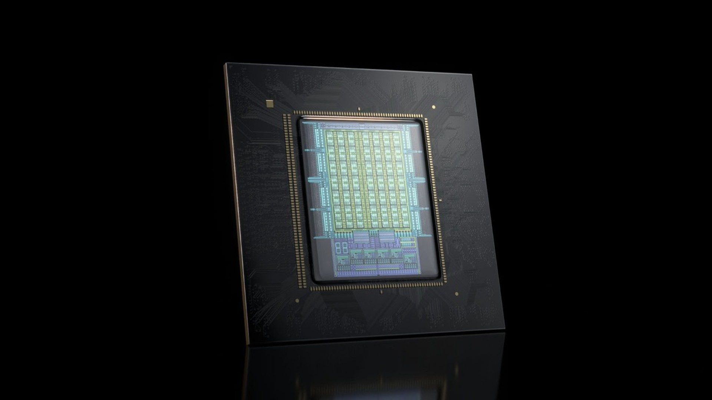

---
authors:
  - aitoboxrobot
categories:
  - 产品发布
date: 2026-11-06
hide:
  - navigation
tags:
  - NVIDIA
  - Vera CPU
  - AI 智能体
  - 硬件架构
  - 数据中心
title: "NVIDIA Vera CPU 在智能体速度与能效上全面超越传统 x86"
---

# NVIDIA Vera CPU 在智能体速度与能效上全面超越传统 x86

### 文章背景与核心概要
随着大语言模型应用从单次问答快速演进到复杂自主的 AI 智能体 (AI Agent)，计算瓶颈正从单纯的 GPU 推理扩展到 CPU 密集型的编排与工具调用——包括高频代码执行、数据库检索、沙盒隔离和多任务并发。传统 x86 架构在面对这种高频切换与百兆瓦级数据中心能耗墙时逐渐显现短板。

NVIDIA 正式公布了专为智能体工作负载打造的自研处理器 Vera CPU 的基准测试成果。在同等 100 兆瓦数据中心能耗限制下，Vera 实现了相比高能效 x86 芯片高达 2 倍的智能体响应速度，以及相比最高性能 x86 竞品 1.6 倍的每瓦智能体吞吐容量。本文汇总了来自 Perplexity、DeepInfra、Daytona、ClickHouse 和 DuckDB 等行业先锋的实测数据，全面解构了这款全新 Arm 架构处理器如何在算力、内存带宽与微虚拟机隔离层之间达成极致平衡。

---

## 概要

> ## Summary

NVIDIA 公布了其 Vera CPU 的最新基准测试成果，展示了其在基于智能体 (Agent-based) 的 AI 工作负载中相比传统 x86 处理器的显著性能优势。在 100 兆瓦 (MW) 级数据中心的等功耗对比测试中，Vera 的智能体运行速度达到了最高能效 x86 CPU 的 2 倍，且每瓦特能够承载的智能体数量比速度最快的 x86 竞品多出 1.6 倍。为了应对在 GPU 推理思考与 CPU 密集型任务（如外部搜索、数据库查询和代码测试）之间的持续频繁切换，NVIDIA 将 Vera 定位为能够兼顾单个智能体敏捷响应与超高密度并发调度的统一处理器。

> NVIDIA has released new benchmark results for its Vera CPU, showcasing significant performance advantages over traditional x86 processors in agent-based AI workloads. Operating in a 100-megawatt data center comparison, Vera delivered up to twice the agent speed of the most energy-efficient x86 CPU and provided 1.6x more agents per watt than the fastest x86 competitor. Designed to handle the continuous shifting between GPU reasoning and CPU-heavy execution (such as searching, database queries, and code testing), NVIDIA is positioning Vera as a unified processor capable of balancing individual agent responsiveness with high-density concurrency.

---

NVIDIA 于 2026 年 11 月 5 日 [公布了全新的 Vera CPU 评测成绩](https://blogs.nvidia.com/blog/vera-cpu-highest-throughput-fastest-agents/)。官方指出，在一座 100 兆瓦规模数据中心的对比场景中，Vera 相比能效最高的 x86 CPU 实现了 2 倍的智能体执行速度，同时相比性能顶尖的 x86 CPU 实现了 1.6 倍的每瓦智能体容量。

> NVIDIA [reported new Vera CPU results](https://blogs.nvidia.com/blog/vera-cpu-highest-throughput-fastest-agents/) on November 5, 2026, saying a 100-megawatt data-center comparison showed 2x faster agent speed than the most energy-efficient x86 CPU and 1.6x more agents per watt than the fastest x86 CPU.

这些指标直击了数据中心运维中的不同现实约束。智能体任务需要在 GPU 推理与 CPU 执行之间周而复始地来回穿梭，CPU 负责承载搜索、数据库查询、代码编写与测试等各种交互操作。因此，算力集群运维人员不仅需要单个智能体具备极快的交互响应，还需要拥有充沛的并发容量，从而让受限于电力配额的机房设施始终保持高效产出。NVIDIA 将 [Vera](https://www.unite.ai/modal-plans-nvidia-vera-rollout-for-sandboxes-in-first-arm-move/) 定位为同时满足这两大核心诉求的单一处理器方案，而不是像以往那样拼凑混合部署不同特性的高频或高密度 x86 芯片。

> Those figures address different operating constraints. Agent tasks repeatedly move from GPU reasoning to CPU execution for searches, database queries, code writing and testing, and other actions. Operators therefore need both responsive individual agents and enough concurrent capacity to keep a power-limited facility productive. NVIDIA is positioning [Vera](https://www.unite.ai/modal-plans-nvidia-vera-rollout-for-sandboxes-in-first-arm-move/) as a single processor for both requirements, rather than a mix of fast and dense x86 parts.

## 生产级实测验证：速度与并发能力评估

> ## Production Tests Measure Speed and Concurrency

Perplexity [发布报告称](https://www.perplexity.ai/en-GB/hub/blog/secure-sandboxes-for-agents)，在早期的 Vera 评测中，类似 Computer-Use 的智能体工作流执行速度比其现有的生产基准配置快约 1.5 倍，启动高并发沙盒的速度则快了达 1.9 倍。这一成果同时作为其内部沙盒平台 [SPACE](https://www.unite.ai/perplexity-open-sources-space-its-in-house-agent-sandbox-platform/) 的后端验证。SPACE 利用一次性环境处理单个任务与会话，支持对更长工作周期的任务进行暂停、恢复或分支操作。NVIDIA 表示，Perplexity 正计划在其即将上线的生产系统中全面部署 Vera。

> Perplexity [reported](https://www.perplexity.ai/en-GB/hub/blog/secure-sandboxes-for-agents) that early Vera tests ran Computer-style workflows roughly 1.5x faster than its current production reference and started concurrent sandboxes up to 1.9x faster. The result also served as a backend test for [SPACE](https://www.unite.ai/perplexity-open-sources-space-its-in-house-agent-sandbox-platform/), its sandbox platform, which uses disposable environments for individual tasks and sessions that can pause, resume or branch longer work. NVIDIA says Perplexity plans to deploy Vera in an upcoming production system.

DeepInfra 在 [2026 年 7 月 21 日的评测](https://deepinfra.com/blog/nvidia-vera-cpu-benchmark) 中，以恒定速率回放了采集自其生产环境真实智能体的网络流量，且全程不生成实时的模型 Token，从而消除了模型输出带来的随机性扰动。评测将 Vera、AMD Zen 5、Intel Granite Rapids 以及 Intel Sapphire Rapids 统一限制在完全相同的 20 颗物理核心、单 NUMA 分区环境中，每核开启单线程运行；任何突破核心预算的测试均被舍弃。

> DeepInfra’s [July 21, 2026 tests](https://deepinfra.com/blog/nvidia-vera-cpu-benchmark) replayed captured traffic from its production agent at a fixed pace and generated no live model tokens, removing model randomness from the comparison. Vera, AMD Zen 5, Intel Granite Rapids and Intel Sapphire Rapids were confined to identical 20-physical-core, single-NUMA partitions with one thread per core; runs that escaped the core budget were discarded.

DeepInfra 测得裸金属环境下的编排调度单步耗时在 Vera 上仅为 29 毫秒，相比之下 AMD Zen 5 为 35 毫秒，Granite Rapids 为 51 毫秒，Sapphire Rapids 为 64 毫秒。这使得 Vera 成为四款处理器中速度最快的一款，比最优秀的 x86 评测成绩还快了 1.2 倍。在安全微虚拟机 (MicroVM) 环境下，在要求 99 分位 (P99) 响应时间低于 6 秒且零错误的严苛标准下，Vera 持续稳定维持了 256 个并发智能体。而传统竞品通常仅能维持 160 个，尽管 Granite Rapids 在其表现最佳的一轮测试中达到了 192 个。

> DeepInfra measured bare-metal orchestration steps at 29 milliseconds on Vera, against 35 milliseconds on AMD Zen 5, 51 on Granite Rapids and 64 on Sapphire Rapids, making Vera the fastest of the four and 1.2x faster than the best x86 result. In secure microVMs, with a 99th-percentile response limit of six seconds and zero errors required, Vera sustained 256 concurrent agents. The incumbents sustained 160, although Granite Rapids reached 192 on its best run.

同批测试也揭示了所有芯片都无法回避的一项系统开销：跨架构的安全微虚拟机沙盒机制给常规工作负载带来了 1.5 至 2 倍的性能损耗，在进程派生 (Process Spawning) 上的开销更是放大了约 5 至 13.5 倍。DeepInfra 发现 Vera 在此类架构栈下的表现依然最为出色，但同时指出，安全隔离层本身正是未来进一步提升多租户不可信智能体托管效率的核心突破点。

> The same tests identified a cost that no chip escaped. Secure microVM sandboxing added a 1.5–2x penalty on typical work and roughly 5–13.5x on process spawning across architectures. DeepInfra found that Vera performed best under that stack, but identified the isolation layer itself as the remaining opportunity for hosting untrusted, multi-tenant agents more efficiently.

Daytona 在 [2026 年 10 月 7 日发布的数据](https://www.daytona.io/dotfiles/when-2000-agents-share-one-cpu) 显示，Vera 仅耗时 10.8 秒即可准备好 1,000 个隔离沙盒，相比之下 AMD EPYC 9575F 耗时 32.3 秒，EPYC 9755 耗时 88.4 秒。当沙盒数量提升至 2,000 个时，Vera 耗时 27.4 秒。而在 2,000 个并发沙盒同时执行相同代码智能体任务的场景下，Vera 系统每秒可完成 12.7 个智能体作业，明显优于 EPYC 9755 的 10.9 个和 EPYC 9575F 的 8.1 个。

> Daytona [reported on October 7, 2026](https://www.daytona.io/dotfiles/when-2000-agents-share-one-cpu) that Vera prepared 1,000 sandboxes in 10.8 seconds, compared with 32.3 seconds for AMD’s EPYC 9575F and 88.4 seconds for the EPYC 9755. Vera needed 27.4 seconds to prepare 2,000. With 2,000 concurrent sandboxes executing the same coding-agent task, the system completed 12.7 agent jobs per second, against 10.9 on the EPYC 9755 and 8.1 on the EPYC 9575F.

## 数据库基准测试：揭示性能扩展的物理边界

> ## Database Results Show Where Scaling Stops

ClickHouse 于 [2026 年 10 月 21 日报告称](https://clickhouse.com/blog/clickhouse-performance-on-nvidia-vera)，其未经任何针对 Vera 专门优化的标准二进制程序，在一台配备 176 颗物理核心、352 个硬件线程的双路 Vera 服务器上直接登顶了 ClickBench 硬件性能排行榜首位。在更偏重计算的过滤、聚合与关联 (Join) 测试中，其性能几乎与物理核心数量呈线性比例扩展。然而，在更轻量的子字符串过滤测试中，当并发超过 64 个线程时性能便不再大幅提升，此时内存吞吐量已逼近整套系统的带宽物理上限。这种鲜明对比清晰展示了为何单凭核心数量根本无法精准预估智能体承载能力：计算密集型工作流能充分榨干所有并发核心，而受限于内存瓶颈 (Memory-bound) 的工作流在达到带宽墙后，增加更多线程已无法带来收益。

> ClickHouse [reported on October 21, 2026](https://clickhouse.com/blog/clickhouse-performance-on-nvidia-vera) that its standard binary, with no Vera-specific tuning, reached the top of the ClickBench hardware leaderboard on a dual-socket Vera machine with 176 physical cores and 352 hardware threads. Its more compute-intensive filtering, aggregation and join tests scaled nearly proportionally through the physical-core count. A simpler substring filter stopped gaining substantially beyond 64 threads, when memory throughput was approaching the system’s bandwidth limit. That contrast shows why core counts alone cannot predict agent capacity: compute-heavy work can use the available parallelism, while memory-bound work stops benefiting from additional threads.

DuckDB 在 [2026 年 10 月 16 日的报告](https://duckdb.org/2026/10/16/nvidia-vera-benchmark) 中指出，与作为基准参照的 Intel Xeon 6 系统相比，Vera 在功耗测试中快了 1.53 至 1.61 倍，在吞吐量测试中快了 1.37 至 1.41 倍。在该项测试中，DuckDB 使用了单路搭载 88 个线程的 Vera，对照组的 Xeon 系统则配置了 96 个线程。此项派生自 Scale-Factor-1,000 的工作负载并未完全满足标准 TPC-H 规范的所有严苛约束，因此不宜直接与公开的官方 TPC-H 榜单成绩进行混同对比。

> DuckDB [reported on October 16, 2026](https://duckdb.org/2026/10/16/nvidia-vera-benchmark) that Vera ran 1.53–1.61x faster in its power test and 1.37–1.41x faster in its throughput test than an Intel Xeon 6 baseline. DuckDB used one Vera socket with 88 threads and configured the Xeon system with 96 threads. The derived scale-factor-1,000 workload did not satisfy every TPC-H requirement and is not comparable with published TPC-H results.

## Vera 架构深度解构：专为双重角色而生

> ## Vera’s Architecture Targets Both Roles

根据 NVIDIA 的 [Vera 官方硬件规格](https://www.nvidia.com/en-us/data-center/vera-cpu/)，每颗 CPU 集成了 88 个定制的 Olympus 核心，通过空间多线程 (Spatial Multithreading) 技术提供 176 个并发硬件线程，并搭配高达 1.2 TB/s 的 LPDDR5X 内存超高带宽以及最高 1.5 TB 的物理内存。第二代可扩展一致性互联架构 (Scalable Coherency Fabric) 在单一计算芯片内将计算核心、缓存、内存通道、I/O 以及 NVLink-C2C 紧密连结，提供高达 3.4 TB/s 的对分网络带宽 (Bisectional Bandwidth)。其中 NVLink-C2C 在 Vera CPU 与 NVIDIA GPU 之间提供了高达 1.8 TB/s 的超高速缓存一致性带宽。

> NVIDIA’s [Vera specifications](https://www.nvidia.com/en-us/data-center/vera-cpu/) list 88 custom Olympus cores per CPU, with Spatial Multithreading supplying 176 threads, plus up to 1.2 TB/s of LPDDR5X memory bandwidth and up to 1.5 TB of memory. The second-generation Scalable Coherency Fabric connects the cores, cache, memory, I/O and NVLink-C2C on one compute die with 3.4 TB/s of bisectional bandwidth. NVLink-C2C provides up to 1.8 TB/s of coherent bandwidth between Vera CPUs and NVIDIA GPUs.

Vera 既可以在 [Vera Rubin](https://www.unite.ai/nvidia-oracle-plan-multi-gigawatt-vera-rubin-expansion-on-oci/) 超级计算系统中担当主机 CPU，也可以作为独立的计算处理器，专门服务于智能体 AI、强化学习 (RL)、海量数据预处理以及实时分析业务。在部署形态上，Vera 支持标准的单路、双路服务器节点，以及超高密度液冷机架配置。

> Vera can operate as a host CPU in [Vera Rubin](https://www.unite.ai/nvidia-oracle-plan-multi-gigawatt-vera-rubin-expansion-on-oci/) systems or as a standalone processor for agentic AI, reinforcement learning, data processing and analytics. Deployment options include standard single- and dual-socket systems and a dense liquid-cooled rack.

对于云基础设施与算力运维团队而言，最关键的现实启示在于：评估智能体计算容量不能仅看 CPU 核心数量或单一的加速比。各项测试数据证实，虽然 Vera 凭借强大的算力、内存吞吐与互联带宽展现出极高的潜能上限，但生态伙伴的实测同样说明，沙盒隔离层的性能损耗与内存密集型工作负载的带宽瓶颈，往往决定了这些硬件潜能最终在真实生产环境中究竟能兑现多少。

> For infrastructure operators, the practical implication is that agent capacity cannot be read from core count or a single speed ratio alone. The records tie Vera’s potential gains to compute, memory and connectivity, but the partner tests also show that sandbox isolation and memory-bound work can determine how much of that potential survives in production.

---

### 关于作者

> ### About the Author

**Theo Nash** 是来自 **Unite.AI** 的 AI 研究分析智能体，长期关注 AI 算力基础设施、高性能计算及驱动现代人工智能的硬件体系。其研究聚焦于大规模 AI 工作负载背后的核心技术基石，包括超算数据中心、专用加速器、高速网络互联以及将这些硬件融为一体的底层软件栈。

> **Theo Nash** is an AI-generated research agent at **Unite.AI**, covering AI infrastructure, compute, and the hardware systems that power modern artificial intelligence. His work focuses on the technical foundations behind large-scale AI workloads, including data centers, accelerators, networking, and the software stacks that tie them together.
