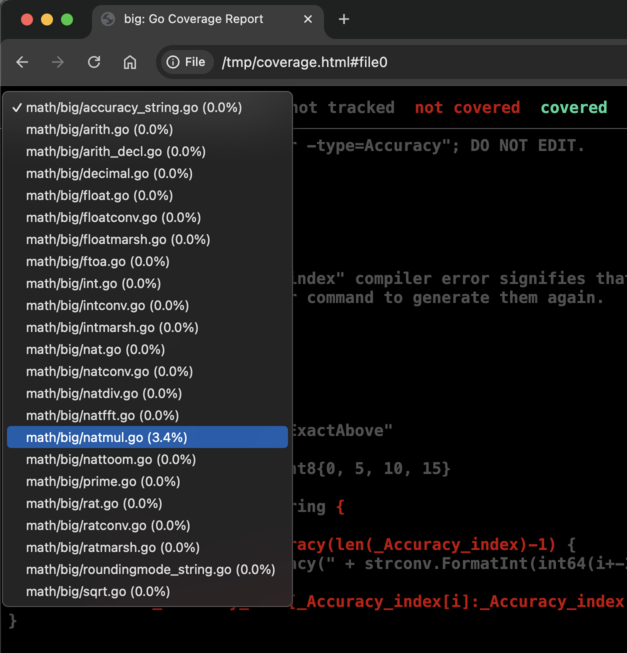
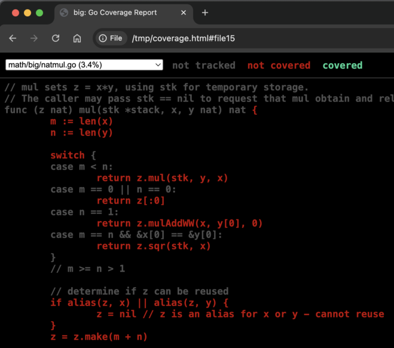
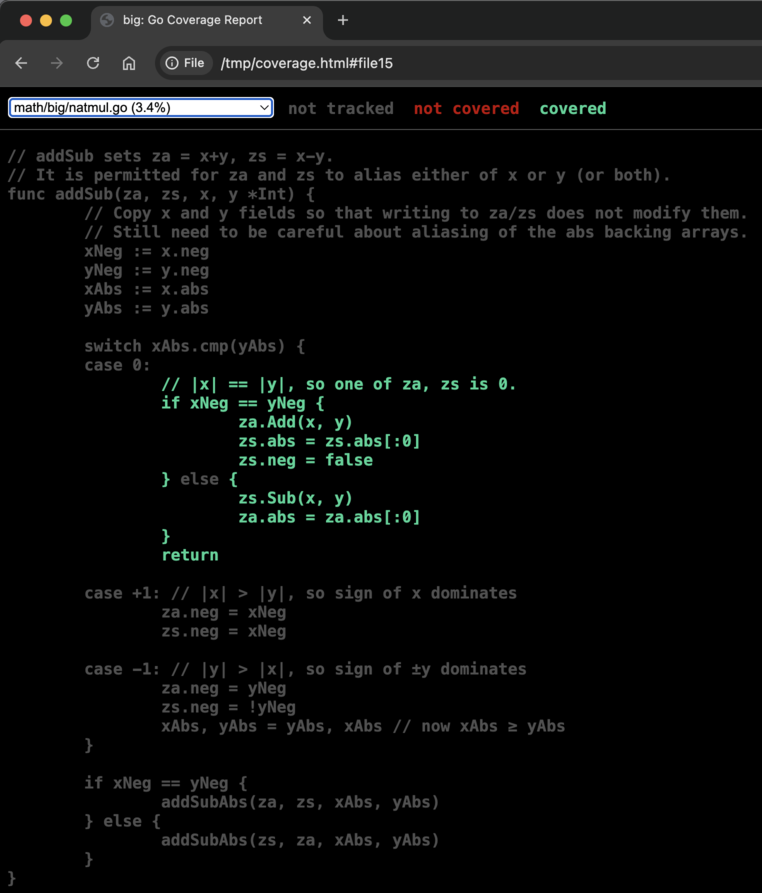

---
authors:
  - aitoboxrobot
categories:
  - 工具教程
date: 2026-11-06
hide:
  - navigation
tags:
  - Go语言
  - 自动化测试
  - 差异覆盖率
  - 软件调试
  - 代码质量
title: "使用差异覆盖率精准定位代码缺陷：一种高效的软件调试技术"
---

# 使用差异覆盖率精准定位代码缺陷：一种高效的软件调试技术

### 文章背景与核心概要
在大型未知代码库中面对单条莫名失败的测试用例时，传统的单步断点与日志排查往往耗时费力。Go 核心团队专家 Russ Cox 介绍了一种巧妙而轻量的调试利器 —— **差异覆盖率 (Differential Coverage)**。该技术通过收集成功测试集与失败测试各自的代码覆盖率数据，利用简单的差集比对，一键剥离出“仅在失败测试中运行”的代码分支。在超过 15,000 行的大型数学库中，它瞬间将怀疑范围收敛至仅 10 行代码，并精准指明错误诱因。本文深入拆解其实战工作流，并拓展至单用例分析与快速定位陌生模块实现的探索场景。

---

## 概要

> ## Summary

当面对未知代码库中的单个测试用例失败时，传统调试手段可能会耗费大量时间。**差异覆盖率 (Differential Coverage)** 是一项极其强大的技术，它通过将通过测试集的代码覆盖率与失败测试的覆盖率进行比对，精准剥离出导致失败的独有代码路径。通过生成并比对覆盖率配置文件 (Coverage Profile)，开发者能够以极快速度锁定可疑代码块 —— 通常能将数万行庞大代码的排查范围收缩至寥寥数行。

> When facing a single failing test case in an unfamiliar codebase, traditional debugging can be time-consuming. **Differential coverage** is a powerful technique that compares the code coverage of passing tests against a failing test to isolate what is unique to the failure. By generating and diffing coverage profiles, developers can quickly pinpoint suspicious code blocks—often narrowing down thousands of lines of code to just a handful.

---

## 引言

> ## Introduction

在调试一段并非由我编写的代码时，我想起了这项技术。我确信这是一个历史悠久的经典调试思路（就像 [二分排查法 / Bisection](https://research.swtch.com/bisect) 一样），但它绝对值得被更广泛的工程师所熟知。

> While debugging code I did not write, I was reminded of this technique. I’m sure it’s a very old debugging idea (much like [bisection](https://research.swtch.com/bisect)), but it deserves to be more widely known.

假设你遇到了一个失败的测试用例。通过比对通过测试与失败测试之间的代码覆盖率差异，你就能迅速直观地感知哪些代码参与了此次异常。

> Suppose you have one test case that’s failing. You can get a sense of what code might be involved by comparing the code coverage of successful tests with the code coverage of the failing test.

举个例子，我在本地开发分支的 `math/big` 库中故意植入了一个缺陷：

> For example, I’ve inserted a bug into my development copy of `math/big`:

```bash
$ go test
--- FAIL: TestAddSub (0.00s)
    int_test.go:2020: addSub(-0xffffffffffffffffffffffffffffffffffffffffffffffffffffffffffffffff, 0xffffffffffffffffffffffffffffffffffffffffffffffffffffffffffffffff) = -0x0, -0x1fffffffffffffffffffffffffffffffffffffffffffffffffffffffffffffffe, want 0x0, -0x1fffffffffffffffffffffffffffffffffffffffffffffffffffffffffffffffe
FAIL
exit status 1
FAIL	math/big	7.528s
$
```

---

## 采集与差异比对覆盖率配置

> ## Collecting and Diffing Profiles

首先，让我们分别采集通过用例和失败用例的覆盖率数据：

> First, let’s collect a passing and failing profile:

```bash
$ go test -coverprofile=c1.prof -skip='TestAddSub$'
PASS
coverage: 85.0% of statements
ok  	math/big	8.373s
$ go test -coverprofile=c2.prof -run='TestAddSub$'
--- FAIL: TestAddSub (0.00s)
    int_test.go:2020: addSub(-0xffffffffffffffffffffffffffffffffffffffffffffffffffffffffffffffff, 0xffffffffffffffffffffffffffffffffffffffffffffffffffffffffffffffff) = -0x0, -0x1fffffffffffffffffffffffffffffffffffffffffffffffffffffffffffffffe, want 0x0, -0x1fffffffffffffffffffffffffffffffffffffffffffffffffffffffffffffffe
FAIL
coverage: 4.7% of statements
exit status 1
FAIL	math/big	0.789s
$
```

现在，我们通过比对两个文件，提取出一份仅展示该失败测试所独有的代码覆盖率文件：

> Now we can diff them to make a profile showing what’s unique about the failing test:

```bash
$ (head -1 c1.prof; diff c[12].prof | sed -n 's/^> //p') >c3.prof
$ go tool cover -html=c3.prof
```

- `head -1`：保留覆盖率文件首行的单行配置标头。
- `diff | sed`：仅保留失败测试覆盖率中独有的行变更。
- `go tool cover -html`：在浏览器中以可视化网页方式打开最终的差异报告。

> * The `head -1` preserves the one-line coverage profile header. 
> * The `diff | sed` saves only the lines unique to the failing test’s profile.
> * The `go tool cover -html` opens the profile in a web browser.

---

## 深入分析比对结果

> ## Analyzing the Results

在生成的覆盖率报告中，“已覆盖（绿色）”意味着该段代码在失败用例中运行了、但在所有通过用例中均未被执行 —— 这正是我们最需要严密审视的对象。纵观文件列表，只有 `natmul.go` 的覆盖率百分比不为零，这意味着它包含了唯独在失败测试中才会走到的代码分支。

> In the resulting profile, “covered” (green) means it ran in the failing test but not the passing ones, making it something to take a closer look at. Looking at the file list, only `natmul.go` has a non-zero coverage percentage, meaning it contains lines that are unique to the failing test.



打开 `natmul.go`，我们能看到大量被标记为红色的代码行（即“未覆盖”）：

> If we open `natmul.go`, we can see various lines in red (“uncovered”).



这些红色代码行在通过的测试中正常执行，但在本次失败测试中并未触发。它们已经被排除了嫌疑；不过，通常能够正常运行的代码在失败用例中反而被跳过这一事实，有时也能促使我们提出极具价值的追问：究竟是什么逻辑分支导致它们被跳过了？而在本例中，原因很简单：单纯是该用例没有覆盖到这些功能，`nat.mul` 方法在此次执行中根本没有被调用。

> These lines ran in passing tests but not in the failing test. They are exonerated, although the fact that the lines normally run but were skipped in the failing test may prompt useful questions about what logic led to them being skipped. In this case, it’s just that the test does not exercise them: the `nat.mul` method has not been called at all.

继续向下滚动，我们找到了全篇唯一一处高亮的绿色区域：

> Scrolling down, we find the one section of green.



这段代码正是我故意插入缺陷的位置：`else` 分支中遗漏了 `za.neg = false`，从而在测试中输出了错误的 `-0x0`。差异覆盖率的计算与可视化极为轻量，一旦命中，能节省巨量的调试时间。在超过 15,000 行的代码库中，差异覆盖率只挑出了 10 行，其中就直接包含了那 2 行致命代码。

> This code is where I inserted the bug: the `else` branch is missing `za.neg = false`, producing the `-0x0` in the test failure. Differential coverage is cheap to compute and display, and when it’s right, it can save a lot of time. Out of over 15,000 lines of code, differential coverage identified 10, including the two relevant ones.

---

## 局限性与拓展应用场景

> ## Limitations and Alternative Uses

当然，这项技术并不是万能的：如果缺陷强依赖于特定输入数据，或者测试用例对特定的逻辑偏差不敏感，那么包含缺陷的代码也可能在通过的测试集中被静默执行。但在绝大多数情况下，有缺陷的代码往往只会触发失败。在那些场景下，差异覆盖率能够一针见血地框定最值得仔细审视的代码核心。

> Of course, this technique is not foolproof: a passing test can still execute buggy code if the bug is data-dependent, or if the test is not sensitive to the specific mistake in the code. But a lot of the time, buggy code only triggers failures. In those cases, differential coverage pinpoints the code blocks that merit a closer look.

你可以在此 [查看完整的覆盖率报告示例](https://research.swtch.com/bigcover.html)。

> You can [see the full profile here](https://research.swtch.com/bigcover.html).

### 单测试用例覆盖率分析

> ### Single Test Coverage

一个更简单但同样极为实用的技巧，是直接查看单个失败测试的基础覆盖率报告。这能让你准确了解该测试到底触发了哪些代码段，进而指导调试方向：未执行的代码绝对不是问题所在。如果你困惑于某个函数究竟是如何返回特定错误的，覆盖率可以精确指出错误返回的具体代码行。在上面的示例中，失败的测试实际上仅覆盖了 4.7% 的代码。

> A simpler but still useful technique is to view the basic coverage profile for a single failing test. That gives you an accurate picture of which sections of code ran in the test, which can guide your debugging: code that didn’t run is not the problem. And if you are confused about how exactly a particular function returned an error, the coverage pinpoints the exact error line. In the example above, the failing test covered only 4.7% of the code.

### 探索陌生代码库

> ### Exploring Codebases

差异覆盖率同样可以应用于全绿的测试中。比如，想要快速找出 [net/http 中实现 SOCKS5 代理的核心代码](https://research.swtch.com/httpcover.html) 吗？

> Differential coverage also works for passing tests. Want to find the [code that implements the SOCKS5 proxy in net/http](https://research.swtch.com/httpcover.html)?

```bash
$ go test -short -skip=SOCKS5 -coverprofile=c1.prof net/http
$ go test -short -run=SOCKS5 -coverprofile=c2.prof net/http
$ (head -1 c1.prof; diff c[12].prof | sed -n 's/^> //p') >c3.prof
$ go tool cover -html=c3.prof
```

尽情享受高效调试的乐趣吧！

> Have fun!
