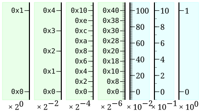
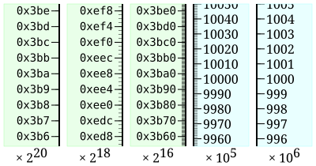
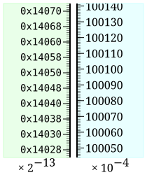
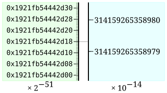
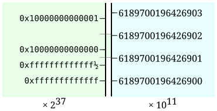
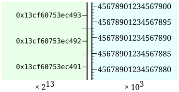
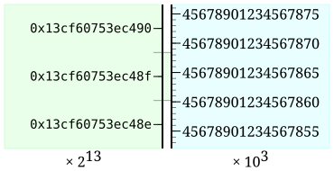
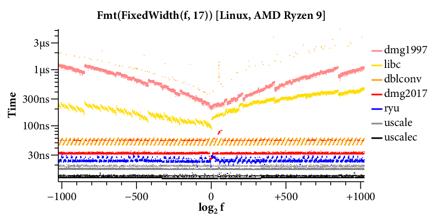

---
authors:
  - aitoboxrobot
categories:
  - 研究解读
date: 2026-11-06
hide:
  - navigation
tags:
  - 浮点数
  - 算法优化
  - 性能优化
  - 精度计算
title: "浮点数打印与解析亦可兼得极简与极致速度"
---

# 浮点数打印与解析亦可兼得极简与极致速度

### 文章背景与核心概要
在计算机科学中，二进制浮点数与十进制字符串之间的相互转换（打印与解析）历来被视为极其复杂且易生暗坑的底层难题。长久以来，业界普遍认为在算法的极简性与运行速度之间必须做出妥协，催生出了 Dragon4、Grisu3、Ryū 以及 Dragonbox 等各具复杂度与专有技巧的“屠龙”算法。本文提出了一种全新的通用计算原语——未舍入缩放 (Unrounded Scaling)，通过 128 位中间精度与追踪舍入余数的“粘滞位”设计，巧妙统一了浮点数的打印与解析过程。该方案不仅实现代码极其精炼直观，更通过深度优化乘法进位处理将核心运算简化为单次 64 位乘法，在各项基准测试中性能全面比肩甚至超越了现有的顶尖算法，证明了浮点数格式转换完全可以同时做到极致简洁与飞速执行。

---

## 概要

> ## Summary

本文证明，借助名为**未舍入缩放** (Unrounded Scaling) 的简洁通用原语，我们能够构建出兼具极高速度与完全精度的浮点数打印与解析算法。通过引入 128 位精度以及用于追踪舍入信息的“粘滞位” (Sticky bit)，新算法在性能上全面超越了 Dragon4、Grisu3、Ryū 和 Dragonbox 等现有主流解决方案。该算法实现极为精简，其性能跃升的核心在于优化了关键缩放操作，使得大多数情况下仅需执行一次单宽度的 64 位乘法即可完成转换。

> This post demonstrates that fast, accurate floating-point printing and parsing can be achieved through a simple, unified primitive called **unrounded scaling**. By using 128-bit precision and a "sticky bit" to track rounding information, we can build algorithms that outperform existing solutions like Dragon4, Grisu3, Ryū, and Dragonbox. The implementation is concise, and the performance gains are achieved by optimizing the core scaling operation to often require only a single 64-bit multiplication.

---

## 引言

> ## Introduction

浮点数 $f$ 在计算机底层通常表示为 $f = m \cdot 2^e$，其中 $m$ 代表尾数 (Mantissa)，$e$ 代表指数 (Exponent)。鉴于人类天然习惯十进制表达，计算机系统必须借助特定算法在二进制浮点数与十进制文本之间进行精准的双向转换。过去，学术界与工业界一直普遍认为算法的实现简洁性与执行速度难以两全；而本文的研究明确表明，速度飞快的转换器同样可以设计得非常简明优雅。

> A floating-point number $f$ is represented as $f = m \cdot 2^e$, where $m$ is the mantissa and $e$ is the exponent. Because humans prefer decimal, computers require algorithms to convert between binary floating-point and decimal text. While previously thought to be a trade-off between simplicity and speed, this post demonstrates that fast converters can be simple.

其核心构想在于**快速未舍入缩放** (Fast Unrounded Scaling)，该操作用于高效计算 $x \cdot 2^e \cdot 10^p$ 的高精度近似值。以此为基石，我们可以构建出逻辑极为简单且性能卓越的浮点数打印与解析算法。

> The core idea is **fast unrounded scaling**, which computes an approximation to $x \cdot 2^e \cdot 10^p$. This foundation allows for nearly trivial, high-performance printing and parsing algorithms.

---

## 定点数与浮点数

> ## Fixed-Point and Floating-Point Numbers

定点数 (Fixed-Point Number) 的数学形式通常记为 $f = m \cdot B^e$。本质上，浮点数就是一种以 2 为基数（$B=2$）的定点数，只不过其指数 $e$ 会根据数值动态调整，从而确保尾数 $m$ 始终落在特定的固定区间内（例如在标准的 float64 双精度浮点数中，尾数区间为 $[2^{52}, 2^{53})$）。

> Fixed-point numbers take the form $f = m \cdot B^e$. Floating-point numbers are essentially base-2 fixed-point numbers where the exponent $e$ adjusts to keep the mantissa $m$ within a fixed range (e.g., $[2^{52}, 2^{53})$ for float64).

---

## 未舍入数

> ## Unrounded Numbers

为了在数值缩放过程中始终牢牢保持精度，我们引入了**未舍入数** (Unrounded Numbers) $\langle x \rangle$ 的概念。它保存了实数 $x$ 截断后的整数部分，并附加了两个额外的指示位：
1. **半位 (Half bit)**：指示小数部分是否大于等于 0.5（即 $\ge 0.5$）；
2. **粘滞位 (Sticky bit)**：指示小数部分是否存在非零余数（即是否严格大于 0）。

> To maintain precision during scaling, we use **unrounded numbers** $\langle x \rangle$, which store the truncated integer part of $x$ plus two extra bits:
> 1. The **half bit**: Indicates if the fractional part is $\ge 0.5$.
> 2. The **sticky bit**: Indicates if the fractional part is non-zero.

这种精巧的位表示结构使得我们仅凭简单的位运算，就能轻而易举地实现包括向下取整 (floor)、向上取整 (ceil) 以及就近舍入到偶数 (round-to-even) 在内的各类严格舍入模式。

> This representation allows for correct rounding (floor, ceil, round-to-even) using simple bitwise operations.

---

## 未舍入缩放

> ## Unrounded Scaling

核心计算原语 `uscale(x, e, p)` 负责准确计算 $\langle x \cdot 2^e \cdot 10^p \rangle$。通过结合预先计算好的 10 的幂次常数查找表以及 128 位的中间精度运算，我们能够极其高效地完成这一缩放操作。

> The primitive `uscale(x, e, p)` computes $\langle x \cdot 2^e \cdot 10^p \rangle$. By using a precomputed table of powers of 10 and 128-bit intermediate precision, we can perform this scaling efficiently.

---

## 固定宽度打印

> ## Fixed-Width Printing

固定宽度打印 (Fixed-Width Printing) 的目标是计算浮点数对应的指定 $n$ 位有效数字十进制形式。我们只需推导出一个合适的 10 的幂次 $p$，使得 $m \cdot 2^e \cdot 10^p \in [10^{n-1}, 10^n)$ 成立，随后调用 `uscale` 即可直接求得目标十进制整数尾数 $d$，最后完成字符串格式化输出。

> Fixed-width printing computes the $n$-digit decimal form of a float. By deriving the required power $p$ such that $m \cdot 2^e \cdot 10^p \in [10^{n-1}, 10^n)$, we can use `uscale` to find the integer mantissa $d$ and then format it.

---

## 十进制字符串解析

> ## Parsing Decimals

解析十进制数本质上是打印输出的逆过程。给定十进制形式 $d \cdot 10^p$，我们首先寻找一个合适的 2 的幂指数 $e$，将该数值准确映射到 float64 的合法数值区间内，然后直接运用 `uscale` 精确计算出对应的二进制尾数。

> Parsing is the inverse of printing. Given a decimal $d \cdot 10^p$, we find an exponent $e$ that maps the value into the float64 range and use `uscale` to compute the binary mantissa.

---

## 最短宽度打印

> ## Shortest-Width Printing

最短宽度打印 (Shortest-Width Printing) 旨在寻找能够精准无歧义地舍入回原始 float64 数值的最短十进制字符串表示。这需要精确计算浮点数的“足迹” (Footprint，即相邻两个浮点数中点之间的区间距离），并从中挑选落在该有效合法范围内的最短十进制表示。

> Shortest-width printing finds the shortest decimal representation that rounds back to the original float64. This involves calculating the "footprint" (the distance between midpoints of adjacent floats) and choosing the decimal representation that falls within the valid range.

---

## 快速未舍入缩放

> ## Fast Unrounded Scaling

算法具体实现采用了 128 位的 10 的幂次常数表。通过在乘法过程中精细追踪并控制进位信息，我们可以在大部分情况下直接忽略 128 位乘积的低位部分，从而将整个耗时的多精度运算在很多场景下精简为单次高效的 64 位乘法。

> The implementation uses a 128-bit table of powers of 10. By carefully managing the carry bits during multiplication, we can often skip the lower half of the 128-bit product, reducing the operation to a single 64-bit multiplication in many cases.

---

## 性能基准测试

> ## Performance

多项基准测试 (Benchmark) 结果表明，基于未舍入缩放的算法在执行速度上持续超越或持平于当前业界公认的高性能库（包括 Ryū、Dragonbox 以及主流标准 C 语言运行时库实现）。

> Benchmarks show that unrounded scaling consistently outperforms or matches existing libraries like Ryū, Dragonbox, and standard C library implementations.

---

## 发展历程与相关工作

> ## History and Related Work

本文呈现的算法体系集成了数十年来计算数学领域的研究精粹：从 Goldstein 和 Von Neumann 早在 1947 年奠定的开拓性先驱工作，到 1970 年 University of Michigan 团队创造性提出的“粘滞位”理论，再到现代具有里程碑意义的 Ryū 与 Dragonbox 算法。本项工作站在巨人的肩膀上，将看似“显而易见”的基础算术规律提炼升华为了一个极速、统一的现代算法框架。

> The algorithms presented here synthesize decades of research, from the early work of Goldstein and Von Neumann (1947) to the development of the "sticky bit" at the University of Michigan (1970) and modern algorithms like Ryū and Dragonbox. This work stands on the shoulders of giants, refining the "obvious" into a fast, unified framework.

---

## 总结

> ## Conclusion

凭借极其短小的代码，浮点数的打印与解析同样可以跑得飞快。曾经困扰系统程序员数十年的“打印算法之龙”已被彻底征服。

> Floating-point printing and parsing can be done quickly with minimal code. The dragons have been vanquished.
