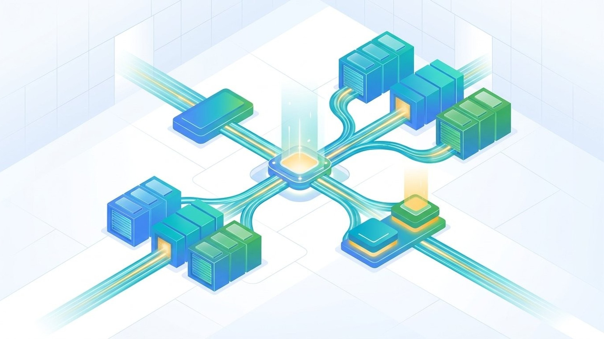

---
authors:
  - aitoboxrobot
categories:
  - 产品发布
date: 2026-11-11
hide:
  - navigation
tags:
  - TPU
  - Google Cloud
  - Pathways
  - 分布式训练
  - GKE
title: "Google Cloud Pathways 运行时在 GKE 上正式商用：为超大规模 TPU 集群打造统一控制平面"
---

# Google Cloud Pathways 运行时在 GKE 上正式商用：为超大规模 TPU 集群打造统一控制平面

### 文章背景与核心概要
在大模型与前沿多模态架构迈向万亿参数的时代，如何高效协同与调度成千上万颗 AI 芯片，是分布式机器学习领域面临的最核心瓶颈。Google Cloud 近日正式宣布，其划时代的分布式运行时 Cloud Pathways 在 Google Kubernetes Engine (GKE) 上进入正式商用 (General Availability, GA) 阶段。这项底层技术最初由 Google DeepMind 研发，曾作为孵化 Gemini 等旗舰前沿模型的核心算力中枢，通过颠覆性的单一控制器架构，彻底摆脱了传统多控制器 JAX 方案中局部视角受限与协调脆弱的困境。无论是面对硬件故障时的秒级透明重分片与弹性自愈，还是支撑数万颗 TPU 芯片的高吞吐训练与强化学习推理，Pathways 在 GKE 上的落地商用，都为超大规模 AI 算力集群的基础设施管理树立了全新标杆。

---

## 概述

> ## Summary

Google Cloud 正式宣布 **Cloud Pathways** 在 Google Kubernetes Engine (GKE) 上进入全面商用 (General Availability, GA) 阶段。该分布式机器学习 (ML) 运行时最初由 Google DeepMind 研发，专用于训练 Gemini 等前沿基座大模型，能为超大规模、异构的 TPU 计算集群提供先进的单一控制器 (Single-Controller) 架构。在正式发布前的短短 90 天内，各类用户通过 GKE 上的 Pathways 已经处理了超过 1.3 亿个 Cloud TPU 芯片时 (chip-hours) 的计算负载。该运行时不仅大幅简化了节点间的协同开销，显著提升了遇到硬件故障时的弹性恢复能力，还能够轻松扩展至数千颗 TPU 芯片上高效运转。

> Google Cloud has announced the General Availability (GA) of **Cloud Pathways** on Google Kubernetes Engine (GKE). Originally designed by Google DeepMind to train frontier models like Gemini, the distributed ML runtime offers a single-controller architecture for massive, heterogeneous TPU fleets. Within the first 90 days leading up to the announcement, users processed over 130 million Cloud TPU chip-hours using Pathways on GKE. The runtime simplifies coordination overhead, enhances elastic recovery, and scales efficiently across thousands of TPU chips.

---

## 跨 TPU 切片的统一控制器

> ## One Controller Across TPU Slices

在传统的默认多控制器 JAX 架构下，一旦计算规模扩大，系统就会变得异常复杂且脆弱，因为每一台 TPU 宿主机都必须运行独立的 Python 解释器，并且仅拥有自身所连设备的局部视角。

> Default multi-controller JAX setups can become complex and brittle at scale, requiring every TPU host to run a separate Python interpreter with only a local view of connected devices.

Cloud Pathways 彻底重构了这种模式，它基于开源的临时框架运行时 (Interim Framework Runtime) 构建了统一控制器。只需配合 `pathwaysutils` 将环境变量设置为 `JAX_PLATFORMS=proxy`，单个 JAX 客户端就能以全局视角编排跨越数千颗芯片的多个大型 TPU 切片 (TPU Slices)，操作体验犹如直接连接在本地设备上一样流畅。

> Cloud Pathways solves this by replacing that arrangement with a unified controller built on the open-source Interim Framework Runtime. By setting `JAX_PLATFORMS=proxy` alongside `pathwaysutils`, a single JAX client can view and orchestrate multiple large TPU slices spanning thousands of chips as if they were connected locally.

该统一控制器的核心能力包括：

> Key capabilities of the unified controller include:

* **计算图求值与编译缓存 (Graph Evaluation & Caching)**：统一管理计算图求值流程，并在 Cloud Storage 中实现持久化的编译缓存。
* **异步调度分发 (Asynchronous Dispatch)**：负责在不同 TPU 切片之间高效处理 XLA 计算任务的异步分发。
* **同机部署 Sidecar 容器 (Colocated Sidecars)**：支持共享内存的 Python Sidecar 容器可直接在 TPU 宿主机上运行分布式数据加载与模型检查点 (Checkpointing) 保存等高算力消耗任务。
* **弹性自愈训练 (Elastic Training)**：借助宿主机内存快照技术，当发生硬件中断故障时，能够无缝地将训练作业动态重新分片 (Reshard) 到少一个切片的剩余硬件上继续运行，而不会导致主客户端崩溃中断。
* **灵活的资源接入与共享 (Flexible Access)**：全面支持交互式 Notebook、终端命令行，以及 *共享 Pathways 服务 (Shared Pathways Service)*，允许多位用户按需共享同一个长期运行的 TPU 切片资源池。

> * **Graph Evaluation & Caching:** Manages graph evaluation and persistent compilation caching in Cloud Storage.
> * **Asynchronous Dispatch:** Handles the asynchronous dispatch of XLA work across various slices.
> * **Colocated Sidecars:** Python sidecar containers with shared-memory support run compute-intensive tasks—such as distributed data loading and checkpointing—directly on TPU hosts.
> * **Elastic Training:** Uses host-memory snapshots to seamlessly reshard jobs onto one fewer slice after hardware interruptions without crashing the client.
> * **Flexible Access:** Supports interactive notebooks, terminals, and a *Shared Pathways Service* that lets multiple users draw from a long-running pool of TPU slices.

---

## 生产落地与弹性故障自愈

> ## Production Use and Elastic Recovery

众多知名企业与前沿科研机构已经开始将 Cloud Pathways 应用于高强度的生产级工作负载中：

> Enterprise and research organizations are already leveraging Cloud Pathways for heavy workloads:

* **消费级科技巨头 (Consumer Technology)**：某大型消费科技企业在由数万颗 TPU v5p、Trillium v6e 和 Ironwood TPU7x 芯片构成的集群上，运行生产级批处理与强化学习推理任务，每季度消耗的计算量超过 1 亿芯片时。
* **ZenteiQ 机构**：在将该技术栈应用于科学基座模型的研发中，ZenteiQ 在 GKE 上结合 Cluster Toolkit 和宿主机快照技术，利用 Cloud Pathways 实现了基于 MaxText 的弹性预训练和强化学习。创始人 Sashikumaar Ganesan 指出，动态网格拓扑重映射 (Dynamic Re-meshing) 与秒级快速恢复能力大幅缩短了系统停机等待时间，使 TPU 算力能够始终保持满负荷运转。

> * **Consumer Technology:** A major consumer tech company runs production batch and reinforcement-learning inference on tens of thousands of TPU v5p, Trillium v6e, and Ironwood TPU7x chips, consuming over 100 million chip-hours per quarter.
> * **ZenteiQ:** Applying the stack to scientific foundation models, ZenteiQ utilizes Cloud Pathways on GKE with Cluster Toolkit and host snapshotting for elastic MaxText pre-training and reinforcement learning. Founder Sashikumaar Ganesan noted that the dynamic re-meshing and rapid recovery significantly minimize downtime and keep TPU capacity fully utilized.

---

## GKE 正式可用与 Slurm 预览支持

> ## GKE Availability and Slurm Preview

* **GKE 正式商用 (GKE)**：Cloud Pathways 现已在所有支持 Cloud TPU v5e、TPU v5p、Trillium TPU v6e 及 Ironwood TPU 7x 的 Google Cloud 区域中正式面向 GKE 用户商用，并提供了适配 JAX 0.10.1 及更高版本的带版本容器镜像。
* **Slurm 预览支持 (Slurm Preview)**：通过与 Cluster Director 的独立集成，Cloud Pathways 的能力进一步延伸至 Slurm TPU 集群——将统一的多切片 JAX 执行、弹性自愈训练以及交互式 Notebook 全面带入预览 (Preview) 阶段。

> * **GKE:** Cloud Pathways is now generally available on GKE in all Google Cloud regions supporting Cloud TPU v5e, TPU v5p, Trillium TPU v6e, and Ironwood TPU 7x, with versioned container images supporting JAX 0.10.1 and later.
> * **Slurm (Preview):** A separate integration with Cluster Director extends Cloud Pathways to Slurm TPU clusters—bringing unified multi-slice JAX execution, elastic training, and interactive notebooks into Preview status.
