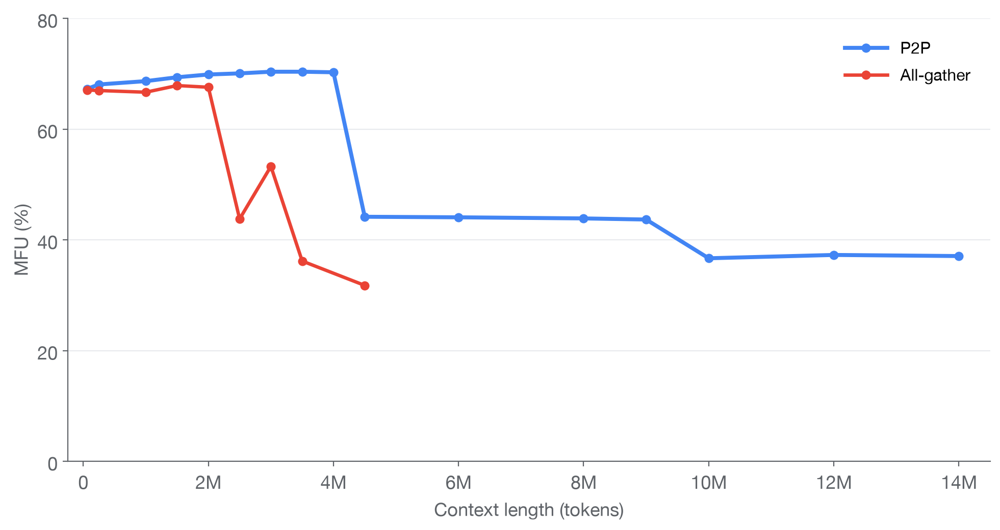

---
authors:
  - aitoboxrobot
categories:
  - 工具教程
date: 2026-11-11
hide:
  - navigation
tags:
  - MaxText
  - TPU
  - 长上下文
  - 上下文并行
  - Splash Attention
title: "MaxText 推出上下文并行技术：在 TPU 上实现数百万 Token 级别长上下文训练"
---

# MaxText 推出上下文并行技术：在 TPU 上实现数百万 Token 级别长上下文训练

**Published:** Nov. 9, 2026  
**Authors:** Michael Tran (Software Engineering Intern, Google Cloud), Nuojin Cheng (Software Engineer, Google Cloud), Deepak Patil (Group Product Manager)  
**Categories:** AI, Cloud, Announcements

### 文章背景与核心概要
随着人工智能应用向超长代码库分析、数小时超长视频理解以及复杂长链路 AI 智能体任务演进，大语言模型 (Large Language Model, LLM) 对上下文长度的需求正呈爆发式增长，迈向百万乃至千万级 Token 的时代。然而，序列长度的飙升带来了计算量平方级膨胀、高带宽内存 (High-Bandwidth Memory, HBM) 显存告急以及跨设备通信瓶颈等严峻挑战。Google Cloud 宣布在其开源训练框架 MaxText v0.2.4 中，正式引入基于 Cloud TPU 的原生上下文并行 (Context Parallelism, CP) 技术，并深度整合 OpenXLA Tokamax 的 Splash Attention 加速算子。通过 All-gather、All-to-All、Ring Attention 及混合 USP 四大多元并行策略，MaxText 在 TPU 5p 上实现了高达 400 万 Token 训练时保持 70% 的模型 FLOPs 利用率 (Model FLOPs Utilization, MFU) ，并在新一代 TPU 7 (Ironwood) 上无缝扩展至 1400 万 Token，为超长上下文大模型的高效规模化训练奠定了全新基石。

---

## 📌 执行摘要

> ## 📌 Executive Summary

长上下文训练已成为现代 AI 模型不可或缺的基石，它赋予了大语言模型 (Large Language Model, LLM) 吞吐海量代码仓库、解析数小时高清视频以及执行复杂长链路智能体任务的强大能力。然而，当序列长度扩展到数百万个 Token 时，注意力机制计算量、内存占用以及芯片间的通信开销都会遭遇极其严峻的系统瓶颈。

> Long-context training has become foundational for modern AI models, enabling large language models (LLMs) to ingest massive code repositories, hours of video, and execute complex agentic tasks. However, scaling sequence lengths to millions of tokens introduces significant bottlenecks in attention compute, memory, and communication. 

Google Cloud 宣布在 **MaxText v0.2.4** 中基于 Cloud TPU 基础设施原生支持长上下文训练。通过融合四种截然不同的上下文并行策略，并结合来自 OpenXLA 的 **Tokamax Splash Attention 算子**，MaxText 展现出了令人瞩目的硬件运行效率 —— 例如在 TPU 5p 上处理长达 400 万 Token 的序列时，依然能够维持 **70% 的模型 FLOPs 利用率 (Model FLOPs Utilization, MFU)** ，而在新一代 TPU 7 (Ironwood) 上更是能无缝扩展至 1400 万 Token 规模的训练。

> Google Cloud has announced native long-context training support in **MaxText v0.2.4** using Cloud TPU infrastructure. By leveraging four distinct context-parallel strategies combined with the **Tokamax Splash Attention kernel**, MaxText achieves exceptional efficiency—such as maintaining **70% Model FLOPs Utilization (MFU)** on TPU 5p for sequence lengths up to 4 million tokens, and scaling seamlessly up to 14 million tokens on TPU 7 (Ironwood).

---

## 引言：千万级 Token 时代的严峻挑战

> ## Introduction: The Multi-Million-Token Challenge

随着上下文窗口从过去的 128K–200K Token 飞速跃升至 100 万到 200 万 Token，甚至千万级 Token 的模型也已呼之欲出，在如此超大规模下进行训练暴露出了底层的关键系统瓶颈：

> As context windows expand rapidly from 128K–200K tokens to 1M–2M—with 10M-token models on the horizon—training at these scales reveals critical system limitations:

1. **注意力计算开销**：自注意力计算的浮点运算次数 (FLOPs) 随序列长度呈二次方级增长，使得注意力机制逐渐主导了单步训练耗时。系统的整体吞吐量 (Throughput) 极大程度上依赖于高度优化的注意力算子。
2. **内存与通信瓶颈**：随着序列变长，中间激活值 (Activation) （包括每个 Token 的 Key 和 Value）呈线性急剧攀升。如果简单地采用单芯片完整复制等初级策略，将瞬间耗尽高带宽内存 (High-Bandwidth Memory, HBM) 并导致显存溢出 (Out-Of-Memory, OOM) 崩溃。而上下文并行 (Context Parallelism, CP) 技术通过流式传递 Key 和 Value、避免将其完整实例化，从而优雅地化解了这一危机。

> 1. **Attention Compute:** Attention FLOPs grow quadratically with sequence length, causing attention to dominate the training step. Throughput relies heavily on optimized attention kernels.
> 2. **Memory and Communication:** Activations (including keys and values for every token) scale with sequence length. Naive approaches like full chip replication exhaust High-Bandwidth Memory (HBM) and trigger Out-Of-Memory (OOM) errors. Context Parallelism (CP) solves this by streaming keys and values instead of materializing them fully.

针对这些系统性难题，MaxText 提供了四种针对性的上下文并行策略：**全收集 (All-gather)** 、**全对全通信 (All-to-All, DeepSpeed Ulysses)** 、**点对点环状注意力 (P2P, Ring Attention)** ，以及融合二者的 **A2A + P2P 混合模式 (统一序列并行，Unified Sequence Parallelism, 简称 USP)** 。

> MaxText addresses these challenges through four context-parallel strategies: **All-gather, A2A (DeepSpeed Ulysses), P2P (Ring Attention)**, and the **A2A + P2P hybrid (Unified Sequence Parallelism, or USP)**.

---

## MaxText 中的四种上下文并行策略

> ## Context Parallelism Strategies in MaxText

上下文并行 (Context Parallelism) 的核心思想是将超长序列切分打散到多个计算芯片上，使任何单个芯片都无需承载整条序列的完整激活值。MaxText 重点支持以下四种并行策略：

> Context parallelism splits long sequences across chips so no single chip holds the entire sequence's activations. MaxText supports four primary strategies:

### 1. 全收集策略 (All-gather)

> ### 1. All-gather

每个芯片只保留分配给自己的序列切片，并在计算每个注意力层时，从集群中的所有其他芯片全量收集 (Gather) 完整的 Key 和 Value。
* *优势*：实现逻辑清晰直接。
* *劣势*：在自回归任务的因果掩码 (Causal Masking) 机制下，序列后部的 Token 需要关注前面更大的前缀上下文，从而导致不同芯片之间的计算量严重不均衡，必须配合精细的跨设备负载均衡机制。

> Each chip retains its sequence chunk and gathers keys and values from all other chips at every layer. 
> * *Pros:* Simple implementation.
> * *Cons:* Causal masking causes later tokens to attend to larger prefixes, requiring careful load balancing across devices.

  
*图 1: 单条序列切分至四个设备 (TPU 芯片) 时的 All-gather 全收集过程。*

> *Figure 1. All-gather, for one sequence split across four devices (TPU chips).*

### 2. 全对全通信策略 (All-to-All / Ulysses)

> ### 2. All-to-All (Ulysses)

与单纯在 Token 维度切分显存不同，All-to-All 策略巧妙地将切分维度从 Token 轴旋转到了注意力头 (Attention Head) 轴。各芯片之间通过全局交换数据，使得每颗芯片都能针对分配给自己的那部分注意力头子集，处理完整的全量序列。
* *优势*：可以直接调用单芯片标准注意力算子，完全省去了 Token 维度的负载均衡调度开销。
* *劣势*：并行扩展上限直接受限于模型的注意力头数量（在分组查询注意力 Grouped-Query Attention, GQA 架构下则受限于 KV 头数）。此外，通信阶段与计算过程无法实现重叠掩盖。

> Instead of shrinking attention memory via token sharding, All-to-All rotates the sharding axis from tokens to attention heads. Chips exchange data so that each chip processes the full sequence for a subset of attention heads.
> * *Pros:* Standard single-chip attention kernels can be used without token load balancing.
> * *Cons:* Scalability is capped by the model's head count (or KV heads under Grouped-Query Attention). The communication step does not overlap with compute.

  
*图 2: All-to-All (Ulysses)：通过全对全通信将 Token 序列切片转换为注意力头切分。*

> *Figure 2. All-to-All (Ulysses). An all-to-all trades token chunks for attention heads.*

### 3. 点对点环状注意力策略 (P2P / Ring Attention)

> ### 3. P2P (Ring Attention)

Ring Attention 打破了注意力头数量对扩展性的枷锁，始终保持在 Token 维度上进行分布式切分与计算。在该模式下，全量的 Key 和 Value 永远不会在任何单张芯片上完整展开；相反，各个 KV 数据块会沿着由各个芯片组成的环形拓扑，在相邻设备之间依次流转传递。
* *优势*：芯片间的数据通信可以与注意力计算无缝重叠 (Overlap) ，且每颗芯片的内存占用仅取决于本地切块大小，而不再随总序列长度爆炸增长。
* *劣势*：需要专门的因果掩码负载均衡算法；将注意力切分为更小的数据块也可能会对单芯片算子的局部执行效率产生一定影响。

> Removes the head-count ceiling by keeping computations along the token axis. Keys and values never materialize in full; instead, KV chunks rotate around a ring of chips neighbor-to-neighbor.
> * *Pros:* Communication overlaps seamlessly with compute; memory scales with local chunk size rather than total sequence length.
> * *Cons:* Requires explicit load balancing; dividing attention into smaller chunks can impact local kernel efficiency.

  
*图 3: P2P 环状注意力机制：KV 块每次在相邻节点间轮转一跳。*

> *Figure 3. P2P (ring attention). KV chunks rotate one hop at a time.*

### 4. 混合模式：A2A + P2P 统一序列并行 (USP)

> ### 4. A2A + P2P (Unified Sequence Parallelism - USP)

这是一种强强联合的混合并行架构：在一个维度上网格切分运行 All-to-All 通信（规模恰好适配 KV 头的数量），而在另一个维度上则构建 P2P 环形网络流转数据。
* *优势*：每次通信轮转的数据块更大，大幅减少了总跳数 (Hops) ，从而在 Cloud TPU 的多维环形网格拓扑 (Mesh) 上释放出更出色的硬件计算与带宽利用率。

> A hybrid approach combining All-to-All along one axis (sized to fit the KV-head count) and a P2P ring along the other axis. 
> * *Pros:* Yields larger chunks per hop, fewer total hops, and better hardware utilization on Cloud TPU meshes.

  
*图 4: A2A + P2P (USP)：在成对设备组内执行 All-to-All，跨设备组运行 P2P 环状通信。*

> *Figure 4. A2A + P2P (USP). The all-to-all runs within pairs and the P2P ring across pairs.*

---

## 基石保障：基于超高速 Splash Attention 算子构建

> ## Built on a Fast Attention Kernel: Splash Attention

上述所有并行策略的底层动力均由 **Splash Attention** 强力驱动 —— 这是来自 OpenXLA **Tokamax** 高性能算子库的分块稀疏闪存注意力 (Block-Sparse Flash Attention) 算子。它能够智能跳过被完全掩盖 (Fully Masked) 的空白计算块，并原生高效地处理无需填充 (Padding) 的紧凑打包序列 (Packed Sequences) ，巧妙地将集群跨节点通信延迟完整掩盖在前向与反向计算耗时之中。

> All strategies are powered by **Splash Attention**, the block-sparse flash attention kernel from the OpenXLA **Tokamax** library. It skips fully masked blocks and processes packed sequences natively without padding, hiding communication latency behind forward and backward passes.

---

## TPU 性能表现与基准测试

> ## TPU Performance and Benchmarks

* **TPU 5p**：在由 64 颗芯片组成的算力切片 (Slice) 上，针对 Llama 3.1 8B 模型 (注意力头维度 256，包含 16 个 Query 头) 进行基准测试 (Benchmark) 。测试表明，在绝大多数上下文长度 (64K 到 1400 万 Token) 下，P2P 环状注意力 (Ring Attention) 的性能均显著超越了全收集 (All-Gather) 模式，并在高达 400 万 Token 的长上下文下依旧斩获了 **70% 的模型 FLOPs 利用率 (MFU)** 。
* **TPU v7x (Ironwood)**：得益于单芯片翻倍的高带宽内存 (HBM) 容量，新一代 TPU 7 在面对 1400 万 Token 的极端超长训练工作负载时，仍能维持高达 **48.7% 的 MFU** ，展现出坚如磐石的强劲性能输出。

> * **TPU 5p:** Benchmarked on Llama 3.1 8B (256 head dim, 16 query heads) across a 64-chip slice, P2P (Ring Attention) successfully outpaced All-Gather across most context lengths (64K to 14M tokens), achieving **70% MFU** up to 4 million tokens.
> * **TPU v7x (Ironwood):** Benefiting from doubled HBM per chip, TPU 7 reached **48.7% MFU** for 14M token training workloads, consistently maintaining high performance.

---

## 如何挑选最契合的并行策略

> ## Choosing the Right Strategy

* **当汇总后的 KV 激活值能容纳于 HBM 显存时**：优先选用开启负载均衡的 **全收集 (All-gather)** 模式。该方案实现直观明了，对于分组查询注意力 (Grouped-Query Attention, GQA) 模型极为高效。
* **芯片数量不超过 KV 头数时**：可直接采用 **纯 A2A (All-to-All) 模式** (注意：该模式不适用于仅含单个 KV 头的多查询注意力 Multi-Query Attention 架构) 。
* **当汇总后的 KV 激活值超出 HBM 显存容量时**：应果断切换到 **环状并行家族 (Ring Family)** 。若模型 KV 头数支持 $\ge 2$ 的 A2A 分片因子，推荐使用 **USP 混合模式**；否则使用 **纯 P2P 环状注意力** (对于 DeepSeek 等多头潜在注意力 Multi-Head Latent Attention, MLA 架构尤为契合) 。

> * **When gathered KV fits in HBM:** Use **All-gather** with load balancing enabled. It is straightforward and highly efficient for Grouped-Query Attention models.
> * **Up to the number of KV heads:** Use **A2A alone** (not suitable for Multi-Query Attention).
> * **When gathered KV exceeds HBM:** Use the **Ring family**. Use **USP** if KV heads allow an A2A factor of $\ge 2$; otherwise, use **P2P alone** (ideal for MLA architectures like DeepSeek).

*实用建议 (Tip)* ：当显存吃紧时，在万不得已采用重计算 (Recomputation) 之前，建议优先利用 MaxText 提供的激活值、优化器状态以及模型参数卸载 (Offloading) 功能。

> *Tip:* When running low on memory, utilize MaxText’s activation, optimizer state, and parameter offloading features before resorting to recomputation.

---

## 即刻开启实战

> ## Get Started Today

长上下文训练功能现已在 **MaxText v0.2.4** 中全面上线，开发者可通过 PyPI、GitHub 以及官方预构建 Docker 镜像即刻获取。更多实操配置范例与保姆级教程，请参阅 [MaxText 切分指南 (MaxText Sharding Guide)](https://github.com/AI-Hypercomputer/maxtext/blob/main/docs/guides/optimization/sharding.md) 以及针对 [TPU 7](https://github.com/AI-Hypercomputer/tpu-recipes/tree/main/training/ironwood/Llama3.1-8B-LongContext-Maxtext) 和 [TPU 5p](https://github.com/AI-Hypercomputer/tpu-recipes/tree/main/training/v5p/Llama3.1-8B-LongContext-Maxtext) 的特定硬件最佳实践仓库。

> Long-context training support is available now in **MaxText v0.2.4** on PyPI, GitHub, and pre-built Docker images. Sample recipes and tutorials can be found via the [MaxText Sharding Guide](https://github.com/AI-Hypercomputer/maxtext/blob/main/docs/guides/optimization/sharding.md) and TPU-specific repository implementations for [TPU 7](https://github.com/AI-Hypercomputer/tpu-recipes/tree/main/training/ironwood/Llama3.1-8B-LongContext-Maxtext) and [TPU 5p](https://github.com/AI-Hypercomputer/tpu-recipes/tree/main/training/v5p/Llama3.1-8B-LongContext-Maxtext).
