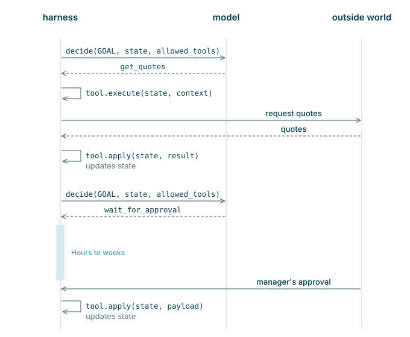
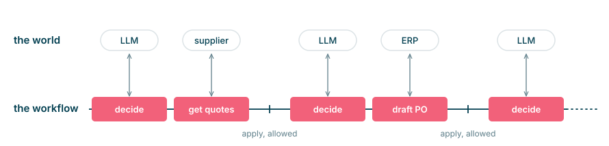
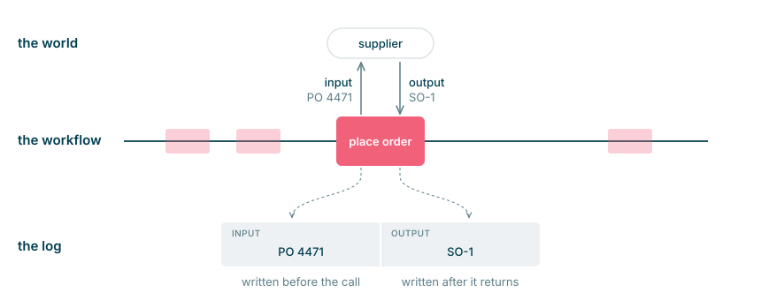
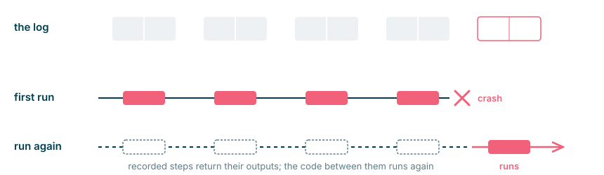
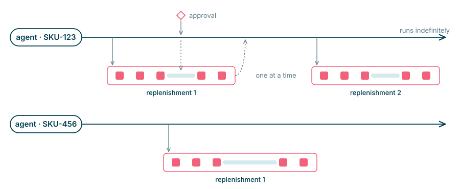
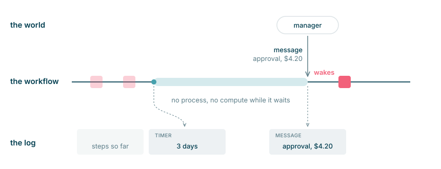

---
authors:
  - aitoboxrobot
categories:
  - 研究解读
date: 2026-11-11
hide:
  - navigation
tags:
  - AI智能体
  - 持久化执行
  - 系统架构
  - Temporal
  - 容错机制
title: "长程 AI 智能体与持久化执行架构深度剖析"
---

# 长程 AI 智能体与持久化执行架构深度剖析

**作者:** Kiran Prakash (Thoughtworks 数据与 AI 总监)  
> **Author:** Kiran Prakash (Director of Data and AI, Thoughtworks)  

**发布时间:** 2026年11月10日  
> **Date:** 10 November 2026  

**标签:** 应用架构, 生成式 AI  
> **Tags:** Application Architecture, Generative AI  

---

### 文章背景与核心概要

随着大语言模型 (Large Language Model, LLM) 能力的跃升，AI 智能体 (AI Agent) 正从单次问答迈向能够自主执行数天乃至数周复杂任务的“长程智能体”时代。然而，跨越漫长时间周期的自主任务面临进程崩溃、网络抖动、外部 API 超时以及现实世界状态突变等严峻的工程挑战。本文深入剖析了 Thoughtworks 提出的全新架构方案——持久化执行 (Durable Execution)，揭示其如何通过事件日志与状态重放技术，为长程 AI 智能体构筑坚不可摧的运行时底座。文章同时提醒开发者，“持久化”并不等同于“业务正确性”，必须在幂等性、过期数据重检、记忆分层和提示词 (Prompt) 注入防御等维度建立全面的韧性设计。

---

## 执行概要

> ## Executive Summary

长程 AI 智能体致力于自动化处理跨越数天、数周甚至数月的复杂长链条任务，这期间需要与人类用户及各类外部系统进行频繁的多轮交互。然而，由于这些多步骤流程极其容易遭受进程崩溃、网络故障以及瞬息万变的现实环境干扰，传统的程序执行模型往往在此类场景下败下阵来。

> Long-horizon agents automate complex tasks spanning days, weeks, or even months, requiring multiple exchanges with humans and external systems. Because these multi-step processes are vulnerable to system crashes, network failures, and unpredictable real-world changes, traditional execution models often fail.

**持久化执行 (Durable Execution)** 正是一种旨在彻底解决这一痛点的新兴编程范式。通过持久化记录每一次与外部世界交互的步骤日志，持久化运行时环境能够在程序发生故障后实现无缝恢复：已成功执行的步骤会被直接跳过，而程序的运行状态则完全通过回放执行日志动态重建。然而，仅仅拥有持久化特性并不能保证业务层面的绝对正确；开发者仍然必须制定严密的工程策略，以从容应对数据失效、业务规则变更、外部不可见结果以及运行底座框架升级等一系列现实挑战。

> **Durable execution** is an emerging programming pattern that solves this problem. By maintaining a persistent record (log) of every step that interacts with the outside world, a durable runtime allows programs to recover seamlessly from failures: completed steps are skipped, and the program's state is dynamically rebuilt from the execution log. However, durability alone does not guarantee business correctness; developers must still build strategies to handle stale data, shifting business rules, unseen external outcomes, and harness updates.

---

## 目录

> ## Contents

- [跨越数周的长程工作](#跨越数周的长程工作)
  - [贯穿全篇的实际案例](#贯穿全篇的实际案例)
  - [智能体循环机制](#智能体循环机制)
  - [可能出现哪些故障](#可能出现哪些故障)
- [持久化执行](#持久化执行)
  - [让智能体循环具备持久化能力](#让智能体循环具备持久化能力)
  - [实体与工作流架构](#实体与工作流架构)
  - [等待人类与外部系统响应](#等待人类与外部系统响应)
  - [失败调用的重试机制：至少执行一次](#失败调用的重试机制至少执行一次)
- [持久化并不等同于业务正确](#持久化并不等同于业务正确)
  - [智能体无法直接感知的外部执行结果](#智能体无法直接感知的外部执行结果)
  - [在你等待期间，现实世界已经发生改变](#在你等待期间现实世界已经发生改变)
  - [运行中任务面临的代码与框架变更](#运行中任务面临的代码与框架变更)
  - [记忆管理：智能体保留的内容与大模型看到的内容](#记忆管理智能体保留的内容与大模型看到的内容)
  - [操控智能体意图的外部不可信文本](#操控智能体意图的外部不可信文本)
- [总结与展望](#总结与展望)

> - [Work That Takes Weeks](#work-that-takes-weeks)
>   - [The Running Example](#the-running-example)
>   - [The Agentic Loop](#the-agentic-loop)
>   - [What Can Go Wrong](#what-can-go-wrong)
> - [Durable Execution](#durable-execution)
>   - [Making the Loop Durable](#making-the-loop-durable)
>   - [The Entity and the Workflow](#the-entity-and-the-workflow)
>   - [Waiting for People and Systems](#waiting-for-people-and-systems)
>   - [Retrying Failed Calls, At Least Once](#retrying-failed-calls-at-least-once)
> - [Durable Is Not the Same as Correct](#durable-is-not-the-same-as-correct)
>   - [Outcomes the Agent Doesn't See](#outcomes-the-agent-doesnt-see)
>   - [The World Moves On While You Wait](#the-world-moves-on-while-you-wait)
>   - [Code Change Under a Running Task](#code-change-under-a-running-task)
>   - [Memory: What the Agent Keeps, and What the Model Sees](#memory-what-the-agent-keeps-and-what-the-model-sees)
>   - [Text That Steers the Agent](#text-that-steers-the-agent)
> - [Conclusion](#conclusion)

---

## 跨越数周的长程工作

> ## Work That Takes Weeks

数十年来，现代企业的商业运营架构始终受限于“人类注意力”的稀缺性。而长程 AI 智能体的出现，从根本上改变了这种经济学规律——它们能够让过去在经济上不划算或流程极为繁复的工作流变得可行且高效。例如：引导流失客户完成高度个性化的重新激活与入职流程、统筹协调跨越多个部门的销售与采购大单，或是穿梭于复杂医疗体系中协调多方转诊。

> For decades, business operations have been structured around the scarcity of human attention. Long-horizon agents fundamental alter this economics by making previously uneconomical or tedious workflows viable—such as guiding churned customers through personalized onboarding, shepherding multi-department sales and procurement deals, or coordinating complex healthcare referrals.

传统软件擅长自动化处理确定性高、路径可预测的既定流程；而长程智能体则是在高度不可预测的动态路径中，持续探索并最终达成既定目标。

> While traditional software automates predictable processes, long-horizon agents pursue outcomes across highly unpredictable pathways.

### 贯穿全篇的实际案例

> ### The Running Example

贯穿全篇的实际案例是**库存补给员 (Stock Replenisher)**，这是一个专门负责维持制造工厂零部件安全库存水平的 AI 智能体。一旦某种物料的库存量跌破安全阈值，该智能体就会自动启动补给流程：向多个供应商获取报价、智能比选出最优供应商、向采购经理提交价格审批请求、正式下发订单，并全程跟踪履约状态直至货物验收入库。

> Our running example is **Stock Replenisher**, an agent responsible for maintaining a manufacturer's parts inventory. When stock drops below safety thresholds, the agent initiates replenishment: acquiring quotes, selecting a supplier, requesting price approval from a procurement manager, placing an order, and tracking fulfillment until delivery.

整个生命周期往往跨越数周之久。在此漫长期间，服务器进程随时可能意外重启，与供应商系统的网络通信可能发生中断，各类交互消息也可能遭遇延迟甚至重复发送。

> This lifecycle can take weeks, during which processes may restart, supplier communication can fail, and messages can be delayed or duplicated.

<figure class="embed wide">

</figure>

### 智能体循环机制

> ### The Agentic Loop

绝大多数现代 AI 智能体均基于一种标准架构模式运行，即**智能体循环 (Agentic Loop)**。该循环由四大核心要素构成：
1. **目标 (Goal)**：期望达成的最终结果 (例如：维持安全的零部件库存水位)；
2. **工具 (Tools)**：智能体用以感知与干预外部世界的交互机制 (例如：`get_quotes`、`place_order`)；
3. **状态 (State)**：智能体当前所掌握的关于任务推进情况的全部上下文信息；
4. **模型 (Model)**：核心智能引擎 (如大语言模型)，负责在每一轮循环中评估当前状态，并决定调用哪个工具或采取何种行动。

> Most modern agents operate via a standard structural pattern known as the **agentic loop**, which consists of four core components:
> 1. **Goal:** The desired end outcome (e.g., maintaining safe stock levels).
> 2. **Tools:** Mechanisms through which the agent interacts with the world (e.g., `get_quotes`, `place_order`).
> 3. **State:** Everything the agent currently knows about its progress.
> 4. **Model:** The underlying intelligence that evaluates the state at each turn and selects the appropriate tool.

图 1: 智能体循环的两个轮次：一次调用工具，一次等待

> Figure 1: Two turns of the loop: one calls a tool, one waits

### 可能出现哪些故障

> ### What Can Go Wrong

将长程智能体视作一个分布式系统时，我们会发现它不仅面临分布式架构中所有经典的故障模式，还会遭遇特定于智能体领域的独特挑战：

> Treating a long-horizon agent as a distributed system reveals several classic failure modes, alongside domain-specific challenges:

| 故障模式 (Failure Mode) | 领域业务示例 (Domain Example) | 解决方案对应章节 (Addressed In) |
| :--- | :--- | :--- |
| **进程崩溃 (Process crash)** | 采购订单正在等待人工审批时，后台服务进程意外重启。 | [让智能体循环具备持久化能力](#让智能体循环具备持久化能力) / [Making the loop durable](#making-the-loop-durable) |
| **远程 API 故障 (Remote API failure)** | 智能体在调用供应商 API 下单时，对方服务出现宕机或无响应。 | [失败调用的重试机制：至少执行一次](#失败调用的重试机制至少执行一次) / [Retrying failed calls](#retrying-failed-calls-at-least-once) |
| **重复执行 (Duplicate execution)** | 下单确认响应丢失，触发重试逻辑导致重复向供应商提交订单。 | [失败调用的重试机制：至少执行一次](#失败调用的重试机制至少执行一次) / [Retrying failed calls](#retrying-failed-calls-at-least-once) |
| **并发冲突问题 (Concurrency issues)** | 当首笔补货流程仍在流转时，系统又错误触发了第二笔并发补货任务。 | [实体与工作流架构](#实体与工作流架构) / [The entity and the workflow](#the-entity-and-the-workflow) |
| **无法感知的外部结果 (Unseen outcomes)** | 供应商已成功接收订单，随后服务断线；智能体将本次调用记录为失败。 | [智能体无法直接感知的外部执行结果](#智能体无法直接感知的外部执行结果) / [Outcomes the agent doesn't see](#outcomes-the-agent-doesnt-see) |
| **等待期间外部世界发生改变 (World changes during waits)** | 业务经理在 3 天后批准了报价，但此时供应商的原材料价格已经上调。 | [在你等待期间，现实世界已经发生改变](#在你等待期间现实世界已经发生改变) / [The world moves on while you wait](#the-world-moves-on-while-you-wait) |
| **代码与环境热更新 (Code changes)** | 在某项长任务休眠挂起期间，底层框架代码完成了新版本的线上发布。 | [运行中任务面临的代码与框架变更](#运行中任务面临的代码与框架变更) / [Code change under a running task](#code-change-under-a-running-task) |
| **历史上下文膨胀 (History bloat)** | 长期运行的客户服务智能体需要调用数月之前的上下文记忆。 | [记忆管理](#记忆管理智能体保留的内容与大模型看到的内容) / [Memory](#memory-what-the-agent-keeps-and-what-the-model-sees) |
| **不可信外部输入 (Untrusted input)** | 供应商邮件中夹带提示词注入 (Prompt Injection) 恶意文本，企图篡改价格审批规则。 | [操控智能体意图的外部不可信文本](#操控智能体意图的外部不可信文本) / [Text that steers the agent](#text-that-steers-the-agent) |

> | Failure Mode | Domain Example | Addressed In |
> | :--- | :--- | :--- |
> | **Process crash** | Process restarts while a purchase order awaits approval. | [Making the loop durable](#making-the-loop-durable) |
> | **Remote API failure** | The supplier's API is down during order placement. | [Retrying failed calls](#retrying-failed-calls-at-least-once) |
> | **Duplicate execution** | Order confirmation is lost, causing a retry that places a duplicate order. | [Retrying failed calls](#retrying-failed-calls-at-least-once) |
> | **Concurrency issues** | A secondary replenishment starts while the first is pending. | [The entity and the workflow](#the-entity-and-the-workflow) |
> | **Unseen outcomes** | Supplier accepts an order, then goes offline; the run is logged as failed. | [Outcomes the agent doesn't see](#unseen-outcomes) |
> | **World changes during waits** | Manager approves a price after 3 days, but supplier pricing has risen. | [The world moves on while you wait](#world-moves) |
> | **Code changes** | New harness code is deployed while a task is suspended. | [Code change under a running task](#change) |
> | **History bloat** | A long-running customer agent needs context from months prior. | [Memory](#memory) |
> | **Untrusted input** | Supplier email contains prompt injection text attempting to alter pricing rules. | [Text that steers the agent](#untrusted-text) |

---

## 持久化执行

> ## Durable Execution

**持久化执行 (Durable Execution)** 是一种革新性的编程模型。在此模型下，运行时框架会精确记录每一个与外部世界进行交互的步骤 (Step) 的输入与输出。一旦系统发生故障崩溃，程序只需从头重新执行 (即“重放” Replay)——那些在日志中已有记录的步骤会被直接跳过并复用先前的结果，从而在代码层面无损重建出崩溃前的本地状态。

> **Durable execution** is a programming model where the runtime records the input and output of every step interacting with the outside world. When a failure occurs, the program is re-executed (replayed), completed steps are bypassed via the log, and the local state is programmatically rebuilt.

业界实现这一模式的主流开源框架与商业引擎包括 Temporal、Restate、Inngest、DBOS 以及 Cloudflare Workflows 等。

> Popular engines implementing this model include Temporal, Restate, Inngest, DBOS, and Cloudflare Workflows.

图 2: 每次与外部世界的交互调用都是一个步骤

> Figure 2: Every call to the outside world is a step

图 3: 步骤特写剖析

> Figure 3: A step, close-up

图 4: 崩溃后程序再次运行；已记录的步骤不再重复执行

> Figure 4: After a crash, the program runs again; recorded steps don't

### 让智能体循环具备持久化能力

> ### Making the Loop Durable

通过将智能体循环封装在工作流原语中 (例如 Temporal 的 `@workflow.run` 和 `workflow.execute_activity`)，持久化引擎能够自动捕获每个动作的输入与输出并写入持久化日志，从而让整个智能体运行流程对底层基础设施的意外崩溃具备天然的免疫力与韧性。

> By wrapping the agentic loop in workflow primitives (such as Temporal's `@workflow.run` and `workflow.execute_activity`), the engine captures inputs/outputs in a persistent log, making the entire routine resilient against infrastructure crashes.

<figure class="embed wide">

</figure>

### 实体与工作流架构

> ### The Entity and the Workflow

在复杂的业务场景中，必须对关注点进行清晰拆分，通常区分为两类不同的工作流：
* **流程工作流 (Process Workflow)**：用于处理单一孤立任务的持久化工作流 (例如：某次特定的补库存执行过程)，任务完成后即告结束；
* **实体工作流 (Entity Workflow)**：代表业务实体 (例如：特定的库存单元 / SKU) 整个生命周期的长寿命持久化工作流，负责持续维护实体状态，并根据业务需要动态触发流程工作流。

> Complex business domains require separating concerns between two types of workflows:
> * **Process Workflow:** A durable workflow that handles a single isolated task (e.g., a specific stock replenishment run) and completes.
> * **Entity Workflow:** A long-lived durable workflow representing a business entity (e.g., a specific Stock Keeping Unit / SKU) over its entire lifecycle, managing state and spawning process workflows as needed.

图 5: 每个 SKU 对应一个智能体；同一时间仅运行一个工作流

> Figure 5: One agent per SKU; one workflow at a time

### 等待人类与外部系统响应

> ### Waiting for People and Systems

长程 AI 智能体的大部分时间其实都处于空闲等待状态，例如等待人类主管的审批反馈或外部系统的异步通知。持久化运行时环境允许工作流进入高效率的休眠挂起状态，既不占用宝贵的活跃内存，也不会持续消耗计算资源。

> Long-horizon agents spend significant time idle, awaiting human or system inputs. Durable runtimes enable efficient sleeping states without holding active memory or consuming compute resources.

图 6: 等待计时器与外部消息均被记录进持久化日志中

> Figure 6: The wait's timer and the message both go into the log

### 失败调用的重试机制：至少执行一次

> ### Retrying Failed Calls, At Least Once

持久化运行时环境支持高度可配置的自动重试策略，但它们在本质上遵循**至少交付一次 (At-least-once)** 的执行语义。举例来说，如果供应商系统已经成功接受了订单，但返回给智能体的确认响应数据包在网络中丢失，运行时引擎就会判定调用超时并自动发起重试。

> Durable runtimes support configurable retry policies, but they operate on **at-least-once** delivery semantics. If a supplier accepts an order but the response packet drops, the runtime retries the call.

为了避免重复执行写操作带来严重灾难 (如重复下单)，所有产生副作用的操作都必须引入**幂等键 (Idempotency Key)** (例如全局唯一的采购订单号 Purchase Order Number)，以确保下游系统能够安全识别并自动去重重复的请求。

> To prevent duplicate actions, writes must incorporate **idempotency keys** (such as a unique Purchase Order number) so downstream systems can safely deduplicate repeated requests.

---

## 持久化并不等同于业务正确

> ## Durable Is Not the Same as Correct

即便是具备了持久化执行所带来的系统级高可用保障，智能体依然必须直面复杂的真实业务挑战。

> Even with durable execution guarantees, agents must contend with complex operational realities.

### 智能体无法直接感知的外部执行结果

> ### Outcomes the Agent Doesn't See

当一次 API 调用由于网络分区而超时失败时，该动作在下游系统中可能实际上已经执行成功。由于持久化日志记录的仅仅是智能体自身*观察到*的结果，而非现实世界的终极事实，因此系统必须设计严谨的补救机制，例如自动化取消或冲正补偿工具 (如 `cancel_order`)。

> When an API call fails due to a network partition, the action might have actually succeeded downstream. Because logs record what the agent *observed* rather than universal truth, systems require corrective mitigations, such as automated cancellation or compensation tools (`cancel_order`).

### 在你等待期间，现实世界已经发生改变

> ### The World Moves On While You Wait

几天前收集到的环境数据可能会以极快的速度过时失效。为了确保业务执行的准确性，系统应当遵循以下原则：
1. **设置有效期窗口 (Expiry Windows)**：为所有的审批流程和供应商报价明确设定有效时间窗口；
2. **执行前重新验证前置条件 (Re-verify Conditions)**：在真正执行不可逆的业务动作之前，必须实时重新核验各项先决条件；
3. **批准浮动容差区间 (Variance Ranges)**：审批时应核准一个合理的价格浮动区间 (如采购价格上限)，而非机械刚性的固定数值。

> Data gathered days prior can quickly become obsolete. To maintain accuracy:
> 1. **Set expiry windows** on approvals and quotes.
> 2. **Re-verify conditions** immediately before executing irreversible actions.
> 3. **Approve variance ranges** (e.g., price ceilings) rather than rigid point values.

### 运行中任务面临的代码与框架变更

> ### Code Change Under a Running Task

当工作流处于休眠挂起状态并保存在持久化日志中时，若此时对底座支撑代码 (Harness Code) 进行版本升级，很可能引发历史回放与新代码不一致的不兼容崩溃。采用**并行变更 (Parallel Change)** 演进模式与显式的工作流版本控制规则，能够确保正在运行的历史工作流按照既有定义平稳执行完毕，而新创建的工作流则自动采用最新的业务逻辑。

> Updating harness code while workflows are suspended in a durable log can cause replay mismatches. Utilizing **Parallel Change** patterns and versioning rules ensures older running workflows safely complete under legacy definitions while new workflows adopt updated criteria.

### 记忆管理：智能体保留的内容与大模型看到的内容

> ### Memory: What the Agent Keeps, and What the Model Sees

随着智能体交互历史的不断拉长 (例如长达数年的客户服务全生命周期)，Token 上下文窗口必然会发生溢出。为此，底座支撑架构必须构建分层记忆机制——在活跃内存中仅保留轻量级的工作上下文 (类似于计算机内存 RAM)，同时将海量的历史知识与过往事件卸载至外部向量数据库或关系型数据库中，大语言模型仅在必要时通过显式的工具调用按需进行精准检索。

> As history expands (e.g., multi-year customer lifecycles), context windows overflow. Harness architectures must implement tiered memory models—maintaining a small working context (RAM equivalent) while offloading historical knowledge to external vector stores or databases accessed via explicit tool calls.

### 操控智能体意图的外部不可信文本

> ### Text That Steers the Agent

由于大语言模型在底层对系统提示词指令和外部输入文本的处理方式并无本质区别，智能体极易遭受提示词注入 (Prompt Injection) 攻击 (例如：供应商发来的电子邮件中夹带恶意伪造内容，谎称业务经理已经特批上调采购预算)。防范此类风险必须依靠刚性的程序化校验：所有涉及重大决策的审批动作必须通过加密凭证或结构化的系统级钩子 (System Hooks) 进行强制校验，坚决阻断通过不可信外部文本随意操控智能体执行分支的漏洞。

> Because LLMs process instructions and external text identically, agents are vulnerable to prompt injections (e.g., malicious supplier emails claiming a manager approved higher budgets). Defenses require strict programmatic enforcement: approvals must be validated cryptographically or structurally via system hooks, ignoring untrusted textual instructions.

---

## 总结与展望

> ## Conclusion

迈向智能体驱动的全新时代，不仅需要强大的模型推理能力，更离不开坚如磐石的软件工程架构与深刻的业务领域洞察。权宜性的临时修补与松散无序的代码只会让系统变得脆弱不堪；实现真正可靠的长程自动化，必须仰赖严谨的设计模式、精细的系统集成约束，以及兼顾人类协同与自主智能体访问的完备数据管理底座。

> Transitioning to an agentic era requires combining robust software architecture with deep domain expertise. Tactical fixes and unstructured code create fragility; true long-horizon automation demands rigorous design patterns, careful integration constraints, and robust data management designed for both human and autonomous agent access.

---

## 致谢

> ## Acknowledgments

感谢 Martin Fowler 给予的鼓励与编辑支持。感谢 Paulo Caroli、James Shore、Mike Mason、Manisha Jain 以及 Seema Swamy 对本文早期草稿提出的宝贵反馈与修改建议。

> Thanks to Martin Fowler for encouragement and editorial support. Thanks to Paulo Caroli, James Shore, Mike Mason, Manisha Jain, and Seema Swamy for feedback on early drafts.

* 英文文案编辑由 Grammarly 提供辅助。
* 代码片段、可视化图表及校对由 Claude 提供辅助。

> * Copy editing assisted by Grammarly.
> * Code fragments, visualizations, and proofreading assisted by Claude.

---

## 版本修订记录

> ## Significant Revisions

* *2026年11月10日:* 首次正式发布

> * *10 November 2026:* Published
