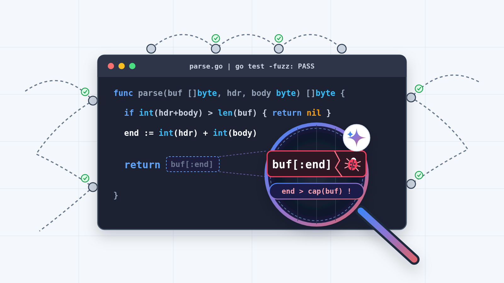
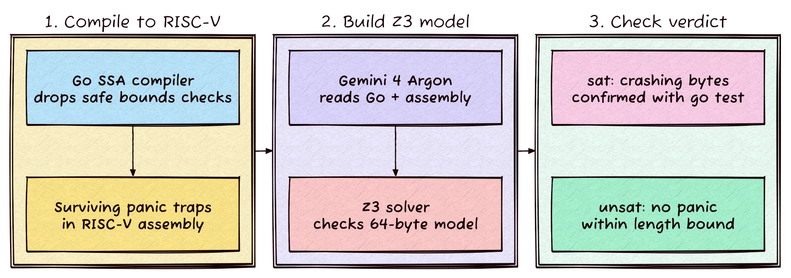
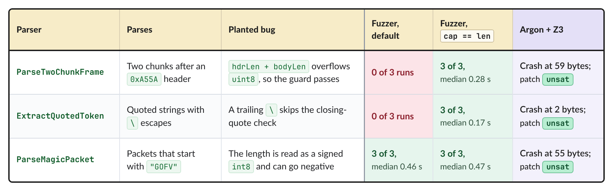
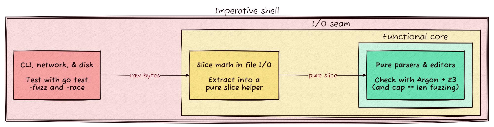

---
authors:
  - aitoboxrobot
categories:
  - 工具教程
date: 2026-11-14
hide:
  - navigation
tags:
  - Go
  - Gemini
  - Z3
  - 形式化验证
  - 模糊测试
title: "结合 Gemini 与约束求解器捕捉模糊测试错漏的 Go 代码缺陷"
---

# 结合 Gemini 与约束求解器捕捉模糊测试错漏的 Go 代码缺陷

**Published:** Nov. 12, 2026  
**Author:** Karl Weinmeister, Director, Developer Relations  

---

### 文章背景与核心概要
在 Go 语言日常开发中，传统的单元测试和基于随机输入的模糊测试 (Fuzzing) 常常由于切片底层容量 (Capacity) 等隐蔽盲区，漏掉极其致命的越界切片与行号边界逻辑缺陷。为了根治这一痛点，Google 团队构想出了一种前沿的软件工程验证新范式：先将 Go 源码跨平台编译为 RISC-V 汇编指令，精确定位那些经编译器静态单赋值 (Static Single Assignment, SSA) 优化后依然残留的 `runtime.panicBounds` 潜在崩溃陷阱；随后利用 Gemini 4 Argon 大语言模型 (Large Language Model, LLM) 深度理解代码控制流并秒级生成 Z3 约束求解器 (Constraint Solver) 规则；最后由求解器在毫秒内反向合成精准的崩溃复现输入，并在真实代码中直接验证。这一“大语言模型 + 形式化约束求解”的轻量化协同方案，不仅以极低的时间成本捕获了实际项目中的隐蔽漏洞，也为现代软件工程中缺陷挖掘与代码验证提供了全新的落地标杆。

---

## 核心概述

> ## Summary

在开发用于检查与编辑 Markdown 技能文件的 Go 命令行工具 `skill-lint` 时，传统的单元测试与模糊测试 (Fuzzing) 偶尔会遗漏微妙的切片边界与行号逻辑缺陷。为了彻底捕获这些隐藏的隐患，作者构建了一套创新的验证流水线：

> While developing `skill-lint`—a Go CLI used to check and edit Markdown skill files—traditional unit and fuzz testing occasionally missed subtle slice-bounds and line-number logic bugs. To catch these, the author built a novel verification pipeline: 

1. **编译分析**：将目标 Go 函数编译为 RISC-V 汇编代码，以此找出经编译器静态单赋值 (Static Single Assignment, SSA) 优化器精简后仍然留存的 `runtime.panicBounds` 陷阱。
2. **AI 代码转换**：借助 **Gemini 4 Argon** 研读 Go 源码与汇编指令，将控制流执行路径直接转译为 **Z3 约束求解器 (Constraint Solver)** 的判定规则。
3. **自动化复现**：通过 Z3 自动求解并生成触发崩溃的具体字节输入，随后立即调用 `go test` 在真实代码中重放并验证缺陷。

> 1. **Compilation Analysis:** Compiling target Go functions to RISC-V assembly to locate surviving `runtime.panicBounds` traps left behind by the compiler's SSA optimizer.
> 2. **AI Translation:** Using **Gemini 4 Argon** to read the Go source code and assembly, translating control-flow paths directly into **Z3 constraint solver** rules.
> 3. **Automated Reproducers:** Using Z3 to generate concrete crashing byte inputs, which are immediately replayed and verified against the real code using `go test`.

本文将深入剖析这种混合验证方案的工作机理，揭示为什么标准模糊测试工具会因为切片容量盲区而漏掉潜在缺陷，探讨该方案的独到优势，以及它如何优雅地融入 Go 开发者的日常工作流。

> This post explores how this hybrid approach successfully uncovered latent bugs that standard fuzzers missed (due to slice capacity blind spots), where it shines, and how it fits into a day-to-day Go development workflow.

---



我参与领导 Google 的 [智能体技能项目 (Agent Skills Program)](https://github.com/google/skills)，该项目目前拥有 175 项智能体技能，对像 [go-skills](https://github.com/spf13/go-skills) 这样的社区资源形成了有力补充。为了保证这众多技能文件格式的高度统一，我编写了 `skill-lint`——一款独立的 [Go](https://go.dev/?utm_team=DSS+DevRel&utm_campaign=default&utm_source=blog&utm_medium=article&utm_content=b583878026) 命令行工具，专门用于在正式发布前检查 `SKILL.md` 文件并应用大语言模型 (Large Language Model, LLM) 生成的行级编辑。尽管 `skill-lint` 自身配备了完备的单元测试和模糊测试套件，但在其 Markdown 解析器或编辑应用器中，一处微小的切片截取或行号计算差错依然可能长期潜伏，直到遇到极其罕见的特殊文件或编辑区间时，才会在运行时触发 linter 崩溃 (Panic)。

> I help lead Google's [agent skills program](https://github.com/google/skills), currently with 175 agent skills that supplement community collections like [go-skills](https://github.com/spf13/go-skills). To keep that many skill files consistent, I wrote skill-lint, a standalone [Go](https://go.dev/?utm_team=DSS+DevRel&utm_campaign=default&utm_source=blog&utm_medium=article&utm_content=b583878026) CLI that checks SKILL.md files and applies LLM-generated line edits before they ship. Even with skill-lint's own unit and fuzz test suite, a small slice or line-number mistake inside its Markdown parsers or edit applier can sit dormant until an unusual file or edit range triggers a runtime panic in the linter.

在 Go 语言中，当编译器的优化器剥离掉所有能预先排除的安全检查后，每一个可能在运行时引发 panic 的切片或索引访问操作，都会在底层机器码中编译为一段显式的边界检查陷阱 (Bounds-check Trap)。为了搜寻潜在崩溃，我将代码中的关键函数进行编译，观察优化后幸存下来的 panic 陷阱，并利用 [Gemini 4 Argon](https://ai.google.dev/gemini-api/docs/models/gemini-4-argon?utm_team=DSS+DevRel&utm_campaign=default&utm_source=blog&utm_medium=article&utm_content=b583878026) 将通往每个陷阱的执行路径翻译为 [Z3 约束求解器](https://github.com/Z3Prover/z3) 的规则。虽然大模型编写的求解器模型并非严格完备的证明系统，但它为智能体提供了一种推导控制流并合成具体 Go 复现测试用例的独立能力；而且由于 `go test` 会直接执行这些触发异常的字节，因此它捕获的每一个崩溃都是 100% 真实存在的。该工作流不仅捕获了我在测试解析器中故意埋下的全部 3 个漏洞，还在 `skill-lint` 中挖掘出了 3 个此前未被察觉的隐蔽缺陷。

> In Go, every slice or index operation that can panic at runtime compiles down to an explicit bounds-check trap in machine code, after the compiler's optimizer strips out the checks it can already rule out. To hunt for crashes, I compiled key functions from my code to see which panic traps survived optimization, and [Gemini 4 Argon](https://ai.google.dev/gemini-api/docs/models/gemini-4-argon?utm_team=DSS+DevRel&utm_campaign=default&utm_source=blog&utm_medium=article&utm_content=b583878026) translated the path to each trap into rules for the [Z3 constraint solver](https://github.com/Z3Prover/z3). An LLM-written solver model isn't a sound proof system, but it gives the agent an independent way to reason about control flow and synthesize concrete Go reproducers, and every crash it finds is real because go test runs the offending bytes directly. That workflow caught all three bugs I planted in test parsers and turned up three latent bugs in skill-lint.

在本文中，我将逐步拆解 Gemini 与 Z3 验证流水线的实现原理，探讨为何 [`go test -fuzz`](https://go.dev/security/fuzz/?utm_team=DSS+DevRel&utm_campaign=default&utm_source=blog&utm_medium=article&utm_content=b583878026) 会漏掉其中的两个崩溃（以及只需一行改动就能修复该漏检的方法），并阐述这种方法在日常 Go 开发流程中的绝佳定位。

> In this post, I'll walk through how the Gemini and Z3 pipeline works, why [`go test -fuzz`](https://go.dev/security/fuzz/?utm_team=DSS+DevRel&utm_campaign=default&utm_source=blog&utm_medium=article&utm_content=b583878026) missed two of those crashes (and the one-line change that fixes it), and where this approach fits in a day-to-day Go workflow.

---

## 求解器流水线的工作原理

> ## How the solver pipeline works

Anthropic [近期的一篇博文](https://www.anthropic.com/research/formal-verification) 展示了如何通过前沿 AI 模型在 [OSS-Fuzz](https://github.com/google/oss-fuzz) 代码库上编写经机器检验的 [Rocq](https://rocq-prover.org/) 形式化证明，来捕获 C 和 C++ 中的潜在缺陷。形式化工具与依靠随机采样输入的模糊测试器不同，它是从每一个错误故障条件出发进行反向推导，精准求解出能触发该故障的确切输入。然而，完备的定理证明对于绝大多数日常 Go 项目而言过于沉重且门槛极高，因此我想探索的是：在一个函数耗时仅需约 1 分钟的前提下，智能体结合大语言模型与约束求解器究竟能发挥出多大的缺陷搜寻威力。

> A [recent post from Anthropic](https://www.anthropic.com/research/formal-verification) showed how formal verification catches latent bugs in C and C++ by having frontier AI models write machine-checked [Rocq](https://rocq-prover.org/) proofs across [OSS-Fuzz](https://github.com/google/oss-fuzz) libraries. Instead of sampling random inputs like a fuzzer, a formal tool works backward from each failure condition to solve for the exact input that triggers it. Full theorem proving is still too heavy for most day-to-day Go projects, so I wanted to see how much of that bug-hunting power an agent can get from an LLM and a constraint solver in about a minute per function.

在 C 和 C++ 语言中，读写超出缓冲区末尾会导致内存损坏。而 Go 语言则选择在运行时捕获越界访问：对于任何无法证明绝对安全的切片或索引访问操作，编译器都会将其编译为跳转至 [runtime.panicBounds](https://github.com/golang/go/blob/go1.27.3/src/runtime/panic.go#L208) 的显式条件分支。一旦执行到这里就会引发 panic，若未经 recover 捕获，整个进程便会直接崩溃退出。

> In C and C++, reading or writing past the end of a buffer corrupts memory. Go catches out-of-bounds access at runtime instead, compiling every slice or index operation it can't prove safe into an explicit branch to [runtime.panicBounds](https://github.com/golang/go/blob/go1.27.3/src/runtime/panic.go#L208) that panics, crashing the process unless recovered.

在生成机器码之前，Go 的 [静态单赋值 (Static Single Assignment, SSA)](https://pkg.go.dev/cmd/compile/internal/ssa?utm_team=DSS+DevRel&utm_campaign=default&utm_source=blog&utm_medium=article&utm_content=b583878026) [prove](https://github.com/golang/go/blob/go1.27.3/src/cmd/compile/internal/ssa/prove.go) 优化阶段已经通过追踪切片长度和循环变量，消除了其中的绝大多数边界检查。这道优化过滤工序最终仅留下了编译器自身无法彻底排除的 `runtime.panicBounds` 陷阱，正好为约束求解器提供了一份精炼的目标候选崩溃点清单。

> Before generating machine code, Go's [SSA](https://pkg.go.dev/cmd/compile/internal/ssa?utm_team=DSS+DevRel&utm_campaign=default&utm_source=blog&utm_medium=article&utm_content=b583878026) [prove](https://github.com/golang/go/blob/go1.27.3/src/cmd/compile/internal/ssa/prove.go) pass already eliminates most of those checks by tracking slice lengths and loop variables. That optimization pass leaves behind only the `runtime.panicBounds` traps the compiler couldn't rule out on its own, giving the solver a short list of candidate crash sites to target.

我使用 `GOOS=linux GOARCH=riscv64 go build -gcflags="-S -d=ssa/check_bce/debug=1"` 编译每个目标函数（其中 `-S` 用于打印汇编代码列表，`ssa/check_bce/debug=1` 则输出所有留存边界检查的详细日志），并将 Go 源代码与反汇编结果一同输入给模型。仅凭 Go 源码，你无法洞察编译器已经移除了哪些边界检查，也无法察觉寄存器是在哪一步被截断为 8 位的；但在反汇编代码中，这些底层细节一览无余。我之所以选择 [RISC-V](https://en.wikipedia.org/wiki/RISC-V) 架构，是因为它正是 Anthropic 文章在 Rocq 形式化证明中选定的指令集架构，且 Go 原生开箱即用支持其交叉编译。

> I compiled each target with `GOOS=linux GOARCH=riscv64 go build -gcflags="-S -d=ssa/check_bce/debug=1"` (`-S` prints the assembly listing and `ssa/check_bce/debug=1` logs every surviving bounds check) and passed both the Go source and the disassembly to the model. Looking at Go source alone, you can't see which bounds checks the compiler already removed or where a register gets truncated to 8 bits; in the disassembly, both show up. I targeted [RISC-V](https://en.wikipedia.org/wiki/RISC-V) because it's the instruction set Anthropic's post targets for its Rocq proofs, and Go cross-compiles to it out of the box.

随后，Argon 研读 Go 源码和反汇编代码，并返回一段用于为每个幸存陷阱建模执行路径的 Z3 脚本；每当它标记出缺陷时，还会同步给出一个修复后的补丁函数。Z3 紧接着检验这些约束条件是否可以满足 (Satisfiable)；一旦求得触发崩溃的输入，`go test` 就会针对真实函数重放这组字节。利用大语言模型让我免去了人工将汇编指令逐一转译为求解器约束的繁重劳动。在整个运行时间中，Argon 的转译占据了主要耗时（每个函数约 1 分钟），而 Z3 求解器本身的计算则在短短几毫秒内即可迅速完成。

> From there, Argon read the Go source and disassembly and returned a Z3 script modeling the path to each surviving trap, along with a patched function whenever it flagged a bug. Z3 then checked whether those constraints could be satisfied, and whenever it found a crashing input, `go test` replayed those bytes against the real function. Using an LLM saved me from translating assembly into solver constraints by hand. Argon's translation dominated the runtime, at about a minute per function, while Z3 itself finished in milliseconds.


*图 1：Go 语言的 SSA 编译器会先剥离掉所有经证明安全的边界检查，随后由 Gemini 4 Argon 对留存的潜在陷阱进行建模，交由 Z3 完成求解检验。*

> *Go's SSA compiler strips out provably safe bounds checks first. Gemini 4 Argon then models the remaining traps for Z3 to check.*

---

## 何时应当信任约束求解器

> ## When to trust the solver

Anthropic 的方案依赖于 [交互式定理证明 (Interactive Theorem Proving)](https://en.wikipedia.org/wiki/Proof_assistant)，通常需要人类专家对机器语义进行形式化建模，再由 Rocq 根据这些严格规则检验大语言模型生成的证明过程。与之相对，我的工作流采用了基于 [可满足性模理论 (Satisfiability Modulo Theories, SMT)](https://en.wikipedia.org/wiki/Satisfiability_modulo_theories) 的约束求解器，依托 Argon 将汇编逻辑直接翻译为 Z3 约束规则。虽然在缺乏严格语义模型的情况下，约束求解器无法给出百分之百完备的代码正确性证明，但它在挖掘缺陷方面却出奇地高效。Z3 的 [check-sat](https://microsoft.github.io/z3guide/docs/logic/basiccommands) 指令会在输入约束可满足时返回 `sat` (Satisfiable)，在不可满足时返回 `unsat` (Unsatisfiable)。

> Anthropic's approach relies on [interactive theorem proving](https://en.wikipedia.org/wiki/Proof_assistant), where experts model machine semantics and Rocq checks LLM-generated proofs against those rules. In contrast, my workflow uses a constraint solver based on [satisfiability modulo theories (SMT)](https://en.wikipedia.org/wiki/Satisfiability_modulo_theories), relying on Argon to translate assembly directly into Z3 constraints. While a constraint solver doesn't provide a complete correctness proof without a semantic model, it is highly effective for finding bugs. Z3's [check-sat](https://microsoft.github.io/z3guide/docs/logic/basiccommands) command returns sat when input constraints can be satisfied and `unsat` when they cannot.

当求解器返回 `sat` 结果（即“明确存在缺陷”）时，它会附带一组直指崩溃陷阱的具体字节数据，而 `go test` 会直接在真实函数上执行它们。一旦真实代码抛出 panic，无论 Argon 的求解器建模是否在理论上严丝合缝，你都已经获得了一个确定无疑的代码缺陷复现用例！正如面向缺陷的布隆过滤器 (Bloom Filter) 一样，`unsat` 结果仅代表代码“大概率正确”。牺牲严苛的绝对正确性证明，正是让该方案具备极高工程实用性的关键所在：仅需付出极其微小的精力和时间成本，你就能收获形式化方法最核心的缺陷挖掘价值。

> A sat answer ("definitely buggy") comes with concrete bytes aimed at the trap, and `go test` runs them against the real function. Once go test panics, you have a concrete bug reproducer regardless of whether Argon's model was sound. Like a Bloom filter for bugs, an `unsat` answer only means "maybe correct." Trading away a correctness proof is what makes the approach so practical: you get most of the bug-finding value of formal methods for a tiny fraction of the effort.

Anthropic 的方案在 64 MB 内存限制下证明了整个二进制程序的无崩溃特性；而我则针对单个函数，在全新的 64 字节切片且满足 [cap(buf) == len(buf)](https://go.dev/ref/spec?utm_team=DSS+DevRel&utm_campaign=default&utm_source=blog&utm_medium=article&utm_content=b583878026#Length_and_capacity) 的条件下进行检验，因此任何超出 `len(buf)` 的切片操作都会立刻引发 panic。（如果你想在 Go 中尝试全二进制的 Rocq 验证方案，[theorem-labs/oss-verify](https://github.com/theorem-labs/oss-verify) 包含了一套针对 [Go 1.27](https://go.dev/doc/go1.27?utm_team=DSS+DevRel&utm_campaign=default&utm_source=blog&utm_medium=article&utm_content=b583878026) 的运行时覆盖层，能使 Go 运行时变为单线程且完全确定性）。

> Anthropic's setup proved no-crash properties on whole binaries under a 64 MB budget; I checked individual functions on fresh 64-byte slices where [cap(buf) == len(buf)](https://go.dev/ref/spec?utm_team=DSS+DevRel&utm_campaign=default&utm_source=blog&utm_medium=article&utm_content=b583878026#Length_and_capacity), so any slice past `len(buf)` panics. (If you want the full-binary Rocq setup for Go, [theorem-labs/oss-verify](https://github.com/theorem-labs/oss-verify) includes a [Go 1.27](https://go.dev/doc/go1.27?utm_team=DSS+DevRel&utm_campaign=default&utm_source=blog&utm_medium=article&utm_content=b583878026) runtime overlay that makes the runtime single-threaded and deterministic.)

作为模糊测试的对比基线，我在 Go 1.27.3 环境下针对每个植入的缺陷运行了无种子的 [`go test -fuzz`](https://go.dev/security/fuzz/?utm_team=DSS+DevRel&utm_campaign=default&utm_source=blog&utm_medium=article&utm_content=b583878026)：包括一次 3 秒的快速运行以及三次 60 秒的运行；每次测试都清空缓存以避免测试时长过短成为漏检的借口。

> For the fuzzing baseline, I ran unseeded [`go test -fuzz`](https://go.dev/security/fuzz/?utm_team=DSS+DevRel&utm_campaign=default&utm_source=blog&utm_medium=article&utm_content=b583878026) on Go 1.27.3 against each planted bug: one 3-second run and three 60-second runs, each with a fresh fuzz cache so a short time budget wouldn't explain a miss.

---

## 在汇编代码中捕获植入的人工缺陷

> ## Finding a planted bug in assembly

在正式测试前，我首先选用了 3 个不存在越界漏洞的安全解析器，以确保流水线不会误报正常代码。编译器的 `prove` 优化阶段自主消除了 TOML 键名解析器中的所有边界检查；而对于 HTTP 报头扫描器和变长整数 (Varint) 解码器中残留的陷阱，Z3 均准确返回了 `unsat`（不可满足）。

> I started with three safe parsers to make sure the pipeline didn't flag clean code. The compiler's `prove` pass removed every bounds check in a TOML key parser on its own, and Z3 returned `unsat` on the remaining traps in an HTTP header scanner and a varint decoder.

随后，我编写了 3 个暗藏微小 panic 漏洞的解析器。这是其中的第一个——`ParseTwoChunkFrame`：

> Then I wrote three parsers with subtle panics. Here's the first one, `ParseTwoChunkFrame`:

```go
func ParseTwoChunkFrame(buf []byte) ([]byte, []byte) {
	if len(buf) < 4 || buf[0] != 0xA5 || buf[1] != 0x5A {
		return nil, nil
	}
	hdrLen, bodyLen := buf[2], buf[3]
	total := hdrLen + bodyLen
	if int(total)+4 > len(buf) {
		return nil, nil
	}
	endHdr := 4 + int(hdrLen)
	endBody := endHdr + int(bodyLen)
	return buf[4:endHdr], buf[endHdr:endBody]
}
```

在 RISC-V 反汇编代码中，这一缺陷变得清晰易见：

> In the RISC-V disassembly, the bug is much easier to see:

```plaintext
0x0060  ADD    X16, X9, X5                 ; X5 = hdrLen + bodyLen
0x0064  MOVBU  X5, X5                      ; TRUNCATE to uint8: X5 = X5 & 0xff
0x0068  ADDI   $4, X5, X5                  ; X5 = int(total) + 4
0x006a  BLT    X11, X5, 0x00bc             ; guard: if len(buf) < X5, return nil, nil
0x006e  MOV    X9, X11                     ; X11 = int(hdrLen)
0x0070  MOV    X16, X14                    ; X14 = int(bodyLen)
0x0072  ADD    X14, X11, X9                ; X9 = int(hdrLen) + int(bodyLen) (unmasked!)
0x0076  ADDI   $4, X11, X16                ; X16 = endHdr = 4 + int(hdrLen)
0x007a  BLTU   X12, X16, 0x00ec            ; if cap(buf) < endHdr -> runtime.panicBounds
...
0x0090  ADDI   $4, X9, X9                  ; X9 = endBody = 4 + int(hdrLen) + int(bodyLen)
0x0092  BLTU   X12, X9, 0x00e8             ; if cap(buf) < endBody -> runtime.panicBounds
```

代码中的 `total := hdrLen + bodyLen` 是将两个 `uint8` 类型的变量相加，因此在长度防护条件执行判定前，汇编中的 `MOVBU` 指令已经 [在 256 处发生了整数回绕溢出 (Integer Overflow Wrap)](https://go.dev/ref/spec?utm_team=DSS+DevRel&utm_campaign=default&utm_source=blog&utm_medium=article&utm_content=b583878026#Integer_overflow)；而在计算 `endBody` 时，指令相加的却是完整的 64 位整数。Argon 将这些汇编指令转化为一条 Z3 求解查询：询问对于一个长度至多为 64 字节的新建切片，是否存在某种输入不仅能够通过长度防护判断，而且仍会在 `0x0092` 处触发 `endBody` 边界检查失败：

> `total := hdrLen + bodyLen` adds two `uint8` values, so `MOVBU` [wraps the sum at 256](https://go.dev/ref/spec?utm_team=DSS+DevRel&utm_campaign=default&utm_source=blog&utm_medium=article&utm_content=b583878026#Integer_overflow) before the length guard checks it, while `endBody` adds the full 64-bit ints. Argon turned those instructions into a Z3 query asking whether a fresh slice of up to 64 bytes can pass the guard and still fail the `endBody` check at `0x0092`:

```python
import z3

s = z3.Solver()
length, capacity = z3.BitVecs("length capacity", 64)
b0, b1, hdrLen8, bodyLen8 = z3.BitVecs("b0 b1 hdrLen8 bodyLen8", 8)

wrapped_sum64 = z3.ZeroExt(56, hdrLen8 + bodyLen8) + z3.BitVecVal(4, 64)
end_hdr64 = z3.BitVecVal(4, 64) + z3.ZeroExt(56, hdrLen8)
end_body64 = end_hdr64 + z3.ZeroExt(56, bodyLen8)

s.add(z3.UGE(length, 4), z3.ULE(length, 64), capacity == length)
s.add(b0 == 0xA5, b1 == 0x5A)
s.add(z3.UGE(length, wrapped_sum64), z3.ULE(end_hdr64, capacity))
s.add(z3.UGT(end_body64, capacity))  # panic at 0x0092
assert s.check() == z3.sat
print(s.model())
```

Z3 迅速给出了一个 59 字节的反例输入，其中 `hdrLen = 48` 且 `bodyLen = 236`：它们作为 `uint8` 相加后，其数值从 284 回绕溢出缩小至 28（因此 28 + 4 ≤ 59 顺利通过了长度防护），而随后执行的 `buf[endHdr:endBody]` 却要求截取到下标 288，从而直接引发了 panic 崩溃。

> Z3 returned a 59-byte counterexample with `hdrLen = 48` and `bodyLen = 236`: their `uint8` sum wraps from 284 down to 28 (so 28 + 4 ≤ 59 passes the guard), and `buf[endHdr:endBody]` then slices to index 288 and panics.

---

## 为什么 Go 模糊测试器会漏掉概率高达 1/5 的崩溃

> ## Why Go's fuzzer missed a 1-in-5 crash

在 59 字节的长度下，所有可能的 `(hdrLen, bodyLen)` 取值组合中有高达 19.4% 的概率会触发这一崩溃。然而，无论是 3 秒的模糊测试还是连续三次 60 秒的完整测试，全部无一例外地漏掉了该漏洞。

> At 59 bytes, 19.4% of all possible `(hdrLen, bodyLen)` pairs trigger this crash. Yet a 3-second fuzz run missed it, and so did three 60-second runs.

Go 语言在对形如 `buf[endHdr:endBody]` 的 [切片表达式 (Slice Expression)](https://go.dev/ref/spec?utm_team=DSS+DevRel&utm_campaign=default&utm_source=blog&utm_medium=article&utm_content=b583878026#Slice_expressions) 进行越界检查时，依据的标准是切片的底层容量 (Capacity)，而非当前长度 (Length)；而 Go 自带的模糊测试器在传入切片时，几乎总是带有充足的闲置容量。在一次包含 386,741 次模糊测试调用、历时 10 秒的探针探测中，89% 的测试输入本质上都是指向同一个约 100 MB 共享缓冲区的切片视图，其中仅有 0.07% 的用例满足 `cap == len`。在拥有如此充裕的闲置容量下，最大不超过 514 的 `endBody` 永远不会超过 `cap(buf)`，导致存在缺陷的解析器直接静默返回了超出 `buf` 有效长度的脏数据，而完全没有触发 panic 报警。

> Go checks a [slice expression](https://go.dev/ref/spec?utm_team=DSS+DevRel&utm_campaign=default&utm_source=blog&utm_medium=article&utm_content=b583878026#Slice_expressions) like `buf[endHdr:endBody]` against the slice's capacity, not its length, and Go's fuzzer rarely passes a slice without spare capacity. In a 10-second probe of 386,741 fuzz calls, 89% of inputs were views into a shared ~100 MB buffer, and only 0.07% had `cap == len`. With that much spare capacity, endBody (at most 514) never exceeds `cap(buf)`, so the buggy parser returns bytes past the end of `buf` instead of panicking.

第二个目标函数 `ExtractQuotedToken` 也掉入了相同的盲区：当末尾的反斜杠导致索引超出 `len(buf)` 刚好 1 个字节时，Z3 凭借仅仅 2 个字节的输入 `[]byte{'"', '\\'}` 瞬间就捕获了缺陷，而模糊测试器却将这一微小的越界直接吸收在闲置容量中，毫无知觉。

> The second target, `ExtractQuotedToken`, hit the same blind spot when a trailing backslash pushed the index one byte past `len(buf)`. Z3 caught it immediately with the 2-byte input `[]byte{'"', '\\'}`, while the fuzzer absorbed the overrun in spare capacity.

通过使用完整三索引切片表达式将容量截齐至当前长度，任何超出 `len` 的越界切片都会立即转化为 panic：

> Clipping capacity to length with a full slice expression turns any slice past `len` into a panic:

```go
f.Fuzz(func(t *testing.T, data []byte) {
	data = data[:len(data):len(data)] // cap == len: slicing past the end now panics
	ParseTwoChunkFrame(data)
})
```

完成这一行关键修改后，模糊测试器在三次测试中均成功触发了 `ParseTwoChunkFrame` 和 `ExtractQuotedToken` 的崩溃（耗时中位数分别仅为 0.28 秒和 0.17 秒）。第三个测试目标 `ParseMagicPacket` 则是作为对照组设置的：由于其内部有符号 `int8` 长度逻辑会在负数索引上引发 panic（无论容量多大都会报错），模糊测试器在无论修改前后均能稳定捕捉到该问题。然而，模糊测试始终无法为你提供覆盖其余路径的 `unsat`（证明无崩溃可能）信号，而这正是用于验证那 3 个安全解析器及检验 Argon 补丁代码有效性的决定性机制。

> After that change, the fuzzer crashed both `ParseTwoChunkFrame` and `ExtractQuotedToken` in all three runs (median 0.28 s and 0.17 s). The third target, `ParseMagicPacket`, was a control because its signed `int8` length bug panics on a negative index regardless of capacity, and the fuzzer found it in every run either way. Fuzzing still can't give you an `unsat` signal across the remaining paths, which is how I checked the three safe parsers and Argon's patches.


*图 2：将切片容量截齐至长度，消除了模糊测试器在两处越界缺陷上的盲区；而 Argon 与 Z3 则不仅捕获了全部 3 处崩溃，还成功验证了每个修复补丁的正确性。*

> *Clipping slice capacity to length fixes the fuzzer's blind spot on both overrun bugs, while Argon and Z3 catch all three crashes and check each patched parser.*

---

## 在实际项目 skill-lint 中的实战检验

> ## Running it on skill-lint

接下来，我将该流水线投入到 `skill-lint` 项目本体的真实检验中。一个完整的 Go 命令行程序过于庞大，无法直接整体丢给约束求解器：即使是一个仅有 10 行的解析器，也会从 Go 运行时链接多达 1,559 个符号，而体积达 28 MB 的 `skill-lint` 二进制文件总共包含 32,321 个符号。遵循“函数式核心、命令式外壳 (Functional Core, Imperative Shell)”的软件设计原则，我将命令行参数解析、网络请求以及文件 I/O 依然交由 `go test -fuzz` 和 `go test -race` 处理，仅对从文件读取逻辑中提炼出的纯函数 (Pure Functions) 和切片辅助工具执行求解器验证。

> Next, I pointed the pipeline at skill-lint itself. A whole Go CLI is too large to hand to a solver directly. Even a 10-line parser links 1,559 symbols from the Go runtime, and the 28 MB skill-lint binary has 32,321 symbols in total. Following [Functional Core, Imperative Shell](https://www.destroyallsoftware.com/screencasts/catalog/functional-core-imperative-shell), I left CLI flags, network calls, and file I/O to `go test -fuzz` and `go test -race`, and ran the solver only on pure functions and slice helpers extracted from file-reading code.


*图 3：将解析与切片运算提取为纯函数交由约束求解器检验，而将文件 I/O、命令行参数及网络调用留给标准的模糊测试与竞态检测。*

> *Pull parsing and slice math into pure functions for the solver, and leave file I/O, CLI flags, and network calls to standard fuzzing and race detection.*

在我测试的 5 个函数中，有 2 个扫描器经验证返回了 `unsat`（其中包括一个在 SSA 优化后依然保留 6 处边界检查的 CRLF 行切分器），而其余 3 个函数均被抓出了真缺陷。其中最隐蔽也最棘手的一个位于 `ApplyReplacementChunks` 中，该函数的作用是根据初始行数校验大语言模型生成的 `{StartLine, EndLine}` 编辑区块，并将其自底向上逆向排序，以防止前置编辑的插入导致后置行号发生偏移：

> Of the five functions I tested, two scanners came back `unsat` (including a CRLF line splitter with six surviving bounds checks), and the other three had bugs. The sharpest was in `ApplyReplacementChunks`, which validates LLM-generated `{StartLine, EndLine}` edits against the initial line count and sorts them bottom-to-top so earlier edits don't shift later line numbers:

```go
for _, c := range chunks {
	if c.StartLine < 1 || c.EndLine > len(lines) || c.StartLine > c.EndLine {
		return nil
	}
}
sort.Slice(chunks, func(i, j int) bool {
	return chunks[i].StartLine > chunks[j].StartLine
})
for _, c := range chunks {
	lines = append(lines[:c.StartLine-1],
		append(c.Replacement, lines[c.EndLine:]...)...)
}
```

Z3 迅速给出了 `sat`（可满足）判定，因为仅按 `StartLine` 降序排序并不能防止两个编辑块产生重叠。在一次性预先做完边界检查的辅助函数中，如果一个总长 4 行的文件在应用第 3、4 行替换为 1 行后，`lines` 会缩短至 3 个元素；此时若第二个编辑块覆盖第 2 到 4 行，在执行到 `lines[4:]` 时便会直接因越界抛出 `slice bounds out of range [4:3]` 导致崩溃。而在已发布的生产版 `ApplyChunks` 中，每次循环迭代时的边界检查会将此情况转变为一种极具误导性的范围错误；更糟的是，若重叠编辑块的范围依然落在 `len(lines)` 内，后执行的编辑便会悄无声息地覆盖掉先前的编辑。在完成排序后增加一步重叠校验并直接拒绝重叠区块，即可彻底根治这两种问题。

> Z3 immediately returned `sat` because sorting by `StartLine` doesn't prevent two chunks from overlapping. In the extracted helper, which checks bounds once up front, replacing lines 3 and 4 of a 4-line file with one line shrinks `lines` to 3 elements, so a second chunk spanning lines 2 through 4 evaluates `lines[4:]` and panics with `slice bounds out of range [4:3]`. In the shipped `ApplyChunks`, a per-iteration bounds check turns that case into a misleading range error, while overlapping chunks that stay within `len(lines)` silently overwrite the earlier edit. Rejecting overlapping chunks after the sort fixes both.

其余两处缺陷也是类似的边界核算差错。在本地修复器中，每个违规项的行号只在最初检查了一次，但在随后的内部循环中如果执行了删除操作就会缩小切片长度（一旦修复器在删除后返回第二个块，就会触发潜在的崩溃，虽然目前 `DeleteLineFix` 仅返回一个块）。而在提示词打包器中，截断检查硬编码预留了 100 字节用于容纳约 70 字节的外层包装以及文件路径；一旦文件路径超过约 30 字节，在生产代码中就会超出 2 MB 的上下文预算，并在提炼出的辅助函数中引发 panic。

> The other two bugs were similar accounting errors. In the local fixer, target line numbers were checked once per violation before the inner chunk loop applied deletions that shrank the slice (a latent panic if a fixer ever returns a second chunk after a deletion, though `DeleteLineFix` only returns one today). In the prompt packer, a truncation check reserved a flat 100 bytes for a ~70-byte wrapper plus file path, overshooting the 2 MB context budget in the shipped code when a path exceeds about 30 bytes and panicking in the extracted helper.

当你像这样对函数进行模块化检验时，目标函数必须自行包含完整的入口防护逻辑（例如 `ApplyReplacementChunks` 中的边界检查与排序）。如果一个内部辅助函数暗含了某些仅由上层调用方保证或仅在文档注释中说明的前置假设条件，Z3 就会毫不客气地构造出违反这些假设的极端反例输入。正因为我提取的每个辅助函数都完备地保留了入口守卫，误报 (False Positives) 在本测试中完全不是问题：在我测试的全部 6 个存在缺陷的函数中，Z3 返回的第一个 `sat` 赋值用例均在 `go test` 中触发了百分之百真实的崩溃，根本无需额外过滤非崩溃候选解或重新向求解器反馈迭代。

> When you check a function modularly like this, the target has to include its own entry-point guards (like the bounds check and sort in `ApplyReplacementChunks`). If an internal helper assumes preconditions that are only enforced by its caller or stated in a doc comment, Z3 will happily invent inputs that violate them. Because each extracted helper included its entry guards, false positives weren't an issue: across all six buggy functions in my tests, the first `sat` assignment Z3 returned triggered a real panic in `go test` without needing to filter out non-crashing candidates or loop back into the solver.

当我把这些辅助工具函数与文件 I/O 剥离之后，短短 3 秒的模糊测试同样也抓出了这 3 个缺陷。为了确认 Argon 并不是依靠测试文件中的源码注释来“投机取巧”，我还特意将所有代码注释剥离后重新对 `skill-lint` 的测试目标运行了一遍；结果证明，Argon 与 Z3 依然稳定捕获了全部 3 处缺陷，并对 2 个扫描器及所有 3 个修复补丁正确返回了 `unsat`。

> Once I pulled these helpers away from file I/O, a 3-second fuzz run caught all three bugs too. To make sure Argon wasn't leaning on source comments in my test files, I also reran the skill-lint targets with all comments stripped; Argon and Z3 still caught all three bugs and returned `unsat` on the two scanners and all three patches.

---

## 在 Go 工程工作流中的最佳实践定位

> ## Where this fits in a Go workflow

如果完全局限在目标语言的表层语义中，智能体很难察觉某一类深层次的代码缺陷。当大语言模型直接审查 Go 源代码时，像 `if int(total)+4 > len(buf)` 这样的语句看起来就像教科书般无懈可击的标准边界检查；而当它运行 `go test -fuzz` 时，目标语言运行时的底层细节（例如闲置切片容量或多步前置条件检查）又会将崩溃完全隐藏起来。让智能体将 Go 源码和底层汇编代码转译为约束求解器规则，迫使它改变了思考与表示形式——剥离掉表层的语法修饰，将每一位的位宽截断与切片边界显式暴露出来；与此同时，`go test` 又能将求解器的命中断言精准转化为可实际运行的 Go 复现代码。

> Staying entirely inside the target language makes a whole class of bugs hard for an agent to see. When an LLM reviews Go source directly, a line like `if int(total)+4 > len(buf)` looks like a textbook bounds check, and when it runs `go test -fuzz`, target-language runtime details like spare slice capacity or multi-step precondition checks can hide the crash indefinitely. Asking the agent to translate Go and assembly into a constraint solver forces a change of representation that strips away surface syntax and makes every bit width and slice bound explicit, while `go test` turns any solver hit back into a concrete Go reproducer.

对于绝大多数常规 Go 代码而言，只需将切片容量截齐至当前长度，对纯辅助函数进行模糊测试就能在数秒内捕获绝大部分边界缺陷。而在那些既逃过了编译器范围证明优化器、又在快速模糊测试中幸存下来的高危代码陷阱上，花额外 1 分钟调用约束求解器是极具性价比的——尤其是在需要根据多字段报头或行号范围复杂计算偏移量的各类解析器和文本编辑器中。

> For most Go code, fuzzing pure helpers with slice capacity clipped to length will catch bounds bugs in seconds. A solver is worth the extra minute on the traps that survive both the compiler's range prover and a quick fuzz run, especially in parsers and editors that compute offsets from multi-field headers or line ranges.

单线程约束求解器模型无法捕捉数据竞态 (Data Races) 或死锁等并发问题，因此并发代码的验证依然应当依赖 [竞态检测器 (Race Detector)](https://go.dev/doc/articles/race_detector?utm_team=DSS+DevRel&utm_campaign=default&utm_source=blog&utm_medium=article&utm_content=b583878026)、[确定性并发测试](https://go.dev/pkg/testing/synctest?utm_team=DSS+DevRel&utm_campaign=default&utm_source=blog&utm_medium=article&utm_content=b583878026) 以及 Go 1.27 的 [Goroutine 泄漏分析 (Goroutine Leak Profiles)](https://go.dev/doc/go1.27?utm_team=DSS+DevRel&utm_campaign=default&utm_source=blog&utm_medium=article&utm_content=b583878026#goroutineleak-profiles)。

> Single-threaded solver models don't see data races or deadlocks, so concurrent code still belongs with the [race detector](https://go.dev/doc/articles/race_detector?utm_team=DSS+DevRel&utm_campaign=default&utm_source=blog&utm_medium=article&utm_content=b583878026), [deterministic concurrency testing](https://go.dev/pkg/testing/synctest?utm_team=DSS+DevRel&utm_campaign=default&utm_source=blog&utm_medium=article&utm_content=b583878026), and Go 1.27's [goroutine leak profiles](https://go.dev/doc/go1.27?utm_team=DSS+DevRel&utm_campaign=default&utm_source=blog&utm_medium=article&utm_content=b583878026#goroutineleak-profiles).

如果你也在探索将约束求解器或编码智能体引入 Go 语言开发，欢迎在 [X](https://x.com/kweinmeister) 或 [LinkedIn](https://www.linkedin.com/in/karlweinmeister/) 上与我交流心得。

> If you're experimenting with solvers or coding agents on Go, let's compare notes on [X](https://x.com/kweinmeister) or [LinkedIn](https://www.linkedin.com/in/karlweinmeister/).
