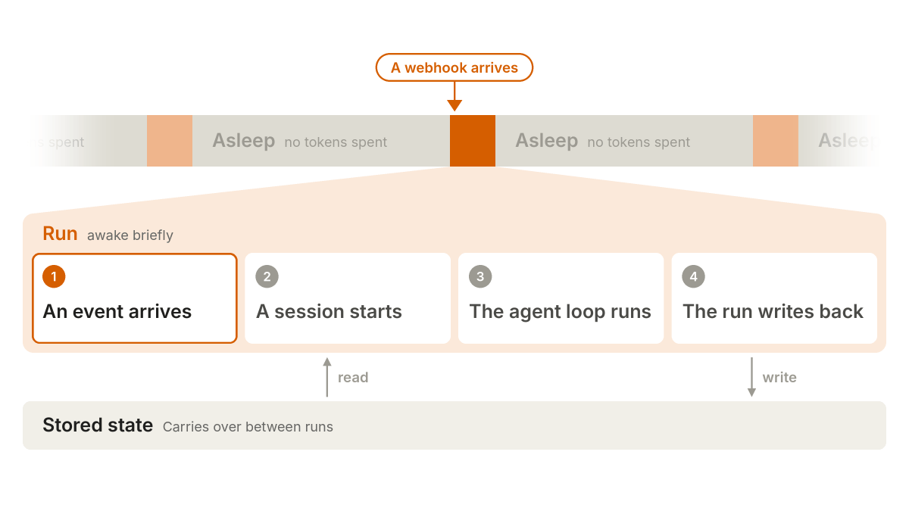
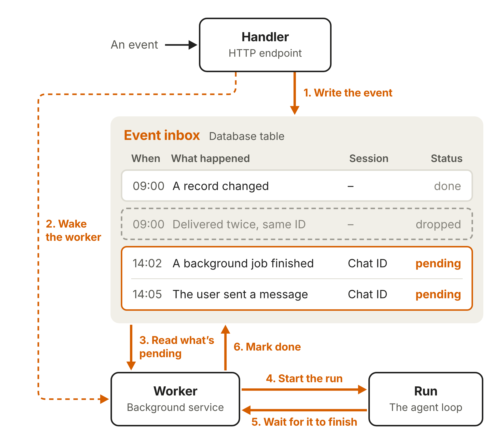
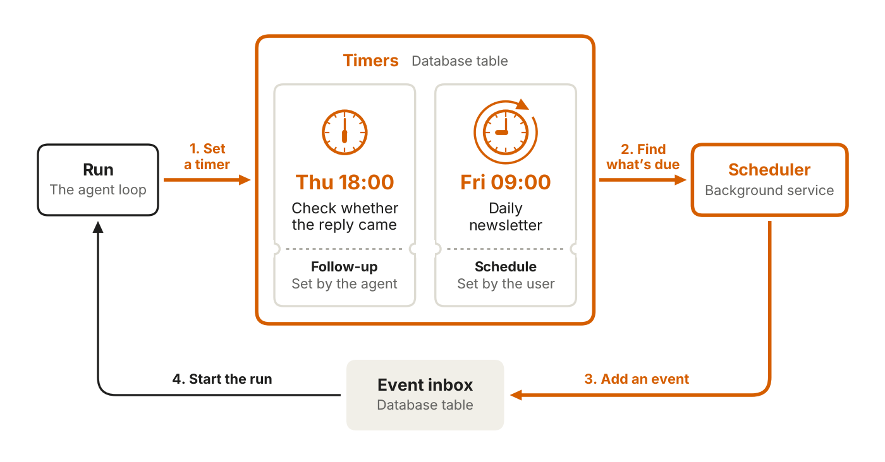
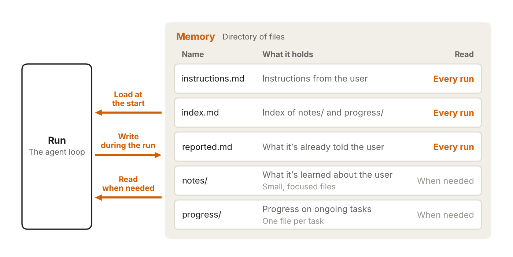
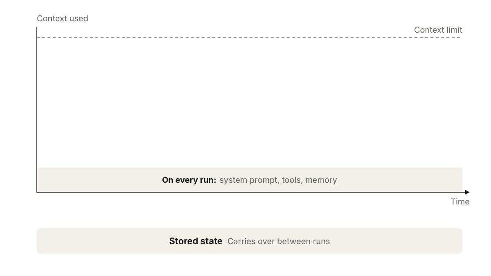
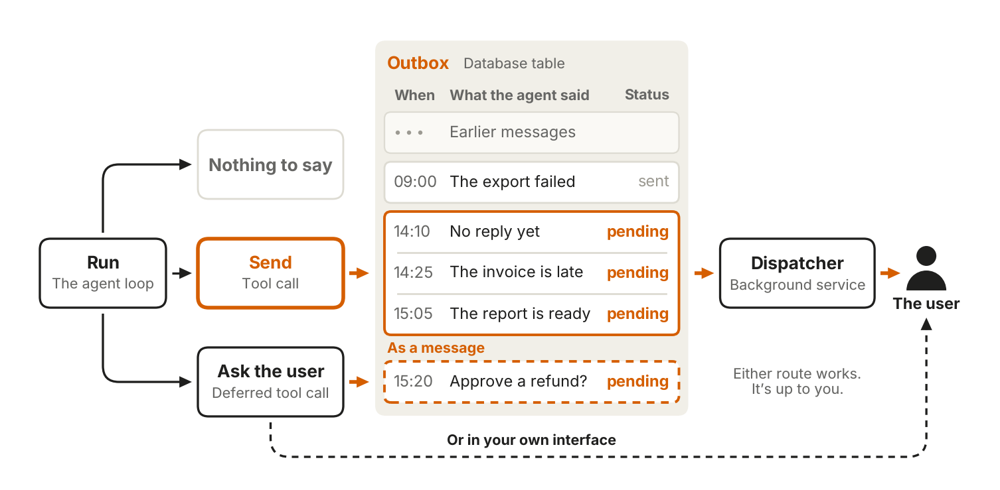
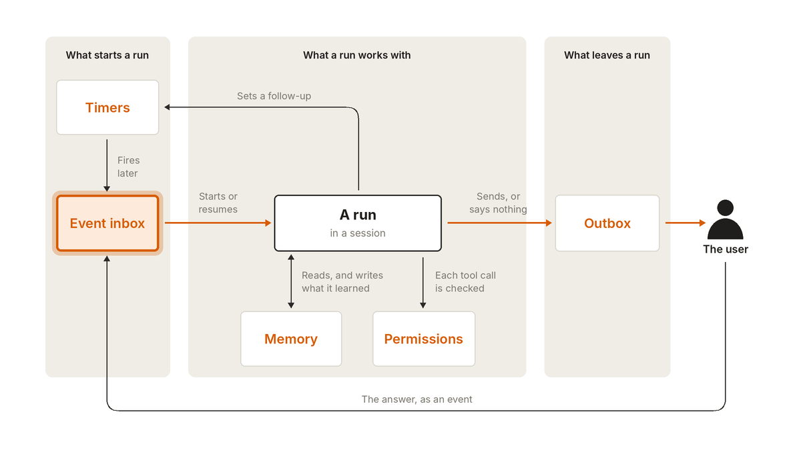

---
authors:
  - aitoboxrobot
categories:
  - 研究解读
date: 2026-11-15
hide:
  - navigation
tags:
  - AI智能体
  - 系统架构
  - 智能体原语
  - Anthropic
  - 持久化运行
title: "构建全天候 AI 智能体：驱动持久自主运行的五大核心原语"
---

# 构建全天候 AI 智能体：驱动持久自主运行的五大核心原语

**作者:** William Hu (特别鸣谢 Rodrigo Olivares 与 Michael Segner 的贡献)  
> *Written by William Hu. Special thanks to Rodrigo Olivares and Michael Segner for their contributions.*

---

### 文章背景与核心概要

传统 AI 智能体 (AI Agent) 大多依赖人类的主动呼叫与即时输入，处于“不问不动”的被动响应状态。然而，随着大语言模型 (Large Language Model, LLM) 推理判断力的飞跃以及长程任务执行成本的大幅下降，能够跨越会话边界、无需人工值守即可自主推进任务的“全天候智能体 (Always-On Agent)”正在成为现实。本文深入揭示了全天候智能体的工程本质——它并非永不停歇地狂刷 Token，而是在绝大部分时间保持“休眠”，并在事件触发时精准“唤醒”执行瞬时任务。围绕这一核心机制，文章解构了驱动持久自主运行的五大系统级架构原语：事件收件箱、定时器、持久化记忆、安全权限管理以及发件箱，为构建安全、经济且高可靠的自主智能体系统提供了极具指导价值的设计蓝图。

---

## 内容摘要

> ## Summary

全天候 AI 智能体 (AI Agent) 是一种具备状态记忆与主动行动能力的人工智能系统。它们能够跨越不同的交互会话妥善管理上下文，并在无需人类实时监督的情况下自主执行任务。得益于前沿大语言模型 (Large Language Model, LLM) 综合判断能力的跃升以及长程任务运行成本的大幅降低，这类智能体彻底颠覆了传统的常驻进程模式——它们绝大部分时间都处于静默“休眠”状态，仅在特定触发条件下定期唤醒以完成短暂的运行批次。本篇架构解析将深入剖析构建全天候智能体所必需的五大核心原语 (Primitives)：事件收件箱、定时器、记忆机制、权限控制以及发件箱。

> Always-on agents are stateful, proactive AI systems that manage context across sessions and execute tasks autonomously without direct supervision. Driven by recent model advancements (such as improved judgment and lower operational costs for long-horizon tasks), these agents spend most of their time "asleep" and wake up periodically to complete brief runs. This architectural breakdown explores the five core primitives required to build always-on agents: an event inbox, timers, memory, permissions, and an outbox.

---

## 全天候智能体的生命周期循环机制

> ## The Cycle Behind the Always-On Agent

所谓“全天候智能体”，在底层架构上其实并非真正一刻不停地处于“开机运行”状态——“全天候”仅仅是对用户感知体验的一种形象描述。

> An always-on agent is not actually "always on"—this is simply a description of the user experience. 

在真实的系统运行中，智能体绝大多数时间都处于休眠状态，只有当外界事件发生时才会按需唤醒去执行工作。我们将智能体单次连续的工作过程称为一次**运行周期 (Run)**：智能体接收到一个事件，完成对应的任务，并将运行过程中发生的重要信息持久化保存下来。而一个运行周期则依托于**会话 (Session)** 展开，会话完整记录了本次运行中所有的消息与工具调用日志。一旦当前运行周期的任务完成，智能体便会立刻重新归入休眠，如此周而复始、无限循环。

> In reality, the agent spends most of its time asleep, waking up periodically to do work. Each stretch of work is called a **run**: the agent receives an event, completes its task, and then saves information about what happened. A run works inside a **session**, which is the transcript of messages and tool calls. Once the run is finished, the agent goes back to sleep, and the cycle repeats indefinitely.

---

## 支撑全天候智能体的五大核心原语

> ## The Core Primitives

全天候智能体的外围系统架构牢牢扎根于五大核心原语之上：事件收件箱 (Event Inbox)、定时器 (Timers)、记忆机制 (Memory)、权限控制 (Permissions) 以及发件箱 (Outbox)。

> The surrounding architecture of an always-on agent relies on five core primitives: an event inbox, timers, memory, permissions, and an outbox. 

### 1. 事件收件箱 (Event Inbox)

> ### Event inbox

目前绝大多数 AI 智能体都采用“被动应答”模式，只有当用户在输入框发送消息时才会启动运行。与此截然不同的是，全天候智能体可以被多种多样的外部事件所唤醒，包括各类 Webhook 回调、定时调度任务以及后台异步作业等。

> Most AI agents only run when the user sends a message. In contrast, always-on agents can be triggered by many types of events, including webhooks, scheduled tasks, and background jobs.

很多开发者在起步时最容易想到的直观做法，是让每一个事件源直接调用智能体。然而，这种紧耦合的设计存在多个致命的故障隐患：举例来说，当两个外部事件恰好在同一时刻到达时，会同时触发两个相互竞争的运行周期导致数据覆写；而一旦宿主进程中途发生崩溃，未处理的事件就将彻底丢失。

> One tempting approach is to have each event source call the agent directly, but that has a few failure modes. For example, two events arriving at the same time can start competing runs, and a crash can lose an event entirely.

这正是“事件收件箱”必须登场的原因。在此架构下，所有外部事件源都不会直接惊动智能体，而是统一把事件投递到一个持久化的收件箱中，再由独立的工作进程 (Worker) 从容拾取并处理。

> This is where the event inbox comes in. Instead of calling the agent, every source sends an event to an inbox, where a worker picks it up.

最基础的事件收件箱通常由三大组件构成：
* **持久化事件列表**：通常由一张数据库表实现；
* **事件接收处理器 (Handler)**：通常为一个轻量的 HTTP 接口端点，负责将传入的事件写入事件列表；
* **工作进程 (Worker)**：通常为一个后台常驻服务，负责轮询或监听并从事件列表中读取待处理事件。

> The simplest version has three components:
> * A durable list of events, usually a database table;
> * A handler, usually an HTTP endpoint, that writes events to the list; and
> * A worker, usually a background service, that reads from the list.

收件箱需要严密跟踪每个事件的流转状态，并依据事件源提供的全局唯一标识符进行精准去重。关系型数据库是构建收件箱的理想之选，每个新到达的事件都会作为一行新记录追加写入表中。在架构规划初期，我们建议先为每位用户分配一个专属的收件箱；随着业务对并发度要求的提升，后续还可以按业务维度进一步拆分拓展。

> The inbox should track the status of each event, and events can be deduplicated based on unique identifiers from the source. A relational database works well for the inbox, with every event appended as a new row. We recommend starting with one inbox per user, but you can split this further if you need more parallelism.

每当有新事件到达系统时，接收处理器会将该事件写入收件箱数据库，并向工作进程发出唤醒信号。工作进程随即拉取所有处于待处理状态的事件，并正式启动一次运行周期。对于那些需要延续此前上下文的事件（例如用户发送的追问或后续回复），工作进程会选择唤醒并恢复原有的会话；而对于全新的独立任务，则会直接开辟一个全新的会话。

> When a new event comes in, the handler writes the event to the inbox and wakes the worker. The worker reads whatever is pending and starts a run. Events that continue earlier work, such as a reply from the user, resume an existing session, while everything else starts a new session.

随后，工作进程将待处理事件移交给智能体的主执行循环，静待本次运行周期圆满完成，最后将对应的事件记录标记为已完成。在工程实现中，以下最佳实践至关重要：
* **接收处理器必须秒级快速确认响应**：许多外部系统（如第三方 Webhook 服务提供商）会将响应缓慢的请求判定为超时失败。因此处理器仅应执行极轻量的数据校验，而任何耗时较深的安全性审查（例如提示词注入检查）都应延迟到智能体运行周期内去执行。
* **收件箱必须作为系统的唯一真实数据源 (Single Source of Truth)**：当工作进程被唤醒时，首要动作必须是从收件箱中拉取最新的事件记录。如此一来，即使工作进程在运行中途突发崩溃宕机，新启动的替代进程也能立刻从收件箱中拾取同一事件并安全重试。
* **单个收件箱同一时刻应仅允许一个活跃的工作进程运行**：这一单写限制能彻底杜绝两个并行运行周期之间出现重复执行或相互覆盖数据的风险。当运行中途有突发的新事件到达时，系统可以选择将其顺延至下一轮运行、无缝合并进当前正在执行的批次，或者立即中断当前任务并重设运行。
* **工作进程应当把积攒的待处理事件批量打包合并**：举个例子，如果用户在短时间内连续发送了多条零散消息，工作进程可以巧妙地将它们合并到同一个运行周期中，这样智能体仅需组织一次综合回复即可，既降低了交互延迟，又节省了宝贵的 Token 成本。

> From there, the worker passes the events to the agent loop, waits for the run to finish, and marks the corresponding events as done. Best practices include:
> * **The handler should acknowledge events quickly**. Some sources, such as webhook providers, treat slow responses as failures. The handler can still run lightweight checks, but any deeper verification, such as checking for prompt injection, should be done during the run.
> * **The inbox should be the source of truth**. When the worker is woken up, it should pull the latest events from the inbox first. That way, if the worker dies mid-run, a new one can pick up the same event and retry.
> * **An inbox should only have one active worker at a time**. This prevents two runs from duplicating work or overwriting each other. When a new event shows up mid-run, you can either push it to the next run, fold it into the current run, or interrupt and restart.
> * **The worker should batch pending events together.** For example, if the user sends several messages in a row, the worker can merge them into a single run, so the agent only needs to reply once.

### 2. 定时器 (Timers)

> ### Timers

如果说事件收件箱赋予了智能体感知外部世界的能力，那么定时器则是让全天候智能体具备“主动出击”超能力的关键所在。在业务场景中，定时器通常划分为两大类别：**跟进追踪 (Follow-ups)** 与 **周期调度 (Schedules)**。跟进追踪是智能体为自己设定的行动截止期限，比如“等待用户回复并在两小时后检查跟进”；而周期调度则是按照已知的时间频率周期性循环触发的任务，比如“每天早晨 8 点定时生成的晨报摘要”。

> Together with the event inbox, timers let always-on agents be proactive. Timers generally fall into one of two categories: follow-ups or schedules. A follow-up is a deadline that the agent sets for itself, such as checking in on a reply. A schedule, on the other hand, is a recurring task that happens on a known cadence, such as a daily newsletter.

定时器必须保存在独立的持久化数据存储中（通常是另一张独立的数据库表），严禁与事件收件箱混在一起。收件箱应当保持纯粹，只存放那些“当前时刻已经就绪、立即可执行”的事件。虽然单次跟进与周期调度可以共享高度相似的数据表结构，但周期调度还需要额外跟踪记录其循环发生的执行周期规则。

> Timers live in their own durable store, usually another database table, separate from the inbox. The inbox should only hold events that are ready to be worked on. A follow-up and a schedule can share a similar schema, but a schedule needs to track its recurrence as well.

值得注意的是，定时器本身并不能凭空直接启动一次运行周期。实际运作中，通常是由一个后台调度器 (Scheduler) 按照固定的时间间隔定期轮询定时器存储表，并将所有已经到期的定时任务触发激活。在每一次轮询扫描中，调度器会严格执行以下三步操作：
1. 扫描存储表，精准筛选出当前所有已经到达执行时间的定时器；
2. 根据定时器的业务类型分别更新其状态：
   1. 如果是跟进追踪定时器，直接将其状态标记为已完成；
   2. 如果是周期调度定时器，则将其下一次触发时间顺延更新为下一个周期点；
3. 将生成的对应触发事件写入事件收件箱，并唤醒工作进程展开工作。

> A timer doesn’t initiate a run on its own. Instead, a scheduler, usually a background service, polls the store at a fixed interval and fires anything that’s due. On each pass, the scheduler:
> 1. Scans the store and finds timers that are due.
> 2. Updates each timer based on its category:
>    1. A follow-up should be marked as done.
>    2. A schedule should get its due time updated to the next occurrence.
> 3. Adds an event to the inbox and wakes the worker.

### 3. 记忆机制 (Memory)

> ### Memory

全天候智能体的一大核心特征是跨越多次彼此断开的离散运行周期，因此必须高度依赖强韧的长期记忆系统来维系认知的连续性。

> Always-on agents work across many disjointed runs and rely on memory to maintain continuity.

与事件收件箱和定时器类似，记忆系统同样必须拥有专属的持久化存储底座。在诸如 Claude Code 的[自动记忆系统 (Auto Memory)](https://code.claude.com/docs/en/memory) 以及 Messages API 的[记忆工具 (Memory Tool)](https://platform.claude.com/docs/en/agents-and-tools/tool-use/memory-tool) 等先进工程实践中，记忆通常以结构化文件目录的形式落地实现。对于全天候智能体而言，这些文件目录应直接映射到底层持久化存储中（例如关系型数据库或云端对象存储），确保智能体的记忆能够超越具体工作进程的生命周期而永久留存。

> Similar to the event inbox and timers, memory should have its own store. In products like Claude Code’s [auto memory](https://code.claude.com/docs/en/memory) and the Messages API’s [memory tool](https://platform.claude.com/docs/en/agents-and-tools/tool-use/memory-tool), this is implemented as a directory of files. For an always-on agent, the directories should map to durable storage, usually a database or an object store, so memories outlive the worker.

根据经过实战检验的工程经验法则，智能体的记忆存储库应该且只应该存放那些“智能体无法通过实时检索再次获取”的关键信息：
* **用户指令规范 (User instructions)**：用户对智能体行为方式所作出的所有全局指令或要求，都应单独写入独立的文件中，并在每一次运行周期启动时第一时间加载；
* **用户个性画像 (User notes)**：智能体在长期协作中积累的关于用户的深度认知，例如用户的业务角色、工作偏好以及此前给出的纠错反馈；
* **历史通信轨迹 (Past messages)**：精准记录智能体已经向用户传达过哪些内容，防止在后续交互中出现烦人的多余废话或重复告知；
* **任务执行进度 (Task progress)**：针对每一个正在长线推进的复杂任务，维护一份动态进度文件，详细罗列哪些子步骤已经搞定、哪些步骤仍待攻坚。

> As a rule of thumb, memory should only hold what the agent can’t look up again:
> * **User instructions:** Any instructions from the user about agent behavior should be saved in their own file and loaded at the start of every run.
> * **User notes:** The agent should save what it’s learned about the user, such as their role, preferences, or corrections given.
> * **Past messages:** The agent should keep track of what it’s already told the user so nothing is repeated.
> * **Task progress:** For each ongoing task, the agent should keep a progress file covering what’s been done and what’s left.

#### 探秘上下文窗口内部构造

> #### Inside the context window

在正式执行具体任务之前，智能体会先行将系统提示词 (System Prompt)、工具定义以及核心记忆文件完整加载到上下文窗口 (Context Window) 中。我们强烈建议尽可能精简这些初始上下文的体积开销，并充分利用[提示词缓存 (Prompt Caching)](https://platform.claude.com/docs/en/build-with-claude/prompt-caching) 技术，从而成倍压降频繁唤醒带来的推理成本。

> Before doing any work, the agent loads the system prompt, tool definitions, and memory files. We recommend keeping this initial context overhead lean and using [prompt caching](https://platform.claude.com/docs/en/build-with-claude/prompt-caching) to lower costs.

### 4. 权限管理与安全防护 (Permissions)

> ### Permissions

权限控制无疑是全天候智能体架构中最具安全挑战的一环。在运行周期中，智能体承载着用户赋予的广泛访问权限，并在完全无人值守的环境下自主运转。针对每一次工具调用，智能体与外围系统必须审慎决断：究竟是自主放行、予以阻断，还是挂起等待人工审批？
* **凭据隔离存储 (Credential store)**：全天候智能体通常需要使用敏感的用户凭据（如服务密码或 API 访问 Token）。业界[官方推荐的设计模式](https://code.claude.com/docs/en/agent-sdk/secure-deployment#credential-management)是在中间部署独立的外部代理服务器，由代理在向外部发出请求时动态注入真实凭据，防止大模型自身直接接触或泄露机密；
* **自主运行模式 (Auto mode)**：全天候智能体必须具备在摆脱人工频繁干预的前提下自主推进工作的能力。类似于 Claude Code 中的[自动模式 (Auto Mode)](https://www.anthropic.com/research/claude-code-auto-mode)，系统可引入安全分类器 (Classifier) 对高风险操作实施动态审查，并果断拦截具有潜在危险的破坏性行为；
* **延迟工具调用 (Deferred tool calls)**：借助[挂起延迟工具调用的钩子机制 (Hooks)](https://code.claude.com/docs/en/hooks#defer-a-tool-call-for-later)，智能体可以在发起某项敏感调用的中途主动暂停当前运行周期，向用户抛出一个交互式卡片（例如基于 [MCP Apps](https://modelcontextprotocol.io/extensions/apps/overview) 构建的交互界面）请求确认授权，一旦用户完成审批输入，智能体便会立刻无缝恢复执行。

> Permissions are where always-on agents carry the most risk. A run holds the user’s access and operates unattended. For each tool call, the agent needs to decide whether to proceed on its own, block it, or wait for approval:
> * **Credential store:** Always-on agents often need sensitive user credentials like passwords or access tokens. The [recommended pattern](https://code.claude.com/docs/en/agent-sdk/secure-deployment#credential-management) is an external proxy that injects real credentials into outgoing requests.
> * **Auto mode:** An always-on agent should be able to work without constant user input. Similar to [auto mode](https://www.anthropic.com/research/claude-code-auto-mode) in Claude Code, classifiers can review higher-risk actions and block dangerous ones.
> * **Deferred tool calls:** Using [hooks to defer a tool call](https://code.claude.com/docs/en/hooks#defer-a-tool-call-for-later), an agent can pause a run mid-call, prompt the user for input via an interactive card (e.g., built with [MCP Apps](https://modelcontextprotocol.io/extensions/apps/overview)), and resume once the user answers.

### 5. 发件箱 (Outbox)

> ### Outbox

全天候智能体的绝大多数计算与探索工作都在安静的后台默默进行，这意味着用户最终期望接收到的是经过提炼的最终成果与精简摘要，而非滔滔不绝、逐步流式输出的过程流水账。

> Always-on agents do most of their work in the background, meaning the user receives outcomes and summaries rather than a step-by-step stream.

每一次运行周期的结束，通常归结为以下三种出口情形之一：
* 智能体生成通知或答复消息，并成功投递至发件箱；
* 智能体经过自主推理，判定当前事件处理无需向人类用户发送任何打扰通知；
* 智能体触发了延迟工具调用，需要暂停并向用户索取进一步的审批授权或关键补充信息。

> A run can end in one of three ways:
> * The agent sends a message to the outbox,
> * The agent decides that nothing needs to be sent, or
> * The agent uses a deferred tool call to request permission or additional input.

发件箱在工程实现上是一张独立的出站消息数据库表，并配备了一套专属的后台分发器 (Dispatcher) 服务。在产品体验层面，开发者需要严密调优智能体的发信阈值与消息频次——既要杜绝信息泛滥给用户带来严重的通知噪音与注意力骚扰，又要确保在关键节点绝不漏报重要进展。

> The outbox is a separate table of outgoing messages paired with a background dispatcher service. It's important to tune how many messages the agent sends to ensure it avoids being overly noisy or missing critical updates.

---

## 融会贯通：五大原语如何高效协同运转

> ## How Everything Fits Together

每一次运行周期都起源于事件收件箱中的一条就绪事件。工作进程拉取事件启动运行，并在特定的会话空间中唤醒智能体。智能体首先读取长期记忆建立对当前上下文的基准认知，随后严格在安全权限边界内自主调用工具开展工作，任务结束后实时更新记忆档案，并将最终的处理成果推送到发件箱以供分发给用户。用户的后续反馈或外部世界的新动作，又会化作全新的事件重新进入收件箱。正是这种闭环流动、不知疲倦的事件驱动反馈循环，在底层仅消耗极低资源的同时，为用户创造了宛如有一位顶尖专家时刻在线、全天候陪伴的持久自主智能体验。

> Every run starts with an event from the inbox. The worker kicks off a run, waking the agent in a session. The agent reads memory for a baseline, operates within its permission boundaries, updates its records, and pushes an outcome to the outbox for user delivery. This continuous feedback loop creates the persistent experience of an always-on agent.
