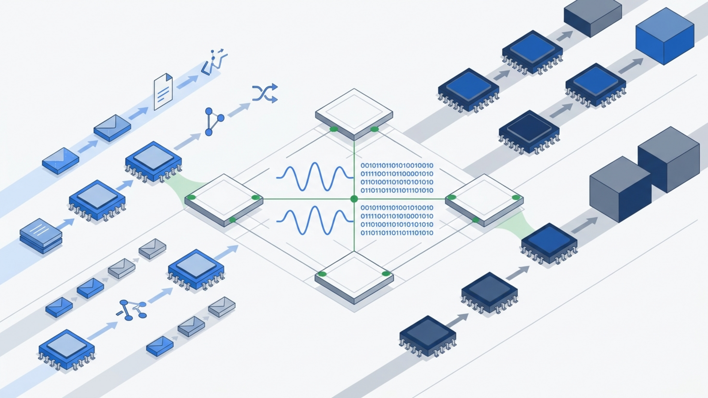
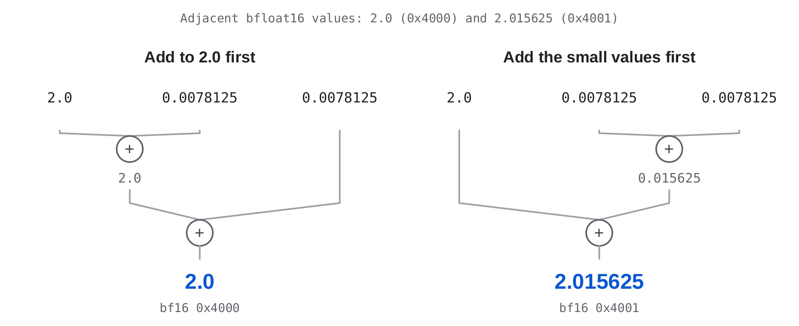
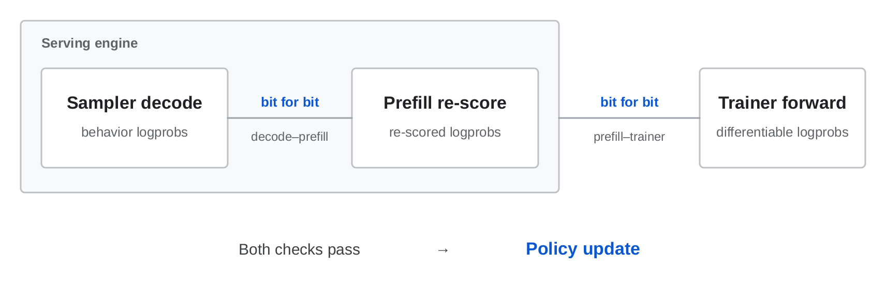
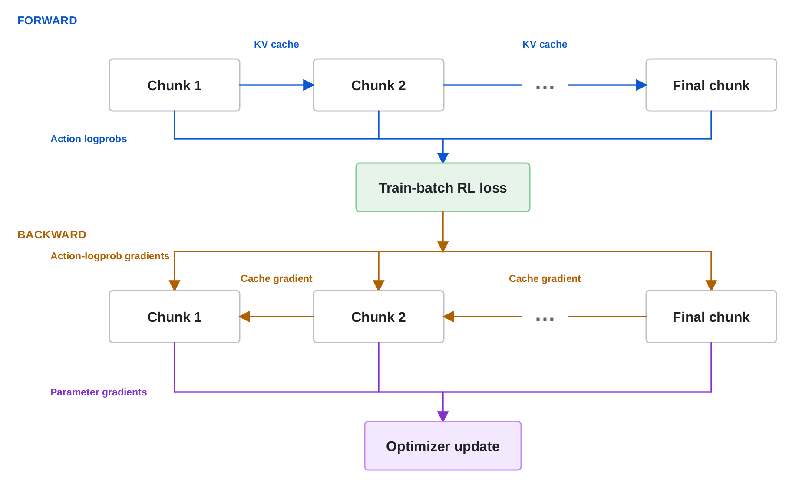
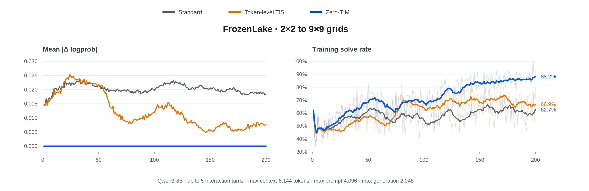

---
authors:
  - aitoboxrobot
categories:
  - 研究解读
date: 2026-11-17
hide:
  - navigation
tags:
  - 强化学习
  - TPU
  - JAX
  - 系统优化
  - 大语言模型
title: "在 TPU 上实现位级零误差的同策略强化学习"
---

# 在 TPU 上实现位级零误差的同策略强化学习

> # Unlocking Stable On-Policy RL on TPU with Bitwise-Zero Train–Inference Mismatch

**发布日期：** 2026 年 11 月 16 日  
> **Published Date:** November 16, 2026  

**作者：** Yuxuan Zhang (Software Engineer), Lin Chai (Senior Software Engineer), Lance Wang (Senior Software Engineer), Tianshu Bao (Senior Staff Software Engineer), Weiren Yu (Senior Product Manager)  
> **Authors:** Yuxuan Zhang (Software Engineer), Lin Chai (Senior Software Engineer), Lance Wang (Senior Software Engineer), Tianshu Bao (Senior Staff Software Engineer), Weiren Yu (Senior Product Manager)

### 文章背景与核心概要

大语言模型 (Large Language Model, LLM) 的强化学习训练对数值精度极其敏感，微小的计算误差即可导致训练严重失稳。然而在工业生产实践中，为了兼顾高吞吐与高算力，采样推理与梯度训练往往被切分在两条独立的计算流水线上；浮点运算在多轮长对话轨迹中累积的舍入偏差，悄然引入了隐秘的“异策略漂移”。为了攻克这一系统难题，Google Tunix 团队在 64 块 TPU v5p 集群拓扑上构建并验证了 Zero-TIM 架构，通过对分片内算子内核的精确固化、跨卡规约通信的严格时序重组以及自动微分与推理算子的解耦复用，首次实现了推理与训练在位级别 (Bitwise) 完全零误差的一致性。这项突破彻底消除了困扰分布式大模型强化学习的数值漂移，为业界在大规模 TPU 集群上稳定训练前沿推理模型树立了全新的技术标杆。

---

## 内容提要

> ## Summary

大语言模型 (Large Language Model, LLM) 的强化学习 (Reinforcement Learning, RL) 训练对数值不稳定性极其敏感。在轨迹采样生成 (rollout generation) 与梯度更新之间，哪怕产生极其微小的数值出入，都可能导致训练失稳甚至收敛停滞。在工业界实际的生产级强化学习系统中，采样与训练通常分别运行在独立的专用执行路径上；浮点数舍入误差随着多轮交互轨迹层层累加，无意间引入了隐秘的异策略 (off-policy) 偏差。

> Reinforcement learning (RL) for large language models is notoriously sensitive to numerical instabilities. Even tiny discrepancies between rollout generation and gradient updates can destabilize training or stall convergence. Production RL stacks typically run sampling and training through separate execution paths, inadvertently introducing a hidden off-policy gap that compounds over multi-turn trajectories due to floating-point rounding errors.

本文向大家介绍 **训练-推理位级零误差 (Zero Train–Inference Mismatch, Zero-TIM)**——该方案在开源库 [Tunix](https://github.com/google/tunix) 中构建，并在由 64 块 TPU v5p 芯片 (`DP8×TP8`) 组成的多主机集群规模下完成了验证。Zero-TIM 能够确保在模型权重完全相同的前提下，采样器与训练器针对完全一致的动作与 Token 历史，计算出在位级别 (Bitwise) 分毫不差的对数概率 (logprobs)，为 TPU 上的强化学习训练带来真正坚固的同策略稳定性。

> This post introduces **Zero Train–Inference Mismatch (Zero-TIM)**—developed in [Tunix](https://github.com/google/tunix) and verified at multi-host scale across 64 TPU v5p chips (`DP8×TP8`). Zero-TIM ensures that the sampler and trainer assign bitwise-identical logprobs to the same action and token history under identical weights, bringing true on-policy stability to TPU RL training.

---



---

## 问题的根源：隐秘的异策略偏差

> ## The Problem

在基于大语言模型的强化学习中，模型本身充当策略函数 $\pi(\text{action} \mid \text{previous tokens})$，而纯粹的同策略学习要求每次参数更新中的每一个动作，都必须由该策略本身生成并以完全一致的逻辑进行评估。尽管同步训练循环能够确保用于打分的模型权重与生成采样数据时的权重完全一致，但背后还有一个至关重要的数值计算前提：采样器与训练器对该策略的数值计算结果必须完全一致。

> In LLM RL, the model serves as the policy $\pi(\text{action} \mid \text{previous tokens})$, and true on-policy learning requires every action in an update to be generated and evaluated by that exact same policy. While a synchronous loop ensures each rollout batch is scored using the same weights that generated it, a critical numerical requirement remains: the sampler and trainer must evaluate that policy identically.

在实际生产实践中，强化学习架构通常将采样推理与模型训练划分到两条不同且高度优化的执行路径中：

* **采样器 (Sampler)**：在自回归增量解码 (incremental decoding) 期间逐一选择每个动作 Token，并记录其行为对数概率；
* **训练器 (Trainer)**：在批量前向和反向传播计算中评估相同的 Token，从而计算其当前对数概率以及梯度。

> In practice, production RL stacks run sampling and training through separate, specialized execution paths:
> * **The sampler** chooses each action token during incremental decoding and records its behavior logprob.
> * **The trainer** evaluates the same token in batched forward-backward passes to compute its current logprob and gradients.

即便在模型权重毫无二致的情况下，这两条截然不同的执行路径依然可能针对同一个上下文和相同的 Token，计算出存在细微差异的对数概率。从算法调度逻辑来看，整个训练流程虽然名义上是同策略的，但在底层数值计算层面，却悄然潜入了隐秘的异策略偏差，并在多轮交互的长轨迹中如滚雪球般累积放大。

> Under the same weights, these differing execution paths can still assign different logprobs to the same token and context. The training schedule is on-policy, but the numerical execution has introduced a hidden off-policy gap that compounds over multi-turn trajectories.

---

## 偏差由何而来：浮点运算的非结合律

> ## Why It Happens

计算机中的规约 (reduction) 运算本质上是由浮点数加法构建的计算树。由于浮点加法并不满足数学上的结合律，计算树的结构一旦改变，舍入发生的位置也会随之改变。这种效应在精度低于 float32 的 **bfloat16** 格式下尤其容易暴露。

> A reduction is a tree of floating-point additions. Floating-point addition is not associative, so changing the tree changes where rounding occurs. The effect is easier to expose in **bfloat16**, which retains less precision than float32.

下面这个 bfloat16 示例清晰地展示了规约加法顺序带来的影响：

> The following bfloat16 example isolates the effect of reduction order:


图 1: 在数值 2.0 附近，每个 0.0078125 输入刚好是到达下一个可表示 bfloat16 数值距离的一半。“舍入到最近的偶数”规则在单独相加时会丢弃每个输入；而先将相同的小输入合并相加，则能顺利进位到下一个数值。

> **Figure 1.** Near 2.0, each 0.0078125 input is half the distance to the next representable bfloat16 value. Round-to-nearest-even discards each input when added separately; grouping the same inputs first reaches the next value.

同样的问题也会在深度学习模型的规约计算中频繁出现：矩阵乘法需要累加部分和 (partial sums)，归一化层需要计算统计量，张量并行 (tensor-parallel) 的不同分片需要汇总合并各自分片的部分输出。在我们早期的系统实现中，采样器的解码过程与训练器的前向传播采用了不同的 Token 数组形状以及不同的前向计算实现方式。JAX 会根据输入张量的形状专门特化编译计算图，而且训练时的前向传播是在自动微分程序内部运行的。

> The same issue appears in model reductions: matrix products accumulate partial sums, normalization computes statistics, and tensor-parallel shards combine partial outputs. In our original stack, sampler decode and trainer forward used different token-array shapes and forward implementations. JAX specializes computations to their input shapes, and the training forward also runs inside a differentiated program.

在这些不同的执行路径之间，规约加法的顺序以及中间计算精度未能保持严格一致。微小的浮点舍入差异最终转化为对数概率在二进制位层面的不同。模型权重和数学公式虽然完全一样，但底层的实际算术计算过程却各不相同。

> Across these paths, reduction order and intermediate precision were not consistently aligned. Floating-point rounding turned those arithmetic differences into different logprob bits. The weights and model equations were identical; the arithmetic was not.

---

## 对齐约定：三方一致性校验契约

> ## The Alignment Contract

这项对齐约定十分明确：在采样解码 (sampler decode)、推理预填充 (serving prefill) 以及训练前向传播 (trainer forward) 这三条路径之间，对于每一个被采样的动作，都必须产生位级完全一致的对数概率——在相同的采样权重、Token 历史和采样配置下，直接对比底层原始的浮点字节，允许的舍入误差或公差为绝对的零。

> The contract is simple: across sampler decode, serving prefill, and trainer forward, all three paths must produce bitwise-identical logprobs for every sampled action—comparing raw floating-point bytes under the same rollout weights, token history, and sampling settings, with zero rounding or tolerance.

为什么是三条路径而不是两条？在一个解耦的强化学习系统栈中，如果直接发现采样器与训练器存在数值分歧，我们只能确认存在数值偏差，却无法定位偏差究竟是在哪个环节产生的。通过引入推理预填充作为中间检查点，数值对齐转变成了一套**任何强化学习架构均可采用的系统化两步诊断机制**：

> Why three paths instead of two? In a decoupled RL stack, a direct sampler–trainer disagreement shows that a numerical gap exists, but not where it enters. Introducing serving prefill as a middle checkpoint turns alignment into a **systematic two-step diagnostic that any RL stack can adopt**:

* **采样解码 vs. 推理预填充**：验证推理服务引擎在自回归增量 Token 生成与全序列重新打分之间，自身内部是否完全一致。
* **推理预填充 vs. 训练器**：验证推理服务引擎与训练引擎在跨越不同编译优化与自动微分边界时，是否保持完全一致。

> * **Sampler decode vs. prefill** verifies that the serving engine agrees with itself between incremental token generation and full-sequence re-scoring.
> * **Prefill vs. trainer** verifies that the serving and training engines agree across compilation and differentiation boundaries.


图 2: 在完全相同的采样权重下，对推理引擎内部以及推理与训练边界之间的采样动作对数概率进行位级比对。

> **Figure 2.** Bitwise comparisons of sampled-action logprobs within the serving engine and across the serving–training boundary, evaluated at the same rollout weights.

---

## 我们如何在 TPU 上构建 Zero-TIM

> ## How We Built Zero-TIM on TPU

实现 Zero-TIM 并不需要把采样器和训练器强行合并为一个臃肿的单体引擎。相反，我们采用了一套**极具通用性的四步工程方案**，在跨多主机 TPU 网格拓扑上无缝衔接独立的推理与训练流水线：锁定分片内的算子内核累加过程、规范跨分片的规约顺序、标准化动作对数概率评分尾部，以及为推理内核封装自定义微分求导规则。

> Achieving Zero-TIM does not require merging the sampler and trainer into a single monolithic engine. Instead, we use a **generalizable four-part recipe** that bridges separate serving and training pipelines across multi-host TPU meshes: locking within-shard kernel accumulation, ordering cross-shard reductions, standardizing the logprob scoring tail, and wrapping serving kernels with custom differentiation rules.

### 1. 固化分片内算术累加机制

> ### 1. Fix Within-Shard Arithmetic

在每个张量并行秩 (rank) 内部，与批次无关 (batch-invariant) 的 Pallas 内核严格控制着累加顺序和中间精度。投影内核按固定顺序遍历收缩分块 (contraction blocks)，确保规约分块逻辑完全独立于当前处理的 Token 行数。部分积统一在 float32 精度下累加，仅在最后输出时进行显式类型转换。

> Inside each tensor-parallel rank, batch-invariant Pallas kernels control accumulation order and intermediate precision. Projection kernels traverse fixed contraction blocks in order, keeping the reduction blocking independent of token-row count. Partial products accumulate in float32, with explicit output casts.

生产环境中的内核在遍历分块 (tile traversal) 之前先初始化暂存累加器，随后对每个分块执行以下核心计算：

> The production kernel initializes its scratch accumulator before the tile traversal, then applies this core to each tile:

```python
input_tile = x_ref[...]
weight_tile = y_ref[...]

partial = jnp.dot(
    input_tile,
    weight_tile,
    preferred_element_type=jnp.float32,
)
acc_ref[...] = acc_ref[...] + partial
out_ref[...] = acc_ref[...].astype(out_ref.dtype)
```

下一个分块的计算将直接从 float32 累加器继续累加，而不是从已经转换类型的输出值中读取。这种设计覆盖了注意力投影、MLP 投影以及语言模型头 (LM head)。我们还开发了专用内核来固化 RMSNorm 规约计算以及 SwiGLU 的中间类型转换，并保留了现有的 Pallas 分页注意力 (paged-attention) 前向算子。

> The next tile continues from the float32 accumulator, not the cast output. This construction covers the attention and MLP projections and the LM head. Dedicated kernels fix RMSNorm reductions and SwiGLU’s intermediate casts. The existing Pallas paged-attention forward is retained.

### 2. 规范跨分片规约顺序

> ### 2. Order Cross-Shard Reductions

对于行并行 (row-parallel) 投影，每个张量并行分片都会生成一部分局部输出。我们将跨卡通信与相加操作彻底解耦：先使用 `ppermute` 在卡间传输各个局部结果，然后让每个分片严格按照相同的源分片顺序进行累加。规约的顺序在代码逻辑中明确写死，而不再依赖集合通信库的隐式实现。

> For row-parallel projections, each tensor-parallel rank produces a partial output. We separate communication from addition: `ppermute` transports the partials, then every rank adds them in the same source-rank order. The reduction order is explicit in the program rather than selected by a collective implementation.

### 3. 共享动作对数概率计算路径

> ### 3. Share the Action-Logprob Path

一致性对齐不仅要覆盖模型输出的 Logits，更必须延伸至实际采样动作的概率计算。解码、预填充和训练器均采用相匹配的采样变换，使用同一套固定的 Pallas log-softmax 计算构造，并精确选取所记录的动作 Token。

> Alignment must extend beyond model logits to the probability of the sampled action. Decode, prefill, and trainer apply matching sampling transforms, use the same fixed Pallas log-softmax construction, and select the recorded action token.

预填充和训练器直接为采样阶段生成的动作进行打分，而不是重新选择新的动作。同时，我们在跨交互轮次中完整保留了采样的 Token ID，从而确保所有计算路径评估的都是完全相同的 Token 历史。

> Prefill and trainer score the action generated during rollout rather than choosing another action. We also preserve sampled token IDs across environment turns so that every path evaluates the same token history.

### 4. 为推理前向算子提供自定义微分求导

> ### 4. Differentiate the Serving Forward

训练器复用了推理服务的预填充计算逻辑。通过自定义向量-雅可比积 (vector-Jacobian products, VJP)，我们在前向评估中复用推理内核，并为其提供专门的反向传播规则。下面的矩阵乘法示例展示了这种设计分离：

> The trainer reuses the serving prefill computation. Custom vector–Jacobian products retain the serving kernels for forward evaluation and provide their backward rules. The matmul example shows this separation:

```python
@jax.custom_vjp
def serving_matmul(inputs, weights):
    return pallas_matmul(inputs, weights)

def matmul_forward(inputs, weights):
    output = pallas_matmul(inputs, weights)
    return output, (inputs, weights)

def matmul_backward(saved, output_gradient):
    inputs, weights = saved
    _, pullback = jax.vjp(
        differentiable_matmul,
        inputs,
        weights,
    )
    return pullback(output_gradient)

serving_matmul.defvjp(matmul_forward, matmul_backward)
```

可微副本严格复刻了推理内核的累加顺序和类型转换，但它仅用于构建反向拉回 (pullback) 梯度计算。前向计算产生的值依然完全来自推理服务的 Pallas 内核。

> The differentiable replica mirrors the kernel’s accumulation and casts, but is used only to construct the pullback. Forward values still come from the serving Pallas kernel.

在训练时，该前向算子置于可自动微分的 JAX 程序内部运行。我们通过 `XLA_FLAGS` 向编译器传递 `--xla_allow_excess_precision=false` 标志，从而抑制 Pallas 内核周边算术操作中产生的额外中间精度。

> Training places that forward inside a differentiated JAX program. We pass `--xla_allow_excess_precision=false` through `XLA_FLAGS` to the compiler process, constraining excess intermediate precision in the operations surrounding the Pallas kernels.

针对超长交互轨迹，系统将其划分为固定大小的分块 (chunks) 进行评估，并沿计算流传递分页键值缓存 (paged KV cache)。所有动作的对数概率都会注入到完整训练批次的强化学习损失函数中。反向传播过程沿着这些缓存连接反向传递梯度，并在优化器更新参数前汇总所有的参数梯度贡献。

> Long trajectories are evaluated in fixed-size chunks, carrying the paged KV cache forward. All action logprobs feed the complete train-batch RL loss. The reverse pass propagates gradients through those cache connections and combines parameter-gradient contributions before the optimizer update.


图 3: 键值缓存 (KV cache) 状态连接了前向计算分块；缓存梯度则连接了反向传播过程。在优化器更新参数前，系统会将所有参数梯度的贡献进行合并汇总。

> **Figure 3.** KV-cache state connects the forward chunks; cache gradients connect their reverse passes. Parameter-gradient contributions are combined before the optimizer update.

---

## 将前沿强化学习数值对齐能力引入 TPU

> ## Bringing Frontier RL Numerical Alignment to TPU

在整个 AI 系统社区中，消除训练与推理之间的不一致性，已迅速成为稳定大规模强化学习收敛的顶尖标配要求。最近的开源前沿成果——包括 [vLLM 与 TorchTitan 的结合](https://vllm-project.github.io/2025/11/10/bitwise-consistent-train-inference.html) 以及 [RadixArk/LMSys Miles](https://www.lmsys.org/blog/2025-11-19-miles/)——均已充分证明，批次无关内核与位级数值对齐技术能够有效防止策略优化过程中的异策略漂移。

> Across the AI systems community, eliminating train–inference mismatch has rapidly become a state-of-the-art requirement for stabilizing large-scale RL convergence. Recent open-source efforts—including [vLLM with TorchTitan](https://vllm-project.github.io/2025/11/10/bitwise-consistent-train-inference.html) and [RadixArk/LMSys Miles](https://www.lmsys.org/blog/2025-11-19-miles/)—have demonstrated how batch-invariant kernels and bitwise numerical alignment prevent off-policy drift during policy optimization.

我们的工作在 Tunix 中为 TPU 提供了基于 JAX/XLA 和 Pallas 的开源模块化实现。经过在 **64 块 TPU v5p 多主机网格 (`DP8×TP8`)** 上的严格验证，这些算子内核与集合通信模式提供了一套可复用的工程蓝图，便于工程团队直接采用并在分布式 JAX/TPU 架构上实现位级完全精准的同策略强化学习。

> Our work delivers an open-source, modular JAX/XLA and Pallas implementation of this contract for TPU in Tunix. Verified across a **multi-host 64 TPU v5p (`DP8×TP8`) mesh**, these kernel and collective patterns provide a reusable blueprint that teams can adopt to achieve bit-exact on-policy RL across distributed JAX/TPU stacks.

---

## 实验评估与测试结果

> ## Evaluation and Results

为了对我们的 TPU 内核进行基准测试，我们在合成的 FrozenLake 环境上运行了 200 步的数值验证测试，采用公开的 Qwen3-8B 检查点作为基线测试用例，并在由 64 块 TPU v5p 组成的 `DP8×TP8` 网格上运行。训练方案采用带留一法优势估计 (leave-one-out advantages) 的 GSPO-token 损失函数。我们将三种配置进行了对比：采用训练器旧对数概率且无额外采样修正的标准训练 (Standard)、Token 级别的截断重要性采样 (Truncated Importance Sampling, TIS)，以及 Zero-TIM。

> To benchmark our TPU kernels, we run a 200-step numerical verification test on the synthetic FrozenLake environment using a public Qwen3-8B checkpoint as a baseline test case using 64 TPU v5p chips with a `DP8×TP8` mesh. The recipe uses a GSPO-token loss with leave-one-out advantages. We compare Standard training with trainer-old logprobs and no additional sampler correction, token-level truncated importance sampling (TIS), and Zero-TIM.

Zero-TIM 配置还使用了 Token 进/Token 出 (Token-in/Token-out, TiTO) 处理，以跨环境交互轮次完整保留采样的 Token ID。对比基线则保留了其既有的分词处理路径。

> The Zero-TIM configuration also uses token-in/token-out (TiTO) handling to preserve sampled token IDs across environment turns. The comparison runs retain their existing tokenization paths.


图 4: 在 2×2 到 9×9 网格大小的 FrozenLake 环境中进行的单随机种子训练运行，最多支持 5 轮交互。两幅图均展示了前 200 个训练步。对数概率差异未经平滑直接绘制；求解成功率显示了浅色原始测量值和 10 步滑动平均曲线。曲线末端标签展示了最终 10 步的平均值。

> **Figure 4.** Single-seed training runs on FrozenLake grids from 2×2 through 9×9, with up to five interaction turns. Both panels show the first 200 training steps. Logprob differences are plotted without smoothing; solve rates show faint raw measurements and a ten-step trailing average. Endpoint labels show the final ten-step averages.

在该记录时间窗口内的每一个采样步，Zero-TIM 记录的采样器与训练器平均绝对对数概率差异均恒为零，同时其训练任务求解成功率稳步攀升。相比之下，标准训练与 TIS 均保留了非零的数值差异：TIS 仅仅是调整了这些误差对参数更新的贡献权重，并未从根本上消除底层的数值不匹配。在这些测试运行中，Zero-TIM 取得了显著更高的求解成功率。

> Zero-TIM records zero mean absolute sampler–trainer logprob difference at every logged step in this window, while its training solve rate increases. Standard and TIS retain nonzero differences: TIS adjusts their contribution to the update without removing the underlying mismatch. Zero-TIM reaches higher observed solve rates in these runs.

---

## 开源代码与最新进展

> ## Code and Updates

我们将 Zero-TIM 原型作为 [Tunix](https://github.com/google/tunix) 的一部分进行开发，Tunix 是 Google 面向 Cloud TPU 推出的开源原生 JAX 强化学习与后训练库。这些内核模式和三方验证契约均采用了模块化设计，能够极其便捷地集成到现有的多主机 JAX/TPU 推理与训练流水线中；目前我们正在积极推进将其支持扩展到线性注意力 (linear-attention) 以及混合专家模型 (Mixture-of-Experts, MoE) 架构。

> We developed the Zero-TIM prototype as part of [Tunix](https://github.com/google/tunix), Google's open-source, JAX-native library for LLM RL and post-training on Cloud TPU. The kernel patterns and three-way verification contract are modular by design—making them straightforward to adopt across existing multi-host JAX/TPU serving and training pipelines—and we are actively extending support to linear-attention and Mixture-of-Experts (MoE) architectures.

* [预览当前代码实现](https://github.com/google/tunix/blob/yuxzhang/canon-zero-tim/canon-zero-tim/blog_reprod/README.md)

> * [Preview the current implementation](https://github.com/google/tunix/blob/yuxzhang/canon-zero-tim/canon-zero-tim/blog_reprod/README.md)
