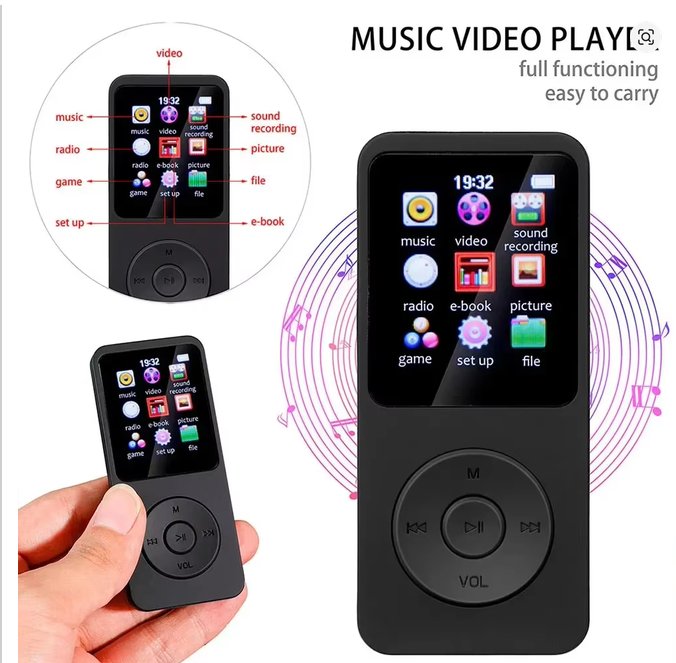
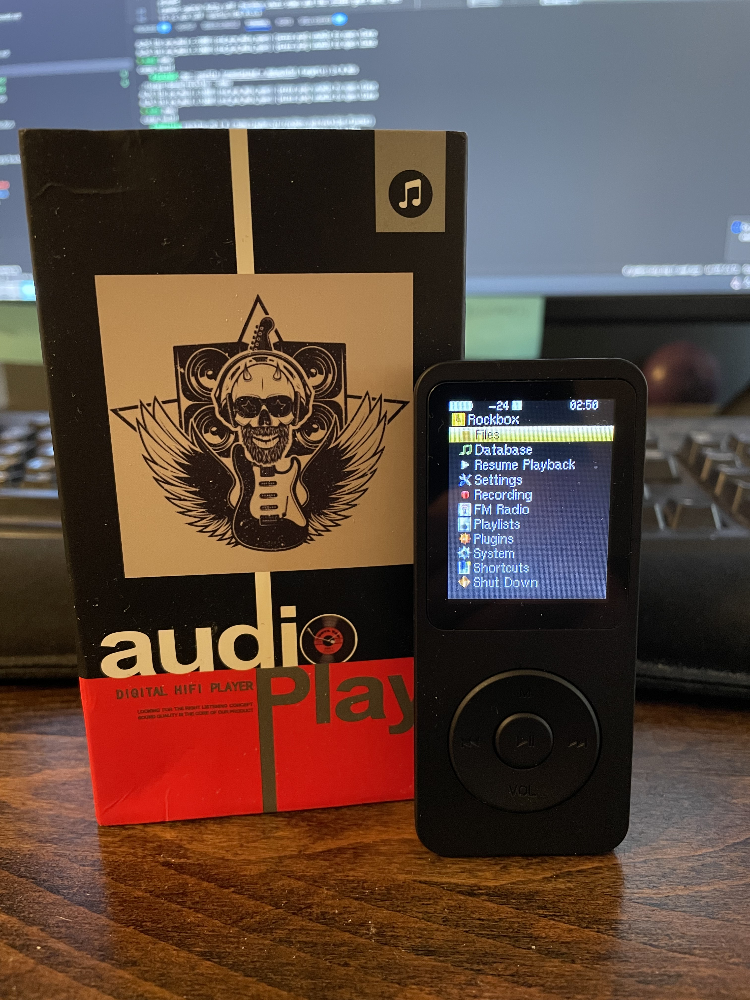
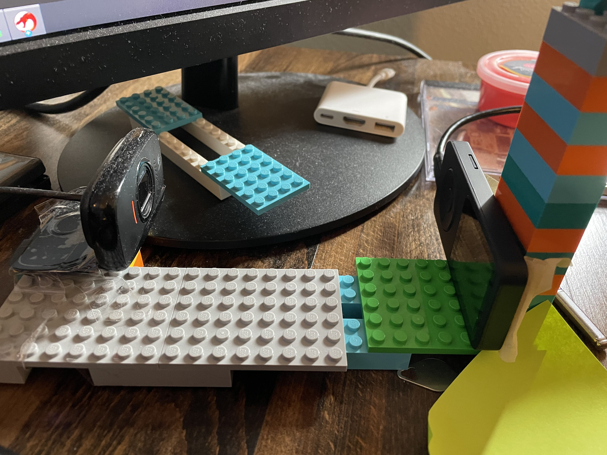
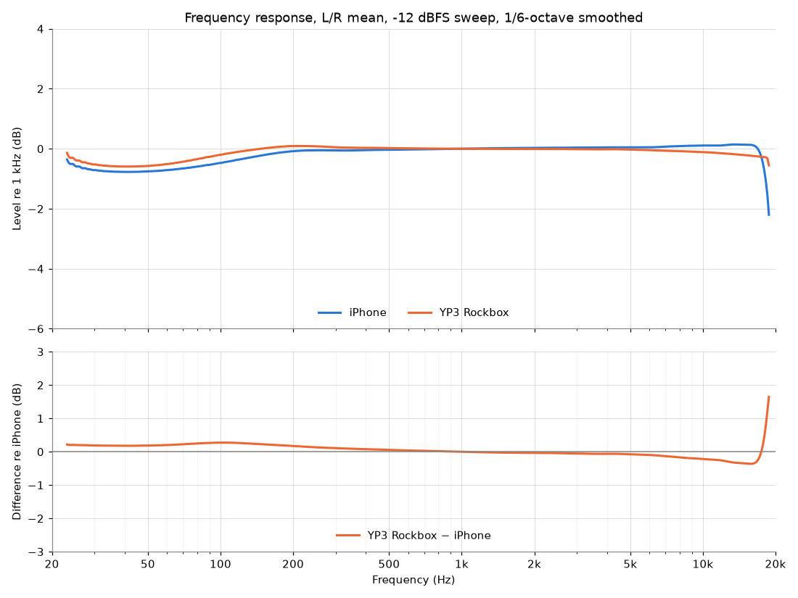
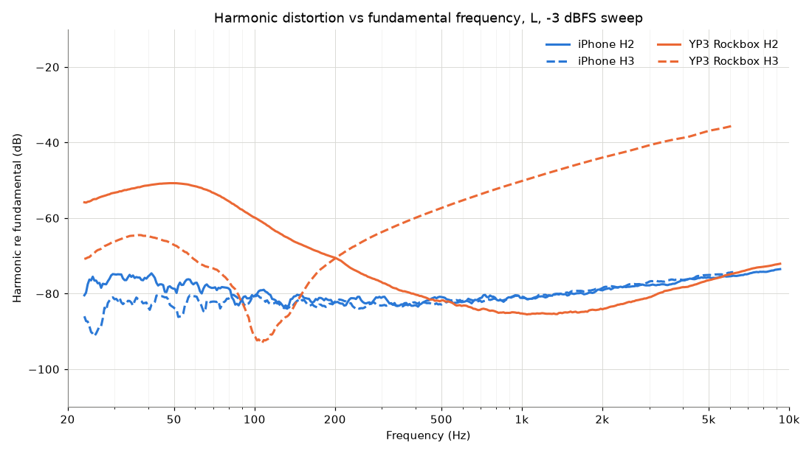
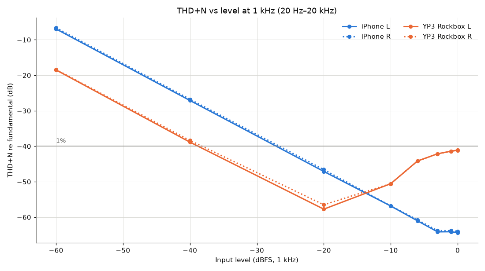
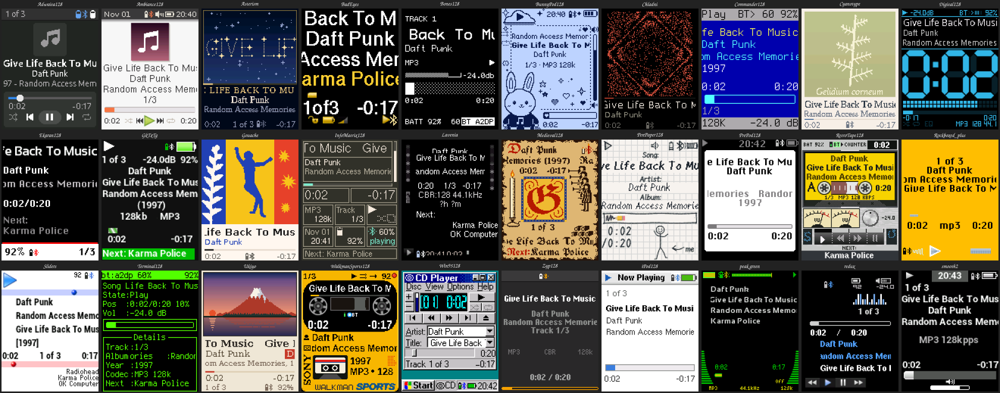
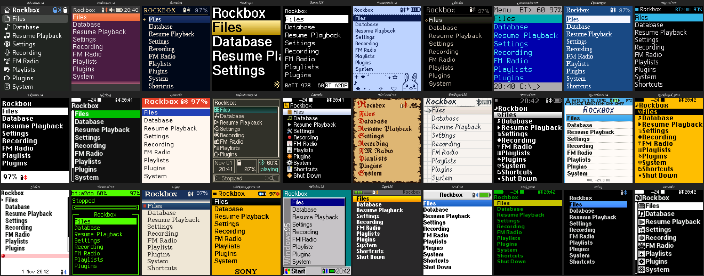

---
authors:
  - aitoboxrobot
categories:
  - 工具教程
date: 2026-11-22
hide:
  - navigation
tags:
  - 嵌入式开发
  - 逆向工程
  - AI 智能体
  - Rockbox
title: "利用大模型将 Rockbox 固件移植到 9 美元 AliExpress MP3 播放器"
---

# 利用大模型将 Rockbox 固件移植到 9 美元 AliExpress MP3 播放器

> # Porting Rockbox to an Undocumented $9 AliExpress ‘YP3’ MP3 Player with LLMs

### 文章背景与核心概要

作者借助 Claude / Opus 5.5 大语言模型 (Large Language Model, LLM) 智能体 (AI Agent) 与 Ghidra MCP 逆向工具，在完全不拆机、不焊接任何排线的纯软件环境下，奇迹般地将经典开源音频固件 Rockbox 移植到了一款售价仅 9 美元、毫无硬件文档的 AliExpress “YP3” MP3 播放器上。面对仅有 512 KiB SRAM 的极限内存瓶颈（远低于 Rockbox 以往 2 MiB 的官方最低运行门槛），AI 智能体通过网络摄像头、音频线路输入与定制的双向 USB 终端，通宵达旦地自主完成了逆向分析、固件烧录、驱动适配与压力测试，甚至实现了蓝牙音频传输及 357 款游戏插件移植。这项硬核工程不仅展现了 AI 在高难度嵌入式系统与底层驱动开发中的惊人自主潜能，更沉淀出了一套可复用的自动化固件移植工具箱。

---

## 概述

> ## Summary

借助大语言模型编程智能体（主要使用 Claude / Opus 5.5，并搭配 Ghidra MCP 逆向工具及净室逆向工程体系），作者成功将著名的开源播放器固件 [Rockbox](https://www.rockbox.org/) 移植到了一款硬件信息毫无公开文档、售价仅 9 美元的 AliExpress “YP3” MP3 播放器上。该播放器搭载了一颗神秘的国产芯片 Smartlink SL6801 片上系统 (SoC)，其内部仅有 512 KiB 的静态随机存取内存 (SRAM)——远低于 Rockbox 此前官方要求的 2 MiB 最低运行门槛。在完全无需电烙铁焊接、甚至连外壳都未曾拆开的纯软件操作下，AI 智能体配合网络摄像头、电脑音频输入口 (Line In)、蓝牙适配器以及扩展的双向 USB 开发者终端，完全自主地完成了固件烧录、驱动调试、XIP Flash 性能瓶颈分析以及通宵达旦的高强度破坏性测试。最终的移植固件不仅支持绝大多数主流音频编解码器、蓝牙音频与 HID 外设、纯磁盘音乐数据库和自定义主题，还具备约 20 小时的超长电池续航，并新增了多达 357 款游戏与插件；同时该项目还沉淀出了一套通用的自动化移植工具链 [auto-rockbox](https://github.com/jaydens-tasty-slop/auto-rockbox)，随后仅用 4 小时就成功将 Rockbox 移植到了另一款全新的播放器上。

> Using LLM coding agents (primarily Claude/Opus 5.5 alongside Ghidra MCP and a cleanroom reverse-engineering setup), the author ported [Rockbox](https://www.rockbox.org/) to an undocumented, $9 AliExpress "YP3" MP3 player powered by a mystery Smartlink SL6801 SoC with just 512 KiB of SRAM—well below Rockbox’s previous 2 MiB minimum target. Operating entirely via software without soldering or opening the case, the agent used a webcam, PC line-in audio, a Bluetooth dongle, and an extended bidirectional USB dev shell to autonomously flash firmware, debug drivers, profile XIP flash bottlenecks, and torture-test the device overnight. The resulting port supports most major audio codecs, Bluetooth audio and HID devices, an on-disk database, custom themes, ~20-hour battery life, and 357 newly added games and plugins, while producing a reusable [auto-rockbox](https://github.com/jaydens-tasty-slop/auto-rockbox) toolkit that subsequently ported Rockbox to another player in just four hours.

---

对于各种经典 MP3 播放器和 iPod 而言，[Rockbox](https://www.rockbox.org/) 是一个充满极客情怀且历史悠久的第三方开源固件项目。当年给我的 [Sansa E200](https://en.wikipedia.org/wiki/Sansa_e200_series) 刷入 Rockbox 的经历，堪称我人生中的一次顿悟时刻：计算机无处不在，如果它们不能做一些很酷的事情，那只是因为还没有人花心思去为它们编写对应的程序而已。回想起来，这对我后来的职业生涯抉择起到了不可忽视的作用。

> [Rockbox](https://www.rockbox.org/) is a wonderful old custom firmware project for a variety of MP3 players and iPods. Flashing Rockbox to my [Sansa E200](https://en.wikipedia.org/wiki/Sansa_e200_series) was a seminal moment for me: computers were everywhere, and if they didn’t do cool things, it was because no one had bothered to program them to do so. Looking back, that played no small part in my choice of career.

然而到了 2026 年，市面上似乎已经找不到任何 Rockbox 官方支持的廉价 MP3 播放器了。逆向工程这样一套未知的嵌入式硬件平台，是我能想到的技术挑战中最艰难的事情之一。于是我决定咬咬牙，花大价钱订阅了带有高额补贴的 Token 套餐，打算把大模型的能力压榨到极限——而正好我手头就躺着这么一台在 AliExpress 上花 9 美元淘来的白菜价 MP3 播放器。

> It seems like in 2026 there aren’t any cheap MP3 players that Rockbox supports, though. Reverse engineering an embedded platform like this is one of the hardest things I can think of, so I decided to pay the big bucks for one of those subsidized token plans to push it as hard as I could—and I happened to have a dirt-cheap $9 AliExpress MP3 player lying around.

**太长不看 (TL;DR)**：AI 成功把 Rockbox 移植到了一台只有 512 KiB 内存的设备上，而我几乎全程都在甩手当掌柜。随后我让它基于第一次尝试中行之有效的经验，构建了一套可复用的工具包与移植技能库，接着 Claude 仅用了 4 个小时，就让 Rockbox 在另一款全新的 MP3 播放器 (TS47) 上顺利跑了起来。

> **TL;DR:** It ported Rockbox to a 512 KiB player, and I was barely involved. Then I had it build a reusable toolkit and set of skills for future ports based on what worked from the first attempt, and Claude was able to get Rockbox running on another MP3 player (TS47) in 4 hours.

- **演示视频**：[在 YouTube 上观看](https://www.youtube-nocookie.com/embed/4_XmC1UqO1U?si=zrLtwsddV3i1syp6)
- **项目主页**：[https://rockslop.jayd.ml](https://rockslop.jayd.ml)
- **移植工具箱**：[GitHub 上的 auto-rockbox](https://github.com/jaydens-tasty-slop/auto-rockbox)

> - **Demo Video:** [Watch on YouTube](https://www.youtube-nocookie.com/embed/4_XmC1UqO1U?si=zrLtwsddV3i1syp6)
> - **Project Website:** [https://rockslop.jayd.ml](https://rockslop.jayd.ml)
> - **Porting Toolkit:** [auto-rockbox on GitHub](https://github.com/jaydens-tasty-slop/auto-rockbox)

---

## 登场：神秘的 YP3 播放器

> ## Enter: The YP3

这是一款典型的白牌播放器，在 Amazon 和 AliExpress 上以各种如同乱码辅音拼凑出的山寨品牌名进行销售。如果你从 Alibaba 上大批量批发，单个进货价甚至还不到 7 美元。

> This is an unbranded player sold under a variety of fake consonant-soup brands on Amazon as well as AliExpress. You can order them wholesale from Alibaba for less than $7 each.

在系统内置的“关于”菜单里，它将自己标识为 `yp3_2.0.43`。[这里似乎是 YP3 的一个购买链接](https://www.aliexpress.us/item/3256807764385286.html)（我当初买的原始商品页面已经下架了；我买的时候包邮花了 9.71 美元）。

> It identifies itself as `yp3_2.0.43` in the "About" menu. [This appears to be a listing for a YP3](https://www.aliexpress.us/item/3256807764385286.html) (the original listing is gone; I paid $9.71 shipped for mine).

> 💬 [原文提示 / Original Note]:
> **注意**：在大家急着跑去下单之前提醒一下，我还有另一款设备的 Rockbox 移植工作大概再过一两周就能完工——目前已经能够稳定开机，只需进行更多验收测试。那台设备非常相似，但配备了 4 MiB 的伪静态随机存取内存 (PSRAM)，因此做出的功能妥协要少得多。[打折促销时只需 20 美元](https://www.tengsen.vip/pages/mp3-player-w1.html)。
>
> 我手头还堆了一大堆各种随手买来的杂牌 MP3 播放器，打算后续挨个复现这个移植流程。详情可以查看项目主页：[https://rockslop.jayd.ml](https://rockslop.jayd.ml)。

> 💬 [原文引用 / Original Quote]:
> > **Note:** Before you run off and buy one, I have another Rockbox port that is probably a week or two out—it is booting and stable, and just needs more acceptance testing. That device is extremely similar but has 4 MiB PSRAM, so it has fewer compromises. [It was $20 on sale](https://www.tengsen.vip/pages/mp3-player-w1.html).
> >
> > I also have a stack of other random MP3 players I intend to repeat this with. See the project website: [https://rockslop.jayd.ml](https://rockslop.jayd.ml).

### 特别致谢

> ### Special Thanks

如果要论这项 Rockbox 移植项目最大的功臣，那非 [ilyakurdyukov](https://github.com/ilyakurdyukov/smartlink_flash) 莫属——正是他们摸清了如何让设备进入 ROM 下载模式（按住向下键 + 插上 USB 线），并编写了一个用于提取和烧写 Flash 固件的工具。正因如此，我才能像个投机取巧的小脚本小子一样坐享其成，完全不需要掏出电烙铁动手飞线。

> If anyone gets credit for this Rockbox port, it’s [ilyakurdyukov](https://github.com/ilyakurdyukov/smartlink_flash)—they figured out how to get the device into ROM Download mode (Down + USB) and wrote a utility to dump and write flash. Thanks to that, I could be a little slop kiddie and not have to use a soldering iron.

更多详细信息，欢迎查阅项目主页上的 [YP3 专题页面](https://rockslop.jayd.ml/players/yp3/)。

> See [the YP3 page](https://rockslop.jayd.ml/players/yp3/) on the project website for more info.

### 优点

> ### The Good

- 只要 9 美元。就算折腾坏了，随时再买一个也不心疼。
- 配备了 USB-C 接口和蓝牙！
- 带有物理复位 (Reset) 按钮孔，出现故障极易恢复。
- 绝不损坏硬件的“防变砖”机制（只要保留原厂 Bootloader）：按住向下键的同时捅复位孔，即可让设备进入 DFU USB 下载模式。
- 之前已经有前辈研究出了如何与 ROM DFU 模式通信并烧录固件。
- 该 ROM DFU 模式允许直接读写探测 Flash 和 RAM。

> - It costs $9. If it breaks, buy another one.
> - USB-C and Bluetooth!
> - There is a physical reset button, so the device is easily recoverable.
> - Unbrickable (if you keep the stock bootloader): holding Down while resetting brings you into a DFU USB download mode.
> - Someone had already figured out how to flash and interact with ROM DFU.
> - That ROM DFU mode lets you poke flash and RAM.

### 缺点

> ### The Bad

- **片上系统 (SoC)**：完全是来历不明的神秘国产芯片“Smartlink SL6801” / Jointbees。在整个互联网上根本找不到任何公开资料。
  - 双核 Cortex-M4 r0p1，CPUID 为 `0x410fc241`
  - 主频 192 MHz（原厂固件从不调节 CPU 频率）；集成浮点运算单元 (FPU)
  - 支持直接从 Flash 芯片片上就地执行代码 (Execute In Place, XIP)，但完全没有任何缓存 (Cache)——运行速度慢如蜗牛
  - 在通过 XIP 执行代码时，`cpu1` 总是排在 `cpu0` 后面等待，如果 `cpu0` 持续不断地从 Flash 中抓取指令，`cpu1` 就可能无限期停顿卡死（极易引发死锁）
- **SRAM**：仅有 512 KiB，外加专用于蓝牙无线电数据包的约 30 KiB
- **Flash**：2 MB Flash ROM
- **屏幕**：128×160 全彩 LCD（RGB565 像素格式）
- **按键**：只有 5 个按键——一个带中心按键的四向方向键（中心按键同时也是电源键，硬件直连电源管理芯片 PMU）
- **蓝牙**：具备蓝牙硬件，但协议栈没有任何文档记载

> - **SoC:** Complete mystery-meat Chinese "Smartlink SL6801" / Jointbees. Does not exist online.
>   - 2× Cortex-M4 r0p1, CPUID `0x410fc241`
>   - 192 MHz (stock does not vary CPU frequency); has an FPU
>   - Capable of Execute In Place (XIP) from flash, but has no cache at all—slow as dirt
>   - When XIP-ing code, `cpu1` always waits behind `cpu0` and can stall indefinitely if `cpu0` is continuously fetching instructions from flash (very easy to deadlock)
> - **SRAM:** 512 KiB, plus ~30 KiB for Bluetooth radio packets
> - **Flash:** 2 MB Flash ROM
> - **Display:** 128×160 full-color LCD (RGB565)
> - **Controls:** Only 5 buttons—a D-pad with a center press (the center press is power and is wired to the PMU)
> - **Bluetooth:** Present, with an undocumented stack

正因为这台播放器仅有区区 512 KiB 的 SRAM，而此前 Rockbox 官方支持的最小内存目标设备也有 2 MiB，我当时本来已经开始在 AliExpress 上翻找下一款播放器了——但大模型却信誓旦旦地说：“相信我兄弟，我肯定能搞定它。”于是我决定放手一搏，看看它的造化。

> Because it only has 512 KiB of SRAM and the smallest existing Rockbox target was 2 MiB, I was already scrolling AliExpress for another player—but the LLM said "trust me bro, I can make it happen," so I decided to try its luck.

### 糟糕之处

> ### The Ugly

- 虽然硬件非常便宜而且功能完好，但原厂自带的操作系统用起来简直是折磨。
- 在 USB 数据传输模式下，系统经常毫无征兆地崩溃并触发看门狗 (Watchdog) 强制重启。

> - While the hardware is cheap and functional, the stock OS is painful to use.
> - It regularly crashes and triggers the watchdog when in USB transfer mode.

---

## 固件移植的最终成果

> ## Where the Port Ended Up

*正在运行 Rockbox 固件的 YP3 播放器*

> *YP3 running Rockbox*

经过大约一周的奋战，设备终于成功启动了一个经过极限“节食瘦身”的 Rockbox 构建版本——每一个内存缓冲区都被削减到了骨头里，但它确实能够开机启动并正常播放音频了。至于后续的系统调优、Bug 修复以及细节打磨，又耗费了大约一个月的时间。

> After about a week, it was booting a build of Rockbox on a crash diet—every single buffer had been cut to the bone, but it could start and play audio. Tuning, bug fixing, and polishing took another month or so.

就硬件功能而言，据我所知目前没有任何硬件特性处于无法工作的状态。

> I am not aware of anything that isn’t working hardware-wise.

在功能上失去的最大特性，就是在听歌的同时并发运行插件。在标准版 Rockbox 中，音频编解码器和插件本来就是在运行时动态加载和换入换出的；但在这台播放器上，由于内存所限，两者必须共享同一块仅有 128 KiB 的内存区域 (Arena)，因此只要启动插件，正在播放的音乐就必须暂停。

> The main feature you lose is concurrency while playing music and running plugins. Codecs and plugins are already loaded and swapped around at runtime in normal Rockbox, but on this player there is one shared 128 KiB arena for both, so starting a plugin stops music playback.

### 阉割与功能妥协

> ### Cuts and Limitations

- 移除了语音用户界面 (Voice UI)；
- 仅支持英文语言；
- **数字信号处理 (DSP)**：移除了音调/播放速度控制、环绕声以及交叉渐变效果；
- 不支持分轨索引表 (Cuesheets)；
- 不支持专辑封面显示；
- 不支持主题背景壁纸；
- 移除了目录缓存 (dircache)，文件夹内容直接实时从 SD 卡中读取；
  - 超大文件夹默认截断为最多显示 256 项（可在 32 至 512 之间自由配置）；
- 播放列表上限被限制在 400 首歌曲以内；
- **精简掉的音频格式编解码器**：WMA Pro、Musepack (MPC)、RealAudio (Cook)、WavPack（16 位和 24 位 / 96 kHz），以及各种芯片音乐格式 SID、NSF、VGM、KSS、HES、SGC 和 ASAP。

> - No voice UI
> - Only English is supported
> - **DSP:** No pitch/speed control, surround, or crossfade
> - No cuesheets
> - No album art
> - No theme backdrop pictures
> - No dircache, so folders are read straight from the SD card
>   - Large folders are truncated by default at 256 entries (configurable from 32 to 512)
> - Playlists are capped at 400 tracks
> - **Cut codecs:** WMA Pro, Musepack (MPC), RealAudio (Cook), WavPack (16-bit and 24-bit/96 kHz), and the chiptune formats SID, NSF, VGM, KSS, HES, SGC, and ASAP

### 竟然成功保留下来的功能

> ### What Made It In, Somehow

- **音频编解码器**：支持 MP3（最高 320 kbps）、AAC/M4A（包括 AAC+；HE-AAC v2 以单声道播放）、WMA、Opus（最高约 192 kbps）、Ogg Vorbis、FLAC（立体声，最高支持 24 位 / 96 kHz）、ALAC、WAV、AIFF、AU、TTA、APE、Speex、MOD、SPC、AY、GBS、A52/AC3、ATRAC3、Shorten、ADX、VOX 以及 SMAF。
- **媒体数据库**：引入了一种全新的纯磁盘运行变体，采用同步阻塞式更新（意味着在刷新数据库时播放器会显示加载界面并暂停播放音乐，而不是在后台静默刷新）。我记得它还去掉了“按首字母查找歌曲”的菜单。数据库在运行时才会为其菜单申请内存，因此根据你所选主题占用的内存大小，它有时可能会因为内存不足而拒绝打开菜单。
- **主题界面**：各类主题（不包含背景壁纸）均可正常加载与显示，不过过于沉重复杂的主题可能会导致媒体数据库无法打开（系统会优雅地弹出警告提示，不会直接崩溃）。
- **蓝牙支持**：在短短一夜之间，Claude 就逆向工程搞定了整个蓝牙协议栈，并为 Rockbox 编写了一套完整的蓝牙硬件抽象层 (HAL)。我是在睡觉前给它下达的任务，第二天早晨醒来时它就已经能正常工作了。而且固件中没有打包任何闭源二进制 Blob：蓝牙协议栈其实已经被硬编码固化在了芯片自身的内置 ROM 中（而非外部 Flash），YP3 的蓝牙驱动直接对该芯片内置协议栈进行函数调用。

> - **Codecs:** MP3 (up to 320 kbps), AAC/M4A (including AAC+; HE-AAC v2 plays in mono), WMA, Opus (up to ~192 kbps), Ogg Vorbis, FLAC (stereo, up to 24-bit/96 kHz), ALAC, WAV, AIFF, AU, TTA, APE, Speex, MOD, SPC, AY, GBS, A52/AC3, ATRAC3, Shorten, ADX, VOX, and SMAF.
> - **The Database:** Features a new disk-only variant with synchronous, blocking updates (meaning the player shows a loading screen, stops music when refreshing, and doesn't refresh in the background). I believe it also cut the "songs by letter" menu. The database requests memory for its menus at runtime, so depending on the size of your theme, it can refuse to open the menus.
> - **Themes:** Themes (without backgrounds) load and work, though heavy themes can prevent the database from opening (handled gracefully with a warning).
> - **Bluetooth:** Overnight, Claude reverse-engineered the Bluetooth stack and wrote a Bluetooth HAL for Rockbox. I asked it before I went to bed, and it was working in the morning. No binary blobs are shipped: the BT stack is burned into chip ROM (not flash), and the YP3 Bluetooth driver calls directly into the stack.

#### 关于音频编解码器的说明

> #### A Note on Codecs

绝大多数音频编解码器像往常一样直接在 SRAM 中运行。然而，MP3、AAC、WMA、Vorbis 和 Opus 由于体积极大，根本无法体面地塞进我们这块紧巴巴的内存区域中，因此它们必须直接从外部 Flash 芯片中就地运行。

> Most of the codecs run from SRAM as normal. MP3, AAC, WMA, Vorbis, and Opus, however, wouldn’t fit in our arena nicely, so they run from flash.

由于我们设备的 XIP Flash 执行速度慢如龟爬，因此必须进行极为细致的性能剖析 (Profiling)，从而将执行最频繁的高频热点代码循环 (Hot loops) 重新搬移回高速 SRAM 中。这种极其繁琐的性能剖析在整个 Rockbox 的各个角落都进行了一遍——包括字体渲染、Alpha 混合透明通道、文本滚动等等。这也是后续那几个星期精细打磨所耗费时间最多的地方。

> Because our XIP flash is dirt slow, a lot of very careful profiling was done to move hot code loops back into SRAM. This kind of profiling had to be done all over Rockbox—for font rendering, alpha blending, scrolling, etc. That is where most of the weeks of polishing went.

### 电池续航表现

> ### Battery Life

续航时间在很大程度上与原厂固件相当。我把播放器连接到电脑的 Line In 音频输入口，或者连接到一个虚拟的蓝牙音频接收端 (Sink)，让它单曲循环播放 Daft Punk 的专辑 *Random Access Memories*，并在电脑上运行脚本，自动检测音频何时中断以计算播放时间。

> Battery life is largely comparable to stock. I hooked the player up to my PC’s line-in or a fake Bluetooth sink and set it to repeat Daft Punk’s *Random Access Memories*, using a script on the PC to detect when playback cut out.

- **原厂固件**：有线耳机播放 21.29 小时，蓝牙播放 20.07 小时
- **Rockbox 固件**：有线耳机播放 20.07 小时，蓝牙播放 19.30 小时

> - **Stock:** 21.29 hours wired, 20.07 hours on Bluetooth
> - **Rockbox:** 20.07 hours wired, 19.30 hours on Bluetooth

测试开始时电池的起始电压存在细微波动，而且这仅仅是一次单独的单轮测试，因此实际续航可能会有些许出入——但无论如何，这台小机器的电池续航能力依然令人印象深刻。

> There was some variation in battery voltage at the start and this was only a single run, so expect some variance—still, battery life is surprisingly impressive on this player.

---

## 移植思路与方法

> ## Approach

我是那种纯粹的“软件派”程序员——你就算拿枪指着我的脑袋，我也既不会摆弄电烙铁，也找不到电路板上的串口 UART 焊盘在哪里。因此，这完全是一次 100% 纯软件层面的移植尝试；我甚至从头到尾都没撬开过这台播放器的外壳。

> I’m one of those software guys—I can’t solder or find UART pads to save my life. This was an entirely software-only port; I haven’t ever opened mine up.

我配置连接上了 `ghidra-mcp` 工具，然后让 AI 智能体放手去把原厂固件抽丝剥茧。它成功摸索出如何在 Bootloader 模式下向正在运行的实时操作系统 (FreeRTOS) 动态注入任务，这使得它甚至在尝试正式启动 Rockbox 之前，就能够主动探测底层硬件并编写出基础驱动程序。

> I hooked up `ghidra-mcp` and let the agent start pulling the firmware apart. It figured out how to inject tasks into the running RTOS (FreeRTOS) in bootloader mode, which allowed it to probe the hardware and even write drivers before attempting a Rockbox boot.

老实说：这整个过程堪称 **100% 氛围编程 (vibecoded)**。它写出来的代码，我充其量只是粗略扫了几眼。我所贡献的主要是整体的开发思路与测试规划，充当着产品经理 (PM) 和测试工程师 (QA) 的角色，同时兼任智能体的“碳基人肉机器人”——在设备崩溃时帮它按键重启，或者在它调试蓝牙无线电射频信号时戴着耳机在房子里到处溜达。我本人已经很多年没有写过 C 语言和固件底层代码了。

> To be clear: this is *100% vibecoded*. I have only glanced at some of the code it wrote. I contributed the approach to development and testing, acted as the PM and QA person, and served as the agent’s little meat robot to reboot the device when it crashed or wander around my house with headphones on while it tuned the Bluetooth radio. I haven’t done C and firmware development for years.

### 净室逆向工程

> ### Cleanroom Reverse Engineering

最开始，我让同一个 AI 智能体同时负责逆向分析和具体代码实现。后来，我指示它把所有非硬件客观事实（即除了芯片寄存器地址定义之外的内容）全部推倒重来，采用严格的“净室 (Cleanroom)”架构重写了所有驱动程序：一个负责与 Ghidra 打交道的“脏区 (Dirty)”逆向智能体，一个居中把关防止任何专有代码泄漏的“裁判 (Referee)”智能体，以及一个纯粹根据规格说明编写干净代码的“实现 (Implementation)”智能体。在后续的其他设备移植中，从一开始就全面采用了这种架构的衍生版本。

> Initially, I let the same agent handle both reverse engineering and implementation. Later, I had it go through and rip out anything that wasn’t a hardware fact (i.e., a register) and redo the drivers with a cleanroom setup: one "dirty" agent with Ghidra, one referee agent in between to make sure nothing leaked, and one implementation agent. Subsequent ports used a variation of this setup from the beginning.

说句大实话，我在这整个项目中所亲自付出的最大工作量，其实就是写这篇博客文章。

> Honestly, the most work I have done personally on this project is writing this blog post.

### 给 AI 装上机器人的“眼睛”与“耳朵”

> ### Robotic Eyes and Ears

- **正对着屏幕的网络摄像头**：让大模型能够亲眼“看”到播放器屏幕上的即时显示状态，从而顺利编写调试 LCD 显示屏驱动；
- **摄像头内置麦克风**：用来调试扬声器喇叭的发声情况（中途有次 Claude 决定在凌晨 2 点大放测试音频杂音，逼得我不得不当场对它破口大骂）；
- **插入电脑 Line In 输入口的耳机线**：终于让我电脑上的音频输入接口派上了用场！这让智能体能够直接监听并细致调校模拟音频输出；
- **USB 蓝牙适配器**：插上蓝牙适配器后，直接将控制权彻底移交给智能体进行自动化测试，通过使用 Google 的 [Bumble](https://google.github.io/bumble/) Python 蓝牙协议栈，让电脑能够伪装成蓝牙耳机；
- **测试音频**：Claude 一直固执地选择经典名曲 *《We Will Rock You》* 作为测试音轨。我宁愿相信这是它在为 Rockbox 移植固件时，所展现出的一种微妙而幽默的冷笑话品味。

> - **Webcam pointed at the screen:** Allowed the model to see what the player was doing and develop the LCD drivers.
> - **Webcam mic:** Used for bringing up the speaker (I had to yell at Claude when it decided to start playing test tones at 2 AM).
> - **Headphone jack into PC Line In:** Finally found a use for my PC's Line In! This allowed it to test and tune audio output.
> - **Bluetooth adapter:** Plugged in a Bluetooth adapter and gave the agent full rein for testing, using Google’s [Bumble](https://google.github.io/bumble/) Python Bluetooth stack so the PC could pretend to be headphones.
> - **Test track:** Claude kept picking *"We Will Rock You"* as a test track. I choose to believe this is evidence of a subtle sense of humor when working on a Rockbox port.

### Opus 5.5 完胜 Sol

> ### Opus 5.5 »»»> Sol

这项移植工作最早是由 Codex / Sol 5.6 开工的。它虽然有所进展，但行事风格极度厌恶风险且慢吞吞——折腾了大约 5 天，中途让我手动重启了数十次，它才终于鼓起勇气觉得可以向硬件烧录点东西尝试开机了。

> This port was started with Codex/Sol 5.6. It made progress, but it was incredibly risk-averse and slow—it took about 5 days and dozens of manual resets on my part before it felt ready to flash something and boot it.

我早该提前教它如何配置硬件看门狗并在崩溃时自动重启回下载模式。Codex 确实通过打桩占位的方式糊出了有 Bug 的驱动，成功点亮了屏幕并显示出 Rockbox 的 Logo，但在此期间它显然已经陷入了某种“赛博癫狂”。由于我当时没有全程盯着它，它在原地打转的疯狂循环中竟然搞出了这些杰作：

> I should have told it sooner how to arm the watchdog and reboot into download mode itself. Codex got it to show the Rockbox logo with buggy drivers stubbed out, but had clearly lost its mind in the meantime. I hadn’t been paying close attention, and while spinning around it had:

- 在 2,567 个目录中疯狂生成了 55 GB 的海量文件（总计达 387 万个文件）；
- 编写了 443 个一次性的工具脚本和 384 份技术文档；
- 构建了一个极度疑神疑鬼的烧录工具，在写入数据时会对每一个数据块反复校验，结果足足花了 15 分钟才写完区区 2 MiB 数据；
  - 这个烧录脚本——以及它写的大量其它工具脚本——居然还会去校验*它们所依赖的文档文件的 SHA-256 哈希值*，以此确保没有任何文档被篡改过。从某种疯狂的角度来看，这种行为甚至带有一种荒诞的凄美感（这似乎是它试图在多个智能体协作与有限记忆窗口下解决状态同步的自创土办法），但本质上纯粹是走火入魔。
- 自行折腾出了一个极其繁文缛节的 MCP 服务器，专门围绕固件烧录、运行测试等任务封装了一大堆沉重的工具链。

> - Created 55 GB of files across 2,567 directories (3.87 million files total)
> - Written 443 one-off tool scripts and 384 documentation files
> - Built an incredibly paranoid flasher that verified each block as it was written, taking 15 minutes to write 2 MiB
>   - This flashing script—and many other tool scripts—checked the SHA-256 of the *documentation files they depended on* to ensure nothing had changed. It’s kind of beautiful in its own insane way (seemingly an attempt to work around multiple agents and memory limits), though pure madness.
> - Created an MCP server with tons of ceremony and tooling around flashing things, running tests, etc.

接手后，Claude 毫不留情地把这堆赛博垃圾全部扔进了垃圾桶，转而写了几个简洁明了的 Python 脚本搞定一切。此外，Claude Code 中的 Auto 自动模式也帮了大忙。

> Claude immediately threw that garbage away and wrote a few simple Python scripts instead. Auto mode in Claude Code helped too.

随后进行的 TS17 / TS47 播放器移植中，在 Opus 5.5 的加持下，从我刚把设备插上电脑算起，到成功跑出一个可用的 Alpha 测试版本，整个过程仅仅耗费了大约 4 个小时（除了脚本和工作流技能之外，几乎没有从 YP3 复制粘贴任何设备专属代码）。

> The subsequent TS17/TS47 port went from me plugging it in to a usable alpha build in about 4 hours with Opus 5.5 (with little reused from the YP3 other than scripts and skills).

### 双向 Rockbox 开发者终端

> ### Bidirectional Rockbox Dev Shell

这是智能体构建的最具价值的基础设施之一。Rockbox 本身自带一个单向输出调试日志的 USB 串口驱动，而我让智能体对其进行了扩展，加入了数十条反向控制播放器的交互指令——从注入按键模拟、截取屏幕画面，到对蓝牙无线电射频进行底层调试，应有尽有。

> This was one of the most valuable things it built. Rockbox has an existing one-way USB serial driver for logs, which I had extended with dozens of commands to drive the player—everything from injecting keypresses and taking screenshots to debugging the Bluetooth radio.

这对于实现彻底无人值守的自动化开发至关重要。我让它用 Python 编写了一套破坏性压力测试套件，通过对播放器进行长达数小时的随机乱按式“猴子测试 (Monkey Test)”。我们通过这种方式揪出了大量隐蔽的系统漏洞，其中甚至包括一些 Rockbox 上游主分支中潜伏已久的原生 Bug。截至目前，这台小播放器在 Rockbox 固件下已经累积完成了数百小时的自动化基准测试；我完全可以把它留在那里通宵跑测试，而 Claude 则会耐心地通宵守着日志，一旦捕获到新的崩溃就自主定位原因并打上补丁。

> This was critical for completely hands-off development. I had it build a torture-test suite in Python that monkey-tested the player for hours by pressing buttons at random. Many bugs were found this way, including some in upstream Rockbox. At this point, the player has hundreds of hours of bench testing under Rockbox; I could leave it running and Claude would patiently watch the test logs for new failures to diagnose and fix.

智能体能够完全自主地重启进入恢复模式、烧录固件、重启引导进入 Rockbox、自动化执行测试用例、感知屏幕上的实际渲染画面并倾听音频输出。该项目绝大部分的实质性研发工作，都是在我安然熟睡的深夜由 AI 独自搞定的。

> An agent can reboot to recovery, flash firmware, reboot into Rockbox, run tests, see what is on the screen, and hear what it is doing—completely on its own. Most of the development of this project happened while I was asleep.

### 音频调校

> ### Audio Tuning

为了进行音频测试（以及电池续航压力测试），Claude 指导我搭建了一个 3.5 mm 的音频一分二转接头：一端接入电脑的 Line In 音频接口，另一端则连接真实的耳机以提供实际的阻抗负载。

> For audio (and battery endurance testing), Claude had me set up a 3.5 mm splitter with one end going into the PC’s Line In and the other going into real headphones to provide an actual load.

接着我让它编写了一套测试程序并生成了对应的音频文件，里面包含了各种频率扫频信号与测试基准纯音。在整个测试环境中，我拿苹果原装的 Lightning 转 3.5 mm 转接头作为基准“标准答案 (Ground Truth)”，以对比音量电平与频响曲线。虽然我电脑上的内置声卡绝非专业的高精度仪器，但用来做基本的功能逻辑与合理性校验 (Sanity Check) 已经绰绰有余了。

> Then I had it build a test suite and audio file that played a variety of sweeps and test tones. I used an Apple Lightning adapter as the ground truth for this setup to compare audio levels and frequency response. My PC’s sound card is not high-sensitivity equipment, but it was more than enough for a sanity check.

更多连我也看不太懂的技术图表

> 
More charts that I don't understand

### 最棘手的硬骨头

> ### The Hardest Parts

在整个过程中，有两个极其刁钻的问题让 Claude 大费周章：

> There were two tricky issues that Claude struggled to fix:

1. **关机时序控制**：寻找完全正确的关机指令时序耗费了相当多次的反复试错。这主要是因为关机是极少数必须依赖我人工在现场按键测试的环节之一——Claude 没法在半夜完全自主无人值守地循环迭代测试关机。
2. **失真破音的 FM 收音机**：FM 广播收音机最初听起来音质惨不忍睹；虽然能够调谐搜到电台，但播放出来的声音严重失真、破音且被削顶。Claude 花了海量时间试图排查问题原因，直到最后我偶然发现：播放器界面上所显示的调谐频率，与电台在空中广播的真实呼号频率根本对不上！事实证明，收音机高频头在初始化时被误分配了一个稍有偏差的时钟源，导致整机调谐频率硬生生偏移了约 4 MHz。纯属巧合的是，调谐到我的测试电台时刚好能勉强蹭到另一个电台的边带信号，才导致听到了杂乱不堪的怪异音频。

> 1. **Power-off sequence:** Finding the exact power-off sequence took quite a few tries, likely because it was the one thing I had to be physically present to test—Claude couldn’t just iterate on it for hours overnight.
> 2. **Distorted FM radio:** The FM radio initially sounded terrible; you could tune to a station, but the audio was distorted and clipped. Claude spent forever trying to figure out why, until I eventually noticed that the frequency it reported being tuned to didn’t match the station identifier broadcast over the air. It turned out the tuner had been initialized with a slightly wrong clock source, putting it ~4 MHz off. By coincidence, tuning to my test station let it partially lock onto another station, resulting in awful audio.

---

## 其它新增特性

> ## Other New Features

### 疯狂的插件大移植

> ### Plugin Psychosis

我随口跟 Claude 说了一句：尽你所能把所有的开源小游戏都移植到 Rockbox 上来。

> I told Claude to port as many games as it could to Rockbox.

于是，本次发布一口气带来了多达 **357** 款全新插件——这绝对不是笔误。其中绝大部分是移植作品，还有几个是全新原创的。面对如此庞大的数量，我甚至都没来得及把每一个插件都全面测试一遍。

> This release adds **357** new plugins—not a typo. Most of these are ports, and a few are originals. Given the sheer quantity, I haven’t done enough QA across all of them.

#### 原创插件

> #### Originals

- **RockGPT**：这个插件好玩到值得专门单独写一整篇博客来介绍——这是一个直接运行在你的 MP3 播放器上的约 100 万参数的小型语言模型。逻辑勉强能够自圆其说，经过微调后展现出一种高冷且鄙视全人类的傲娇性格，模型权重实时从 SD 卡中分段流式读取，简直太绝了。
- **RockTrack**：专为 Rockbox 开发的简易音乐追踪器/芯片音乐 (Tracker/Chiptune) 编辑器。我手头还没抽出足够的时间深入体验，它的人机工程交互体验大概还需要进一步优化。
- **视频播放器 (Video Player)**：Rockbox 原生自带的 `mpegplayer` 体积过大，根本塞不进 YP3 的小内存中，而我又不想对原版代码大动干戈，于是便让 Claude 从头重写了一个新的视频播放器。它配备了极具质感的精致像素风 UI，并支持播放 AVI、MKV 和 MP4 封装格式（支持 MPEG-1/2 与 MJPEG 编码）。

> - **RockGPT:** This is going to get its own blog post because it is deeply amusing—a ~1 million parameter model running on your MP3 player. Almost coherent, fine-tuned to be aloof and dismissive of humanity, with weights streamed from the SD card. Crazy.
> - **RockTrack:** A little tracker/chiptune editor for Rockbox. I haven’t had a ton of time to test this one; it probably needs ergonomic improvements.
> - **Video Player:** Rockbox’s existing `mpegplayer` didn’t fit on the YP3 and I didn’t want to hack it up too much, so I had Claude write a new one with a nicer pixel-art UI and support for AVI, MKV, and MP4 (MPEG-1/2, MJPEG).

#### 移植作品

> #### Ports

移植的游戏数量多到根本列不完——[这里是完整的移植游戏列表清单](https://rockslop.jayd.ml/features/)——其中包括：

> There are too many to list—[here is the full set of ports](https://rockslop.jayd.ml/features/)—including:

- **Anarch** —— 开源自由版的经典 DOOM 仿制游戏；
- **蔚蓝经典版 (Celeste Classic)** —— 经典平台跳跃游戏（作者：Maddy Thorson, Noel Berry）；
- **MicroCity** —— 迷你城市建造模拟游戏（作者：jhhoward）；
- **Prizm Racing** —— 复古赛车竞速游戏（作者：duarteapcoelho）；
- **Rockcraft** —— 类似 Minecraft 的 3D 方块沙盒游戏（移植自 The Science Elf 开发的开源项目 *Blocks-TI-84*，遵循 MIT 协议）；
- **Terrario** —— 类似《泰拉瑞亚》的沙盒生存游戏（作者：KBD2）；
- **Jet Island** —— 3D 海岛风光演示 Demo（作者：CubeCoders）；
- **Rock88** —— 3D 渲染动态电影播放 Demo（作者：JetExamples）。

> - **Anarch** — FOSS DOOM clone
> - **Celeste Classic** — Platformer (Maddy Thorson, Noel Berry)
> - **MicroCity** — City builder (jhhoward)
> - **Prizm Racing** — Racing game (duarteapcoelho)
> - **Rockcraft** — Minecraft-style block sandbox (port of *Blocks-TI-84* by The Science Elf, MIT)
> - **Terrario** — Terraria-like (KBD2)
> - **Jet Island** — 3D island demo (CubeCoders)
> - **Rock88** — 3D-rendered film player demo (JetExamples)

#### 批量移植

> #### Bulk Ports

我们之所以能够达成如此庞大夸张的插件数量，秘诀在于直接针对几款主流的开源掌机编写了通用的兼容垫片层与模拟运行库：

> We hit absurd plugin counts by writing compatibility shims/libraries for several popular open-source handhelds:

- [Arduboy](https://www.arduboy.com/) 掌机生态：成功批量引入 240 款游戏；
- [Pokitto](https://www.pokitto.com/) 掌机生态：成功批量引入 23 款游戏；
- [Flipper Zero](https://flipper.net/) 极客玩具：成功批量引入 33 款应用；
- [Gamebuino](https://jayd.ml/2026/11/14/gamebuino) 掌机生态：成功批量引入 17 款游戏。

> - [Arduboy](https://www.arduboy.com/): 240
> - [Pokitto](https://www.pokitto.com/): 23
> - [Flipper Zero](https://flipper.net/): 33
> - [Gamebuino](https://jayd.ml/2026/11/14/gamebuino): 17

### 其它杂项功能

> ### Misc Features

- **增强型无线电数据系统 (Enhanced RDS)**：可解析显示广播节目类型名称、电台呼号缩写、当前时钟时间以及 RadioText+ 广播文本（歌曲名称与艺术家信息）；
- **充电上限保护 (Charge Limiter)**：视硬件支持情况而定，允许在 50% 到 100% 之间自定义设置电池充电截止阈值；
- **蓝牙 HID 外设驱动**：没错，你现在甚至可以把 PS4 游戏手柄或蓝牙键盘直接连接到你的 Rockbox 播放器上！我只是想彻底探寻现有的这套蓝牙协议栈极限究竟在哪里；
- **蓝牙耳机电量指示**：在顶部状态栏中以电池图标的形式直观显示已连接蓝牙耳机的剩余电量。

> - **Enhanced RDS:** Program type names, call letters, clock time, and RadioText+ (artist/title)
> - **Charge limiter:** Hardware-dependent, allows setting a 50–100% cap
> - **Bluetooth HID drivers:** Yes, you can pair a PS4 controller or keyboard to Rockbox. I wanted to see how much we could push the existing Bluetooth stack.
> - **Bluetooth headset battery indicator:** Shows the connected headset's battery level with an icon in the status bar

### 界面主题

> ### Themes

我让 Claude 从 Rockbox 官方主题库中移植了若干套经典主题，并自动适配了这块小屏幕的物理分辨率、加上了蓝牙状态指示图标，同时还自主生成了五款全新设计的原创主题：**Ukiyo**（我个人的最爱）、**Asterism**、**Chaldani**、**Lavenia** 以及 **Cyanotype**。

> I had Claude port several themes from the Rockbox website to fit this screen size, add a Bluetooth status icon, and generate five original themes: **Ukiyo** (my favorite), **Asterism**, **Chaldani**, **Lavenia**, and **Cyanotype**.

> 💬 [原文提示 / Original Note]:
> **注意**：以上均为开发进行中的早期截图；自那以后很多系统 Bug 都已被逐一修复，此外有少数几款主题由于开源许可协议不够明晰而被暂时移除。过于繁重的主题还可能会与媒体数据库抢占内存而导致异常，因此我强烈建议大家优先使用轻量级的主题方案。

> 💬 [原文引用 / Original Quote]:
> > **Note:** These are WIP screenshots; there have been bug fixes since, and a few themes were cut due to unclear licensing. Heavy themes can also cause memory issues with the database, so I suggest sticking with lightweight ones.

---

## 结语

> ## Fin

在没有任何官方文档与技术规格书的前提下，逆向工程一款全新的嵌入式芯片，是我所能想象的最为艰巨的硬核挑战之一，而 Claude 却交出了一份惊艳的满分答卷。接下来，我正摩拳擦掌，准备把 Rockbox 移植到更多五花八门的廉价 MP3 播放器上。

> Reverse engineering a completely undocumented chipset was one of the hardest things I could think of to attempt, and Claude aced it. I’m planning on porting Rockbox to a bunch of other cheap MP3 players.

[让它们通通都跑上 Rockbox 吧！](https://rockslop.jayd.ml/players/)

> [THEY ALL SHALL RUN ROCKBOX!](https://rockslop.jayd.ml/players/)

---

## 附录：如何识别 YP3 播放器

> ## Appendix: Identifying a YP3

市面上存在大量外观与 YP3 几乎真假难辨的山寨公模克隆机。具体而言，正品 YP3 具备以下典型物理特征：

> There are lots of clones that look nearly identical. Specifically, the YP3 has:

- 全机仅有 5 个物理按键——一个四向导航键以及中央确认按键；
  - 没有独立的电源开关按键或音量加减按键；
  - 功能符号是直接一体注塑压印在按键塑料上的，而不是用白色油墨印刷上去的；
- 机身**右侧**设有一个微小的复位孔 (Reset pinhole)；
- 扬声器外放喇叭位于机身背面的**顶部**；
- 底部右侧为 USB 接口，底部左侧为 3.5 mm 耳机插孔；
- 机身左侧设有 MicroSD 卡插槽；
- 机身外壳通常为纯黑色塑料（据我所知目前仅见此配色）。

> - Only 5 buttons—a D-pad and center button
>   - No dedicated power or volume buttons
>   - Symbols molded into the buttons rather than printed on in white
> - A reset pinhole on the *right*
> - Speaker on the *top* rear
> - USB port on the bottom right, headphone jack on the left
> - SD card slot on the left
> - Typically an all-black chassis (as far as I know)

顺便友情提醒一句：这款设备的屏幕表面材质脆弱得跟奶酪似的——到手后强烈建议第一时间贴一张保护膜。

> Also, these screens are made of cheese—you’ll want a screen protector.
