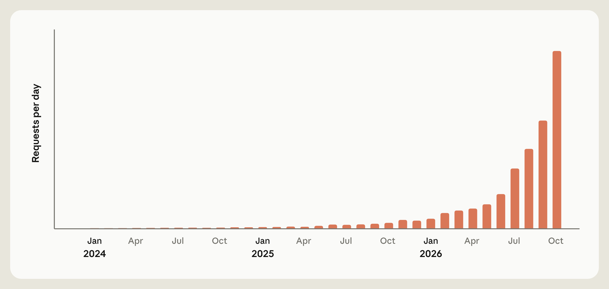
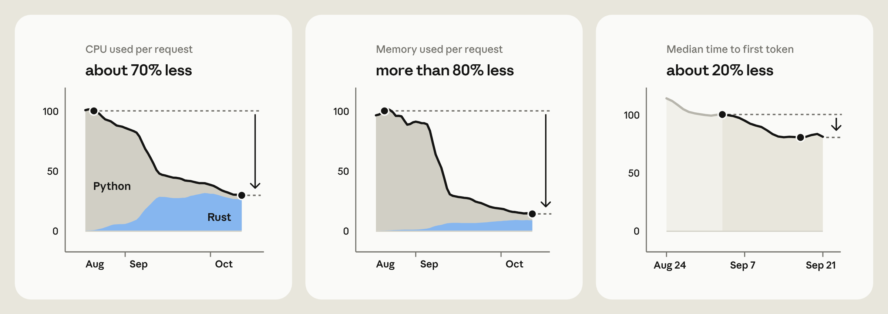

---
authors:
  - aitoboxrobot
categories:
  - 研究解读
date: 2026-11-26
hide:
  - navigation
tags:
  - Anthropic
  - Claude
  - Rust
  - 架构迁移
  - AI智能体
title: "将我们的 Messages API 迁移到 Rust：Anthropic 高并发架构演进与验证实战"
---

# 将我们的 Messages API 迁移到 Rust：Anthropic 高并发架构演进与验证实战

> # Migrating our Messages API to Rust

### 文章背景与核心概要

在 2024 至 2026 年间，Anthropic 核心 Messages API 的调用流量激增了整整 1800 倍。随着请求处理流程愈发复杂，最初用 Python 编写的服务在对象创建、垃圾回收以及异步任务切换中遭遇了严峻的 CPU 与内存性能瓶颈。面对如此庞大且高速演进的关键基础设施，如何在完全不中断服务的前提下将其彻底重写为 Rust？Anthropic 团队没有依赖滞后陈旧的离线测试，而是将生产环境本身变成了实时判题机，构建起由 AI 智能体 (AI Agent) 主导的“三层验证循环”——即毫秒级本地沙盒测试（内环）、全量生产影子流量 (Shadow Traffic) 验证（外环）与沉淀工程师经验规则的记忆闭环（记忆环）。这一自动化闭环不仅消除了生成代码与生产验证之间的鸿沟，更平稳实现了单请求 CPU 开销降低约 70%、内存占用减少超 80%、首 Token 延迟 (Time to First Token) 缩短约 20% 的傲人战果。

---

## 核心摘要

> ## Executive Summary

对庞大且经过严密测试的生产系统进行重构迁移，往往会暴露出明显的“生成器与验证器鸿沟 (Generator-Verifier Gap)”：尤其是在 AI 辅助编程时代，生成新代码的速度快如闪电，但在真实的线上生产环境中验证其正确性却难如登天。

> Migrating large, well-tested production systems often presents a "generator–verifier" gap: while generating new code is fast—especially with AI assistants—verifying its correctness in live environments is extremely difficult. 

本文详细揭秘了 Anthropic 如何在 2024 至 2026 年业务流量激增 1800 倍的极限挑战下，将其核心服务 **Messages API** 从 Python 彻底迁移至 Rust。工程团队并没有单纯依赖陈旧的历史测试用例，而是通过一套创新的**影子流量系统 (Shadowing System)**，把生产环境的 Messages API 本身变成了一台自动化的验证机。通过构建极其严密的验证闭环（涵盖本地沙盒测试的内环、生产影子流量的外环以及规则沉淀的记忆环），他们在服务完全不离线的情况下顺利完成了向 Rust 的平滑切换，取得了亮眼的性能突破：

> This article details how Anthropic migrated its core **Messages API** from Python to Rust amidst an 1,800x traffic growth between 2024 and 2026. Rather than relying solely on legacy tests, the engineering team turned the production Messages API itself into an automated verifier using a novel **shadowing system**. By implementing rigorous verification loops (inner sandbox testing, outer production loops, and memory loops), they successfully transitioned to Rust without taking the service offline, resulting in:

* **单请求 CPU 占用降低约 70%**；
* **单请求内存开销减少超 80%**；
* **首 Token 延迟中位数缩短约 20%**。

> * **~70% less CPU usage** per request.
> * **>80% less memory usage** per request.
> * **~20% reduction** in median time to first token.

---

## 为什么必须迁移？

> ## Why Migrate?

Messages API 最初于 2023 年使用 Python 构建，起初仅是一个简易的请求转发服务。然而截至 2025 年底，流经该 API 的每个请求都需要经历庞杂的输入校验、提示词 (Prompt) 格式转换、分词处理 (Tokenization)、安全内容过滤以及流式 Token 解析。Python 在高并发场景下创建对象、回收内存以及异步任务交接时产生了极为显著的系统开销。

> Built in Python in 2023, the Messages API started as a simple request forwarder. However, by late 2025, every request required extensive validation, prompt conversion, tokenization, safety screening, and token stream parsing. Python added significant overhead during object creation, memory freeing, and task handoffs. 

```
┌────────────────────────────────────────────────────────────────────────┐
│                      The Monthly Average of API Requests               │
└────────────────────────────────────────────────────────────────────────┘
```


### 渐进式改造还是一步到位？

> ### Incremental or All at Once?

Anthropic 最初曾尝试采用渐进式重写方案，仅将下游的输出解析逻辑移植为 Rust。然而，这种“混血架构”导致每个请求在处理流式 Token 时，必须在 Python 与 Rust 的语言边界之间来回跨越三次，由此引入的跨语言交互开销直接抵消了 Rust 带来的性能红利。

> Anthropic initially attempted an incremental rewrite by porting just the output parsing logic to Rust. However, this hybrid approach caused tokens to cross the Python/Rust boundary three times per request, introducing additional overhead that negated the performance benefits. 

到了 2026 年中，随着 Claude 编写的代码已经占到团队合并代码总量的 80% 以上，全量迁移到 Rust 变得切实可行。此时工程推进的核心瓶颈早已不再是*生成代码*，而变成了如何*验证其正确性*。

> By mid-2026, with Claude writing over 80% of merged code, a full migration became feasible. The remaining bottleneck was no longer *generating* code, but *verifying* its correctness.

---

## 我们如何验证迁移的正确性

> ## How We Verified the Migration

为了确保重构后的 Rust 新服务与遗留的 Python 老服务表现完全等价，团队横向对比了保障正确性的三种经典范式：形式化规则 (如 Lean 交互式定理证明器)、样例测试集 (如单元测试套件) 以及现存运行系统 (充当实时的真实基准/Oracle)。鉴于 Messages API 伴随着新功能和新模型在持续高速迭代，传统的离线测试不仅覆盖率不足，而且往往与遗留代码的具体实现细节高度耦合。

> To ensure parity between the legacy Python service and the new Rust service, the team compared general approaches to correctness: rules (e.g., Lean proof assistants), examples (test suites), and existing systems (acting as live oracles). Because the Messages API constantly evolved with new features and models, tests alone were insufficient and often coupled to the legacy implementation.

```
┌────────────────────────────────────────────────────────────────────────┐
│                   Three Common Sources of “Correctness”                │
└────────────────────────────────────────────────────────────────────────┘
```


### 在生产环境中捕捉行为偏差

> ### Detecting Parity with Production

直接在线上生产环境中接入影子流量面临着极其独特的挑战：

> Running live shadow traffic presented unique challenges:

1. **计费与配额控制**：不能对用户请求产生二次计费或重复扣减调用配额；
2. **输出的不确定性**：大语言模型 (Large Language Model, LLM) 本身的输出具有随机性，传统的 Diff 工具很容易将输出的自然波动直接视作噪声丢弃，从而掩盖真正的底层 Bug。

> 1. **Billing & Limits:** Requests could not be double-counted or double-billed.
> 2. **Nondeterminism:** Because Claude's outputs vary naturally, traditional diff tools would discard output differences as noise, masking underlying bugs. 

为了攻克这一难题，系统采取的方案是：让模型只执行一次真实推理，随后将完全相同的模型输出结果分别回放到 Python 与 Rust 两套实现中，逐一对输入和输出处理链路的每一个关键步骤进行精准对比。

> To solve this, the system ran the model once and replayed the exact model output to both Python and Rust implementations, comparing every step of the input and output paths.

```
┌────────────────────────────────────────────────────────────────────────┐
│               The Messages API’s Input and Output Paths                │
└────────────────────────────────────────────────────────────────────────┘
```


为了在不窥探用户具体提示词文本的前提下全面捍卫隐私，工程师们通过记录差异的“**形态特征 (Shape)**”来进行追踪定位：

> To protect user privacy without reading prompt text, engineers recorded the **shape** of differences using:

* **检查点比对 (Checkpointing)**：分步对比关键中间结果 (例如提示词组装、参数校验等)，精确定位代码行为发生分歧的具体执行节点；
* **特征指纹识别 (Fingerprinting)**：依据在提示词中的偏移位置与长度偏差对错误进行聚类归类，从而区分出互不相干的独立缺陷。

> * **Checkpointing:** Comparing step-by-step results (e.g., prompt building, validation) to isolate the exact place code diverged.
> * **Fingerprinting:** Grouping errors by prompt position and length gaps to distinguish specific bugs.

```plaintext
step:        build prompt     ← where in the code
piece:       2                ← where in the prompt
first diff:  byte 17          ← fingerprint
python:      190 bytes        ← fingerprint
rust:        190 bytes        ← fingerprint
```

---

## 核心验证循环

> ## Verification Loops

为了能够完全自主化地消化并修复成千上万条差异记录，Anthropic 建立了一套三层递进的验证闭环机制：

> To manage thousands of diff records autonomously, Anthropic established a three-tiered verification loop:

```
┌────────────────────────────────────────────────────────────────────────┐
│                          Verification Loops                            │
└────────────────────────────────────────────────────────────────────────┘
```


### 1. 本地沙盒测试（内环）

> ### 1. Inner Loop

AI 智能体工作在具备极速本地检测能力的受控云端沙盒环境中。在无需调用大模型的前提下，本地的输入/输出检查工具可以在不到 1 秒的时间内迅速对比新老代码库的行为差异。一旦智能体成功复现出偏差，便会着手修改 Rust 代码并补全回归测试，随后发起 Pull Request 提交人工审查。

> Agents operated inside a secure cloud sandbox equipped with fast local checks. Without calling the model, local input/output checks compared codebase behavior in under a second. Once an agent reproduced a discrepancy, it edited the Rust code and added a regression test before opening a Pull Request for human review.

```
┌────────────────────────────────────────────────────────────────────────┐
│                               Inner Loop                               │
└────────────────────────────────────────────────────────────────────────┘
```


### 2. 生产影子流量验证（外环）

> ### 2. Outer Loop

经人工审核通过的补丁被合并后，会部署至预发环境，并在真实的线上生产影子流量下接受持续监控。如果在数小时或数天的大规模真实流量冲刷下，对应缺陷的特征指纹彻底消失，该修复任务才会标记为圆满闭环。

> Approved fixes were merged, deployed to staging environments, and monitored against shadowed live production traffic. If the bug's fingerprint vanished from live traffic over extended periods, the task closed successfully.

```
┌────────────────────────────────────────────────────────────────────────┐
│                               Outer Loop                               │
└────────────────────────────────────────────────────────────────────────┘
```


### 3. 经验沉淀与规范进化（记忆环）

> ### 3. Memory Loop

人类工程师在代码审查中的每一条反馈与修正意见，都会被系统自动捕获并持久化沉淀到 `CLAUDE.md` 以及共享知识库中。这种机制防止了智能体反复踩进同一条河流，并能促使智能体主动对整个代码库进行排查，清理潜在的类似缺陷。

> Human feedback and reviewer corrections were automatically captured as persistent rules in `CLAUDE.md` and shared memory notes. This prevented agents from repeating past mistakes and allowed them to proactively audit the codebase for similar latent bugs.

```
┌────────────────────────────────────────────────────────────────────────┐
│                              Memory Loop                               │
└────────────────────────────────────────────────────────────────────────┘
```


---

## 成果与核心经验启示

> ## Results and Lessons Learned

通过由严密验证闭环驱动的自主化智能体体系，Anthropic 在生产环境完全不离线的情况下，平稳完成了对这项核心关键基础设施的彻底重构。

> By utilizing autonomous agents governed by rigorous verification loops, Anthropic safely overhauled a live, mission-critical infrastructure service.

```
┌────────────────────────────────────────────────────────────────────────┐
│                     Performance Gains in Rust API                      │
└────────────────────────────────────────────────────────────────────────┘
```


### 核心经验启示

> ### Key Takeaways

1. **验证能力成为全新生产力瓶颈**：当代码生成的边际成本与耗时无限趋近于零时，工程研发的实际迭代速率完全取决于你验证代码正确性的速度与可靠性；
2. **显式设计可观测调试信号**：生产系统本身并不会主动吐出适合调试的比对信号，构建分步检查点 (Checkpointing) 与指纹聚类 (Fingerprinting) 机制是填补这一可观测鸿沟的关键生命线；
3. **构建高可信闭环自动化**：将毫秒级本地测试沙盒（内环）、高并发全量生产影子流量验证（外环）与持久化记忆规则库深度结合，方能使 AI 智能体在规模化真实软件工程中安全、可靠、高产地发挥效能。

> 1. **Verification is the New Bottleneck:** When code generation is cheap and fast, your engineering velocity is strictly bounded by how quickly and reliably you can verify correctness.
> 2. **Design Explicit Signals:** Production systems do not naturally output debugging signals. Building checkpointing and fingerprinting mechanisms is essential to bridge this gap.
> 3. **Build Closed-Loop Automation:** Combining fast local sandboxes (inner loops), live shadow traffic verification (outer loops), and persistent memory rules allows AI agents to operate safely and effectively at scale.

---

## 作者与致谢

> ## Authors & Acknowledgements

* **撰写作者：** Lance Martin, Jake Eaton, Arvin Aminpour, Emma Webb, Bharat Mediratta, 以及 Ravi Trivedi
* **编辑指导：** Caitlin Love

> * **Written by:** Lance Martin, Jake Eaton, Arvin Aminpour, Emma Webb, Bharat Mediratta, and Ravi Trivedi  
> * **Editorial Guidance:** Caitlin Love  

*如需了解更多技术细节，欢迎查阅官方 [Messages API 文档](https://platform.claude.com/docs/en/build-with-claude/working-with-messages)。*

> *For more details, check out the official [Messages API Documentation](https://platform.claude.com/docs/en/build-with-claude/working-with-messages).*
