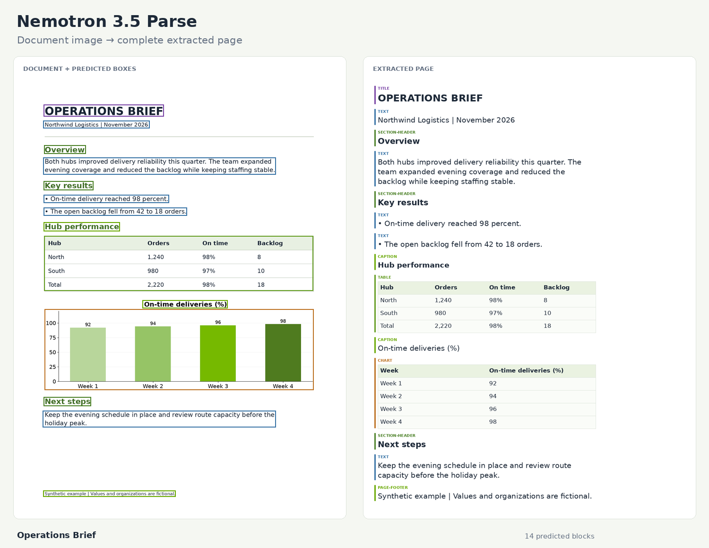
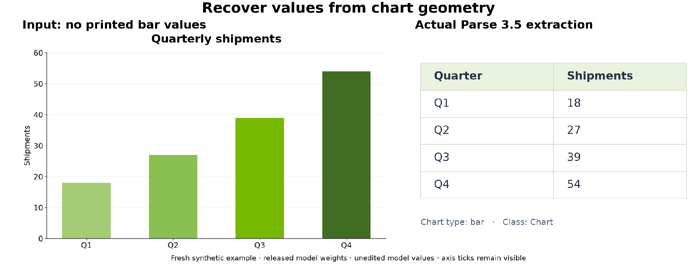
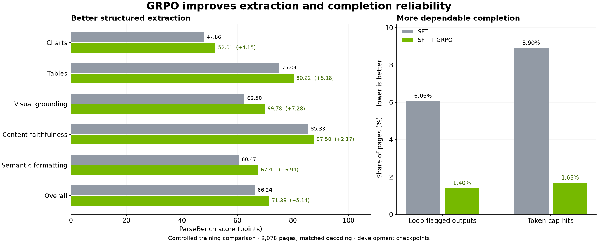
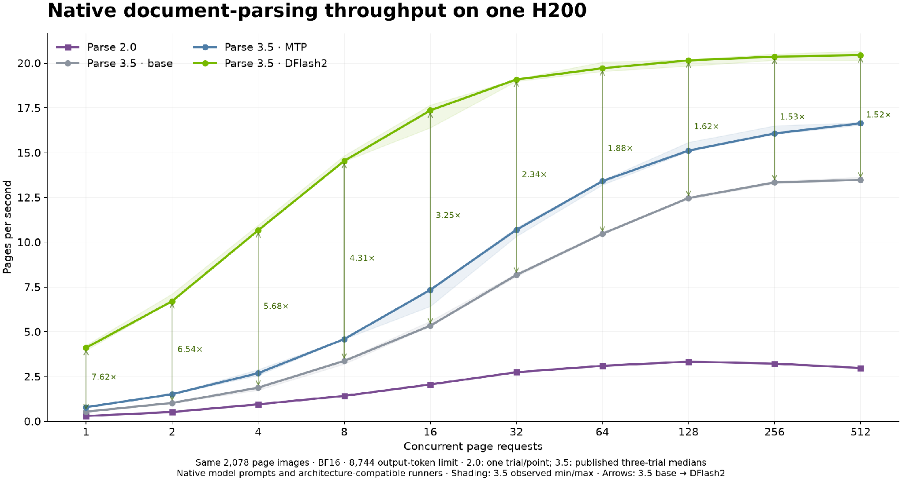
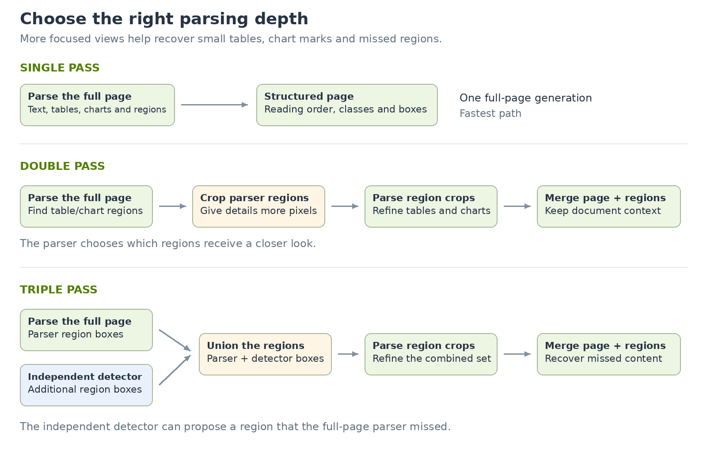
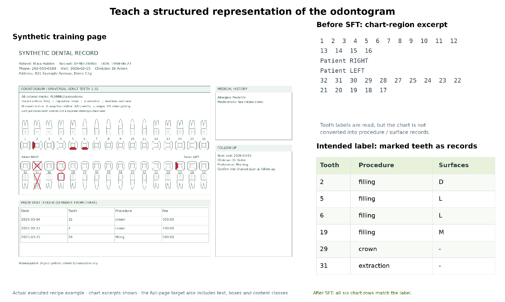
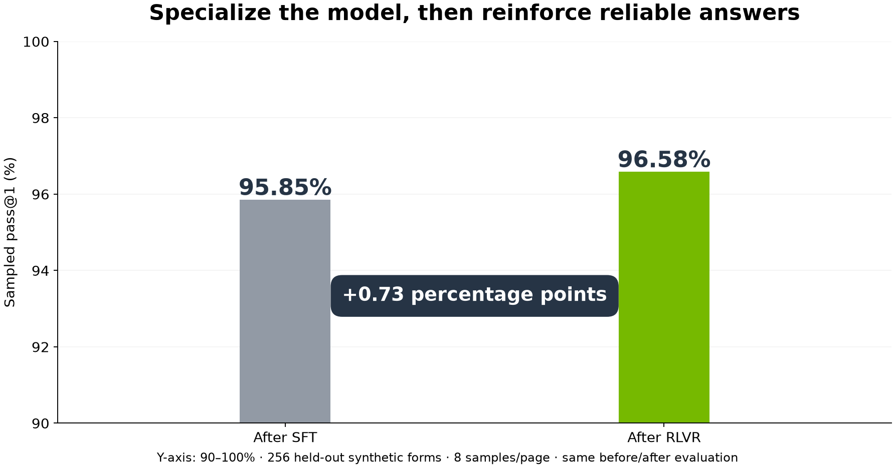

---
authors:
  - aitoboxrobot
categories:
  - 工具教程
date: 2026-11-27
hide:
  - navigation
tags:
  - NVIDIA
  - Nemotron
  - 文档解析
  - 强化学习
  - 大语言模型
title: "基于 Nemotron 3.5 Parse 构建文档模型：开源数据、微调配方与极速推理"
---

# 基于 Nemotron 3.5 Parse 构建文档模型：开源数据、微调配方与极速推理

> # Building on Nemotron 3.5 Parse: Open Data, Fine-Tuning, and Faster Inference

### 文章背景与核心概要

在企业级 AI 应用与检索增强生成 (Retrieval-Augmented Generation, RAG) 系统中，如何将杂乱无章的扫描件、复杂报表以及无标注图表精准转化为机器可读的高质量结构化数据，一直是一道横亘在行业面前的技术难关。NVIDIA 重磅推出了小巧高效的专有文档解析模型 Nemotron 3.5 Parse，并通过完全开源的三套千万级高质量合成数据集、完整的端到端微调配方以及创新的 DFlash2 推测解码技术，为开源社区奉上了一整套工业级文档理解解决方案。该方案创新性地融合了用于夯实基础文档理解能力的监督微调 (Supervised Fine-Tuning, SFT) 与利用群体相对策略优化 (Group Relative Policy Optimization, GRPO) 的可验证奖励强化学习 (Reinforcement Learning with Verifiable Rewards, RLVR)，不仅彻底解决了模型重复输出死循环和 Token 超限截断的痛点，更使表格与图表解析精度实现跨越式提升。借助软硬件协同创新，单张 H200 GPU 上的推理吞吐量飙升至惊人的每秒 20 页以上，无论是通用文档结构提取还是严苛垂直领域 (如专业牙科齿位图谱表单) 的定制微调，都能以极高准确率轻松搞定。

---

**发布时间：** 2026年11月26日  
**作者：** Ryan Chesler, Marek Wawrzos, Steve Han (NVIDIA)

> **Published:** November 26, 2026  
> **Authors:** Ryan Chesler, Marek Wawrzos, Steve Han (NVIDIA)

---

## 核心摘要

> ## Executive Summary

NVIDIA 近期正式发布了 **[NVIDIA Nemotron 3.5 Parse](https://huggingface.co/nvidia/Nemotron-3.5-Parse)**，这是一款小巧精悍的高效文档模型，专门负责将页面图像直接转化为清晰规整的结构化数据，为检索增强生成 (Retrieval-Augmented Generation, RAG) 以及各类 AI 智能体 (AI Agent) 提供高质量输入。在此次发布的基础之上，NVIDIA 进一步开源了大规模合成训练数据集、一套详尽完备的模型微调指南，以及用于大幅拉升推理速度的 DFlash2 推测解码器。本文将深入揭秘背后的训练方法论——如何将用于构建基础文档理解能力的监督微调 (Supervised Fine-Tuning, SFT) 与利用可验证奖励强化学习 (Reinforcement Learning with Verifiable Rewards, RLVR) 深度融合，从而将模型输出的一致性与准确率提升到全新境界。

> NVIDIA recently released **[NVIDIA Nemotron 3.5 Parse](https://huggingface.co/nvidia/Nemotron-3.5-Parse)**, a compact document model that transforms page images into structured data for retrieval-augmented generation (RAG) and AI agents. Building upon this release, NVIDIA has introduced synthetic training datasets, a comprehensive fine-tuning recipe, and a DFlash2 speculator to enable faster inference. This article details the training methodology—combining supervised fine-tuning (SFT) for foundational document understanding with reinforcement learning with verifiable rewards (RLVR) to maximize consistency and accuracy.

---

## Parse 3.5 的解析能力与输出特性

> ## What Parse 3.5 Produces

Parse 能够顺畅地将页面中的所有内容按照符合人类逻辑的阅读顺序逐一提取，准确识别出各个内容类别 (例如各级标题、正文段落、数据表格以及统计图表)，并为每一个元素标注精准的像素级边界框 (Bounding Box)。哪怕是面对结构繁复的表格与图表，它也能游刃有余地将其转换成下游应用程序可以直接消费的结构化记录。

> Parse extracts document content into logical reading order, assigns content classes (headings, paragraphs, tables, and charts), and returns precise bounding boxes. Complex elements like tables and charts are converted into structured records ready for downstream processing.

*图 1. 合成运营简报的真实模型输出展示，清晰呈现了原始页面区域与提取后的结构化数据之间的精准对应关系。*

> *Figure 1. Actual model output from a synthetic operations brief, showing the connection between the page and its structured representation.*

该版本在图表和表格解析方面实现了飞跃式的突破，尤其是针对那些信息模糊、缺乏数值注记的棘手元素 (比如没有任何数字标签的柱状图)，模型甚至能够直接根据坐标轴的几何比例精准推算出每个柱子的实际数值。这些强大能力的背后，离不开高质量合成数据生成技术的加持——研究团队通过生成已知真实标签 (Ground Truth) 的渲染图表与表格，训练模型学会对视觉图像进行逆向工程还原。

> This version significantly improves chart and table parsing, particularly for ambiguous elements like unlabelled bar charts where the model infers values directly from axis geometry. These advancements are driven by synthetic data generation, training the model to reverse-engineer rendered charts and tables with known ground truth.

为了全力支持开源社区的创新，NVIDIA 此次毫无保留地开源了**三大核心训练数据集**：
* **[Synthetic Charts V1 — 998 万个样本](https://huggingface.co/datasets/nvidia/Synthetic-Charts-V1)：** 包含大量渲染图表，以及针对类别、数据序列和数值的精细结构化标注。
* **[Synthetic Tables V1 — 100 万个样本](https://huggingface.co/datasets/nvidia/Synthetic-Tables-V1)：** 包含完整保留行、列、表头和单元格层级关系的渲染 HTML 表格。
* **[OCR Synthetic Multilingual v2 — 790 万个样本](https://huggingface.co/datasets/nvidia/OCR-Synthetic-Multilingual-v2)：** 涵盖多种丰富字体与版面布局的多语言 OCR 合成文档页面。

> To support the community, NVIDIA is open-sourcing **three core training datasets**:
> * **[Synthetic Charts V1 — 9.98M examples](https://huggingface.co/datasets/nvidia/Synthetic-Charts-V1):** Rendered charts and structured annotations for categories, series, and values.
> * **[Synthetic Tables V1 — 1M examples](https://huggingface.co/datasets/nvidia/Synthetic-Tables-V1):** Rendered HTML tables preserving rows, columns, headers, and cell hierarchies.
> * **[OCR Synthetic Multilingual v2 — 7.9M examples](https://huggingface.co/datasets/nvidia/OCR-Synthetic-Multilingual-v2):** Synthetic document pages across varied fonts and layouts for multilingual OCR.

*图 2. Parse 仅凭图表中的坐标轴几何比例，便成功反推出了 18、27、39 和 54 等真实数据。*

> *Figure 2. Parse recovers 18, 27, 39, and 54 from the chart geometry.*

---

## SFT 赋予基础能力，RLVR 淬炼输出一致性

> ## SFT Teaches the Capability; RLVR Improves Consistency

整个训练工作流主要划分为两大核心阶段：
1. **监督微调 (Supervised Fine-Tuning, SFT)：** 覆盖纯文本、版面布局、复杂表格、数据图表以及多语言文档，全面夯实基础的页面识别与阅读理解能力。
2. **可验证奖励强化学习 (Reinforcement Learning with Verifiable Rewards, RLVR)：** 借助**群体相对策略优化 (Group Relative Policy Optimization, GRPO)** 算法，依据可程序化验证的奖励机制持续优化信息提取过程，力求达到极致的准确度、合规的格式排版以及彻底杜绝死循环重复输出。

> The training pipeline consists of two primary phases:
> 1. **Supervised Fine-Tuning (SFT):** Spanning text, layout, tables, charts, and multilingual documents to build baseline page-reading capabilities.
> 2. **Reinforcement Learning with Verifiable Rewards (RLVR):** Using **Group Relative Policy Optimization (GRPO)** to optimize extractions against programmatic rewards for accuracy, proper formatting, and non-repetitive completion.

*图 3. 在完全对齐的评估设定下，SFT 与 GRPO 的严格对照实验结果。*

> *Figure 3. A controlled comparison of SFT and GRPO with matched evaluation settings.*

实测评估结果清晰展现了引入 GRPO 带来的巨大飞跃：
* 触发死循环标记的异常页面输出从 **126 页大幅缩减至 29 页 (降幅达约 77%)**。
* 触及 9,000 Token 上限而被迫截断的输出页面从 **185 页急剧下降至 35 页**。
* 综合基准测试 (Benchmark) 得分从 **66.24 跃升至 71.38** (其中**表格得分提升了 +5.18**，**图表得分提升了 +4.15**)。

> Results demonstrate clear benefits from GRPO:
> * Loop-flagged outputs dropped from **126 to 29 pages (~77% reduction)**.
> * Outputs hitting the 9,000-token limit dropped from **185 to 35**.
> * Overall benchmark scores improved from **66.24 to 71.38** (**+5.18 in tables**, **+4.15 in charts**).

---

## 架构革新与 DFlash2 助力极速推理

> ## Faster Inference Through Architecture and DFlash2

Parse 3.5 引入了多项深层的架构重构，从底层全面优化图像预处理与文本解码效率：

> Parse 3.5 introduces structural updates to optimize image processing and output decoding:

| 核心组件 (Component) | Parse 2.0 | Parse 3.5 |
| :--- | :--- | :--- |
| **页面预处理 (Page preprocessing)** | 固定 2048 × 1664 画布 | NaViT 动态矩形输入 |
| **图文连接机制 (Image-to-text connection)** | 编码器-解码器交叉注意力 (Cross-Attention) | 压缩视觉 Token 作为因果前缀 (Causal Prefix) |
| **解码器自注意力 (Decoder self-attention)** | 多头注意力 (Multi-Head Attention, MHA) | GQA-8：16 个查询头 (Query Heads)，8 个键/值头 (Key/Value Heads) |
| **推测解码 (Speculative decoding)** | — | 单 Token 前瞻多 Token 预测 (MTP)；可选 DFlash2 |

**[DFlash2 推测器 (DFlash2 Speculator)](https://huggingface.co/nvidia/Nemotron-3.5-Parse/tree/main/dflash2)** 能够让一个体量极小的草稿模型 (Draft Model) **一次性预先推测并生成最多 32 个 Token**，随后再由 Parse 主模型在单次前向传播中进行全并行验证。

> The **[DFlash2 speculator](https://huggingface.co/nvidia/Nemotron-3.5-Parse/tree/main/dflash2)** enables a small draft model to propose **up to 32 tokens ahead**, which Parse then verifies in parallel. 

*图 4. 在单张 H200 GPU 上采用 BF16 精度测得的原生单阶段处理吞吐量对比。*

> *Figure 4. Native single-pass throughput on one H200, BF16.*

在单张 NVIDIA H200 GPU 上使用 BF16 精度进行基准测试时，相较于基线模型，DFlash2 在并发数为 1 时的吞吐量暴涨了 **7.62 倍**，在并发数为 512 时吞吐量依然提升了 **1.52 倍**。当处于 512 高并发运行时，搭载 DFlash2 的 Parse 3.5 实现了高达 **每秒 20.44 页** 的惊人处理速度 (而上一代 Parse 2.0 仅为每秒 2.98 页)。

> Tested on a single H200 GPU in BF16, DFlash2 increased throughput **7.62×** at concurrency 1 and **1.52×** at concurrency 512 over baseline. At concurrency 512, Parse 3.5 achieves **20.44 pages/s** with DFlash2 (compared to 2.98 pages/s for Parse 2.0).

### 多阶段精细化解析策略

> ### Multi-Pass Refinement Strategy

在面对内容密集的复杂区域时，各类应用可以通过多阶段策略灵活调度算力，以适度的计算开销换取极致的准确率：
1. **单阶段 (Single Pass)：** 对整个页面开展全局端到端解析，一气呵成提取版面布局、正文文本、数据表格及统计图表。
2. **双阶段 (Double Pass)：** 将密集复杂的表格或图表区域局部裁剪放大，以更高的保真度和视觉分辨率进行二次精准重解析。
3. **三阶段 (Triple Pass)：** 引入一个独立的区域检测器 (Region Detector) 严格核验解析覆盖范围，确保无一遗漏，并针对漏检区域定向重新提取。

> Applications can trade compute for accuracy in dense regions using multi-pass strategies:
> 1. **Single Pass:** Full-page extraction for layout, text, tables, and charts.
> 2. **Double Pass:** Crop dense tables/charts and re-parse at higher fidelity.
> 3. **Triple Pass:** Use an independent region detector to verify coverage before re-extracting missed content.

*图 5. 引入额外的处理阶段，将宝贵的计算资源集中倾注于高难度区域。*

> *Figure 5. Additional stages focus computation on difficult regions.*

---

## 将相同的 SFT/RLVR 方法应用于您的专属文档

> ## Apply the Same SFT/RLVR Approach to Your Documents

NVIDIA 开放了一整套完整的 **[Parse 模型微调配方 (Parse Fine-Tuning Recipe)](https://github.com/NVIDIA-NeMo/Nemotron/blob/main/docs/nemotron/parse/index.md)**，融合了成对数据生成、**NeMo Automodel SFT** 框架以及基于 **NeMo RL 的 GRPO 算法**。

> NVIDIA provides a complete **[Parse fine-tuning recipe](https://github.com/NVIDIA-NeMo/Nemotron/blob/main/docs/nemotron/parse/index.md)** utilizing paired data generation, **NeMo Automodel SFT**, and **NeMo RL GRPO**. 

教程以一个包含**齿位图谱 (Odontogram)** 的合成牙科病历表单作为典型示例，指导如何手把手训练模型将图表中标记的患牙精准映射到特定的诊疗项目与牙齿表面。

> Using a synthetic dental form example containing an **odontogram**, the recipe teaches the model to accurately map marked teeth to specific procedures and surfaces.

*图 6. 牙科领域适配效果展示：图表中的全部 6 行数据均与目标记录达成了完美匹配。*

> *Figure 6. Dental adaptation results: all six chart rows successfully matched the target.*

在预留的独立测试表单上，预估的首发成功率 (抽样 pass@1) 从基座模型的 **0.00%**，在经过 SFT 后猛增至 **95.85%**，经过 RLVR 强化学习进一步淬炼后更是攀升到了 **96.58%**。

> Estimated first-attempt success rates (sampled pass@1) on held-out forms rose from **0.00%** (base model) to **95.85%** after SFT and **96.58%** after RLVR.

*图 7. 在 256 份预留测试表单上的严格对齐评估对比。*

> *Figure 7. Matched evaluation on 256 held-out forms.*

广大开发者只需准备好自己的图像/标注配对数据，并直接复用官方提供的**[文档奖励组件 (Document Reward Components)](https://github.com/NVIDIA-NeMo/Nemotron/tree/main/src/nemotron/recipes/parse/document_rewards)** (涵盖边界框定位、文本保真度以及表格对齐等维度)，就能快速为自己的垂直业务领域打造高度定制化的文档解析专属模型。

> Developers can implement custom adaptations by providing image/label pairs and leveraging the included **[document reward components](https://github.com/NVIDIA-NeMo/Nemotron/tree/main/src/nemotron/recipes/parse/document_rewards)** for bounding boxes, text fidelity, and tables.
