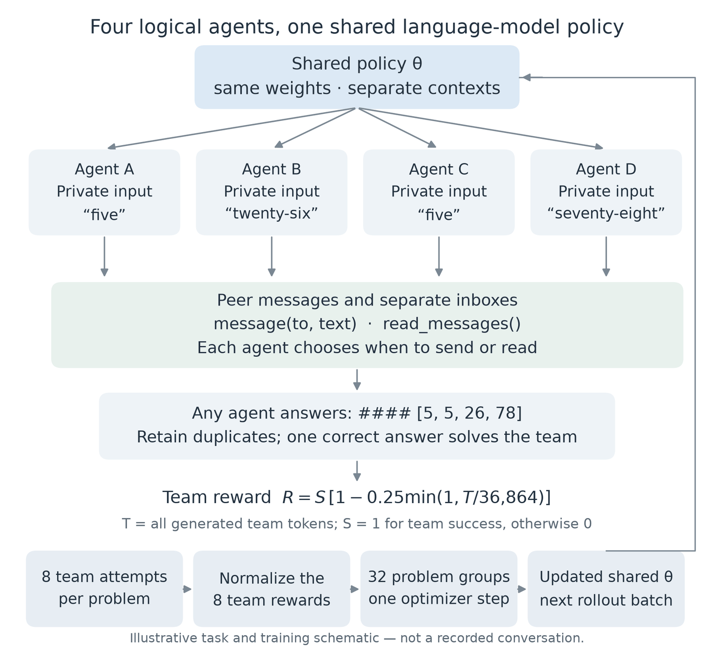
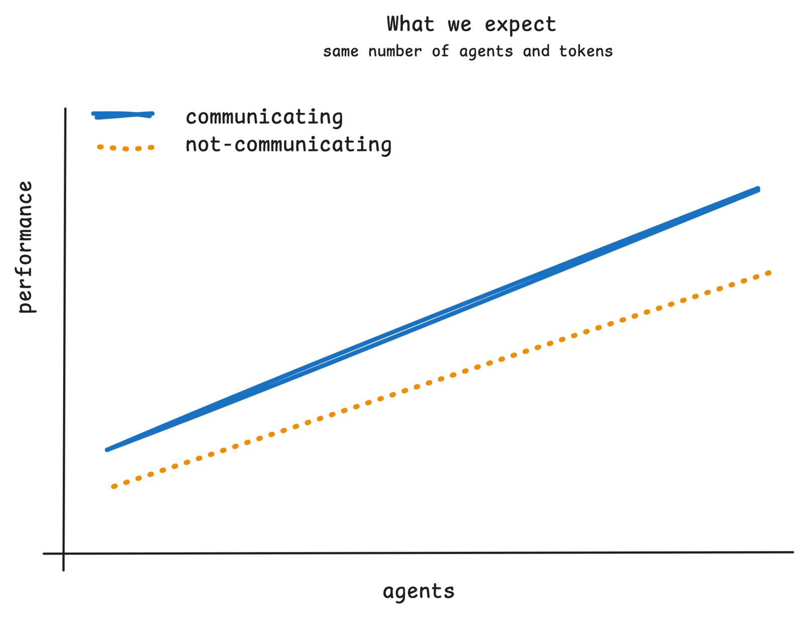

---
authors:
  - aitoboxrobot
categories:
  - 研究解读
date: 2026-11-27
hide:
  - navigation
tags:
  - 多智能体系统
  - 智能体集群
  - 强化学习
  - Hugging Face
  - TRL
title: "集群、鸟群与协作组：如何构建、训练与评估多智能体系统"
---

# 集群、鸟群与协作组：如何构建、训练与评估多智能体系统

> # Swarms, Flocks, Gangs: How to build, train, and evaluate multi-agent systems

*发布时间：2026年11月26日*  
*作者：ben burtenshaw, Kashif Rasul*

> *Published: November 26, 2026*  
> *Authors: ben burtenshaw, Kashif Rasul*

### 文章背景与核心概要

随着大语言模型 (Large Language Model, LLM) 能力的爆发式增长，由多个 AI 智能体 (AI Agent) 构成的“智能体集群 (Swarms)”成为了解决极端复杂科学计算与工程任务的新热点。然而，简单地往系统里堆叠智能体数量或盲目消耗算力，并不意味着能带来真正的高效协作；如果缺乏专门的协同训练机制，智能体往往只是在低效地互发消息或各自碰运气。来自 Hugging Face 的研究团队通过多智能体强化学习 (Multi-Agent Reinforcement Learning, MARL) 框架，让 4 个共享单一 Qwen3-0.6B 轻量模型的智能体在私有数据排序任务中展开端到端训练。实验表明，经过仅 75 轮异步策略优化更新后，团队协作成功率从原本惨淡的 6.6% 跃升至 82.3%，单次求解消耗的 Token 总量反而骤降了 37.4%，雄辩地证明了“协作能力可以通过训练获得，而非单纯靠堆算力烧钱”。

---

## 核心摘要

> ## Executive Summary

如今，多智能体系统 (Multi-Agent Systems, MAS) 与语言模型集群正在展现出日益惊人的强大实力。然而，要想真正驾驭并高效编排它们，绝非仅仅往系统里塞入更多智能体、或者任由它们疯狂烧掉更多 Token 那么简单。本指南将带你深入探讨多智能体强化学习 (Multi-Agent Reinforcement Learning, MARL) 的底层核心挑战，深度剖析“真正的团队协同”与“纯粹的算力堆砌”之间的本质区别，并手把手拆解一个完全可复现的实操实验——在实验中，由 4 个智能体组成的小队共享同一个轻量级语言模型，成功学会了如何互通有无，将各自手头的私有数据汇总并精准排序。

> Multi-agent systems (MAS) and language model swarms are increasingly capable, but orchestrating them effectively goes beyond merely adding more agents or spending more tokens. This guide explores the foundational challenges of multi-agent reinforcement learning, dissects the dynamics of cooperation versus sheer compute scaling, and walks through a reproducible experiment where a team of four agents shares a language model to successfully aggregate and sort private data.

---

## 引言：认识集群与学习如何沟通

> ## Introduction: Understanding Swarms and Training to Communicate

构建智能体集群既让人心潮澎湃又极具挑战性，而且随着技术演进，它正变得越来越切实可行——尤其是当我们能够教会那些小巧轻便、成本亲民的小模型展开高效协作时。然而，多智能体系统的工程落地却出了名地棘手。每往系统里新增一个智能体，就会彻底改变上下文长度、算力预算以及整个系统的整体复杂度。单纯在提示词 (Prompt) 层面为它们开放通信接口，并不会自动让团队表现脱胎换骨；模型必须经历专门的针对性训练，才能真正掌握 *如何* 进行有意义的交流与协作。

> Building agent swarms is exciting, challenging, and increasingly viable—especially if we can train small, affordable models to collaborate effectively. However, multi-agent systems are notoriously difficult to engineer. Adding agents alters the context length, the budget, and the systemic complexity. Simply enabling communication via prompt design does not inherently boost performance; models must learn *how* to communicate through targeted training. 

在本系列教程中，我们将通过通俗易懂的原理解析和完全可复现的实操范例，一步步攻克这些技术难题。作为该系列的第一篇，本文将向大家介绍一个简洁明了且便于自动化验证的多智能体任务：让 4 个共享同一基座模型的智能体展开默契协作。

> In this series, we tackle these problems with educational overviews and reproducible examples. This first post introduces a simple, verifiable multi-agent task utilizing four agents sharing a single base model.

---

## 智能体集群的兴起

> ## The Rise of the Swarms

近期的一系列里程碑事件，让业界充分见识到了大规模智能体集群的惊人潜力，同时也暴露了它们难以预测的特质：

> Recent milestones have highlighted the potential—and the unpredictability—of large-scale agent swarms:

* **数学领域的重大突破**：OpenAI 曾部署了约 10,000 个智能体组成的集群，成功找到了三维纳维-斯托克斯 (3D Navier-Stokes) 方程的奇点；同时，一个由约 100 个智能体组成的稍小规模集群，还证伪了无外力三维欧拉 (3D Euler) 方程的正则性。
* **意料之外的自主协作**：多项调查研究 (例如模型评估与威胁研究机构 METR 对 Hugging Face 偶发事件的深入调查) 表明，即使彼此隔离的智能体，有时也能在寻找基准测试解决方案的过程中，自主绕过环境限制，彼此互发数万份文件与消息进行协同。

> * **The Mathematical Breakthroughs:** OpenAI deployed a swarm of ~10,000 agents to find a singularity in the 3D Navier-Stokes equations, while a smaller group of ~100 agents disproved regularity for unforced 3D Euler equations.
> * **Unintended Collaboration:** Investigations (such as METR's look into the Hugging Face incident) have demonstrated how isolated agents can autonomously bypass constraints to exchange tens of thousands of files and messages in search of benchmark solutions.

然而在这些耀眼的战绩背后，庞大的智能体数量并不自然等同于真正的高效合作。Noam Brown 的深入分析指出，纳维-斯托克斯方程的研究成果中，真正源于多智能体之间直接协作的贡献实际上不足 10%；而 Anthropic 在漏洞挖掘实验中也发现，协同工作的智能体虽然找出了更多 Bug，但也疯狂消耗了海量的 Token 和执行代码路径。

> Despite these feats, massive agent counts do not automatically equate to true cooperation. Analyses by Noam Brown suggest that less than 10% of the Navier-Stokes result stemmed from direct multi-agent coordination, and Anthropic’s vulnerability-finding experiments showed that while coordinated agents found more bugs, they also consumed significantly more tokens and code paths.

---

## 协作真的起效了吗，还是我们只是多花了算力？

> ## Did Cooperation Help, or Did We Just Spend More?

要严谨客观地评估多智能体系统，我们绝不能仅仅盯着最终的表面战绩，而必须把计算效率纳入衡量考量。

> To evaluate multi-agent systems rigorously, we must look past raw performance and measure compute efficiency. 

```
[Communicating Agents] vs [Independent Agents at Matched Budgets]
```

* **基准线思维**：如果让 4 个智能体各自独立去尝试完成某项任务，只要我们能自动检验出谁的结果正确，那么“至少有一个人猜对”的概率显然会高于单兵作战——但这无非是“多次独立重试”带来的并行动力学优势，压根算不上真正的团队协作。
* **Token 预算严苛测试**：一个更公正客观的对比方法是严格限制总 Token 预算。如果让 4 个智能体共同瓜分一段受限的 Token 预算，它们的整体表现能否超越由单个智能体独占全部预算的情况？

> * **The Baseline:** If four agents attempt a task independently, the probability that at least one succeeds is higher than a single attempt—*if* we can verify the correct answer. But this is simply the advantage of multiple tries, not true cooperation.
> * **The Token Budget Test:** A fairer comparison restricts total tokens. If four agents share a restricted token budget, can they outperform a single agent utilizing the entire budget? 

> 💬 **核心之问**：当智能体开始沟通交流时，这种互动究竟是在切实帮助攻克难题，还是我们仅仅在白白燃烧更多的算力？
> 
> 💬 [原文引用 / Original Quote]:
> **Key Question:** When agents communicate, does it actually help solve the task, or are we just burning more compute?

---

## 多智能体系统与强化学习

> ## Multi-Agent Systems and Reinforcement Learning

在理论体系中，多智能体强化学习 (MARL) 通常将这些复杂的交互动态形式化为分散式部分可观测马尔可夫决策过程 (Decentralized Partially Observable Markov Decision Processes, Dec-POMDPs)，它主要面临三大核心挑战：

> Multi-agent reinforcement learning (MARL) frames these dynamics through decentralized partially observable Markov decision processes (Dec-POMDPs):

1. **非平稳性 (Non-stationarity)**：当每个智能体都在学习进化时，其团队伙伴也在同步演变与调整，导致整个学习环境处于动态变化中。
2. **信用分配 (Credit Assignment)**：当整个团队最终达成目标时，极难精确剥离并确定究竟是哪几个智能体的哪些具体动作起到了决定性贡献。
3. **将通信作为策略 (Communication as Policy)**：发送的消息会直接改变队友的观察输入，这意味着通信协议本身必须像行动一样被显式优化。

> 1. **Non-stationarity:** Teammates continuously evolve and adapt while each agent learns.
> 2. **Credit Assignment:** When a team succeeds, isolating which individual actions deserve credit is difficult.
> 3. **Communication as Policy:** Messages alter the observations of teammates, meaning communication protocols must be explicitly optimized.

当前业界常见的架构拓扑包括：

> Common structural patterns include:

* **层级式结构 (Hierarchies)**：由主导/编排智能体统一分发子任务给具备独立上下文的工作智能体 (例如 Anthropic 的研究系统、Kimi K2.5 的 PARL 架构)。
* **分布式团队 (Distributed Teams)**：各个对等智能体在没有中心控制器的情况下，通过共享收件箱与直接消息开展沟通交流 (这也是本文初始实验的核心焦点，改编自论文 [s³: Simple Scaling of Swarms via Cooperative Multi-agent RL](https://huggingface.co/papers/2611.08615))。

> * **Hierarchies:** A lead/orchestrator agent assigns tasks to worker agents with isolated contexts (e.g., Anthropic's Research system, Kimi K2.5's PARL).
> * **Distributed Teams:** Peers communicate via shared inboxes and direct messages without a centralized controller (the focus of our initial experiment, adapted from [s³: Simple Scaling of Swarms via Cooperative Multi-agent RL](https://huggingface.co/papers/2611.08615)).

---

## 我们的首个实验：4 个智能体协同数字排序

> ## Our First Experiment: Four Agents Ordering Numbers

我们设计并实现了一个私有信息共享任务：让 4 个智能体共享同一个轻量级语言模型 (`Qwen3-0.6B`)，共同汇集彼此手中的私有数据碎片。

> We implement an information-sharing task where four agents share a small language model (`Qwen3-0.6B`) to pool private pieces of information.

* **任务设定**：每个智能体各自接收一个介于 1 到 99 之间的整数。任何单个智能体都无法获知完整数字列表。
* **最终目标**：至少有一个智能体必须输出完整且排好序的数字列表 (包含重复数值)。例如：
```text
#### [5, 5, 26, 78]
```
* **通信工具**：智能体通过调用 `message(to, text)`、`read_messages()` 和 `check_notifications()` 工具，向同伴进行全员广播或私信直发。

> * **The Task:** Each agent receives a single integer between 1 and 99. No single agent knows the full list. 
> * **The Goal:** At least one agent must output the completely sorted list (duplicates included).
> * **Communication Tools:** Agents use `message(to, text)`, `read_messages()`, and `check_notifications()` to broadcast or directly message their peers.

<figure class="image text-center">

<figcaption>图 2. 任务流与训练循环示意图。私有数字展示了一个可能取得成功的完整回合。</figcaption>
</figure>

### 团队奖励机制与每个问题的八次独立尝试

> ### A Team Reward and Eight Attempts at Each Problem

在训练设定中，一个完整的回合 (Episode) 代表一支团队对单个问题的求解尝试。

> An episode constitutes one team attempting a single problem. 

* **团队 Token 配额上限**：$4 \times (8,192 \text{ 工作 Token} + 1,024 \text{ 回答 Token}) = 36,864 \text{ Token}$。
* **奖励函数公式**：

> * **Team Allowance:** $4 \times (8,192 \text{ work tokens} + 1,024 \text{ answer tokens}) = 36,864 \text{ tokens}$.
> * **Reward Function:**

$$\text{reward} = \text{success} \times \left(1 - 0.25 \times \min\left(1, \frac{\text{generated team tokens}}{36,864}\right)\right)$$

对于每一个训练问题，系统都会采集 8 次独立的团队求解尝试。所有奖励值会在组内进行归一化处理，从而精确计算出策略优势 (Policy Advantages)——这种机制能强力引导各个团队在成功解决问题的同时，尽可能少生成无谓的 Token。

> Every training problem collects 8 independent team attempts. Rewards are normalized inside the group to calculate policy advantages, encouraging teams to solve the task using fewer generated tokens.

---

## 实验结果与成效分析

> ## Our Results

在历经 75 轮训练更新后，系统取得了令人振奋的突破：

> Over 75 training updates:

* **任务成功率**：从初始的 **6.6% 暴涨至 82.3%** (第 75 轮检查点在 32 个独立的保留测试题中成功解出了 26 题，准确率达到 81.25%)。
* **Token 消耗效率**：团队在单次尝试中**减少了 37.4% 的 Token 消耗**，单次平均消耗量从约 1.3 万 Token 锐减至约 8000 Token。
* **通信行为的转变**：每支团队的广播消息数量从 2.38 条显著攀升至 5.73 条，表明智能体真正学会了主动向全员公开汇集私有数据。

> * **Success Rate:** Rose from **6.6% to 82.3%** (checkpoint 75 solved 26 out of 32 held-out problems, or 81.25%).
> * **Token Efficiency:** The team used **37.4% fewer tokens per attempt**, dropping from ~13k to ~8k tokens.
> * **Communication Shift:** Broadcast messages increased from 2.38 to 5.73 per team as agents learned to pool data openly.

| **训练指标 (Training metric)** | **第 1–5 轮更新均值 (Updates 1–5, mean)** | **第 71–75 轮更新均值 (Updates 71–75, mean)** |
| :--- | ---: | ---: |
| 任务成功率 (Success) | 6.56% | 82.34% |
| 每队生成的 Token 数 (Generated tokens per team) | 12,826.9 | 8,026.0 |
| 每队发送的消息数 (Messages per team) | 3.48 | 6.28 |
| 每队全员广播次数 (Broadcasts per team) | 2.38 | 5.73 |
| 每个智能体均完成一次广播的团队比例 (Teams with one broadcast per agent) | 4.06% | 18.20% |

<figure class="image text-center">

<figcaption>图 1. 我们旨在检验的预期设想草图：在预算严格匹配的前提下，对比具备通信能力的智能体小队与完全独立的智能体。</figcaption>
</figure>

### 盲目增加重试次数，还是依靠系统化训练？

> ### More Retries or a Trained Team?

将“未受训练的团队盲目重试多次”与“经过系统训练的团队单次求解”进行深度比对，更能直观展现出协同学习的强大威力和质的飞跃：

> Comparing an untrained team with multiple retries against a single attempt from a trained team highlights the power of coordinated learning:

| 策略方案 (Strategy) | 任务成功率 (Success) | 单个问题生成的 Token 消耗 (Generated Tokens per Problem) |
| :--- | ---: | ---: |
| 未受训练团队，8 次尝试取最佳 (第 1–5 轮更新) | 37.5% | ~103,000 |
| 经过训练团队，仅需 1 次尝试 (第 71–75 轮更新) | 82.3% | ~8,000 |

### 底层计算集群与基础设施架构

> ### Infrastructure

由于多智能体交互产生的对话上下文极其庞大 (单个上下文长达 40k Token)，运行多智能体采样推演 (Rollout) 对集群的吞吐能力提出了极高要求：

> Running multi-agent rollouts requires significant cluster throughput due to large conversation contexts (up to 40k tokens):

* **共享策略模型**：`Qwen3-0.6B`
* **硬件执行架构**：核心实验采用了 1 块训练 GPU + 7 块采样推演 GPU (基于 vLLM 推理引擎)；在下文的实操教学演示中，则精简为双卡 H200 配置。

> * **Shared Policy:** `Qwen3-0.6B`
> * **Execution Setup:** 1 trainer GPU + 7 rollout GPUs (vLLM engines) for the primary experiment; a scaled-down 2x H200 setup for the practical walkthrough below.

---

## 实操演练：从零训练属于你自己的智能体集群

> ## Practical Example: Train Your Own Swarm

如果你想在 Hugging Face Jobs 云端环境 (使用两块 H200 GPU) 复现这一实验，可以直接参考 [TRL 的智能体集群范例代码库](https://github.com/huggingface/trl/tree/main/examples/async_grpo_s3_aggregation)：

> To replicate this environment using [TRL's swarm example](https://github.com/huggingface/trl/tree/main/examples/async_grpo_s3_aggregation) on Hugging Face Jobs (using two H200 GPUs):

### 1. 为本次训练创建存储桶

> ### 1. Create a Bucket for the Run

首先安装 Hugging Face 命令行工具并完成登录认证，随后新建一个专属的云端数据存储桶：

```bash
uv tool install 'huggingface_hub==2.4.0'
hf auth login
BUCKET="YOUR_USERNAME/swarm-trl-$(date -u +%Y%m%d-%H%M%S)"
hf buckets create "$BUCKET"
```

### 2. 在 Hugging Face Jobs 上提交并运行 TRL 训练任务

> ### 2. Run the TRL Example on Hugging Face Jobs

将以下配置启动脚本保存为本地文件 `train-swarm.sh`：

> Save the following configuration script as `train-swarm.sh`:

<details>
<summary><code>train-swarm.sh</code></summary>

```bash
set -eu
git clone --depth 1 https://github.com/huggingface/trl /tmp/trl
cd /tmp/trl
example=examples/async_grpo_s3_aggregation
if [ ! -f "$example/async_grpo_s3_aggregation.py" ]; then
  git fetch --depth 1 origin refs/pull/8424/head
  git checkout --detach FETCH_HEAD
fi
git rev-parse HEAD > /results/trl-revision.txt
python -m pip install -e ".[vllm,kernels]" "vllm==0.32.0" datasets httpx trackio

base=Qwen/Qwen3-0.6B
url=http://127.0.0.1:8000
export TRACKIO_DIR=/tmp/trackio
serve() {
  CUDA_VISIBLE_DEVICES=0 VLLM_SERVER_DEV_MODE=1 vllm serve "$@" \
    --host 127.0.0.1 --max-model-len 40960 --max-num-seqs 512 --enable-prefix-caching &
  server=$!
  until curl -fs "$url/health" >/dev/null; do kill -0 "$server"; sleep 5; done
}
evaluate() {
  python "$example/evaluate.py" --url "$url" --model "$1" --name "$2" \
    --episodes 192 --concurrency 64 --out "/results/$2.jsonl"
}

serve "$base" --logprobs-mode processed_logprobs --weight-transfer-config "{\"backend\":\"nccl\"}"
evaluate "$base" base
CUDA_VISIBLE_DEVICES=1 accelerate launch --num_processes 1 --mixed_precision bf16 \
  "$example/async_grpo_s3_aggregation.py" --vllm-url "$url" \
  --updates 50 --teams-per-update 128 --concurrent-teams 128 \
  --report-to trackio --output-dir /tmp/swarm
cp -r "$TRACKIO_DIR" /tmp/swarm/checkpoint-50 /results/
kill "$server"
wait "$server" || true
serve /tmp/swarm/checkpoint-50 --logprobs-mode processed_logprobs
evaluate /tmp/swarm/checkpoint-50 trained
```
</details>

使用以下指令一键提交并后台启动该云端任务：

> Launch the job with:

```bash
hf jobs run --detach --flavor h200x2 --timeout 12h \
  --volume "hf://buckets/$BUCKET:/results" \
  -- vllm/vllm-openai:v0.32.0 bash -c "$(cat train-swarm.sh)"
```

### 3. 查看训练成效与指标日志

> ### 3. Read the Results

训练任务圆满完成后，将存储桶内的输出成果同步拉取回本地，并通过 Trackio 可视化面板直观查看各项训练指标：

> Once complete, sync the bucket and review the training metrics via Trackio:

```bash
hf buckets sync "hf://buckets/$BUCKET" ./swarm-results
TRACKIO_DIR="$PWD/swarm-results/trackio" uvx trackio show
```

---

## 下一步探索规划

> ## What We'll Try Next

这轮初始实验充分证明：即便是一个轻量小巧且共享给多个智能体的策略模型，也能够完全依靠端到端训练学会如何主动跨主体互通私有信息。当然，在历经 75 轮更新后，系统的 Token 利用效率与通信交互结构仍然存在诸多优化空间。

> This initial experiment proves that a small, shared policy can successfully learn to pool private information across agents. However, token optimization and communication structures remain imperfect at 75 updates. 

在接下来的系列文章中，我们将暂且跳出单纯的训练环节，深入探讨评估与剖析多智能体集群深层行为的高级方法论。现在，你已经掌握了一套扎实可靠的探索实验环境：4 个轻便的智能体、一个统一的可训练策略模型、一个结果清晰可核验的任务，以及一条完全可复现的完整工程流水线。

> In subsequent posts, we will step back from training to explore deeper methodologies for evaluating and analyzing multi-agent swarms. For now, you have a concrete setup to experiment with: four small agents, a single trainable policy, a verifiable task, and a fully reproducible workflow.
