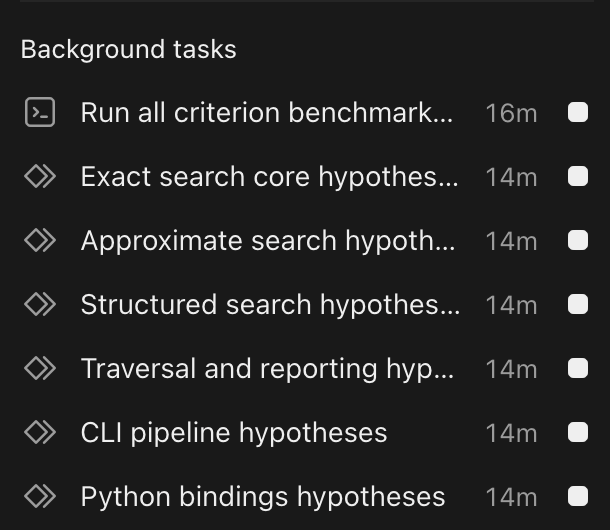
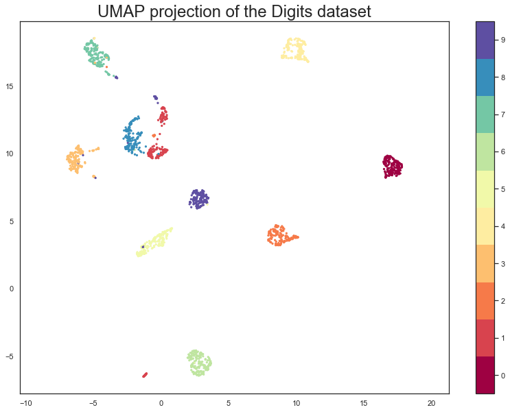
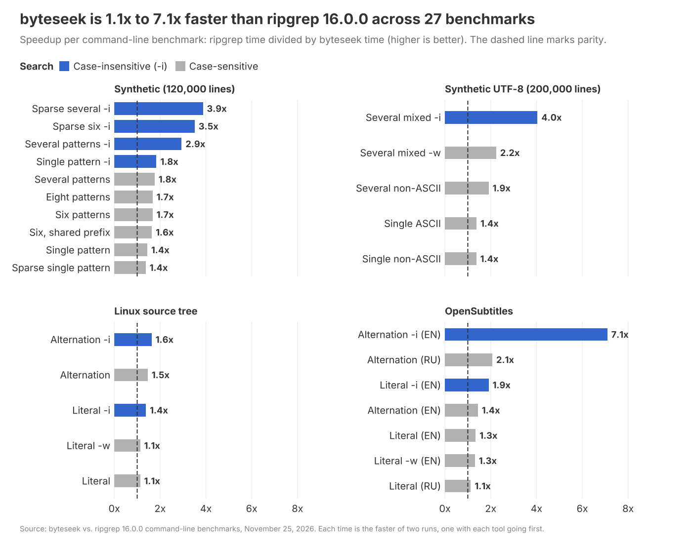

---
authors:
  - aitoboxrobot
categories:
  - 工具教程
date: 2026-11-28
hide:
  - navigation
tags:
  - Rust
  - Claude
  - AI编程
  - 性能优化
  - 逆向工程
title: "Opus 5.5 与 Fable 5.2 实战：借助 AI 智能体将过度优化的 Rust 代码推向硬件极限"
---

# Opus 5.5 与 Fable 5.2 实战：借助 AI 智能体将过度优化的 Rust 代码推向硬件极限

### 文章背景与核心概要
在追求极致性能的系统级软件工程领域，代码优化往往伴随着边际收益递减的巨大挑战。知名数据科学家与工程师 Max Woolf 在前期的实验中，探索了利用大语言模型 (Large Language Model, LLM) 驱动的 AI 智能体 (AI Agent) 持续迭代并优化 Rust 代码的流程。随着 Anthropic 全新发布的 **Claude Opus 5.5** 与 **Fable 5.2** 相继亮相，作者将基准测试与性能调优工作流推向了全新的高度——不仅引入了基于 `samply` 的全进程性能剖析与内存占用精简，更创造性地下发底层汇编反思指令，借助 `objdump` 深入编译二进制产物寻找冗余指令与分支。令人瞩目的是，AI 智能体成功在原本已经处于前沿水平的高度优化 Rust 库上，再次实现了 1.5 倍至 2.0 倍的性能飞跃，不仅让峰值内存大幅缩减，更直接促成了极速文本检索工具 `byteseek` 的提前开源，为探索生成式 AI 辅助系统级极致性能优化树立了全新标杆。

---

## 概要

> ## Summary

在前期利用智能体化大语言模型 (Large Language Model, LLM) 进行代码优化的实验基础之上，作者在一系列高性能 Rust 代码库中对最新发布的 **Claude Opus 5.5** 与 **Fable 5.2** 进行了深入测试。通过从 Codex 切换至 Claude Code，并引入更为激进的工作流——包括使用 `samply` 进行进程性能剖析、大幅精简内存占用、借助 `objdump` 进行汇编指令级审查，以及建立极其严苛的视觉保真度检验机制——这些模型将本已处于业界顶尖水平（State-of-the-Art）的 Rust 软件推向了硬件极限。经过优化后的代码库取得了显著的运行提速（在原有高度优化成果上普遍再提升 1.5 至 2 倍），显著降低了峰值内存占用，并直接催生了一款高性能 grep 替代工具 **byteseek** 的提前开源。

> Building on previous experiments with agentic LLMs for code optimization, the author tests the newly released **Claude Opus 5.5** and **Fable 5.2** on a suite of high-performance Rust libraries. By shifting from Codex to Claude Code and introducing aggressive workflows—such as process profiling with `samply`, memory footprint reduction, assembly-level inspection via `objdump`, and rigorous visual fidelity checks—the models pushed already state-of-the-art Rust software to new extremes. The resulting libraries achieve significant speedups (often 1.5x to 2x beyond previous optimizations), lower peak memory, and even inspired the early open-sourcing of a high-performance grep alternative called **byteseek**.

---

## 从 Codex 切换到 Claude Code

> ## Switching from Codex to Claude Code

我喜欢飞快的软件，尤其是那种快到极致的软件。几个月前，我发表了一篇题为《[让智能体优化代码，编写出超越业界前沿水平的高性能 Rust 库](https://minimaxir.com/2026/09/agentic-iteration/)》的博客。在那篇文章中，我列举了利用 AI 智能体 (AI Agent) 大语言模型来加速 Rust 软件运行时执行的技巧——当然，其间引入了大量的制衡与核验机制，以确保代码质量良好、防止功能退化，并杜绝大模型在基准测试 (Benchmark) 中弄虚作假。经过足够轮次的迭代后，最终产出的 Rust 代码库不仅在性能上超越了现有的顶尖实现，且功能相同甚至更强，即便对比那些本身就用 Rust 编写的高性能项目亦毫不逊色。当时阻碍我正式开源这些 Rust 代码包（crate）的主要瓶颈有两个：一是需要进行全面严苛的真实场景测试，以确保代码完全如宣传的那般稳定；二是我不想刚把代码开源，随后新发布的大模型转眼就能再找出 2 倍以上的提速空间——那可太让人尴尬了。

> I like fast software. I like *very* fast software. A couple months ago, I published a blog post titled [Writing Rust code that’s faster than state-of-the-art libraries by asking agents to make the code faster](https://minimaxir.com/2026/09/agentic-iteration/) in which I listed techniques for using agentic LLMs to speed up the runtime execution of Rust software—of course, with extensive checks and balances to ensure good code quality, avoid regressions, and mitigate cheating by the LLMs. After enough iterations, the resulting Rust libraries are faster than existing state-of-the-art implementations with the same or better capabilities, even against those already written in Rust. The main bottlenecks for me open-sourcing the resulting Rust crates are a) doing comprehensive real-world testing to ensure the code works as advertised and b) I don’t want to release the code and then have another model release immediately find another 2x-or-more speed boost because that would be embarrassing.

仅仅做到比业界顶尖库更快并不能让我满足：我希望自己的代码能触碰硬件本身的极限，哪怕这只是些可能根本不需要极高吞吐量的“好玩”软件。我不希望自己的基准测试单位还在以毫秒（ms）为单位计算，该死，我希望它们能精准到**微秒（μs）**！谁知道未来的某些应用场景，会不会真的需要亚毫秒级的词云生成或亚毫秒级的 ASCII 字符画渲染呢？

> I’m not satisfied with my code merely being faster than state-of-the-art: I want my code to push against hardware limits even for “fun” software that may not require maximum throughput. I don’t want my benchmarks to be measured in milliseconds, I want them measured in *microseconds*, dammit. Who knows if some application in the future will require submillisecond word clouds or submillisecond ASCII art generations?

在那篇博客中，我的智能体迭代流水线主要使用的是 OpenAI 的 GPT 系列模型。然而就在文章发布的第二天，Anthropic 正式发布了 [Claude Opus 5.5](https://www.anthropic.com/claude-opus-5-5)。鉴于先前的 Opus 5 表现平平，外界起初对此充满怀疑……但事实很快证明，Opus 5.5 在智能体能力上实现了跨越式的代际跃升，能够从容解决无论是 OpenAI 还是 Anthropic 其他模型都无法攻克的高难度技术任务。在目睹社区的轰动后，我每月花费 20 美元把 Opus 5.5 接入到自己的智能体迭代流水线中进行测试……仅仅过了两天，其卓越的表现就彻底折服了我，促使我毫不犹豫地升级到了每月 100 美元的订阅档位以获取更多使用额度。经过过去几个月的深入测试，我可以充满信心地断言：Opus 5.5 以及随后推出的孪生模型 Fable 5.2，确实带来了重大的性能突破，真正将我的 Rust 软件推向了硬件极限。

> In that blog post, I mostly used OpenAI’s GPT models for this agentic iteration pipeline. The day after publication, Anthropic announced [Claude Opus 5.5](https://www.anthropic.com/claude-opus-5-5), which was met with skepticism as Opus 5 was underwhelming…and then it quickly turned out that Opus 5.5 was a step-change increase in the capability of agents with the ability to complete difficult technical tasks that neither OpenAI’s nor Anthropic’s other models could complete. I spent the $20/mo to try out Opus 5.5 on my agentic iteration pipeline after observing the hype…and after only two days, the results were impressive enough that I paid the $100/mo to get more usage quota. Through more testing over the past couple months, I can confidently say Opus 5.5 and its subsequent Fable 5.2 sibling did in fact result in significant performance breakthroughs that indeed push my Rust software to its limits.

为了避免被大家误以为这是一篇没有标注赞助的 Anthropic 商业软广，我想先说明：在 Opus 5.5 问世之前，我对 [Claude Code](https://www.claude.com/product/claude-code) 满腹怨气，而这恰恰是我当时转投 OpenAI [Codex](https://openai.com/codex/) 阵营的首要原因。一个典型例子就是，Claude 此前一直无视行业通用的 [AGENTS.md](https://agents.md/)，偏偏执拗地强制要求使用 [CLAUDE.md](https://code.claude.com/docs/en/memor)（[直到最近才终于做出调整](https://news.ycombinator.com/item?id=49760187)）——坦白讲，这种自立门槛的小家子气做法足以让人倒戈。

> Lest people think that this post is an undisclosed #ad for Anthropic, I had grievances with [Claude Code](https://www.claude.com/product/claude-code) prior to Opus 5.5 which were the primary reasons I switched to OpenAI’s [Codex](https://openai.com/codex/). One such example is Claude ignoring [AGENTS.md](https://agents.md/) in favor of [CLAUDE.md](https://code.claude.com/docs/en/memor) ([until very recently](https://news.ycombinator.com/item?id=49760187)), which was honestly petty enough to tip the scales.

使用 Claude Code 最让人头疼的问题在于如何选择运行载体（harness）——或者说，根本没得选。尽管在 Opus 4.5 的美好旧时光里，在终端里直接跑 Claude Code 尚可接受，但 Codex 支持任意运行宿主的特性（例如 [Zed Agent](https://zed.dev/docs/ai/zed-agent)，能直接原生调用 Codex 订阅）让开发者能在一个地方井井有条地搞定所有事情。相比之下，Claude Code 却[出了名地](https://venturebeat.com/technology/anthropic-cracks-down-on-unauthorized-claude-usage-by-third-party-harnesses)封杀第三方运行环境，并不遗余力地封堵一切试图绕过限制接入的变通方案。

> The main grievance with using Claude Code is deciding which harness to use—or, rather, the lack of decision. Although I was fine with using Claude Code in the terminal back in the halcyon days of Opus 4.5, Codex’s ability to use any harness, such as [Zed Agent](https://zed.dev/docs/ai/zed-agent) which allows using the Codex subscription natively, made it more convenient to keep everything in one place. In contrast, Claude Code [infamously](https://venturebeat.com/technology/anthropic-cracks-down-on-unauthorized-claude-usage-by-third-party-harnesses) blocks third-party harnesses and has closed workarounds used to access it regardless.

因此，我不得不思考如何在不伤筋动骨改动智能体迭代管线的前提下，找到使用 Opus 5.5 的折中路径。Zed Agent 虽然提供了一个遵循[智能体客户端协议（Agent Client Protocol）](https://agentclientprotocol.com/get-started/introduction)的[变通途径以接入 Claude Code](https://zed.dev/acp/agent/claude-agent)，但由于 Claude 的独特运行机制，随之产生了一个棘手问题：Opus 5.5 **极度热衷于**在后台启动异步任务，而 Zed Agent 对后台任务的支持相当羸弱，导致我完全搞不清智能体究竟在忙些什么。更令人头大的是，Opus 5.5 从来不规规矩矩地使用常规编辑工具去**修改**代码；相反，它极度偏爱编写临时的 Python 脚本，以手术刀般的方式对目标代码进行查找与精准替换。我曾尝试重新回到 Claude Code 终端应用中操作，但这让上述交互体验与人机工效问题变得更加难以驾驭。

> Therefore, I had to consider workarounds for using Opus 5.5 in a way that doesn’t require significant changes to my agentic iteration pipeline. Zed Agent has a [workaround to use Claude Code](https://zed.dev/acp/agent/claude-agent) by following the [Agent Client Protocol](https://agentclientprotocol.com/get-started/introduction), but there was a problem due to how Claude operates: Opus 5.5 *loves* spinning up background tasks and working asynchronously, and Zed Agent had poor support for background tasks so I had little idea what the agent was actually doing. This was made worse by Opus 5.5 never *editing* code files using Edit tools; instead, Opus 5.5 likes to write Python files which surgically find/replace the code. I tried using the Claude Code terminal application again but that made the ergonomic issues above even more difficult to manage.

<figure>

<figcaption>
<p>Claude 通过编写 Python 脚本来手术式修改 Rust 代码文件。</p>
</figcaption>
</figure>

话虽如此，这种异步特性在启动子智能体（在本例中为 Haiku 5.5）审查代码变更时，确实能大幅节省时间：主 Opus 5.5 智能体可以在前台继续编写代码或运行耗时漫长的基准测试，而各个子智能体则在后台以非阻塞的方式同步进行审查复核。

> That said, the async nature can save time when spinning up subagents (in this case Haiku 5.5) to review the changes made, as the main Opus 5.5 agent can write code or run long benchmarks while the subagents simultaneously do their nonblocking review work.

因此，我在 Opus 5.5 上的主要运行载体最终选定了官方标准的 [Claude 桌面端应用（desktop Claude app）](https://claude.com/download)——尽管这大概会让我彻底丧失作为 AI 工程师在同行心目中的“硬核极客声誉”，但事实就是如此。除了能清晰展示正在运行的后台任务之外，这款原生应用还会直观显示当前会话及每周的使用配额，而在使用 Zed Agent 或命令行工具 (CLI) 时，频繁查询这些额度极其繁琐痛苦。

> Therefore, my main harness for my Opus 5.5 work was the standard [desktop Claude app](https://claude.com/download)—which will likely eliminate all my AI engineering street cred, but it is what it is. In addition to clearly listing background tasks in progress, the native app also lists current session and weekly usage which was a pain to constantly check when using Zed Agent or CLIs.

<figure>

<figcaption>
<p>Claude Code 桌面端应用中的后台任务侧边栏。</p>
</figcaption>
</figure>

此外，在桌面端应用中使用 Claude Code 还有另外两大易用性加分项：当智能体读取图像时，图片始终以内嵌形式直接呈现在界面中，让我能一目了然地知道它具体在看什么；同时，其[远程控制（Remote Control）](https://code.claude.com/docs/en/remote-control)功能出乎意料地实用，允许我在长达数小时的任务运行时安心去忙别的事情，例如投简历找工作或者出去“亲近大自然”（然而往往以失败告终，因为我心里实在太痒，迫不及待想知道代码优化跑得究竟有多快）。

> There are also two more usability perks of using Claude Code within the desktop app: images always appear inline when the agent reads them so I can tell specifically what the agent is reading, and [Remote Control](https://code.claude.com/docs/en/remote-control) is unexpectedly useful for letting hours-long prompts run while I’m doing other things such as job hunting and touching grass (but failing because I really wanted to know how well the code is running).

---

## 充分发挥 Opus 5.5 的优化潜力

> ## Leveraging Opus 5.5

起初，我向 Opus 5.5 输入了我为智能体迭代更新的[元提示词（Ur-Prompt）](https://gist.github.com/minimaxir/85f8919bd887fd1d7c7f539952c6dfd1)——通常是一条包含明确指令的提示词 (Prompt)，要求在不引入任何功能退化且不针对基准测试作弊的前提下，将基准测试运行速度至少提升指定幅度。借助这款新模型（并针对 Claude 的一些特殊行为对 [我的 AGENTS.md](https://gist.github.com/minimaxir/81e552b513a22c136aa75e2b80d32fa2) 进行了几处微调），这种方法确实立竿见影：仅凭单轮遍历，Opus 5.5 就在此前已用 GPT 6.1 Astra 深度优化过的多个不同项目上，再次取得了 1.2 至 1.5 倍的额外提速。

> At first, I fed Opus 5.5 [my updated Ur-Prompt](https://gist.github.com/minimaxir/85f8919bd887fd1d7c7f539952c6dfd1) for agentic iteration—typically a prompt with an explicit directive to improve the speed at which the benchmarks run by at least a specified amount without either causing regressions or cheating the benchmark results. With this new model (and a few tweaks to [my AGENTS.md](https://gist.github.com/minimaxir/81e552b513a22c136aa75e2b80d32fa2) to address some peculiarities with Claude), that approach indeed worked, and in a single pass, Opus 5.5 achieved 1.2x - 1.5x speedups on multiple distinct projects which had already been optimized with GPT 6.1 Astra.

尽管如此，Opus 5.5 的运行机制中存在一些古怪的怪癖，比如提示词排队机制：在 Codex/Zed Agent 中，我可以排队暂存类似 `c'mon, do a breakthrough`（加把劲，实现一次突破）的后续指令，这样它只有在完全执行完当前提示词后才会接收该指令（这一点至关重要，因为这属于刻意制造的信息不对称——如果一个人正在埋头苦干时你突然在一旁催他“赶紧搞出个突破”，往往适得其反）；但在 Claude Code 中，只要智能体处于空闲状态（例如在等待基准测试或子智能体等后台任务返回时），它就会提前把排队的消息发过去。针对这种行为，我想出了一个略显滑稽的应对妙招：把 `c'mon, do a breakthrough` 写入当前工作区外部某个目录下的 Markdown 文件中（防止 Claude 在巡检当前环境时不慎提前发现它），然后在给智能体的提示词中写道：

> That said, there are a few quirks with how Opus 5.5 works such as prompt queueing: with Codex/Zed Agent, I could queue a prompt such as `c'mon, do a breakthrough` such that it would only be sent to the agent after it was done with the current prompt (important as it is deliberately asymmetric information as telling someone to do a breakthrough while they are still working is counterproductive), but with Claude Code it will send any queued message when idle, e.g. while it’s waiting on background tasks such as benchmarks and subagents. My silly workaround to this behavior was to put `c'mon, do a breakthrough` in a Markdown file in another folder outside of the current environment (so Claude can’t accidentally find it when it examines the environment), then add to the prompt:

```text
After completing this task, **and ONLY after completing this task**, then read `/Users/maxwoolf/Desktop/agent_instructions/alpha.md` and follow the instructions within.
```

这个办法非常奏效。Opus 5.5 确实严守纪律、绝不提前偷看文件，而这条督促突破的指令也真真切切带来了实质性的性能飞跃。

> This works, and Opus 5.5 indeed does not cheat by reading ahead of time, and the breakthrough commands do result in actual breakthroughs.

我对 Opus 5.5 稍有微词的一个地方在于，它编写的代码行数明显比 GPT 系列模型多得多：对于 Rust 这种编译型语言而言，代码行数变多从性能角度来看未必是坏事，但它引入的技术债务却超出了我的心理预期。举个例子，我的许多 Rust 项目都需要通过 Rust 官方的 [png](https://docs.rs/png/latest/png/) crate 来进行 PNG 图像的编解码。然而，当指示 Opus 5.5 优化那些 PNG 处理位于热路径（hot path）上的基准测试时，它总是倾向于从零自研一套高度定制化的专属 PNG 模块（使其并行机制与流式处理更精准地契合基础代码处理数据的方式）。这套自定义模块确实在毫无退化的情况下达成了预期的 1.2 至 1.5 倍提速，因此我只能勉为其难地接受。后来我非常频繁地向它下发 `cut the amount of code by 20% without causing regressions`（在不引入功能退化的前提下精简 20% 的代码量）这一维护性指令，即便如此，它在删减代码方面依然举步维艰。

> One issue I have with Opus 5.5 is that it definitely writes more lines of code than the GPT models: in the case of Rust that’s not necessarily bad performance-wise since it’s a compiled language but it adds more technical debt than I would like. For example, many of my Rust projects rely on PNG image encoding and decoding through Rust’s [png](https://docs.rs/png/latest/png/) crate. However, when Opus 5.5 was instructed to make improvements on benchmarks where PNG processing is on the hot path, it consistently creates its own bespoke PNG module from scratch (with parallelism/streaming better-aligned to how the base code processes the data) that does achieve the desired 1.2x - 1.5x speedups without causing any regressions, so I’ll begrudgingly accept it. I very frequently run `cut the amount of code by 20% without causing regressions` maintenance passes and even then it struggles to do so.

在智能体迭代工作中遇到的另一个具体问题是，Claude Code 往往会遮蔽它执行基准测试的中间过程。当使用 [criterion](https://github.com/bheisler/criterion.rs) 运行基准测试时，它不会实时打印测试进度和结果，而是将其全部通过管道重定向到了临时文件中，导致我根本看不到中间状态。尽管我在提示词中明确要求它实时反馈，它依然坚持在所有测试彻底结束后才一次性汇总返回结果。这让我不得不无所事事地干等一会儿（当然，换个角度看，这倒挺适合出去散步透透气）。

> Another issue with agentic iteration work specifically is that Claude Code obfuscates how it runs benchmarks. When running benchmarks with [criterion](https://github.com/bheisler/criterion.rs), instead of displaying the benchmark results as they come in, they’re piped to a temporary file so I can’t view intermediate progress. It also doesn’t return results from the benchmarks until after they’ve concluded, despite my prompting explicitly asking it to, so I have to twiddle my thumbs a bit (again, good for attempting to touch grass).

就各轮交互的思考与执行方式而言，各大智能体大语言模型目前在很大程度上已经趋于同质化，不同模型之间的微弱差异最终往往沦为可以被应试刷榜的基准测试分数，甚至更糟糕的是——纯凭“感觉（vibes）”。总体而言，我不得不对 Opus 5.5 给予更多的自主信任，对此我其实喜忧参半。不过，这份信任最终获得了丰厚的回报，尤其是在我探索出的几套全新优化策略中，Opus 5.5 展现出了 GPT 系列模型所不具备的惊人造诣。

> Agentic LLMs have mostly become homogenized in terms of how they work through their turns, with the difference between certain LLMs coming down to benchmarks which may be gamed, or worse—*vibes*. Overall, I have to give more trust to Opus 5.5, which I have mixed feelings about. That said, the trust has been rewarded, particularly with new approaches I found where Opus 5.5 excels where GPT models did not.

### 进程性能剖析 (Profiling)

> ### Profiling

在过去的提示词中，我总是会加上一段建议模型利用[进程性能剖析（process profiling）](https://en.wikipedia.org/wiki/Profiling_%28computer_programming%29)的指令，但 GPT 系列模型基本对其视而不见：

> In my prompts, I always added a suggestion about leveraging [process profiling](https://en.wikipedia.org/wiki/Profiling_%28computer_programming%29) that the GPT models mostly ignored:

```text
You may consider using profiling areas of the codebase to find specific areas and hot paths which scale poorly (e.g. O(n^2)) at large amounts of data.
```

与此相反，Opus 5.5 极其热衷于使用 [samply](https://github.com/mstange/samply) 进行性能剖析，以准确定位代码执行耗时最集中的热点区域，甚至经常将其作为启动后的第一项行动。在每次修改代码后，它还会主动重新运行性能剖析，以追踪热路径的转移并实施下一轮针对性优化。

> Opus 5.5, in contrast, is extremely eager about profiling with [samply](https://github.com/mstange/samply) to find the areas where code spends most of its time executing and will often do so as its first task, including reprofiling after each change to find changed hot paths for further improvements.

<figure>

<figcaption>
<p>Opus 5.5 正在用一条颇为高深复杂的命令对 Rust crate 进行性能剖析。</p>
</figcaption>
</figure>

此外，Opus 5.5 会投入更多的时间去构思和运行探测性实验，而 GPT 系列模型通常遵循“先改代码再说”的莽夫策略。这两种方法各有千秋，但我认为 Opus 5.5 的沉稳作风在实际产出效率上要高得多。

> Opus 5.5 also spends more time running experiments whereas GPT models edit the code first then ask questions later; both approaches have their merit but I think Opus 5.5 is more productive at it.

### 削减进程峰值内存占用

> ### Reducing Peak Process Memory

在致力于让我的 Rust 软件快如闪电的过程中，我最初并未太在意它到底占用了多少系统内存。我认为关注内存没有太大必要，原因有二：第一，Rust 语言本身的内存管理效率已经极为出众；第二，向内存中进行超出实际需要的频繁读写必然会导致系统额外开销，而这类损耗理应会被我现有的“提升代码运行速度”的提示词自动捕获并优化掉。

> While working on making my Rust software super-fast, I never put much thought into how much system memory it utilized. I figured it was unnecessary since a) Rust is already extremely memory efficient and b) writing to RAM beyond what is needed causes wasted system overhead which would inevitably be caught by the existing prompts to make the software faster.

然而我错了，错得彻头彻尾。

> I was wrong. Very wrong.

如果能在不显著增加代码复杂度的前提下将峰值内存降低约 20%，那这绝对值得一试。于是我丢给 Opus 5.5 一条比平时简短得多的提示词（因为我实在懒得再费心思做提示词工程了）：

> If I could get a ~20% reduction in peak memory without much code complexity change, then maybe it’s worth pursuing. Therefore I gave Opus 5.5 a simpler-than-usual prompt because I was too apathetic to prompt engineer it:

```text
Do a pass to reduce peak memory consumption without causing significant regressions
```

几个项目中的实测成效如下所示：

> The results on a couple projects:

<figure>

<figcaption>
<p>在执行上述提示词后，我的 Rust <a href="https://hdbscan.readthedocs.io/en/latest/how_hdbscan_works.html" rel="noopener noreferrer" referrerpolicy="no-referrer" target="_blank">HDBSCAN</a> 聚类 crate 内存占用大幅下降。</p>
</figcaption>
</figure>

<figure>

<figcaption>
<p>我的 Rust 文本搜索项目内存占用降低（内存基准测试模式，非 CLI 模式）。</p>
</figcaption>
</figure>

我**立刻**把同样的提示词应用到了我所有的项目中，并且无一例外地都取得了同样显著的峰值内存下降（追加第二轮提示词 `c'mon, try doing a breakthrough` 更是带来了更大幅度的内存精简）。总体而言，它主要通过传统显式内存管理技巧达成了这一效果，例如数据流式处理（streaming）以及对 `Vec` 容量更明智的预分配规划。不过，我原本寄希望于这种做法能间接带动运行速度的大幅提升（即智能体发现当前算法在内存上已经无计可施，从而被迫重构出一套更精妙的高效算法），但在实际测试中，因此带来明显提速的情况比较罕见。

> I *immediately* used the same prompt on all my projects and achieved similar significant peak memory reductions (doing a second pass with `c'mon, try doing a breakthrough` resulted in even stronger reductions). In general, it achieved this through the traditional tricks used to explicitly manage memory such as streaming data and smarter specification of `Vec` sizes. That said, I had hoped that this approach would result in speed improvements (i.e. the agent discovers an algorithm has no viable memory improvements and therefore it implements a better algorithm) but significant speed improvements were rare.

### 视觉设计理解与审美把控

> ### Visual Design and Knowledge

Opus 5.5 广受关注的另一大亮点在于它具备更出色的视觉设计审美能力，在设计 Web 应用时能够有效避免典型的“AI 劣质工业废品（AI Slop）”风味。这种能力表面上似乎与追求 Rust 软件极致运行速度风马牛不相及，但对于我那些重度依赖视觉呈现的应用来说，它在平衡速度与品质之间起到了至关重要的作用——毕竟视觉设计并非完全主观，“界面变丑了”同样是一种实打实的严重软件退化。

> Another hyped aspect of Opus 5.5 is its ability to better handle visual design and avoid the typical “AI Slop” aesthetic when designing web applications. This capability may not intuitively translate toward maximizing the speed of my Rust software, but it’s crucially important to balancing both speed and quality for my applications that rely on visual design, as visual design isn’t always subjective and “it looks ugly” can be a legitimate software regression.

在我最初关于智能体迭代的那篇博客中，我曾提到使用该方法实现了一套 [UMAP](https://umap-learn.readthedocs.io/en/latest/)（统一流形逼近与投影）算法。UMAP 是我个人常用的众多降维算法之一，当把高维数据降维投影到二维空间时，它能自动构建直观清晰的视觉聚类分布。

> In my initial post about agentic iteration, I described implementing a [UMAP](https://umap-learn.readthedocs.io/en/latest/) algorithm with this approach, as UMAP is a useful-for-me dimensionality reduction algorithm (among many) that when used to project to 2D, it can automatically create intuitive visual clusters.

<figure>

<figcaption>
<p>通过 umap-learn 聚类出的手写数字图像。来自 <a href="https://umap-learn.readthedocs.io/en/latest/basic_usage.html" rel="noopener noreferrer" referrerpolicy="no-referrer" target="_blank">umap-learn 官方文档</a>。</p>
</figcaption>
</figure>

在先前的文章中我曾指出，在经历了几轮智能体迭代之后，我的 Rust UMAP 算法的 Python 绑定相比官方的 [umap-learn](https://github.com/lmcinnes/umap) 提速了 4 至 15 倍。尽管它在所有常规量化基准测试指标上都表现拔群，但在最关键的基准测试——“观感体验（vibes）”上，它却显然翻了车。在处理经典手写数字图像集 [MNIST 数据集](https://en.wikipedia.org/wiki/MNIST_database) 时，其生成的二维聚类在语义边界的清晰可辨度上，明显不及 umap-learn、[PaCMAP](https://github.com/YingfanWang/PaCMAP) 和 [TriMap](https://github.com/eamid/trimap) 等业界成熟方案：

> In my original post, I noted that the Python bindings of my Rust UMAP algorithm beat [umap-learn](https://github.com/lmcinnes/umap) by 4x - 15x after several agentic iterations. Although it excelled at all the typical quantitative benchmark metrics, my UMAP algorithm apparently failed the most important benchmark: vibes. The visual clusters in cases such as the famous [MNIST dataset](https://en.wikipedia.org/wiki/MNIST_database) of digit images were not semantically distinct compared to existing implementations such as umap-learn, [PaCMAP](https://github.com/YingfanWang/PaCMAP), and [TriMap](https://github.com/eamid/trimap):

<figure>

<figcaption>
<p>我的 UMAP crate 对应的 Python 绑定（左上）确实比 <code>umap-learn</code> 快了约 12 倍，但如果它生成的聚类团块含混不清，提速也就失去了意义。</p>
</figcaption>
</figure>

于是，我要求 Opus 5.5 专门针对聚类边界的清晰分明程度展开针对性迭代，以业内公认的优秀实现为标杆，在尽可能减少速度牺牲的前提下进行优化，并进行更多确保公平对比的细致调校：

> So I asked Opus 5.5 iterate specifically to improve cluster distinctiveness compared against for the known good implementations while minimizing the speed tradeoff, along with making more apples-to-apples fairness tweaks:

<figure>
  <video controls="">
  <source src="https://minimaxir.com/2026/11/opus-fable/mnist_embedding_race.mp4" type="video/mp4"/>
  Your browser does not support embedded video. <a href="https://minimaxir.com/2026/11/opus-fable/mnist_embedding_race.mp4" rel="noopener noreferrer" referrerpolicy="no-referrer" target="_blank">Download the video</a>.
</video>
  <p><a href="https://minimaxir.com/2026/11/opus-fable/mnist_embedding_race.mp4" rel="noopener noreferrer" referrerpolicy="no-referrer" target="_blank">Download the video</a>.</p>
  <figcaption>
    <p>Opus 5.5 还自动生成了这段正面交锋的比拼视频，画面具有一种出人意料的催眠感。</p>
  </figcaption>
</figure>

尽管相比 `umap-learn` 的提速幅度回落到了约 4 倍，但聚类成品的质量如今已完全不分伯仲，而 4 倍的性能提升依然是一项非常可观的提速成绩。

> The speedup relative to `umap-learn` fell to about 4x, but cluster quality is very comparable now and 4x is still a good speedup.

自 Opus 4.5 时代以来我一直在推进的另一个重度依赖视觉的项目，是将位图（栅格图像）快速且精准地自动转换为可无限无损缩放的矢量图 (SVG) 文件。将位图转换为矢量/SVG 图算不上什么新鲜概念：像 [Inkscape](https://inkscape.org) 这样的经典工具早已存在多年。Rust 生态中也有像 [vtracer](https://github.com/visioncortex/vtracer) 和 [img2svg](https://github.com/cloudbsdorg/img2svg) 这样的优秀库，但我想看看能否在不仅战胜它们运行速度的同时，还在以下两个维度取得超越：a) 矢量图与原始位图之间的视觉保真度；b) 输出的 SVG 文件体积——这要求算法必须推导出更少且更高效的 SVG [路径（Paths）](https://developer.mozilla.org/en-US/docs/Web/SVG/Tutorials/SVG_from_scratch/Paths)与[贝塞尔曲线（Bézier curves）](https://en.wikipedia.org/wiki/B%C3%A9zier_curve)。

> Another visual-oriented project I’ve been working on since Opus 4.5 is the fast and accurate automatic conversion of images from raster files to vector (SVG) files that can scale to any size. This isn’t a new concept: tools such as [Inkscape](https://inkscape.org) that convert images to vectors/SVGs have been around for awhile. Rust itself has [vtracer](https://github.com/visioncortex/vtracer) and [img2svg](https://github.com/cloudbsdorg/img2svg), but I wanted to see if I could beat them not only in speed, but also a) visual fidelity between the vector and raster and b) output SVG file size, which requires deriving fewer and more efficient SVG [Paths](https://developer.mozilla.org/en-US/docs/Web/SVG/Tutorials/SVG_from_scratch/Paths) and [Bézier curves](https://en.wikipedia.org/wiki/B%C3%A9zier_curve).

以这张“骑自行车的鹈鹕”图像为例（[这可是当下大家谈论 AI 时最津津乐道的话题梗](https://simonwillison.net/tags/pelican-riding-a-bicycle)，对吧？）：

> Take for example, this image of a pelican riding a bicycle. [That is what everyone talks about](https://simonwillison.net/tags/pelican-riding-a-bicycle) with AI, right?

<figure>

<figcaption>
<p>由 ChatGPT Images 2.5 生成的 393KB 矢量艺术风格图像。请不要太深究它的左腿长得有多别扭。</p>
</figcaption>
</figure>

对于位图转矢量算法而言，这个测试用例难度极高，因为鹈鹕身体各处有着大量极其复杂的圆弧曲面。

> This test case is deliberately tricky for raster-to-vector algorithms as pelicans are very curvy.`

<figure>

<figcaption>
<p>使用默认配置在 <code>vtracer</code> 中运行该图像，得到的是一个大小为 153KB 的 SVG 文件，画面充满了严重的色块感，几乎无法使用。</p>
</figcaption>
</figure>

在 Opus 5.5 出现前，通过我那套经由 GPT 智能体迭代管线优化后的 Rust crate 处理该图像，输出效果虽然显著优于 `vtracer` 和 `img2svg`，但仍残留着大量肉眼显而易见的色彩斑块与锯齿状“阶梯伪影”，导致生成的矢量 SVG 根本无法直接交付使用，因此我曾把这个项目完全束之高阁。相比之下，Opus 5.5 表现得异常执着：它会主动放大检查图像局部细节、捕捉边缘锯齿伪影、构建网格对比矩阵并生成图像差异图（diff），针对性修正底层数学算法，并周而复始地反复迭代，直到彻底解决瑕疵为止。

> Prior to Opus 5.5, running the image through my Rust crate that went through the GPT agentic iterative optimization pipeline resulted in much better output than `vtracer`/`img2svg` for my crate, but still had enough errors such as color blotches and jagged “staircases” that were easily identifiable and would make the output vector SVG unusable, so I shelved the project entirely. Opus 5.5 in contrast is eager to zoom into the image, find staircases, construct comparison grids and image diffs, fix the underlying algorithms, and repeat until it’s fixed.

<figure>

<figcaption>
<p>Opus 5.5 通过构建测试输出的对比矩阵，迭代审查生成的 SVG 效果。</p>
</figcaption>
</figure>

在精心设立的质量防线护航与 Opus 5.5 的多轮反复迭代打磨下，我的位图转矢量解决方案终于在全方位上以巨大优势碾压了现存的所有备选项。

> With the guardrails and repeated Opus 5.5 iterations, my approach to raster-to-vector finally beats the existing options by considerable margins.

<figure>

<figcaption>
<p>在鹈鹕这个示例中，我的 crate 在速度、文件大小与失真误差三项指标上全面超越了 <code>vtracer</code> 和 <code>img2svg</code>。</p>
</figcaption>
</figure>

以下是该 crate 生成的最终鹈鹕 SVG 矢量图。在经过我利用类似技巧基于 Opus 5.5 构建并优化的另一套独立 SVG 压缩与精炼工具处理后，其大小从原本标注的 25KB 进一步缩减至仅 14KB：

> Here’s the pelican SVG output from the crate, reduced from the stated 25KB to 14KB after passing it through a separate SVG compression/refinement tool I also created and optimized with Opus 5.5 using similar techniques:

<figure>

<figcaption>
<p>虽然谈不上 100% 毫无瑕疵，但你真的得把画面放大到极大倍数才能捕捉到细微瑕疵。</p>
</figcaption>
</figure>

这套优化管线在我测试的其他各类图像上也表现良好，但在正式发布开源之前，它仍需经受更多现实世界复杂场景的严苛考验。

> This pipeline has worked well with my other test images, but it still needs more real-world tests before I will release it.

### 深入编译二进制产物的反汇编分析

> ### Disassembling the Compiled Binary

没错，我们真的要把触角伸到机器底层了。

> Yes, we’re going there.

Opus 5.5 的问世，正式开启了利用大语言模型进行软件逆向工程的崭新时代——从无所不能逆向的工具库 [Reverse Engineering Anything (REA)](https://github.com/morluto/rea)，到实现[游戏反编译与移植](https://www.reddit.com/r/ClaudeAI/comments/1x3nkty/opus_55_is_insane_at_decompilation_ports/)速度的飞跃。在我追求软件极致性能的工作中，我起初并未过分深究这一方向，直到偶然在一次推理轨迹中，发现它主动调用了 [objdump](https://en.wikipedia.org/wiki/Objdump)，试图从底层机器码层面探究为什么某次代码改动没有达到预期的加速效果。受此启发，我将其封装为一个[专属变体元提示词](https://gist.github.com/minimaxir/bf92aac850c4f4df39ad7a250036cf75)，作为一轮独立的优化流程注入给模型（因为如果不加严格约束，Opus 5.5 平时可能并不会主动去碰汇编分析）：

> The release of Opus 5.5 specifically led to a new age of reverse engineering software using LLMs, from [Reverse Engineering Anything](https://github.com/morluto/rea) allowing reverse engineering anything (duh), to drastically speeding up [decompiling games](https://www.reddit.com/r/ClaudeAI/comments/1x3nkty/opus_55_is_insane_at_decompilation_ports/). For my work making software as fast as possible, I didn’t read too much into it until I randomly saw one of my reasoning traces run [objdump](https://en.wikipedia.org/wiki/Objdump) to try and figure out why a change did not result in an expected speed increase. So as an experiment, I gave this as a part of a [dedicated variant Ur-Prompt](https://gist.github.com/minimaxir/bf92aac850c4f4df39ad7a250036cf75) in its own pass (since Opus 5.5 may avoid disassembly unless you specifically constrain it):

```text
For this particular round of optimization, focus on investigating the compiled binaries—including minimizing the number of CPU instructions emitted and reducing unnecessary branching—in order to hit the specified benchmark metric improvements. **ALL library code changes this session MUST FIRST be discovered and justified by disassembling the binary**. Do not chase marginal speed gains through disassembling: if performance converges and no more major changes are feasible, wrap it up.
```

<figure>

</figure>

这种基于反汇编的优化方式所展现出的惊人威力令我由衷震撼……但千万别让我解释它底层具体都发生了什么神奇操作。

> The effectiveness of this approach legitimately surprised me…but don’t ask me to explain what’s happening.

<figure>

<figcaption>
<p>在对一个 Rust 图网络 crate 进行反汇编级优化后的运行提速成果。</p>
</figcaption>
</figure>

<figure>

<figcaption>
<p>Rust UMAP crate 经反汇编优化后的提速表现（同时持续严格维持视觉聚类质量约束）。</p>
</figcaption>
</figure>

令人不可思议的是，Opus 5.5 居然聪慧到懂得如何在 Rust 源码层面进行调整，使得这些改动在经过 [LLVM](https://llvm.org) 编译器编译后，能够映射为发射出更少指令且毫无功能退化的底层二进制产物——要是放在一年前，我绝对会断言这根本是天方夜谭。

> Somehow, Opus 5.5 is smart enough to make Rust code changes that propagate through [LLVM](https://llvm.org) to the resulting binary with fewer instructions without causing regressions—I would have called that impossible a year ago.

这种方法潜在的一个软肋在于，它可能会对特定的硬件环境产生过拟合（例如我使用的 M3 MacBook Pro / ARM 架构），但从生成的代码差异（diff）来看，这些改动大体上具备良好的跨架构通用性。退一步讲，它并不会在 Rust 源代码中强行写入自定义的平台专属 CPU 汇编指令，因为那需要引入 `unsafe` 关键字。

> One potential weakness of this approach is that it may overfit to specific hardware (my M3 MacBook Pro / ARM architecture) but the diffs appear to be more architecture agnostic. At the very least, it intentionally doesn’t write custom CPU instructions in Rust itself because doing so requires `unsafe`.

---

## 那么，Fable 5.2 的表现又如何？

> ## What About Fable 5.2?

你可能已经注意到，尽管我在文章标题中将 Fable 5.2 与 Opus 5.5 并列，但前文却只字未提 Fable 5.2。Fable 5.2 [大约两周前正式发布](https://www.anthropic.com/claude-fable-and-mythos-5-2)，其基准测试跑分成绩总体来看……还算过得去。从纸面参数上看，它并没有比 Opus 5.5 展现出压倒性的优势，尤其是在未开启 `max` 努力等级（effort）的情况下，但其 API 调用资费却**昂贵得多**。

> You may have noticed I haven’t talked about Fable 5.2 yet despite giving it equal billing with Opus 5.5 in the headline. Fable 5.2 [was released](https://www.anthropic.com/claude-fable-and-mythos-5-2) a couple weeks ago and its benchmarks were…ok. Not much better than Opus 5.5 on paper especially below `max` effort, but *much* more expensive.

正好我手头还有富余的额度，那何不把 Fable 5.2（开启 `high` 努力等级）放到与测试 Opus 5.5 相同的严苛管线中跑一跑呢？我向它输入了同样的元提示词（并将负责深度分析的调研子智能体升级到了 Opus 5.5）。这一次，Fable 5.2 带来的提速幅度，完全打破了历代模型迭代时常见的 1.2 至 1.5 倍的温和提升格局。

> I had spare quota, so why not put Fable 5.2 (on `high` effort) through the same paces I did for Opus 5.5? I fed it the Ur-Prompt (and bumped the research subagents to Opus 5.5), and Fable 5.2 did not achieve the 1.2x - 1.5x speedup consistent with each successive model release.

在我的多个项目中，Fable 5.2 一举斩获了惊人的 1.5 倍乃至**整整 2.0 倍**的性能飞跃。

> Fable 5.2 instead achieved a 1.5x - *2.0x* speedup on many of my projects.

<figure>

<figcaption>
<p>在我的词云生成项目中，文本解析与图像生成环节均取得了极其惊人的提速。</p>
</figcaption>
</figure>

单从那些常规评测跑分来看，我实在难以参透它为何在实际代码优化上会有如此超常的发挥，但我显然举双手赞成、乐见其成。

> Given the benchmark results, I don’t get it but I am very much not complaining.

我一直在暗中研发一款工具（在这篇文章中其实就已有体现），但由于担心引来“异端邪说”的口诛笔伐，此前从未对外公开讨论过——那是一款旨在超越备受推崇的 [ripgrep](https://github.com/BurntSushi/ripgrep) 并融入更多新特性的下一代 [grep](https://en.wikipedia.org/wiki/Grep) 替代工具，名为 [byteseek](https://github.com/minimaxir/byteseek)。ripgrep 本身就是用 Rust 编写并历经十余年极致优化的殿堂级项目，要想在速度上正面击溃它，不玩弄些障眼法几乎不可能；然而，Fable 5.2 却硬生生在内存纯合成基准测试中挖掘出了巨大的提速潜力。

> One tool I’ve been experimenting with (particularly in this very post) but never talked about due to potential accusations of heresy is a next-generation [grep](https://en.wikipedia.org/wiki/Grep) replacement that is faster than the beloved [ripgrep](https://github.com/BurntSushi/ripgrep), but with additional features; this new Rust crate named [byteseek](https://github.com/minimaxir/byteseek). ripgrep, itself written in Rust and optimized for over a decade, is tough to beat speedwise without shenanigans, however Fable 5.2 was able to find massive speedups on synthetic benchmarks in-memory.

<figure>

<figcaption>
<p>byteseek 同样斩获了惊人的加速；这是在要求 Fable 5.2 执行 <code>do a breakthrough</code> 之后获得的提升成果。</p>
</figcaption>
</figure>

ripgrep 本身采用[真实世界的数据集来进行基准测试](https://burntsushi.net/ripgrep)（包括 Linux 内核源码树以及英语+俄语 OpenSubtitles 字幕库，其中俄语用于测试 UTF-8 编码处理），且完全通过命令行工具 (CLI) 运行——这会引入打开文件进行扫描的显著磁盘 I/O 开销，而这是内存基准测试所不具备的。为此，我在合成数据与真实数据上，对两者进行了一场完全同台竞技的命令行基准对比：

> ripgrep itself uses [real-world datasets to benchmark](https://burntsushi.net/ripgrep) (Linux source tree and English+Russian OpenSubtitles; Russian tests UTF-8) and does the benchmarks via the CLI which has significant overhead from opening files for scanning not present with in-memory benchmarks, so I ran an apples-to-apples CLI benchmarks comparing the two on both synthetic and real data:

<figure>

<figcaption>
<p>byteseek 在多项交替检索/多查询词匹配以及大小写不敏感搜索上尤为出色。（顺便提一句，我手头也在开发一款全新的 Rust 科学数据可视化库，正好借此机会亲自内部试用体验一番）。</p>
</figcaption>
</figure>

鉴于外界对其惊人性能很可能心存怀疑，我正式在 GitHub 上以研究预览版的形式提前[开源了 byteseek](https://github.com/minimaxir/byteseek)，以便向大家直观展示这种被 AI“过度优化”的 Rust 代码究竟长成什么样。由于在执行效率上拥有充足的性能余量，我还为其追加了许多实用特性，例如面向人类排版的美化输出（pretty-printing）、类似 [jq](https://jqlang.org) 风格的 JSON（及 YAML/TOML）结构化检索、模糊匹配与谓词匹配，以及一套在基准测试中出人意料地[击溃](https://github.com/minimaxir/byteseek/blob/main/BENCHMARKS.md#vs-python)了高度优化的 [pyahocorasick](https://github.com/WojciechMula/pyahocorasick) 和 [orjson](https://github.com/ijl/orjson) 的 Python 绑定。

> Given the likely skepticism about its performance, I am officially [open-sourcing byteseek on GitHub](https://github.com/minimaxir/byteseek) early as a research preview to demonstrate just what this type of overoptimized Rust code looks like. Since I have the speed headroom to do so, I also added more features such as pretty-printing output for humans, [jq](https://jqlang.org)-like JSON searching (plus YAML/TOML), fuzzy and predicate matching, and Python bindings which unexpectedly [beat](https://github.com/minimaxir/byteseek/blob/main/BENCHMARKS.md#vs-python) the optimized [pyahocorasick](https://github.com/WojciechMula/pyahocorasick) and [orjson](https://github.com/ijl/orjson).

<figure>

<figcaption>
<p>byteseek 类似 ripgrep 风格的输出结果，但承载了更丰富的信息且排版更加优雅赏心悦目。</p>
</figcaption>
</figure>

---

## 接下来何去何从？

> ## What Now?

总结起来，这就是我如今全新的智能体迭代优化管线：

> In all, this is my new agentic iteration pipeline:

1. **Opus 5.5 常规遍历轮**：通常配合[我更新后的元提示词](https://gist.github.com/minimaxir/85f8919bd887fd1d7c7f539952c6dfd1)执行，根据具体问题微调各项约束条件（例如明确指定优化指标目标以及退化防护规则）；
2. **Opus 5.5 峰值内存精简轮**：采用简洁的提示词，如果观察到显著提速（意味着性能尚未收敛），则追加下达 `do a breakthrough` 指令；
3. **Opus 5.5 反汇编审查轮**：使用[专属变体元提示词](https://gist.github.com/minimaxir/bf92aac850c4f4df39ad7a250036cf75)运行，如果出现显著的内存削减，同样追加 `do a breakthrough`；
4. **Fable 5.2 进阶遍历轮**：基本流程与 Opus 5.5 相同，不过我将协助调优的子智能体升级为 Opus 5.5，以更好地匹配主模型的强悍算力；
5. **Fable 5.2 反汇编审查轮（可选）**：……仅在 Claude Code 配额富余时启用：毕竟每周只能将一半的 Claude Code 额度分配给 Fable，实在让人有点束手束脚。

> 1. **The Opus 5.5 pass**: Typically done using [my updated Ur-Prompt](https://gist.github.com/minimaxir/85f8919bd887fd1d7c7f539952c6dfd1), with various constraints tweaked depending on the problem (e.g., target metrics for optimization and regression mitigation).
> 2. **The Opus 5.5 peak memory reduction pass**: Simple prompt, `do a breakthrough` if there is a significant speed increase that implies performance has not converged.
> 3. **The Opus 5.5 disassembly pass**: Done with a [dedicated variant Ur-Prompt](https://gist.github.com/minimaxir/bf92aac850c4f4df39ad7a250036cf75), `do a breakthrough` if there is a significant memory reduction.
> 4. **The Fable 5.2 pass**: Same as the Opus 5.5 pass, although I bump the subagents to Opus 5.5 to better match the model’s power.
> 5. **The (optional) Fable 5.2 disassembly pass**: …if I have Claude Code quota to spare: Fable only being able to be used for half of the Claude Code weekly quota is a bummer.

那些此前已经用 GPT-6.1 Astra 深度优化过的 Rust 软件，如今在显著降低内存占用的同时，平均累计达成了 **4 倍的惊人提速**，并且这种提速效果在多个不同项目中均可稳定复现。以我的词云生成工具为例——此前我曾为生成时间成功压进 1 毫秒（ms）而兴奋不已——现在它的完整生成耗时直接骤降到了 374 微秒（μs）。这一优化成果同样无缝迁移到了对速度要求更严苛的严肃项目中，例如我的 Rust 统计建模库与 Rust 数据可视化库。

> My Rust software that I had already optimized with GPT-6.1 Astra now achieves a cumulative **4x speedup** on average with much lower memory utilization, and this was reproducible across multiple projects. My word cloud generator—where I was overly excited about hitting 1 millisecond generation—now generates in 374 microseconds. This also generalizes to projects where speed is more meaningful, such as my Rust statistical modeling library and my Rust data visualization library.

根据 Opus 5.5 的分析判定，我的绝大多数 Rust 项目在性能上目前都已经触碰到了理论硬件极限。因此，我再也没有借口继续拖延了——毕竟未来的新模型大概率也无法再让这些代码产生有实质意义的提速，我理应加快发布交付的节奏。不过，自前文发布以来，出于种种原因，对外推广宣传这些 Rust 开源项目变得愈发困难，但这属于另一个话题了，留待以后的博客再慢慢探讨。

> Per Opus 5.5, the performance for most of my Rust projects have now have hit theoretical hardware limits. Therefore I have little reason to continue procrastinating as new models likely won’t make the code meaningfully faster, so I should hopefully be shipping more quickly. That said, marketing the Rust projects has become increasingly difficult since my original post for a number of reasons, but that’s a discussion for another blog post.

在此期间，我想我应该踏踏实实地深入钻研一下 Rust 中编译器优化的真实底层工作原理了，因为在那里很可能蕴藏着更为可观的性能突破契机……

> In the meantime, I should learn how compiler optimization in Rust actually works as there are likely more significant code speedup opportunities there…
